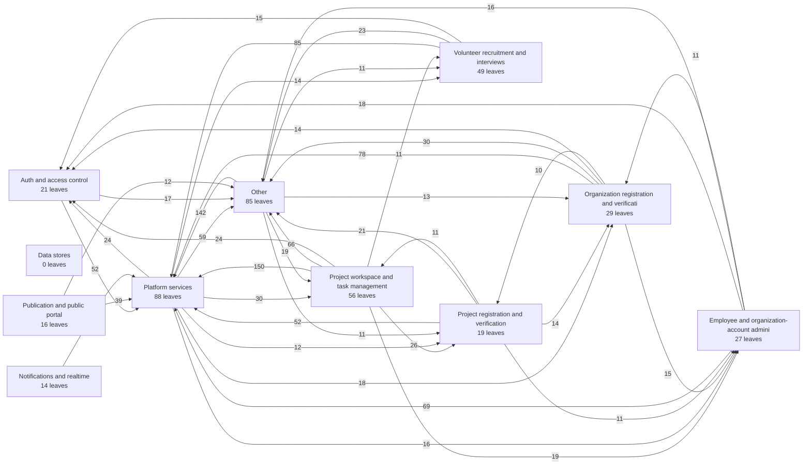

# Topology of falo-application

404 leaves in 11 domain(s), 17 data store(s), 2,177 edge(s). The largest leaves and the edges between them are listed; the links between catalog items are in the catalog.

## Domains

| Domain | Leaves | Data stores | LOC |
| --- | --- | --- | --- |
| Auth and access control | 21 | 0 | 2282 |
| Data stores | 0 | 17 | 0 |
| Employee and organization-account administration | 27 | 0 | 3333 |
| Notifications and realtime | 14 | 0 | 798 |
| Organization registration and verification | 29 | 0 | 6563 |
| Other | 85 | 0 | 19147 |
| Platform services | 88 | 0 | 7950 |
| Project registration and verification | 19 | 0 | 4126 |
| Project workspace and task management | 56 | 0 | 12458 |
| Publication and public portal | 16 | 0 | 2928 |
| Volunteer recruitment and interviews | 49 | 0 | 7183 |

## Edges between domains

| From | To | Kinds | Edges |
| --- | --- | --- | --- |
| Auth and access control | Employee and organization-account administration | call | 4 |
| Auth and access control | Organization registration and verification | call | 1 |
| Auth and access control | Other | call | 17 |
| Auth and access control | Platform services | call | 52 |
| Auth and access control | Project registration and verification | call | 2 |
| Auth and access control | Project workspace and task management | call | 2 |
| Auth and access control | Volunteer recruitment and interviews | call | 2 |
| Employee and organization-account administration | Auth and access control | call | 18 |
| Employee and organization-account administration | Data stores | read, write | 7 |
| Employee and organization-account administration | Organization registration and verification | call | 11 |
| Employee and organization-account administration | Other | call | 16 |
| Employee and organization-account administration | Platform services | call | 69 |
| Employee and organization-account administration | Project registration and verification | call | 2 |
| Employee and organization-account administration | Project workspace and task management | call | 1 |
| Notifications and realtime | Auth and access control | call | 9 |
| Notifications and realtime | Data stores | read, write | 4 |
| Notifications and realtime | Employee and organization-account administration | call | 3 |
| Notifications and realtime | Organization registration and verification | call | 2 |
| Notifications and realtime | Other | call | 3 |
| Notifications and realtime | Platform services | call | 25 |
| Notifications and realtime | Project registration and verification | call | 3 |
| Notifications and realtime | Project workspace and task management | call | 2 |
| Notifications and realtime | Volunteer recruitment and interviews | call | 3 |
| Organization registration and verification | Auth and access control | call | 14 |
| Organization registration and verification | Data stores | read, write | 5 |
| Organization registration and verification | Employee and organization-account administration | call, dispatch | 15 |
| Organization registration and verification | Notifications and realtime | call | 1 |
| Organization registration and verification | Other | call | 30 |
| Organization registration and verification | Platform services | call | 78 |
| Organization registration and verification | Project registration and verification | call | 10 |
| Organization registration and verification | Project workspace and task management | call | 5 |
| Other | Auth and access control | call | 6 |
| Other | Data stores | read, write | 9 |
| Other | Employee and organization-account administration | call | 9 |
| Other | Notifications and realtime | call | 2 |
| Other | Organization registration and verification | call | 13 |
| Other | Platform services | call | 142 |
| Other | Project registration and verification | call | 11 |
| Other | Project workspace and task management | call | 19 |
| Other | Publication and public portal | call | 2 |
| Other | Volunteer recruitment and interviews | call | 11 |
| Platform services | Auth and access control | call, dispatch | 24 |
| Platform services | Data stores | read, write | 6 |
| Platform services | Employee and organization-account administration | call, dispatch | 16 |
| Platform services | Notifications and realtime | call | 1 |
| Platform services | Organization registration and verification | call, dispatch | 18 |
| Platform services | Other | call, dispatch | 59 |
| Platform services | Project registration and verification | call, dispatch | 12 |
| Platform services | Project workspace and task management | call, dispatch | 30 |
| Platform services | Publication and public portal | call, dispatch | 10 |
| Platform services | Volunteer recruitment and interviews | call, dispatch | 14 |
| Project registration and verification | Auth and access control | call | 9 |
| Project registration and verification | Data stores | read, write | 7 |
| Project registration and verification | Employee and organization-account administration | call | 11 |
| Project registration and verification | Notifications and realtime | call | 1 |
| Project registration and verification | Organization registration and verification | call | 14 |
| Project registration and verification | Other | call | 21 |
| Project registration and verification | Platform services | call | 52 |
| Project registration and verification | Project workspace and task management | call | 11 |
| Project registration and verification | Publication and public portal | call | 2 |
| Project workspace and task management | Auth and access control | call | 24 |
| Project workspace and task management | Data stores | read, write | 6 |
| Project workspace and task management | Employee and organization-account administration | call | 19 |
| Project workspace and task management | Notifications and realtime | call | 4 |
| Project workspace and task management | Organization registration and verification | call | 10 |
| Project workspace and task management | Other | call, dispatch | 66 |
| Project workspace and task management | Platform services | call | 150 |
| Project workspace and task management | Project registration and verification | call, dispatch | 26 |
| Project workspace and task management | Publication and public portal | call | 2 |
| Project workspace and task management | Volunteer recruitment and interviews | call | 11 |
| Publication and public portal | Auth and access control | call | 4 |
| Publication and public portal | Data stores | read, write | 7 |
| Publication and public portal | Employee and organization-account administration | call | 2 |
| Publication and public portal | Organization registration and verification | call | 2 |
| Publication and public portal | Other | call | 12 |
| Publication and public portal | Platform services | call | 39 |
| Publication and public portal | Project registration and verification | call | 4 |
| Publication and public portal | Project workspace and task management | call | 9 |
| Publication and public portal | Volunteer recruitment and interviews | call | 1 |
| Volunteer recruitment and interviews | Auth and access control | call | 15 |
| Volunteer recruitment and interviews | Data stores | read, write | 6 |
| Volunteer recruitment and interviews | Employee and organization-account administration | call | 7 |
| Volunteer recruitment and interviews | Notifications and realtime | call | 2 |
| Volunteer recruitment and interviews | Other | call | 23 |
| Volunteer recruitment and interviews | Platform services | call | 85 |
| Volunteer recruitment and interviews | Project workspace and task management | call | 7 |
| Volunteer recruitment and interviews | Publication and public portal | call | 1 |

## Leaves

| Leaf | Name | Kind | Domain | File | LOC | Entry point | Dead end |
| --- | --- | --- | --- | --- | --- | --- | --- |
| falo-unities/src/store/modules | falo-unities/src/store/modules | module | Other | falo-unities/src/store/modules | 2416 |  |  |
| falo-unities/src/components/cycle/dialog | falo-unities/src/components/cycle/dialog | module | Project workspace and task management | falo-unities/src/components/cycle/dialog | 2095 |  |  |
| falo-skeleton/src/main/java/com/falo/server/domain/services/queries/project | falo-skeleton/src/main/java/com/falo/server/domain/services/queries/project | module | Project workspace and task management | falo-skeleton/src/main/java/com/falo/server/domain/services/queries/project | 1075 |  |  |
| falo-skeleton/src/main/java/com/falo/server/application/controller/project | falo-skeleton/src/main/java/com/falo/server/application/controller/project | module | Project workspace and task management | falo-skeleton/src/main/java/com/falo/server/application/controller/project | 1047 | yes |  |
| falo-unities/src/components/common/layout/Profile | falo-unities/src/components/common/layout/Profile | module | Other | falo-unities/src/components/common/layout/Profile | 989 |  |  |
| falo-skeleton/src/main/java/com/falo/server/domain/repositories/project | falo-skeleton/src/main/java/com/falo/server/domain/repositories/project | module | Project workspace and task management | falo-skeleton/src/main/java/com/falo/server/domain/repositories/project | 875 |  |  |
| falo-unities/src/components/projects/detail | falo-unities/src/components/projects/detail | module | Other | falo-unities/src/components/projects/detail | 874 |  |  |
| falo-unities/src/views/Common/Task/CyclesPage.vue | falo-unities/src/views/Common/Task/CyclesPage.vue | screen | Project workspace and task management | falo-unities/src/views/Common/Task/CyclesPage.vue | 691 | yes |  |
| falo-unities/src/views/Public/RegisterPage/OrganizationRegisterForm.vue | falo-unities/src/views/Public/RegisterPage/OrganizationRegisterForm.vue | screen | Organization registration and verification | falo-unities/src/views/Public/RegisterPage/OrganizationRegisterForm.vue | 691 | yes |  |
| falo-unities/src/components/organizations/detail | falo-unities/src/components/organizations/detail | module | Organization registration and verification | falo-unities/src/components/organizations/detail | 681 |  |  |
| falo-unities/src/router/index.ts | falo-unities/src/router/index.ts | module | Platform services | falo-unities/src/router/index.ts | 679 |  |  |
| falo-unities/src/components/common/elements/select | falo-unities/src/components/common/elements/select | module | Other | falo-unities/src/components/common/elements/select | 659 |  |  |
| falo-unities/src/components/volunteer/detail | falo-unities/src/components/volunteer/detail | module | Volunteer recruitment and interviews | falo-unities/src/components/volunteer/detail | 629 |  |  |
| falo-skeleton/src/main/java/com/falo/server/domain/repositories/project_register | falo-skeleton/src/main/java/com/falo/server/domain/repositories/project_register | module | Project registration and verification | falo-skeleton/src/main/java/com/falo/server/domain/repositories/project_register | 621 |  |  |
| falo-unities/src/constants | falo-unities/src/constants | module | Platform services | falo-unities/src/constants | 611 |  |  |
| falo-unities/src/views/Common/Volunteer/VolunteerRegistrationDetailPage.vue | falo-unities/src/views/Common/Volunteer/VolunteerRegistrationDetailPage.vue | screen | Volunteer recruitment and interviews | falo-unities/src/views/Common/Volunteer/VolunteerRegistrationDetailPage.vue | 610 | yes |  |
| falo-unities/src/models | falo-unities/src/models | module | Platform services | falo-unities/src/models | 598 |  |  |
| falo-unities/src/components/common/layout/Profile/dialog | falo-unities/src/components/common/layout/Profile/dialog | module | Other | falo-unities/src/components/common/layout/Profile/dialog | 559 |  |  |
| falo-skeleton/src/main/java/com/falo/server/application/converters | falo-skeleton/src/main/java/com/falo/server/application/converters | module | Other | falo-skeleton/src/main/java/com/falo/server/application/converters | 551 |  |  |
| falo-unities/src/components/public/campaign | falo-unities/src/components/public/campaign | module | Other | falo-unities/src/components/public/campaign | 544 |  |  |
| falo-unities/src/components/common/layout/Common | falo-unities/src/components/common/layout/Common | module | Other | falo-unities/src/components/common/layout/Common | 536 |  |  |
| falo-skeleton/src/main/java/com/falo/server/domain/repositories/organization_register | falo-skeleton/src/main/java/com/falo/server/domain/repositories/organization_register | module | Organization registration and verification | falo-skeleton/src/main/java/com/falo/server/domain/repositories/organization_register | 491 |  |  |
| falo-skeleton/src/main/java/com/falo/server/domain/repositories/volunteer | falo-skeleton/src/main/java/com/falo/server/domain/repositories/volunteer | module | Volunteer recruitment and interviews | falo-skeleton/src/main/java/com/falo/server/domain/repositories/volunteer | 487 |  |  |
| falo-skeleton/src/main/java/com/falo/server/domain/services/aggregate/mail | falo-skeleton/src/main/java/com/falo/server/domain/services/aggregate/mail | module | Platform services | falo-skeleton/src/main/java/com/falo/server/domain/services/aggregate/mail | 473 |  |  |
| falo-unities/src/components/common/layout/LandingPage | falo-unities/src/components/common/layout/LandingPage | module | Other | falo-unities/src/components/common/layout/LandingPage | 471 |  |  |
| falo-skeleton/src/main/java/com/falo/server/domain/services/aggregate/project | falo-skeleton/src/main/java/com/falo/server/domain/services/aggregate/project | module | Project workspace and task management | falo-skeleton/src/main/java/com/falo/server/domain/services/aggregate/project | 466 |  |  |
| falo-unities/src/store/modules/organization | falo-unities/src/store/modules/organization | module | Other | falo-unities/src/store/modules/organization | 466 |  |  |
| falo-unities/src/components/employee | falo-unities/src/components/employee | module | Employee and organization-account administration | falo-unities/src/components/employee | 459 |  |  |
| falo-skeleton/libs/core/src/main/java/com/falo/core/application/utils | falo-skeleton/libs/core/src/main/java/com/falo/core/application/utils | module | Platform services | falo-skeleton/libs/core/src/main/java/com/falo/core/application/utils | 456 |  |  |
| falo-unities/src/views/Common/Projects/ProjectRegistrationDetailPage.vue | falo-unities/src/views/Common/Projects/ProjectRegistrationDetailPage.vue | screen | Project registration and verification | falo-unities/src/views/Common/Projects/ProjectRegistrationDetailPage.vue | 444 | yes |  |
| falo-skeleton/src/main/java/com/falo/server/domain/aggregate/project | falo-skeleton/src/main/java/com/falo/server/domain/aggregate/project | module | Project workspace and task management | falo-skeleton/src/main/java/com/falo/server/domain/aggregate/project | 423 |  |  |
| falo-skeleton/src/main/java/com/falo/server/domain/services/queries/volunteer | falo-skeleton/src/main/java/com/falo/server/domain/services/queries/volunteer | module | Volunteer recruitment and interviews | falo-skeleton/src/main/java/com/falo/server/domain/services/queries/volunteer | 422 |  |  |
| falo-unities/src/views/Common/Organizations/OrganizationRegistrationDetailPage.vue | falo-unities/src/views/Common/Organizations/OrganizationRegistrationDetailPage.vue | screen | Organization registration and verification | falo-unities/src/views/Common/Organizations/OrganizationRegistrationDetailPage.vue | 410 | yes |  |
| falo-skeleton/src/main/java/com/falo/server/domain/repositories/auth | falo-skeleton/src/main/java/com/falo/server/domain/repositories/auth | module | Other | falo-skeleton/src/main/java/com/falo/server/domain/repositories/auth | 399 |  |  |
| falo-unities/src/views/Organization/RequestPublic/RequestPublicForm.vue | falo-unities/src/views/Organization/RequestPublic/RequestPublicForm.vue | screen | Publication and public portal | falo-unities/src/views/Organization/RequestPublic/RequestPublicForm.vue | 391 | yes |  |
| falo-unities/src/components/organizations/register | falo-unities/src/components/organizations/register | module | Organization registration and verification | falo-unities/src/components/organizations/register | 389 |  |  |
| falo-unities/src/views/Organization/Projects/RegisterProjectForm.vue | falo-unities/src/views/Organization/Projects/RegisterProjectForm.vue | screen | Project registration and verification | falo-unities/src/views/Organization/Projects/RegisterProjectForm.vue | 389 | yes |  |
| falo-skeleton/src/main/java/com/falo/server/application/controller/organization | falo-skeleton/src/main/java/com/falo/server/application/controller/organization | module | Organization registration and verification | falo-skeleton/src/main/java/com/falo/server/application/controller/organization | 384 | yes |  |
| falo-unities/src/components/projects/approval_request/member/ProjectMemberForm.vue | falo-unities/src/components/projects/approval_request/member/ProjectMemberForm.vue | module | Other | falo-unities/src/components/projects/approval_request/member/ProjectMemberForm.vue | 383 |  |  |
| falo-skeleton/src/main/java/com/falo/server/domain/services/commands/project_register/feedback | falo-skeleton/src/main/java/com/falo/server/domain/services/commands/project_register/feedback | module | Project registration and verification | falo-skeleton/src/main/java/com/falo/server/domain/services/commands/project_register/feedback | 362 |  |  |
| falo-skeleton/src/main/java/com/falo/server/domain/services/queries/project_register | falo-skeleton/src/main/java/com/falo/server/domain/services/queries/project_register | module | Project registration and verification | falo-skeleton/src/main/java/com/falo/server/domain/services/queries/project_register | 362 |  |  |
| falo-unities/src/components/projects/recruiment/dialog/PostRecruitmentDialog.vue | falo-unities/src/components/projects/recruiment/dialog/PostRecruitmentDialog.vue | module | Volunteer recruitment and interviews | falo-unities/src/components/projects/recruiment/dialog/PostRecruitmentDialog.vue | 355 |  |  |
| falo-unities/src/views/Volunteer/Profile/VolunteerProfilePage.vue | falo-unities/src/views/Volunteer/Profile/VolunteerProfilePage.vue | screen | Volunteer recruitment and interviews | falo-unities/src/views/Volunteer/Profile/VolunteerProfilePage.vue | 348 | yes |  |
| falo-skeleton/src/main/java/com/falo/server/domain/services/commands/organization_register/feedback | falo-skeleton/src/main/java/com/falo/server/domain/services/commands/organization_register/feedback | module | Organization registration and verification | falo-skeleton/src/main/java/com/falo/server/domain/services/commands/organization_register/feedback | 345 |  |  |
| falo-skeleton/src/main/java/com/falo/server/application/controller/volunteer | falo-skeleton/src/main/java/com/falo/server/application/controller/volunteer | module | Volunteer recruitment and interviews | falo-skeleton/src/main/java/com/falo/server/application/controller/volunteer | 342 | yes |  |
| falo-unities/src/components/common/elements/form | falo-unities/src/components/common/elements/form | module | Other | falo-unities/src/components/common/elements/form | 342 |  |  |
| falo-unities/src/components/public/project | falo-unities/src/components/public/project | module | Other | falo-unities/src/components/public/project | 329 |  |  |
| falo-unities/src/components/projects/approval_request/attachment/FileAttachmentTable.vue | falo-unities/src/components/projects/approval_request/attachment/FileAttachmentTable.vue | module | Other | falo-unities/src/components/projects/approval_request/attachment/FileAttachmentTable.vue | 323 |  |  |
| falo-unities/src/components/organizations/table | falo-unities/src/components/organizations/table | module | Organization registration and verification | falo-unities/src/components/organizations/table | 321 |  |  |
| falo-unities/src/components/organizations/account/OrganizationAccountForm.vue | falo-unities/src/components/organizations/account/OrganizationAccountForm.vue | module | Organization registration and verification | falo-unities/src/components/organizations/account/OrganizationAccountForm.vue | 320 |  |  |
| falo-skeleton/src/main/java/com/falo/server/application/viewmodel/volunteer | falo-skeleton/src/main/java/com/falo/server/application/viewmodel/volunteer | module | Volunteer recruitment and interviews | falo-skeleton/src/main/java/com/falo/server/application/viewmodel/volunteer | 308 |  |  |
| falo-unities/src/views/Public/ProjectPage/ProjectDetailPage.vue | falo-unities/src/views/Public/ProjectPage/ProjectDetailPage.vue | screen | Publication and public portal | falo-unities/src/views/Public/ProjectPage/ProjectDetailPage.vue | 308 | yes |  |
| falo-unities/src/components/cycle/column | falo-unities/src/components/cycle/column | module | Project workspace and task management | falo-unities/src/components/cycle/column | 307 |  |  |
| falo-unities/src/views/Common/Publication/PublicationProjectForm.vue | falo-unities/src/views/Common/Publication/PublicationProjectForm.vue | screen | Publication and public portal | falo-unities/src/views/Common/Publication/PublicationProjectForm.vue | 304 | yes |  |
| falo-skeleton/src/main/java/com/falo/server/domain/repositories/publication/ProjectPublicationRepository.java | falo-skeleton/src/main/java/com/falo/server/domain/repositories/publication/ProjectPublicationRepository.java | module | Publication and public portal | falo-skeleton/src/main/java/com/falo/server/domain/repositories/publication/ProjectPublicationRepository.java | 301 |  |  |
| falo-unities/src/components/common/elements/phone/GlobalPhone.vue | falo-unities/src/components/common/elements/phone/GlobalPhone.vue | module | Other | falo-unities/src/components/common/elements/phone/GlobalPhone.vue | 300 |  |  |
| falo-unities/src/components/public/LandingPage | falo-unities/src/components/public/LandingPage | module | Other | falo-unities/src/components/public/LandingPage | 298 |  |  |
| falo-skeleton/src/main/java/com/falo/server/application/events/NotificationEvent.java | falo-skeleton/src/main/java/com/falo/server/application/events/NotificationEvent.java | module | Notifications and realtime | falo-skeleton/src/main/java/com/falo/server/application/events/NotificationEvent.java | 294 |  |  |
| falo-skeleton/src/main/java/com/falo/server/application/viewmodel/project/cycle | falo-skeleton/src/main/java/com/falo/server/application/viewmodel/project/cycle | module | Other | falo-skeleton/src/main/java/com/falo/server/application/viewmodel/project/cycle | 288 |  |  |
| falo-unities/src/components/icon | falo-unities/src/components/icon | module | Other | falo-unities/src/components/icon | 284 |  |  |
| falo-skeleton/src/main/java/com/falo/server/domain/services/aggregate/project_register | falo-skeleton/src/main/java/com/falo/server/domain/services/aggregate/project_register | module | Project registration and verification | falo-skeleton/src/main/java/com/falo/server/domain/services/aggregate/project_register | 283 |  |  |
| falo-unities/src/components/projects/table | falo-unities/src/components/projects/table | module | Other | falo-unities/src/components/projects/table | 282 |  |  |
| falo-unities/src/components/common/layout/Task | falo-unities/src/components/common/layout/Task | module | Other | falo-unities/src/components/common/layout/Task | 279 |  |  |
| falo-unities/src/models/cycle | falo-unities/src/models/cycle | module | Platform services | falo-unities/src/models/cycle | 276 |  |  |
| falo-unities/src/components/admin/account | falo-unities/src/components/admin/account | module | Other | falo-unities/src/components/admin/account | 274 |  |  |
| falo-skeleton/src/main/java/com/falo/server/domain/services/queries/organization_register | falo-skeleton/src/main/java/com/falo/server/domain/services/queries/organization_register | module | Organization registration and verification | falo-skeleton/src/main/java/com/falo/server/domain/services/queries/organization_register | 273 |  |  |
| falo-unities/src/components/admin/utilities/project_types | falo-unities/src/components/admin/utilities/project_types | module | Other | falo-unities/src/components/admin/utilities/project_types | 271 |  |  |
| falo-unities/src/components/admin/utilities/tags | falo-unities/src/components/admin/utilities/tags | module | Other | falo-unities/src/components/admin/utilities/tags | 264 |  |  |
| falo-unities/src/components/projects/public_project/table | falo-unities/src/components/projects/public_project/table | module | Publication and public portal | falo-unities/src/components/projects/public_project/table | 262 |  |  |
| falo-skeleton/src/main/java/com/falo/server/domain/services/queries/organization | falo-skeleton/src/main/java/com/falo/server/domain/services/queries/organization | module | Employee and organization-account administration | falo-skeleton/src/main/java/com/falo/server/domain/services/queries/organization | 260 |  |  |
| falo-unities/src/store/modules/volunteer | falo-unities/src/store/modules/volunteer | module | Volunteer recruitment and interviews | falo-unities/src/store/modules/volunteer | 259 |  |  |
| falo-skeleton/src/main/java/com/falo/server/domain/services/commands/project/task/create | falo-skeleton/src/main/java/com/falo/server/domain/services/commands/project/task/create | module | Project workspace and task management | falo-skeleton/src/main/java/com/falo/server/domain/services/commands/project/task/create | 255 |  |  |
| falo-skeleton/src/main/java/com/falo/server/domain/services/commands/organization/organization_account | falo-skeleton/src/main/java/com/falo/server/domain/services/commands/organization/organization_account | module | Employee and organization-account administration | falo-skeleton/src/main/java/com/falo/server/domain/services/commands/organization/organization_account | 252 |  |  |
| falo-unities/src/views/Public/IntroducePage/IntroducePage.vue | falo-unities/src/views/Public/IntroducePage/IntroducePage.vue | screen | Other | falo-unities/src/views/Public/IntroducePage/IntroducePage.vue | 250 | yes |  |
| falo-skeleton/src/main/java/com/falo/server/domain/services/queries/project/model | falo-skeleton/src/main/java/com/falo/server/domain/services/queries/project/model | module | Project workspace and task management | falo-skeleton/src/main/java/com/falo/server/domain/services/queries/project/model | 248 |  |  |
| falo-skeleton/src/main/java/com/falo/server/domain/services/queries/account/AccountQuery.java | falo-skeleton/src/main/java/com/falo/server/domain/services/queries/account/AccountQuery.java | module | Auth and access control | falo-skeleton/src/main/java/com/falo/server/domain/services/queries/account/AccountQuery.java | 244 |  |  |
| falo-skeleton/libs/core/src/main/java/com/falo/core/application/exceptions | falo-skeleton/libs/core/src/main/java/com/falo/core/application/exceptions | module | Platform services | falo-skeleton/libs/core/src/main/java/com/falo/core/application/exceptions | 242 |  |  |
| falo-unities/src/views/Common/Task/ProjectSettingInformationPage.vue | falo-unities/src/views/Common/Task/ProjectSettingInformationPage.vue | screen | Project workspace and task management | falo-unities/src/views/Common/Task/ProjectSettingInformationPage.vue | 242 | yes |  |
| falo-unities/src/components/admin/systems/configs | falo-unities/src/components/admin/systems/configs | module | Platform services | falo-unities/src/components/admin/systems/configs | 240 |  |  |
| falo-unities/src/components/admin/utilities/user_case | falo-unities/src/components/admin/utilities/user_case | module | Other | falo-unities/src/components/admin/utilities/user_case | 238 |  |  |
| falo-unities/src/components/dashboard | falo-unities/src/components/dashboard | module | Other | falo-unities/src/components/dashboard | 238 |  |  |
| falo-skeleton/src/main/java/com/falo/server/application/viewmodel/organization_register | falo-skeleton/src/main/java/com/falo/server/application/viewmodel/organization_register | module | Organization registration and verification | falo-skeleton/src/main/java/com/falo/server/application/viewmodel/organization_register | 237 |  |  |
| falo-unities/src/components/projects/feedback-end | falo-unities/src/components/projects/feedback-end | module | Other | falo-unities/src/components/projects/feedback-end | 236 |  |  |
| falo-unities/src/views/Public/OtherPage/FAQPage.vue | falo-unities/src/views/Public/OtherPage/FAQPage.vue | screen | Other | falo-unities/src/views/Public/OtherPage/FAQPage.vue | 235 | yes |  |
| falo-unities/src/components/interview/TodoCalendar.vue | falo-unities/src/components/interview/TodoCalendar.vue | screen | Volunteer recruitment and interviews | falo-unities/src/components/interview/TodoCalendar.vue | 234 | yes |  |
| falo-skeleton/src/main/java/com/falo/server/domain/services/queue/sync_project_data | falo-skeleton/src/main/java/com/falo/server/domain/services/queue/sync_project_data | module | Project registration and verification | falo-skeleton/src/main/java/com/falo/server/domain/services/queue/sync_project_data | 233 | yes |  |
| falo-skeleton/src/main/java/com/falo/server/application/enums | falo-skeleton/src/main/java/com/falo/server/application/enums | module | Other | falo-skeleton/src/main/java/com/falo/server/application/enums | 232 |  |  |
| falo-skeleton/src/main/java/com/falo/server/domain/services/commands/project_register/update | falo-skeleton/src/main/java/com/falo/server/domain/services/commands/project_register/update | module | Project registration and verification | falo-skeleton/src/main/java/com/falo/server/domain/services/commands/project_register/update | 232 |  |  |
| falo-skeleton/src/main/java/com/falo/server/application/viewmodel/project_register | falo-skeleton/src/main/java/com/falo/server/application/viewmodel/project_register | module | Project registration and verification | falo-skeleton/src/main/java/com/falo/server/application/viewmodel/project_register | 230 |  |  |
| falo-unities/src/components/cycle/icon | falo-unities/src/components/cycle/icon | module | Project workspace and task management | falo-unities/src/components/cycle/icon | 229 |  |  |
| falo-unities/src/components/task/state/ProjectStateFormDialog.vue | falo-unities/src/components/task/state/ProjectStateFormDialog.vue | module | Project workspace and task management | falo-unities/src/components/task/state/ProjectStateFormDialog.vue | 227 |  |  |
| falo-unities/src/views/Common/Publication/PublicProjectListPage.vue | falo-unities/src/views/Common/Publication/PublicProjectListPage.vue | screen | Publication and public portal | falo-unities/src/views/Common/Publication/PublicProjectListPage.vue | 227 | yes |  |
| falo-unities/src/components/common/layout/Common/ChangePasswordForgotForm.vue | falo-unities/src/components/common/layout/Common/ChangePasswordForgotForm.vue | screen | Other | falo-unities/src/components/common/layout/Common/ChangePasswordForgotForm.vue | 222 | yes |  |
| falo-skeleton/src/main/java/com/falo/server/application/constants | falo-skeleton/src/main/java/com/falo/server/application/constants | module | Platform services | falo-skeleton/src/main/java/com/falo/server/application/constants | 221 |  |  |
| falo-skeleton/src/main/java/com/falo/server/domain/services/commands/employee | falo-skeleton/src/main/java/com/falo/server/domain/services/commands/employee | module | Employee and organization-account administration | falo-skeleton/src/main/java/com/falo/server/domain/services/commands/employee | 220 |  |  |
| falo-unities/src/views/Public/CampaignPage/CampaignDetailPage.vue | falo-unities/src/views/Public/CampaignPage/CampaignDetailPage.vue | screen | Other | falo-unities/src/views/Public/CampaignPage/CampaignDetailPage.vue | 220 | yes |  |
| falo-unities/src/components/common/elements/table | falo-unities/src/components/common/elements/table | module | Other | falo-unities/src/components/common/elements/table | 218 |  |  |
| falo-unities/src/components/common/elements/file | falo-unities/src/components/common/elements/file | module | Other | falo-unities/src/components/common/elements/file | 216 |  |  |
| falo-unities/src/views/Common/Task/PageForm.vue | falo-unities/src/views/Common/Task/PageForm.vue | screen | Project workspace and task management | falo-unities/src/views/Common/Task/PageForm.vue | 216 | yes |  |
| falo-skeleton/src/main/java/com/falo/server/domain/services/commands/organization_register/create | falo-skeleton/src/main/java/com/falo/server/domain/services/commands/organization_register/create | module | Organization registration and verification | falo-skeleton/src/main/java/com/falo/server/domain/services/commands/organization_register/create | 215 |  |  |
| falo-unities/src/store/modules/task | falo-unities/src/store/modules/task | module | Project workspace and task management | falo-unities/src/store/modules/task | 215 |  |  |
| falo-unities/src/views/Public/CampaignPage/CampaignPage.vue | falo-unities/src/views/Public/CampaignPage/CampaignPage.vue | screen | Other | falo-unities/src/views/Public/CampaignPage/CampaignPage.vue | 213 | yes |  |
| falo-skeleton/src/main/java/com/falo/server/domain/services/commands/project_register/create | falo-skeleton/src/main/java/com/falo/server/domain/services/commands/project_register/create | module | Project registration and verification | falo-skeleton/src/main/java/com/falo/server/domain/services/commands/project_register/create | 211 |  |  |
| falo-skeleton/src/main/java/com/falo/server/domain/services/aggregate/volunteer | falo-skeleton/src/main/java/com/falo/server/domain/services/aggregate/volunteer | module | Volunteer recruitment and interviews | falo-skeleton/src/main/java/com/falo/server/domain/services/aggregate/volunteer | 208 |  |  |
| falo-unities/src/components/common/layout/Common/ChangePasswordLoginForm.vue | falo-unities/src/components/common/layout/Common/ChangePasswordLoginForm.vue | screen | Other | falo-unities/src/components/common/layout/Common/ChangePasswordLoginForm.vue | 205 | yes |  |
| falo-skeleton/src/main/java/com/falo/server/application/controller/publication/ProjectPublicationController.java | falo-skeleton/src/main/java/com/falo/server/application/controller/publication/ProjectPublicationController.java | module | Publication and public portal | falo-skeleton/src/main/java/com/falo/server/application/controller/publication/ProjectPublicationController.java | 202 | yes |  |
| falo-skeleton/src/main/java/com/falo/server/domain/services/commands/project/cycle | falo-skeleton/src/main/java/com/falo/server/domain/services/commands/project/cycle | module | Project workspace and task management | falo-skeleton/src/main/java/com/falo/server/domain/services/commands/project/cycle | 200 |  |  |
| falo-unities/src/views/Common/Task/ProjectSettingStatesPage.vue | falo-unities/src/views/Common/Task/ProjectSettingStatesPage.vue | screen | Project workspace and task management | falo-unities/src/views/Common/Task/ProjectSettingStatesPage.vue | 198 | yes |  |
| falo-skeleton/src/main/java/com/falo/server/domain/services/aggregate/organization_register | falo-skeleton/src/main/java/com/falo/server/domain/services/aggregate/organization_register | module | Organization registration and verification | falo-skeleton/src/main/java/com/falo/server/domain/services/aggregate/organization_register | 196 |  |  |
| falo-unities/src/components/common/elements/avatar | falo-unities/src/components/common/elements/avatar | module | Other | falo-unities/src/components/common/elements/avatar | 195 |  |  |
| falo-unities/src/views/Common/Organizations/OrganizationsRegistrationsPage.vue | falo-unities/src/views/Common/Organizations/OrganizationsRegistrationsPage.vue | screen | Organization registration and verification | falo-unities/src/views/Common/Organizations/OrganizationsRegistrationsPage.vue | 194 | yes |  |
| falo-skeleton/src/main/java/com/falo/server/domain/services/commands/organization_register/update | falo-skeleton/src/main/java/com/falo/server/domain/services/commands/organization_register/update | module | Organization registration and verification | falo-skeleton/src/main/java/com/falo/server/domain/services/commands/organization_register/update | 193 |  |  |
| falo-unities/src/components/common/elements/pdf/CommonPDFViewer.vue | falo-unities/src/components/common/elements/pdf/CommonPDFViewer.vue | module | Other | falo-unities/src/components/common/elements/pdf/CommonPDFViewer.vue | 193 |  |  |
| falo-unities/src/components/task/labels/TaskLabelForm.vue | falo-unities/src/components/task/labels/TaskLabelForm.vue | module | Project workspace and task management | falo-unities/src/components/task/labels/TaskLabelForm.vue | 192 |  |  |
| falo-unities/src/components/auth/ChangePasswordForm.vue | falo-unities/src/components/auth/ChangePasswordForm.vue | module | Other | falo-unities/src/components/auth/ChangePasswordForm.vue | 189 |  |  |
| falo-unities/src/components/task/cycle/ProjectCycleForm.vue | falo-unities/src/components/task/cycle/ProjectCycleForm.vue | module | Project workspace and task management | falo-unities/src/components/task/cycle/ProjectCycleForm.vue | 188 |  |  |
| falo-unities/src/hooks/organizations/register/index.ts | falo-unities/src/hooks/organizations/register/index.ts | module | Platform services | falo-unities/src/hooks/organizations/register/index.ts | 188 |  |  |
| falo-skeleton/src/main/java/com/falo/server/domain/aggregate/organization_register | falo-skeleton/src/main/java/com/falo/server/domain/aggregate/organization_register | module | Organization registration and verification | falo-skeleton/src/main/java/com/falo/server/domain/aggregate/organization_register | 186 |  |  |
| falo-skeleton/src/main/java/com/falo/server/infrastructure/helper | falo-skeleton/src/main/java/com/falo/server/infrastructure/helper | module | Platform services | falo-skeleton/src/main/java/com/falo/server/infrastructure/helper | 185 |  |  |
| falo-skeleton/src/main/java/com/falo/server/domain/aggregate/volunteer | falo-skeleton/src/main/java/com/falo/server/domain/aggregate/volunteer | module | Volunteer recruitment and interviews | falo-skeleton/src/main/java/com/falo/server/domain/aggregate/volunteer | 184 |  |  |
| falo-unities/src/components/common/elements/input | falo-unities/src/components/common/elements/input | module | Other | falo-unities/src/components/common/elements/input | 184 |  |  |
| falo-unities/src/components/task/pages/PageList.vue | falo-unities/src/components/task/pages/PageList.vue | module | Project workspace and task management | falo-unities/src/components/task/pages/PageList.vue | 183 |  |  |
| falo-skeleton/src/main/java/com/falo/server/infrastructure/security | falo-skeleton/src/main/java/com/falo/server/infrastructure/security | module | Auth and access control | falo-skeleton/src/main/java/com/falo/server/infrastructure/security | 181 |  |  |
| falo-unities/src/components/common/layout/Dashboard | falo-unities/src/components/common/layout/Dashboard | module | Other | falo-unities/src/components/common/layout/Dashboard | 180 |  |  |
| falo-unities/src/views/Common/Employees/EmployeesPage.vue | falo-unities/src/views/Common/Employees/EmployeesPage.vue | screen | Employee and organization-account administration | falo-unities/src/views/Common/Employees/EmployeesPage.vue | 180 | yes |  |
| falo-unities/src/components/common/elements/ckeditor/CKEditor.vue | falo-unities/src/components/common/elements/ckeditor/CKEditor.vue | module | Other | falo-unities/src/components/common/elements/ckeditor/CKEditor.vue | 177 |  |  |
| falo-skeleton/src/main/java/com/falo/server/domain/services/commands/volunteer/interview_feedback | falo-skeleton/src/main/java/com/falo/server/domain/services/commands/volunteer/interview_feedback | module | Volunteer recruitment and interviews | falo-skeleton/src/main/java/com/falo/server/domain/services/commands/volunteer/interview_feedback | 175 |  |  |
| falo-skeleton/src/main/java/com/falo/server/domain/repositories/organization | falo-skeleton/src/main/java/com/falo/server/domain/repositories/organization | module | Employee and organization-account administration | falo-skeleton/src/main/java/com/falo/server/domain/repositories/organization | 174 |  |  |
| falo-skeleton/src/main/java/com/falo/server/domain/aggregate/project_register | falo-skeleton/src/main/java/com/falo/server/domain/aggregate/project_register | module | Project registration and verification | falo-skeleton/src/main/java/com/falo/server/domain/aggregate/project_register | 173 |  |  |
| falo-unities/src/components/common/page | falo-unities/src/components/common/page | module | Other | falo-unities/src/components/common/page | 169 |  |  |
| falo-skeleton/src/main/java/com/falo/server/domain/services/queue/organization_register | falo-skeleton/src/main/java/com/falo/server/domain/services/queue/organization_register | module | Organization registration and verification | falo-skeleton/src/main/java/com/falo/server/domain/services/queue/organization_register | 168 | yes |  |
| falo-skeleton/src/main/java/com/falo/server/application/viewmodel/account | falo-skeleton/src/main/java/com/falo/server/application/viewmodel/account | module | Other | falo-skeleton/src/main/java/com/falo/server/application/viewmodel/account | 164 |  |  |
| falo-skeleton/src/main/java/com/falo/server/domain/services/commands/project/page | falo-skeleton/src/main/java/com/falo/server/domain/services/commands/project/page | module | Project workspace and task management | falo-skeleton/src/main/java/com/falo/server/domain/services/commands/project/page | 164 |  |  |
| falo-unities/src/views/Common/Task/PagesPage.vue | falo-unities/src/views/Common/Task/PagesPage.vue | screen | Project workspace and task management | falo-unities/src/views/Common/Task/PagesPage.vue | 164 | yes |  |
| falo-skeleton/src/main/java/com/falo/server/domain/aggregate/organization | falo-skeleton/src/main/java/com/falo/server/domain/aggregate/organization | module | Employee and organization-account administration | falo-skeleton/src/main/java/com/falo/server/domain/aggregate/organization | 159 |  |  |
| falo-skeleton/src/main/java/com/falo/server/domain/services/queue/sync_organization_data | falo-skeleton/src/main/java/com/falo/server/domain/services/queue/sync_organization_data | module | Organization registration and verification | falo-skeleton/src/main/java/com/falo/server/domain/services/queue/sync_organization_data | 159 | yes |  |
| falo-unities/src/views/Common/Projects/ProjectRegistrationsPage.vue | falo-unities/src/views/Common/Projects/ProjectRegistrationsPage.vue | screen | Project registration and verification | falo-unities/src/views/Common/Projects/ProjectRegistrationsPage.vue | 158 | yes |  |
| falo-unities/src/views/Auth/LoginPage.vue | falo-unities/src/views/Auth/LoginPage.vue | screen | Auth and access control | falo-unities/src/views/Auth/LoginPage.vue | 157 | yes |  |
| falo-skeleton/src/main/java/com/falo/server/domain/services/commands/volunteer/register | falo-skeleton/src/main/java/com/falo/server/domain/services/commands/volunteer/register | module | Volunteer recruitment and interviews | falo-skeleton/src/main/java/com/falo/server/domain/services/commands/volunteer/register | 155 |  |  |
| falo-unities/src/hooks/projects/index.ts | falo-unities/src/hooks/projects/index.ts | module | Platform services | falo-unities/src/hooks/projects/index.ts | 155 |  |  |
| falo-skeleton/libs/core/src/main/java/com/falo/core/infrastructure/config/cqrs | falo-skeleton/libs/core/src/main/java/com/falo/core/infrastructure/config/cqrs | module | Platform services | falo-skeleton/libs/core/src/main/java/com/falo/core/infrastructure/config/cqrs | 153 |  |  |
| falo-skeleton/src/main/java/com/falo/server/application/viewmodel/project | falo-skeleton/src/main/java/com/falo/server/application/viewmodel/project | module | Other | falo-skeleton/src/main/java/com/falo/server/application/viewmodel/project | 150 |  |  |
| falo-skeleton/src/main/java/com/falo/server/domain/services/commands/auth/login | falo-skeleton/src/main/java/com/falo/server/domain/services/commands/auth/login | module | Auth and access control | falo-skeleton/src/main/java/com/falo/server/domain/services/commands/auth/login | 150 |  |  |
| falo-unities/src/views/Common/Task/ProjectSettingLabelsPage.vue | falo-unities/src/views/Common/Task/ProjectSettingLabelsPage.vue | screen | Project workspace and task management | falo-unities/src/views/Common/Task/ProjectSettingLabelsPage.vue | 150 | yes |  |
| falo-unities/src/views/Public/ProjectPage/ProjectPage.vue | falo-unities/src/views/Public/ProjectPage/ProjectPage.vue | screen | Publication and public portal | falo-unities/src/views/Public/ProjectPage/ProjectPage.vue | 149 | yes |  |
| falo-skeleton/libs/core/src/main/java/com/falo/core/domain/service/excel/CommonExcelService.java | falo-skeleton/libs/core/src/main/java/com/falo/core/domain/service/excel/CommonExcelService.java | module | Platform services | falo-skeleton/libs/core/src/main/java/com/falo/core/domain/service/excel/CommonExcelService.java | 148 |  |  |
| falo-skeleton/src/main/java/com/falo/server/application/viewmodel/project/publication/ProjectPublicationVM.java | falo-skeleton/src/main/java/com/falo/server/application/viewmodel/project/publication/ProjectPublicationVM.java | module | Publication and public portal | falo-skeleton/src/main/java/com/falo/server/application/viewmodel/project/publication/ProjectPublicationVM.java | 148 |  |  |
| falo-skeleton/src/main/java/com/falo/server/domain/services/commands/project/task/update | falo-skeleton/src/main/java/com/falo/server/domain/services/commands/project/task/update | module | Project workspace and task management | falo-skeleton/src/main/java/com/falo/server/domain/services/commands/project/task/update | 146 |  |  |
| falo-unities/src/views/Public/PoliciesPage/TermsAndConditionsPage.vue | falo-unities/src/views/Public/PoliciesPage/TermsAndConditionsPage.vue | screen | Other | falo-unities/src/views/Public/PoliciesPage/TermsAndConditionsPage.vue | 144 | yes |  |
| falo-skeleton/src/main/java/com/falo/server/domain/services/commands/account | falo-skeleton/src/main/java/com/falo/server/domain/services/commands/account | module | Employee and organization-account administration | falo-skeleton/src/main/java/com/falo/server/domain/services/commands/account | 143 |  |  |
| falo-skeleton/src/main/java/com/falo/server/domain/services/commands/volunteer/set_interview_time | falo-skeleton/src/main/java/com/falo/server/domain/services/commands/volunteer/set_interview_time | module | Volunteer recruitment and interviews | falo-skeleton/src/main/java/com/falo/server/domain/services/commands/volunteer/set_interview_time | 142 |  |  |
| falo-skeleton/src/main/java/com/falo/server/application/controller/auth | falo-skeleton/src/main/java/com/falo/server/application/controller/auth | module | Auth and access control | falo-skeleton/src/main/java/com/falo/server/application/controller/auth | 141 | yes |  |
| falo-skeleton/src/main/java/com/falo/server/domain/services/commands/volunteer/recruitment | falo-skeleton/src/main/java/com/falo/server/domain/services/commands/volunteer/recruitment | module | Volunteer recruitment and interviews | falo-skeleton/src/main/java/com/falo/server/domain/services/commands/volunteer/recruitment | 141 |  |  |
| falo-unities/src/views/Common/Volunteer/VolunteerRegisterForBackOfficePage.vue | falo-unities/src/views/Common/Volunteer/VolunteerRegisterForBackOfficePage.vue | screen | Volunteer recruitment and interviews | falo-unities/src/views/Common/Volunteer/VolunteerRegisterForBackOfficePage.vue | 141 | yes |  |
| falo-unities/src/views/Organization/Account/OrganizationAccountPage.vue | falo-unities/src/views/Organization/Account/OrganizationAccountPage.vue | screen | Employee and organization-account administration | falo-unities/src/views/Organization/Account/OrganizationAccountPage.vue | 141 | yes |  |
| falo-skeleton/src/main/java/com/falo/server/domain/services/aggregate/auth | falo-skeleton/src/main/java/com/falo/server/domain/services/aggregate/auth | module | Auth and access control | falo-skeleton/src/main/java/com/falo/server/domain/services/aggregate/auth | 140 |  |  |
| falo-skeleton/src/main/java/com/falo/server/application/viewmodel/organization | falo-skeleton/src/main/java/com/falo/server/application/viewmodel/organization | module | Employee and organization-account administration | falo-skeleton/src/main/java/com/falo/server/application/viewmodel/organization | 139 |  |  |
| falo-skeleton/src/main/java/com/falo/server/domain/services/commands/auth/change_password_forgot | falo-skeleton/src/main/java/com/falo/server/domain/services/commands/auth/change_password_forgot | module | Auth and access control | falo-skeleton/src/main/java/com/falo/server/domain/services/commands/auth/change_password_forgot | 139 |  |  |
| falo-unities/src/components/common/elements/image/CommonImageViewer.vue | falo-unities/src/components/common/elements/image/CommonImageViewer.vue | module | Other | falo-unities/src/components/common/elements/image/CommonImageViewer.vue | 137 |  |  |
| falo-skeleton/src/main/java/com/falo/server/domain/services/aggregate/organization | falo-skeleton/src/main/java/com/falo/server/domain/services/aggregate/organization | module | Employee and organization-account administration | falo-skeleton/src/main/java/com/falo/server/domain/services/aggregate/organization | 136 |  |  |
| falo-skeleton/src/main/java/com/falo/server/domain/services/commands/publication | falo-skeleton/src/main/java/com/falo/server/domain/services/commands/publication | module | Publication and public portal | falo-skeleton/src/main/java/com/falo/server/domain/services/commands/publication | 134 |  |  |
| falo-skeleton/src/main/java/com/falo/server/domain/services/commands/project/page/set_lock | falo-skeleton/src/main/java/com/falo/server/domain/services/commands/project/page/set_lock | module | Project workspace and task management | falo-skeleton/src/main/java/com/falo/server/domain/services/commands/project/page/set_lock | 133 |  |  |
| falo-skeleton/src/main/java/com/falo/server/domain/services/commands/tag | falo-skeleton/src/main/java/com/falo/server/domain/services/commands/tag | module | Other | falo-skeleton/src/main/java/com/falo/server/domain/services/commands/tag | 133 |  |  |
| falo-skeleton/src/main/java/com/falo/server/domain/services/queries/volunteer/model | falo-skeleton/src/main/java/com/falo/server/domain/services/queries/volunteer/model | module | Volunteer recruitment and interviews | falo-skeleton/src/main/java/com/falo/server/domain/services/queries/volunteer/model | 131 |  |  |
| falo-skeleton/src/main/java/com/falo/server/domain/services/commands/project/state/create | falo-skeleton/src/main/java/com/falo/server/domain/services/commands/project/state/create | module | Project workspace and task management | falo-skeleton/src/main/java/com/falo/server/domain/services/commands/project/state/create | 130 |  |  |
| falo-unities/src/components/interview/detail | falo-unities/src/components/interview/detail | module | Volunteer recruitment and interviews | falo-unities/src/components/interview/detail | 130 |  |  |
| falo-unities/src/views/Organization/Profile/OrganizationProfilePage.vue | falo-unities/src/views/Organization/Profile/OrganizationProfilePage.vue | screen | Other | falo-unities/src/views/Organization/Profile/OrganizationProfilePage.vue | 130 | yes |  |
| falo-skeleton/libs/core/src/main/java/com/falo/core/infrastructure/config | falo-skeleton/libs/core/src/main/java/com/falo/core/infrastructure/config | module | Platform services | falo-skeleton/libs/core/src/main/java/com/falo/core/infrastructure/config | 129 |  | yes |
| falo-skeleton/src/main/java/com/falo/server/domain/services/commands/project/feedback_project_end/post_feedback | falo-skeleton/src/main/java/com/falo/server/domain/services/commands/project/feedback_project_end/post_feedback | module | Project workspace and task management | falo-skeleton/src/main/java/com/falo/server/domain/services/commands/project/feedback_project_end/post_feedback | 127 |  |  |
| falo-unities/src/components/cycle/ProjectCycle.vue | falo-unities/src/components/cycle/ProjectCycle.vue | module | Project workspace and task management | falo-unities/src/components/cycle/ProjectCycle.vue | 127 |  |  |
| falo-unities/src/views/Common/Task/AddProjectMemberPage.vue | falo-unities/src/views/Common/Task/AddProjectMemberPage.vue | screen | Project workspace and task management | falo-unities/src/views/Common/Task/AddProjectMemberPage.vue | 127 | yes |  |
| falo-unities/src/components/public/recruitment/PublicRecruitmentCard.vue | falo-unities/src/components/public/recruitment/PublicRecruitmentCard.vue | module | Volunteer recruitment and interviews | falo-unities/src/components/public/recruitment/PublicRecruitmentCard.vue | 125 |  |  |
| falo-skeleton/src/main/java/com/falo/server/domain/services/commands/types | falo-skeleton/src/main/java/com/falo/server/domain/services/commands/types | module | Project workspace and task management | falo-skeleton/src/main/java/com/falo/server/domain/services/commands/types | 124 |  |  |
| falo-unities/src/store/modules/layout | falo-unities/src/store/modules/layout | module | Other | falo-unities/src/store/modules/layout | 123 |  |  |
| falo-unities/src/views/SystemAdmin/Utilities/UserCasePage.vue | falo-unities/src/views/SystemAdmin/Utilities/UserCasePage.vue | screen | Employee and organization-account administration | falo-unities/src/views/SystemAdmin/Utilities/UserCasePage.vue | 123 | yes |  |
| falo-skeleton/src/main/java/com/falo/server/domain/services/queue/sync_volunteer_data | falo-skeleton/src/main/java/com/falo/server/domain/services/queue/sync_volunteer_data | module | Volunteer recruitment and interviews | falo-skeleton/src/main/java/com/falo/server/domain/services/queue/sync_volunteer_data | 122 | yes |  |
| falo-unities/src/api/axios.ts | falo-unities/src/api/axios.ts | module | Auth and access control | falo-unities/src/api/axios.ts | 119 |  |  |
| falo-skeleton/src/main/java/com/falo/server/domain/aggregate/master | falo-skeleton/src/main/java/com/falo/server/domain/aggregate/master | module | Platform services | falo-skeleton/src/main/java/com/falo/server/domain/aggregate/master | 118 |  |  |
| falo-unities | falo-unities | module | Other | falo-unities | 117 |  | yes |
| falo-skeleton/src/main/java/com/falo/server/domain/services/commands/auth/reset_password | falo-skeleton/src/main/java/com/falo/server/domain/services/commands/auth/reset_password | module | Auth and access control | falo-skeleton/src/main/java/com/falo/server/domain/services/commands/auth/reset_password | 115 |  |  |
| falo-skeleton/src/main/java/com/falo/server/domain/services/commands/volunteer/update_profile/save_achievement | falo-skeleton/src/main/java/com/falo/server/domain/services/commands/volunteer/update_profile/save_achievement | module | Volunteer recruitment and interviews | falo-skeleton/src/main/java/com/falo/server/domain/services/commands/volunteer/update_profile/save_achievement | 113 |  |  |
| falo-skeleton/src/main/java/com/falo/server/domain/services/commands/auth/change_password | falo-skeleton/src/main/java/com/falo/server/domain/services/commands/auth/change_password | module | Auth and access control | falo-skeleton/src/main/java/com/falo/server/domain/services/commands/auth/change_password | 111 |  |  |
| falo-unities/src/views/MemberOrganization/Recruitment/VolunteerRecruitmentPage.vue | falo-unities/src/views/MemberOrganization/Recruitment/VolunteerRecruitmentPage.vue | screen | Volunteer recruitment and interviews | falo-unities/src/views/MemberOrganization/Recruitment/VolunteerRecruitmentPage.vue | 111 | yes |  |
| falo-skeleton/src/main/java/com/falo/server/application/controller/configs | falo-skeleton/src/main/java/com/falo/server/application/controller/configs | module | Platform services | falo-skeleton/src/main/java/com/falo/server/application/controller/configs | 110 | yes |  |
| falo-unities/src/views/SystemAdmin/Systems/AdminConfigPage.vue | falo-unities/src/views/SystemAdmin/Systems/AdminConfigPage.vue | screen | Employee and organization-account administration | falo-unities/src/views/SystemAdmin/Systems/AdminConfigPage.vue | 110 | yes |  |
| falo-unities/src/components/organizations/dialog/AttachOrganizationAccountDialog.vue | falo-unities/src/components/organizations/dialog/AttachOrganizationAccountDialog.vue | module | Organization registration and verification | falo-unities/src/components/organizations/dialog/AttachOrganizationAccountDialog.vue | 108 |  |  |
| falo-unities/src/views/Auth/ForgotPasswordPage.vue | falo-unities/src/views/Auth/ForgotPasswordPage.vue | screen | Auth and access control | falo-unities/src/views/Auth/ForgotPasswordPage.vue | 107 | yes |  |
| falo-skeleton/libs/core/src/main/java/com/falo/core/infrastructure/helpers | falo-skeleton/libs/core/src/main/java/com/falo/core/infrastructure/helpers | module | Platform services | falo-skeleton/libs/core/src/main/java/com/falo/core/infrastructure/helpers | 106 |  |  |
| falo-skeleton/src/main/java/com/falo/server/application/controller/account/AccountController.java | falo-skeleton/src/main/java/com/falo/server/application/controller/account/AccountController.java | module | Employee and organization-account administration | falo-skeleton/src/main/java/com/falo/server/application/controller/account/AccountController.java | 105 | yes |  |
| falo-unities/src/components/common/elements/button | falo-unities/src/components/common/elements/button | module | Other | falo-unities/src/components/common/elements/button | 105 |  |  |
| falo-unities/src/components/public/HeroCarousel.vue | falo-unities/src/components/public/HeroCarousel.vue | module | Other | falo-unities/src/components/public/HeroCarousel.vue | 105 |  |  |
| falo-unities/src/hooks/publication/index.ts | falo-unities/src/hooks/publication/index.ts | module | Publication and public portal | falo-unities/src/hooks/publication/index.ts | 104 |  |  |
| falo-skeleton/src/main/java/com/falo/server/domain/aggregate/auth | falo-skeleton/src/main/java/com/falo/server/domain/aggregate/auth | module | Auth and access control | falo-skeleton/src/main/java/com/falo/server/domain/aggregate/auth | 103 |  |  |
| falo-skeleton/src/main/java/com/falo/server/domain/services/aggregate/publication/ProjectPublicationService.java | falo-skeleton/src/main/java/com/falo/server/domain/services/aggregate/publication/ProjectPublicationService.java | module | Publication and public portal | falo-skeleton/src/main/java/com/falo/server/domain/services/aggregate/publication/ProjectPublicationService.java | 103 |  |  |
| falo-unities/src/components/common/elements/pagination/CommonPagination.vue | falo-unities/src/components/common/elements/pagination/CommonPagination.vue | module | Other | falo-unities/src/components/common/elements/pagination/CommonPagination.vue | 102 |  |  |
| falo-skeleton/libs/core/src/main/java/com/falo/core/application/viewmodel | falo-skeleton/libs/core/src/main/java/com/falo/core/application/viewmodel | module | Platform services | falo-skeleton/libs/core/src/main/java/com/falo/core/application/viewmodel | 100 |  |  |
| falo-unities/src/api/account | falo-unities/src/api/account | module | Employee and organization-account administration | falo-unities/src/api/account | 100 |  |  |
| falo-unities/src/components/volunteer/table/VolunteerRegisterBackOfficeTable.vue | falo-unities/src/components/volunteer/table/VolunteerRegisterBackOfficeTable.vue | module | Volunteer recruitment and interviews | falo-unities/src/components/volunteer/table/VolunteerRegisterBackOfficeTable.vue | 100 |  |  |
| falo-skeleton/src/main/java/com/falo/server/domain/services/commands/auth/change_password_first | falo-skeleton/src/main/java/com/falo/server/domain/services/commands/auth/change_password_first | module | Auth and access control | falo-skeleton/src/main/java/com/falo/server/domain/services/commands/auth/change_password_first | 99 |  |  |
| falo-skeleton/src/main/java/com/falo/server/domain/services/commands/project/label/update | falo-skeleton/src/main/java/com/falo/server/domain/services/commands/project/label/update | module | Project workspace and task management | falo-skeleton/src/main/java/com/falo/server/domain/services/commands/project/label/update | 98 |  |  |
| falo-skeleton/libs/core/src/main/java/com/falo/core/infrastructure/config/redis | falo-skeleton/libs/core/src/main/java/com/falo/core/infrastructure/config/redis | module | Platform services | falo-skeleton/libs/core/src/main/java/com/falo/core/infrastructure/config/redis | 97 |  | yes |
| falo-unities/src/api/publication | falo-unities/src/api/publication | module | Publication and public portal | falo-unities/src/api/publication | 97 |  |  |
| falo-skeleton/libs/core/src/main/java/com/falo/core/domain/service/object/S3Service.java | falo-skeleton/libs/core/src/main/java/com/falo/core/domain/service/object/S3Service.java | module | Platform services | falo-skeleton/libs/core/src/main/java/com/falo/core/domain/service/object/S3Service.java | 96 |  |  |
| falo-skeleton/libs/core/src/main/java/com/falo/core/infrastructure/security/JwtProvider.java | falo-skeleton/libs/core/src/main/java/com/falo/core/infrastructure/security/JwtProvider.java | module | Auth and access control | falo-skeleton/libs/core/src/main/java/com/falo/core/infrastructure/security/JwtProvider.java | 96 |  |  |
| falo-skeleton/src/main/java/com/falo/server/domain/services/commands/project/member | falo-skeleton/src/main/java/com/falo/server/domain/services/commands/project/member | module | Project workspace and task management | falo-skeleton/src/main/java/com/falo/server/domain/services/commands/project/member | 95 |  |  |
| falo-skeleton/src/main/java/com/falo/server/infrastructure/config | falo-skeleton/src/main/java/com/falo/server/infrastructure/config | module | Platform services | falo-skeleton/src/main/java/com/falo/server/infrastructure/config | 94 |  | yes |
| falo-skeleton/src/main/java/com/falo/server/domain/services/commands/auth/user_case | falo-skeleton/src/main/java/com/falo/server/domain/services/commands/auth/user_case | module | Auth and access control | falo-skeleton/src/main/java/com/falo/server/domain/services/commands/auth/user_case | 93 |  |  |
| falo-skeleton/src/main/java/com/falo/server/domain/services/commands/project/comment | falo-skeleton/src/main/java/com/falo/server/domain/services/commands/project/comment | module | Project workspace and task management | falo-skeleton/src/main/java/com/falo/server/domain/services/commands/project/comment | 93 |  |  |
| falo-skeleton/src/main/java/com/falo/server/domain/services/queries/organization/model | falo-skeleton/src/main/java/com/falo/server/domain/services/queries/organization/model | module | Employee and organization-account administration | falo-skeleton/src/main/java/com/falo/server/domain/services/queries/organization/model | 93 |  |  |
| falo-skeleton/src/main/java/com/falo/server/domain/services/queries/organization_register/model | falo-skeleton/src/main/java/com/falo/server/domain/services/queries/organization_register/model | module | Organization registration and verification | falo-skeleton/src/main/java/com/falo/server/domain/services/queries/organization_register/model | 93 |  |  |
| falo-skeleton/src/main/java/com/falo/server/domain/services/aggregate/master | falo-skeleton/src/main/java/com/falo/server/domain/services/aggregate/master | module | Platform services | falo-skeleton/src/main/java/com/falo/server/domain/services/aggregate/master | 91 |  |  |
| falo-skeleton/src/main/java/com/falo/server/domain/services/commands/publication/verify | falo-skeleton/src/main/java/com/falo/server/domain/services/commands/publication/verify | module | Publication and public portal | falo-skeleton/src/main/java/com/falo/server/domain/services/commands/publication/verify | 91 |  |  |
| falo-skeleton/src/main/java/com/falo/server/domain/services/queue/project_register | falo-skeleton/src/main/java/com/falo/server/domain/services/queue/project_register | module | Project registration and verification | falo-skeleton/src/main/java/com/falo/server/domain/services/queue/project_register | 91 | yes |  |
| falo-unities/src/components/volunteer/approval_request/attachment/CVAttachmentTable.vue | falo-unities/src/components/volunteer/approval_request/attachment/CVAttachmentTable.vue | module | Volunteer recruitment and interviews | falo-unities/src/components/volunteer/approval_request/attachment/CVAttachmentTable.vue | 91 |  |  |
| falo-skeleton/src/main/java/com/falo/server/domain/services/queries/configs | falo-skeleton/src/main/java/com/falo/server/domain/services/queries/configs | module | Platform services | falo-skeleton/src/main/java/com/falo/server/domain/services/queries/configs | 90 |  |  |
| falo-unities/src/models/format/useFormat.ts | falo-unities/src/models/format/useFormat.ts | module | Platform services | falo-unities/src/models/format/useFormat.ts | 90 |  |  |
| falo-unities/src/api/organization/get | falo-unities/src/api/organization/get | module | Organization registration and verification | falo-unities/src/api/organization/get | 89 |  |  |
| falo-unities/src/hooks/volunteer/index.ts | falo-unities/src/hooks/volunteer/index.ts | module | Volunteer recruitment and interviews | falo-unities/src/hooks/volunteer/index.ts | 89 |  |  |
| falo-unities/src/views/Common/Dashboard/DashboardPage.vue | falo-unities/src/views/Common/Dashboard/DashboardPage.vue | screen | Other | falo-unities/src/views/Common/Dashboard/DashboardPage.vue | 89 | yes |  |
| falo-skeleton/src/main/java/com/falo/server/domain/services/commands/project/state/update | falo-skeleton/src/main/java/com/falo/server/domain/services/commands/project/state/update | module | Project workspace and task management | falo-skeleton/src/main/java/com/falo/server/domain/services/commands/project/state/update | 88 |  |  |
| falo-skeleton/src/main/java/com/falo/server/domain/services/commands/project/attachment | falo-skeleton/src/main/java/com/falo/server/domain/services/commands/project/attachment | module | Project workspace and task management | falo-skeleton/src/main/java/com/falo/server/domain/services/commands/project/attachment | 87 |  |  |
| falo-skeleton/src/main/java/com/falo/server/domain/services/commands/project/label/create | falo-skeleton/src/main/java/com/falo/server/domain/services/commands/project/label/create | module | Project workspace and task management | falo-skeleton/src/main/java/com/falo/server/domain/services/commands/project/label/create | 87 |  |  |
| falo-skeleton/src/main/java/com/falo/server/domain/services/queries/employee/EmployeeAccountQuery.java | falo-skeleton/src/main/java/com/falo/server/domain/services/queries/employee/EmployeeAccountQuery.java | module | Employee and organization-account administration | falo-skeleton/src/main/java/com/falo/server/domain/services/queries/employee/EmployeeAccountQuery.java | 87 |  |  |
| falo-unities/src/hooks/volunteer/account/index.ts | falo-unities/src/hooks/volunteer/account/index.ts | module | Volunteer recruitment and interviews | falo-unities/src/hooks/volunteer/account/index.ts | 87 |  |  |
| falo-unities/src/views/Admin/Utilities/ProjectTagsPage.vue | falo-unities/src/views/Admin/Utilities/ProjectTagsPage.vue | screen | Other | falo-unities/src/views/Admin/Utilities/ProjectTagsPage.vue | 87 | yes |  |
| falo-unities/src/views/Admin/Utilities/ProjectTypesPage.vue | falo-unities/src/views/Admin/Utilities/ProjectTypesPage.vue | screen | Other | falo-unities/src/views/Admin/Utilities/ProjectTypesPage.vue | 87 | yes |  |
| falo-skeleton/src/main/java/com/falo/server/application/viewmodel/project/page | falo-skeleton/src/main/java/com/falo/server/application/viewmodel/project/page | module | Other | falo-skeleton/src/main/java/com/falo/server/application/viewmodel/project/page | 86 |  |  |
| falo-skeleton/src/main/java/com/falo/server/application/controller/employees/EmployeeAccountController.java | falo-skeleton/src/main/java/com/falo/server/application/controller/employees/EmployeeAccountController.java | module | Employee and organization-account administration | falo-skeleton/src/main/java/com/falo/server/application/controller/employees/EmployeeAccountController.java | 85 | yes |  |
| falo-skeleton/src/main/java/com/falo/server/domain/services/queue/volunteer_register | falo-skeleton/src/main/java/com/falo/server/domain/services/queue/volunteer_register | module | Volunteer recruitment and interviews | falo-skeleton/src/main/java/com/falo/server/domain/services/queue/volunteer_register | 85 | yes |  |
| falo-skeleton/libs/core/src/main/java/com/falo/core/domain/service/BaseService.java | falo-skeleton/libs/core/src/main/java/com/falo/core/domain/service/BaseService.java | module | Platform services | falo-skeleton/libs/core/src/main/java/com/falo/core/domain/service/BaseService.java | 84 |  |  |
| falo-skeleton/src/main/java/com/falo/server/domain/repositories/config | falo-skeleton/src/main/java/com/falo/server/domain/repositories/config | module | Platform services | falo-skeleton/src/main/java/com/falo/server/domain/repositories/config | 84 |  |  |
| falo-unities/src/api/task/cycle | falo-unities/src/api/task/cycle | module | Project workspace and task management | falo-unities/src/api/task/cycle | 84 |  |  |
| falo-skeleton/src/main/java/com/falo/server/domain/services/commands/configItem | falo-skeleton/src/main/java/com/falo/server/domain/services/commands/configItem | module | Platform services | falo-skeleton/src/main/java/com/falo/server/domain/services/commands/configItem | 83 |  |  |
| falo-skeleton/src/main/java/com/falo/server/domain/services/commands/organization_register/assign_user | falo-skeleton/src/main/java/com/falo/server/domain/services/commands/organization_register/assign_user | module | Organization registration and verification | falo-skeleton/src/main/java/com/falo/server/domain/services/commands/organization_register/assign_user | 83 |  |  |
| falo-unities/src/api/project/get | falo-unities/src/api/project/get | module | Project workspace and task management | falo-unities/src/api/project/get | 82 |  |  |
| falo-skeleton/src/main/java/com/falo/server/domain/services/commands/config | falo-skeleton/src/main/java/com/falo/server/domain/services/commands/config | module | Platform services | falo-skeleton/src/main/java/com/falo/server/domain/services/commands/config | 81 |  |  |
| falo-skeleton/src/main/java/com/falo/server/domain/services/commands/project/feedback_project_end | falo-skeleton/src/main/java/com/falo/server/domain/services/commands/project/feedback_project_end | module | Project workspace and task management | falo-skeleton/src/main/java/com/falo/server/domain/services/commands/project/feedback_project_end | 81 |  |  |
| falo-skeleton/src/main/java/com/falo/server/domain/services/commands/volunteer/update_interview | falo-skeleton/src/main/java/com/falo/server/domain/services/commands/volunteer/update_interview | module | Volunteer recruitment and interviews | falo-skeleton/src/main/java/com/falo/server/domain/services/commands/volunteer/update_interview | 79 |  |  |
| falo-skeleton/src/main/java/com/falo/server/infrastructure/socket/SocketOpenConnection.java | falo-skeleton/src/main/java/com/falo/server/infrastructure/socket/SocketOpenConnection.java | module | Notifications and realtime | falo-skeleton/src/main/java/com/falo/server/infrastructure/socket/SocketOpenConnection.java | 79 |  |  |
| falo-unities/src/components/cycle/subtask/CommonSubTaskDisplay.vue | falo-unities/src/components/cycle/subtask/CommonSubTaskDisplay.vue | module | Project workspace and task management | falo-unities/src/components/cycle/subtask/CommonSubTaskDisplay.vue | 79 |  |  |
| falo-unities/src/views/Organization/Dashboard/OrganizationDashboardPage.vue | falo-unities/src/views/Organization/Dashboard/OrganizationDashboardPage.vue | screen | Other | falo-unities/src/views/Organization/Dashboard/OrganizationDashboardPage.vue | 79 | yes |  |
| falo-skeleton/src/main/java/com/falo/server/domain/services/queue/sync_organization_data/message/SyncOrganizationMessage.java | falo-skeleton/src/main/java/com/falo/server/domain/services/queue/sync_organization_data/message/SyncOrganizationMessage.java | module | Organization registration and verification | falo-skeleton/src/main/java/com/falo/server/domain/services/queue/sync_organization_data/message/SyncOrganizationMessage.java | 78 |  |  |
| falo-unities/src/hooks/organizations/accounts/index.ts | falo-unities/src/hooks/organizations/accounts/index.ts | module | Platform services | falo-unities/src/hooks/organizations/accounts/index.ts | 78 |  |  |
| falo-unities/src/views/SystemAdmin/SystemAccount/AdminAccountPage.vue | falo-unities/src/views/SystemAdmin/SystemAccount/AdminAccountPage.vue | screen | Employee and organization-account administration | falo-unities/src/views/SystemAdmin/SystemAccount/AdminAccountPage.vue | 78 | yes |  |
| falo-skeleton/src/main/java/com/falo/server/domain/services/queries/master/MasterQuery.java | falo-skeleton/src/main/java/com/falo/server/domain/services/queries/master/MasterQuery.java | module | Platform services | falo-skeleton/src/main/java/com/falo/server/domain/services/queries/master/MasterQuery.java | 77 |  |  |
| falo-unities/src/components/common/elements/loader/BaseLoader.vue | falo-unities/src/components/common/elements/loader/BaseLoader.vue | module | Other | falo-unities/src/components/common/elements/loader/BaseLoader.vue | 77 |  |  |
| falo-unities/src/components/common/elements/search/CommonSearch.vue | falo-unities/src/components/common/elements/search/CommonSearch.vue | module | Other | falo-unities/src/components/common/elements/search/CommonSearch.vue | 77 |  |  |
| falo-skeleton/src/main/java/com/falo/server/application/viewmodel/employee | falo-skeleton/src/main/java/com/falo/server/application/viewmodel/employee | module | Other | falo-skeleton/src/main/java/com/falo/server/application/viewmodel/employee | 76 |  |  |
| falo-skeleton/src/main/java/com/falo/server/domain/services/commands/project/member/remove | falo-skeleton/src/main/java/com/falo/server/domain/services/commands/project/member/remove | module | Project workspace and task management | falo-skeleton/src/main/java/com/falo/server/domain/services/commands/project/member/remove | 76 |  |  |
| falo-skeleton/src/main/java/com/falo/server/domain/services/commands/project/page_editor | falo-skeleton/src/main/java/com/falo/server/domain/services/commands/project/page_editor | module | Project workspace and task management | falo-skeleton/src/main/java/com/falo/server/domain/services/commands/project/page_editor | 76 |  |  |
| falo-unities/src/constants/components | falo-unities/src/constants/components | module | Platform services | falo-unities/src/constants/components | 76 |  |  |
| falo-unities/src/components/projects/recruiment/table/VolunteerRecruitmentTable.vue | falo-unities/src/components/projects/recruiment/table/VolunteerRecruitmentTable.vue | module | Volunteer recruitment and interviews | falo-unities/src/components/projects/recruiment/table/VolunteerRecruitmentTable.vue | 75 |  |  |
| falo-skeleton/src/main/java/com/falo/server/domain/services/commands/volunteer/update_profile | falo-skeleton/src/main/java/com/falo/server/domain/services/commands/volunteer/update_profile | module | Volunteer recruitment and interviews | falo-skeleton/src/main/java/com/falo/server/domain/services/commands/volunteer/update_profile | 74 |  |  |
| falo-skeleton/src/main/java/com/falo/server/domain/repositories/employees/EmployeeAccountRepository.java | falo-skeleton/src/main/java/com/falo/server/domain/repositories/employees/EmployeeAccountRepository.java | module | Employee and organization-account administration | falo-skeleton/src/main/java/com/falo/server/domain/repositories/employees/EmployeeAccountRepository.java | 73 |  |  |
| falo-unities/src/api/cycle | falo-unities/src/api/cycle | module | Project workspace and task management | falo-unities/src/api/cycle | 73 |  |  |
| falo-unities/src/components/common/elements/collapse/CollapseContent.vue | falo-unities/src/components/common/elements/collapse/CollapseContent.vue | module | Other | falo-unities/src/components/common/elements/collapse/CollapseContent.vue | 72 |  |  |
| falo-unities/src/components/public/feedback/ProjectFeedbackCard.vue | falo-unities/src/components/public/feedback/ProjectFeedbackCard.vue | module | Other | falo-unities/src/components/public/feedback/ProjectFeedbackCard.vue | 72 |  |  |
| falo-skeleton/src/main/java/com/falo/server/domain/services/commands/project_register/update_assignee | falo-skeleton/src/main/java/com/falo/server/domain/services/commands/project_register/update_assignee | module | Project registration and verification | falo-skeleton/src/main/java/com/falo/server/domain/services/commands/project_register/update_assignee | 71 |  |  |
| falo-unities/src/api/auth | falo-unities/src/api/auth | module | Auth and access control | falo-unities/src/api/auth | 71 |  |  |
| falo-skeleton/src/main/java/com/falo/server/application/viewmodel/configs | falo-skeleton/src/main/java/com/falo/server/application/viewmodel/configs | module | Platform services | falo-skeleton/src/main/java/com/falo/server/application/viewmodel/configs | 70 |  |  |
| falo-skeleton/src/main/java/com/falo/server/domain/services/commands/auth/refresh_token | falo-skeleton/src/main/java/com/falo/server/domain/services/commands/auth/refresh_token | module | Auth and access control | falo-skeleton/src/main/java/com/falo/server/domain/services/commands/auth/refresh_token | 70 |  |  |
| falo-skeleton/src/main/java/com/falo/server/domain/services/commands/notification | falo-skeleton/src/main/java/com/falo/server/domain/services/commands/notification | module | Notifications and realtime | falo-skeleton/src/main/java/com/falo/server/domain/services/commands/notification | 70 |  |  |
| falo-unities/src | falo-unities/src | module | Other | falo-unities/src | 70 | yes |  |
| falo-skeleton/src/main/java/com/falo/server/domain/services/commands/project/member/update | falo-skeleton/src/main/java/com/falo/server/domain/services/commands/project/member/update | module | Project workspace and task management | falo-skeleton/src/main/java/com/falo/server/domain/services/commands/project/member/update | 68 |  |  |
| falo-skeleton/src/main/java/com/falo/server/domain/services/queries/project_register/model | falo-skeleton/src/main/java/com/falo/server/domain/services/queries/project_register/model | module | Project registration and verification | falo-skeleton/src/main/java/com/falo/server/domain/services/queries/project_register/model | 68 |  |  |
| falo-skeleton/src/main/java/com/falo/server/domain/services/commands/publication/set_public | falo-skeleton/src/main/java/com/falo/server/domain/services/commands/publication/set_public | module | Publication and public portal | falo-skeleton/src/main/java/com/falo/server/domain/services/commands/publication/set_public | 66 |  |  |
| falo-skeleton/src/main/java/com/falo/server/domain/services/queries/account/model | falo-skeleton/src/main/java/com/falo/server/domain/services/queries/account/model | module | Auth and access control | falo-skeleton/src/main/java/com/falo/server/domain/services/queries/account/model | 66 |  |  |
| falo-skeleton/src/main/java/com/falo/server/domain/services/queue/update_feedback_type | falo-skeleton/src/main/java/com/falo/server/domain/services/queue/update_feedback_type | module | Organization registration and verification | falo-skeleton/src/main/java/com/falo/server/domain/services/queue/update_feedback_type | 66 | yes |  |
| falo-skeleton/src/main/java/com/falo/server/domain/services/queue/update_project_feedback_type | falo-skeleton/src/main/java/com/falo/server/domain/services/queue/update_project_feedback_type | module | Project registration and verification | falo-skeleton/src/main/java/com/falo/server/domain/services/queue/update_project_feedback_type | 66 | yes |  |
| falo-skeleton/src/main/java/com/falo/server/domain/services/queue/sync_project_data/message/SyncProjectMessage.java | falo-skeleton/src/main/java/com/falo/server/domain/services/queue/sync_project_data/message/SyncProjectMessage.java | module | Project registration and verification | falo-skeleton/src/main/java/com/falo/server/domain/services/queue/sync_project_data/message/SyncProjectMessage.java | 65 |  |  |
| falo-skeleton/src/main/java/com/falo/server/domain/services/s3/S3ServiceImpl.java | falo-skeleton/src/main/java/com/falo/server/domain/services/s3/S3ServiceImpl.java | module | Platform services | falo-skeleton/src/main/java/com/falo/server/domain/services/s3/S3ServiceImpl.java | 65 |  |  |
| falo-unities/src/socket | falo-unities/src/socket | module | Notifications and realtime | falo-unities/src/socket | 64 |  |  |
| falo-unities/src/hooks/volunteer/recruitment/index.ts | falo-unities/src/hooks/volunteer/recruitment/index.ts | module | Volunteer recruitment and interviews | falo-unities/src/hooks/volunteer/recruitment/index.ts | 63 |  |  |
| falo-unities/src/views/MemberOrganization/Dashboard/MemberOrganizationDashboardPage.vue | falo-unities/src/views/MemberOrganization/Dashboard/MemberOrganizationDashboardPage.vue | screen | Volunteer recruitment and interviews | falo-unities/src/views/MemberOrganization/Dashboard/MemberOrganizationDashboardPage.vue | 63 | yes |  |
| falo-unities/src/api/volunteer/get | falo-unities/src/api/volunteer/get | module | Volunteer recruitment and interviews | falo-unities/src/api/volunteer/get | 62 |  |  |
| falo-skeleton/src/main/java/com/falo/server/domain/services/commands/project/cycle/update | falo-skeleton/src/main/java/com/falo/server/domain/services/commands/project/cycle/update | module | Project workspace and task management | falo-skeleton/src/main/java/com/falo/server/domain/services/commands/project/cycle/update | 61 |  |  |
| falo-unities/src/api/organization/accounts | falo-unities/src/api/organization/accounts | module | Organization registration and verification | falo-unities/src/api/organization/accounts | 59 |  |  |
| falo-unities/src/api/volunteer/register | falo-unities/src/api/volunteer/register | module | Volunteer recruitment and interviews | falo-unities/src/api/volunteer/register | 59 |  |  |
| falo-skeleton/libs/core/src/main/java/com/falo/core/domain/aggregate/common | falo-skeleton/libs/core/src/main/java/com/falo/core/domain/aggregate/common | module | Platform services | falo-skeleton/libs/core/src/main/java/com/falo/core/domain/aggregate/common | 58 |  |  |
| falo-skeleton/libs/core/src/main/java/com/falo/core/domain/service/template/ThymeleafEngine.java | falo-skeleton/libs/core/src/main/java/com/falo/core/domain/service/template/ThymeleafEngine.java | module | Platform services | falo-skeleton/libs/core/src/main/java/com/falo/core/domain/service/template/ThymeleafEngine.java | 57 |  |  |
| falo-skeleton/libs/core/src/main/java/com/falo/core/infrastructure/cache | falo-skeleton/libs/core/src/main/java/com/falo/core/infrastructure/cache | module | Platform services | falo-skeleton/libs/core/src/main/java/com/falo/core/infrastructure/cache | 57 |  |  |
| falo-unities/src/api/volunteer/recruitment | falo-unities/src/api/volunteer/recruitment | module | Volunteer recruitment and interviews | falo-unities/src/api/volunteer/recruitment | 56 |  |  |
| falo-unities/src/hooks/systems/config/index.ts | falo-unities/src/hooks/systems/config/index.ts | module | Platform services | falo-unities/src/hooks/systems/config/index.ts | 56 |  |  |
| falo-unities/src/views/Public/HomePage/HomePage.vue | falo-unities/src/views/Public/HomePage/HomePage.vue | screen | Other | falo-unities/src/views/Public/HomePage/HomePage.vue | 55 | yes |  |
| falo-unities/src/constants/layout | falo-unities/src/constants/layout | module | Platform services | falo-unities/src/constants/layout | 54 |  |  |
| falo-skeleton/src/main/java/com/falo/server/domain/services/aggregate/configs | falo-skeleton/src/main/java/com/falo/server/domain/services/aggregate/configs | module | Platform services | falo-skeleton/src/main/java/com/falo/server/domain/services/aggregate/configs | 53 |  |  |
| falo-unities/src/api/organization/register | falo-unities/src/api/organization/register | module | Organization registration and verification | falo-unities/src/api/organization/register | 53 |  |  |
| falo-unities/src/api/project/register | falo-unities/src/api/project/register | module | Project registration and verification | falo-unities/src/api/project/register | 53 |  |  |
| falo-skeleton/libs/core/src/main/java/com/falo/core/domain/aggregate/mail | falo-skeleton/libs/core/src/main/java/com/falo/core/domain/aggregate/mail | module | Platform services | falo-skeleton/libs/core/src/main/java/com/falo/core/domain/aggregate/mail | 52 |  |  |
| falo-skeleton/src/main/java/com/falo/server/application/viewmodel/master | falo-skeleton/src/main/java/com/falo/server/application/viewmodel/master | module | Platform services | falo-skeleton/src/main/java/com/falo/server/application/viewmodel/master | 52 |  |  |
| falo-unities/src/views/Volunteer/Dashboard/VolunteerDashboardPage.vue | falo-unities/src/views/Volunteer/Dashboard/VolunteerDashboardPage.vue | screen | Volunteer recruitment and interviews | falo-unities/src/views/Volunteer/Dashboard/VolunteerDashboardPage.vue | 51 | yes |  |
| falo-skeleton/src/main/java/com/falo/server/domain/aggregate/notification | falo-skeleton/src/main/java/com/falo/server/domain/aggregate/notification | module | Notifications and realtime | falo-skeleton/src/main/java/com/falo/server/domain/aggregate/notification | 50 |  |  |
| falo-unities/src/api/volunteer/accounts | falo-unities/src/api/volunteer/accounts | module | Volunteer recruitment and interviews | falo-unities/src/api/volunteer/accounts | 50 |  |  |
| falo-unities/src/views/SystemAdmin/Systems/SystemLogsPage.vue | falo-unities/src/views/SystemAdmin/Systems/SystemLogsPage.vue | screen | Employee and organization-account administration | falo-unities/src/views/SystemAdmin/Systems/SystemLogsPage.vue | 50 | yes |  |
| falo-unities/src/plugins | falo-unities/src/plugins | module | Platform services | falo-unities/src/plugins | 49 |  |  |
| falo-skeleton/src/main/java/com/falo/server/domain/aggregate/configs | falo-skeleton/src/main/java/com/falo/server/domain/aggregate/configs | module | Platform services | falo-skeleton/src/main/java/com/falo/server/domain/aggregate/configs | 47 |  |  |
| falo-skeleton/libs/core/src/main/java/com/falo/core/application/enums | falo-skeleton/libs/core/src/main/java/com/falo/core/application/enums | module | Platform services | falo-skeleton/libs/core/src/main/java/com/falo/core/application/enums | 43 |  |  |
| falo-skeleton/src/main/java/com/falo/server/domain/repositories/master | falo-skeleton/src/main/java/com/falo/server/domain/repositories/master | module | Platform services | falo-skeleton/src/main/java/com/falo/server/domain/repositories/master | 43 |  |  |
| falo-skeleton/src/main/java/com/falo/server/domain/services/aggregate/notification | falo-skeleton/src/main/java/com/falo/server/domain/services/aggregate/notification | module | Notifications and realtime | falo-skeleton/src/main/java/com/falo/server/domain/services/aggregate/notification | 43 |  |  |
| falo-unities/src/api/project/list | falo-unities/src/api/project/list | module | Project workspace and task management | falo-unities/src/api/project/list | 43 |  |  |
| falo-unities/src/hooks/employee/index.ts | falo-unities/src/hooks/employee/index.ts | module | Platform services | falo-unities/src/hooks/employee/index.ts | 43 |  | yes |
| falo-unities/src/hooks/system-accounts/index.ts | falo-unities/src/hooks/system-accounts/index.ts | module | Platform services | falo-unities/src/hooks/system-accounts/index.ts | 43 |  | yes |
| falo-skeleton/src/main/java/com/falo/server/domain/services/queries/notification/NotificationQuery.java | falo-skeleton/src/main/java/com/falo/server/domain/services/queries/notification/NotificationQuery.java | module | Notifications and realtime | falo-skeleton/src/main/java/com/falo/server/domain/services/queries/notification/NotificationQuery.java | 42 |  |  |
| falo-unities/src/api/project/assign | falo-unities/src/api/project/assign | module | Project workspace and task management | falo-unities/src/api/project/assign | 42 |  |  |
| falo-unities/src/components/common/breadcumb/EBreadcrumb.vue | falo-unities/src/components/common/breadcumb/EBreadcrumb.vue | module | Other | falo-unities/src/components/common/breadcumb/EBreadcrumb.vue | 42 |  |  |
| falo-skeleton/src/main/java/com/falo/server/domain/aggregate/mail/SentEmail.java | falo-skeleton/src/main/java/com/falo/server/domain/aggregate/mail/SentEmail.java | module | Platform services | falo-skeleton/src/main/java/com/falo/server/domain/aggregate/mail/SentEmail.java | 41 |  |  |
| falo-skeleton/src/main/java/com/falo/server/domain/aggregate/publication/ProjectPublication.java | falo-skeleton/src/main/java/com/falo/server/domain/aggregate/publication/ProjectPublication.java | module | Publication and public portal | falo-skeleton/src/main/java/com/falo/server/domain/aggregate/publication/ProjectPublication.java | 41 |  |  |
| falo-unities/src/api/employee | falo-unities/src/api/employee | module | Employee and organization-account administration | falo-unities/src/api/employee | 41 |  |  |
| falo-unities/src/api/organization/list | falo-unities/src/api/organization/list | module | Organization registration and verification | falo-unities/src/api/organization/list | 41 |  |  |
| falo-unities/src/hooks/volunteer/get/index.ts | falo-unities/src/hooks/volunteer/get/index.ts | module | Volunteer recruitment and interviews | falo-unities/src/hooks/volunteer/get/index.ts | 41 |  |  |
| falo-unities/src/api/systems/configs | falo-unities/src/api/systems/configs | module | Platform services | falo-unities/src/api/systems/configs | 39 |  |  |
| falo-skeleton/src/main/java/com/falo/server/application/controller/notification/NotificationController.java | falo-skeleton/src/main/java/com/falo/server/application/controller/notification/NotificationController.java | module | Notifications and realtime | falo-skeleton/src/main/java/com/falo/server/application/controller/notification/NotificationController.java | 38 | yes |  |
| falo-skeleton/src/main/java/com/falo/server/application/viewmodel/auth | falo-skeleton/src/main/java/com/falo/server/application/viewmodel/auth | module | Other | falo-skeleton/src/main/java/com/falo/server/application/viewmodel/auth | 37 |  |  |
| falo-skeleton/src/main/java/com/falo/server/domain/services/aggregate/employees/EmployeeAccountService.java | falo-skeleton/src/main/java/com/falo/server/domain/services/aggregate/employees/EmployeeAccountService.java | module | Employee and organization-account administration | falo-skeleton/src/main/java/com/falo/server/domain/services/aggregate/employees/EmployeeAccountService.java | 37 |  |  |
| falo-unities/src/hooks/customer/index.ts | falo-unities/src/hooks/customer/index.ts | module | Platform services | falo-unities/src/hooks/customer/index.ts | 37 |  | yes |
| falo-skeleton/src/main/java/com/falo/server/application/controller/master/MasterController.java | falo-skeleton/src/main/java/com/falo/server/application/controller/master/MasterController.java | module | Platform services | falo-skeleton/src/main/java/com/falo/server/application/controller/master/MasterController.java | 36 | yes |  |
| falo-unities/src/hooks/volunteer/register/index.ts | falo-unities/src/hooks/volunteer/register/index.ts | module | Volunteer recruitment and interviews | falo-unities/src/hooks/volunteer/register/index.ts | 36 |  |  |
| falo-skeleton/src/main/java/com/falo/server/domain/services/queries/token/TokenQuery.java | falo-skeleton/src/main/java/com/falo/server/domain/services/queries/token/TokenQuery.java | module | Auth and access control | falo-skeleton/src/main/java/com/falo/server/domain/services/queries/token/TokenQuery.java | 34 |  |  |
| falo-unities/src/api/volunteer/update | falo-unities/src/api/volunteer/update | module | Volunteer recruitment and interviews | falo-unities/src/api/volunteer/update | 34 |  |  |
| falo-unities/src/models/task | falo-unities/src/models/task | module | Platform services | falo-unities/src/models/task | 34 |  |  |
| falo-unities/src/api/task/states | falo-unities/src/api/task/states | module | Project workspace and task management | falo-unities/src/api/task/states | 33 |  |  |
| falo-unities/src/store/modules/master/master.ts | falo-unities/src/store/modules/master/master.ts | module | Platform services | falo-unities/src/store/modules/master/master.ts | 33 |  |  |
| falo-unities/src/hooks/task/states/index.ts | falo-unities/src/hooks/task/states/index.ts | module | Platform services | falo-unities/src/hooks/task/states/index.ts | 32 |  |  |
| falo-skeleton/src/main/java/com/falo/server/domain/aggregate/employees/EmployeeAccount.java | falo-skeleton/src/main/java/com/falo/server/domain/aggregate/employees/EmployeeAccount.java | module | Employee and organization-account administration | falo-skeleton/src/main/java/com/falo/server/domain/aggregate/employees/EmployeeAccount.java | 31 |  |  |
| falo-skeleton/src/main/java/com/falo/server/domain/repositories/notification | falo-skeleton/src/main/java/com/falo/server/domain/repositories/notification | module | Notifications and realtime | falo-skeleton/src/main/java/com/falo/server/domain/repositories/notification | 31 |  |  |
| falo-unities/src/views/Common/Task/TasksBoard.vue | falo-unities/src/views/Common/Task/TasksBoard.vue | screen | Project workspace and task management | falo-unities/src/views/Common/Task/TasksBoard.vue | 30 | yes |  |
| falo-skeleton/src/main/java/com/falo/server/domain/services/queries/user_case/UserCaseQuery.java | falo-skeleton/src/main/java/com/falo/server/domain/services/queries/user_case/UserCaseQuery.java | module | Auth and access control | falo-skeleton/src/main/java/com/falo/server/domain/services/queries/user_case/UserCaseQuery.java | 29 |  |  |
| falo-unities/src/hooks/task/sidebar/cycle/index.ts | falo-unities/src/hooks/task/sidebar/cycle/index.ts | module | Platform services | falo-unities/src/hooks/task/sidebar/cycle/index.ts | 29 |  |  |
| falo-skeleton/libs/core/src/main/java/com/falo/core/infrastructure/config/socket/SocketIOConfig.java | falo-skeleton/libs/core/src/main/java/com/falo/core/infrastructure/config/socket/SocketIOConfig.java | module | Notifications and realtime | falo-skeleton/libs/core/src/main/java/com/falo/core/infrastructure/config/socket/SocketIOConfig.java | 28 | yes |  |
| falo-skeleton/src/main/java/com/falo/server/domain/services/queries/mail/SentEmailQuery.java | falo-skeleton/src/main/java/com/falo/server/domain/services/queries/mail/SentEmailQuery.java | module | Platform services | falo-skeleton/src/main/java/com/falo/server/domain/services/queries/mail/SentEmailQuery.java | 28 |  | yes |
| falo-unities/src/hooks/excel/index.ts | falo-unities/src/hooks/excel/index.ts | module | Platform services | falo-unities/src/hooks/excel/index.ts | 28 |  | yes |
| falo-skeleton/src/main/java/com/falo/server/application/controller/s3/S3Controller.java | falo-skeleton/src/main/java/com/falo/server/application/controller/s3/S3Controller.java | module | Platform services | falo-skeleton/src/main/java/com/falo/server/application/controller/s3/S3Controller.java | 27 | yes |  |
| falo-unities/src/api/system-accounts | falo-unities/src/api/system-accounts | module | Employee and organization-account administration | falo-unities/src/api/system-accounts | 27 |  |  |
| falo-unities/src/components/common/layout/Dashboard/DashboardLayout.vue | falo-unities/src/components/common/layout/Dashboard/DashboardLayout.vue | screen | Other | falo-unities/src/components/common/layout/Dashboard/DashboardLayout.vue | 27 | yes |  |
| falo-unities/src/components/common/layout/Task/TaskLayout.vue | falo-unities/src/components/common/layout/Task/TaskLayout.vue | screen | Other | falo-unities/src/components/common/layout/Task/TaskLayout.vue | 27 | yes |  |
| falo-unities/src/api/organization/assign | falo-unities/src/api/organization/assign | module | Organization registration and verification | falo-unities/src/api/organization/assign | 26 |  |  |
| falo-unities/src/api/task/labels | falo-unities/src/api/task/labels | module | Project workspace and task management | falo-unities/src/api/task/labels | 26 |  |  |
| falo-unities/src/models/master | falo-unities/src/models/master | module | Platform services | falo-unities/src/models/master | 26 |  |  |
| falo-skeleton/src/main/java/com/falo/server/domain/services/queries/configs/model | falo-skeleton/src/main/java/com/falo/server/domain/services/queries/configs/model | module | Platform services | falo-skeleton/src/main/java/com/falo/server/domain/services/queries/configs/model | 25 |  |  |
| falo-unities/src/api/utilities/project-tags | falo-unities/src/api/utilities/project-tags | module | Platform services | falo-unities/src/api/utilities/project-tags | 25 |  |  |
| falo-unities/src/api/utilities/project-types | falo-unities/src/api/utilities/project-types | module | Platform services | falo-unities/src/api/utilities/project-types | 25 |  |  |
| falo-unities/src/components/common/elements/list/CommonListTitle.vue | falo-unities/src/components/common/elements/list/CommonListTitle.vue | module | Other | falo-unities/src/components/common/elements/list/CommonListTitle.vue | 25 |  |  |
| falo-unities/src/hooks/task/labels/index.ts | falo-unities/src/hooks/task/labels/index.ts | module | Platform services | falo-unities/src/hooks/task/labels/index.ts | 25 |  |  |
| falo-unities/src/views/Public/StatusPage/UpdateOrganizationRegistrationSuccess.vue | falo-unities/src/views/Public/StatusPage/UpdateOrganizationRegistrationSuccess.vue | screen | Other | falo-unities/src/views/Public/StatusPage/UpdateOrganizationRegistrationSuccess.vue | 25 | yes |  |
| falo-skeleton/src/main/java/com/falo/server/domain/services/queue/sync_volunteer_data/message/SyncVolunteerMessage.java | falo-skeleton/src/main/java/com/falo/server/domain/services/queue/sync_volunteer_data/message/SyncVolunteerMessage.java | module | Volunteer recruitment and interviews | falo-skeleton/src/main/java/com/falo/server/domain/services/queue/sync_volunteer_data/message/SyncVolunteerMessage.java | 24 |  |  |
| falo-unities/src/api/project/feedback-end | falo-unities/src/api/project/feedback-end | module | Project workspace and task management | falo-unities/src/api/project/feedback-end | 24 |  |  |
| falo-skeleton/libs/core/src/main/java/com/falo/core/infrastructure/config/kafka/KafkaConsumerConfig.java | falo-skeleton/libs/core/src/main/java/com/falo/core/infrastructure/config/kafka/KafkaConsumerConfig.java | module | Platform services | falo-skeleton/libs/core/src/main/java/com/falo/core/infrastructure/config/kafka/KafkaConsumerConfig.java | 23 |  | yes |
| falo-unities/src/components/common/elements/tooltip/CommonTooltip.vue | falo-unities/src/components/common/elements/tooltip/CommonTooltip.vue | module | Other | falo-unities/src/components/common/elements/tooltip/CommonTooltip.vue | 23 |  |  |
| falo-unities/src/api/utilities/user-case | falo-unities/src/api/utilities/user-case | module | Platform services | falo-unities/src/api/utilities/user-case | 22 |  |  |
| falo-unities/src/views/Public/PoliciesPage/InformationUsePolicyPage.vue | falo-unities/src/views/Public/PoliciesPage/InformationUsePolicyPage.vue | screen | Other | falo-unities/src/views/Public/PoliciesPage/InformationUsePolicyPage.vue | 22 | yes |  |
| falo-unities/src/views/Public/PoliciesPage/PrivatePolicyPage.vue | falo-unities/src/views/Public/PoliciesPage/PrivatePolicyPage.vue | screen | Other | falo-unities/src/views/Public/PoliciesPage/PrivatePolicyPage.vue | 22 | yes |  |
| falo-unities/src/views/Public/ComingSoonPage.vue | falo-unities/src/views/Public/ComingSoonPage.vue | screen | Other | falo-unities/src/views/Public/ComingSoonPage.vue | 21 | yes |  |
| falo-skeleton/src/main/java/com/falo/server/Application.java | falo-skeleton/src/main/java/com/falo/server/Application.java | module | Other | falo-skeleton/src/main/java/com/falo/server/Application.java | 20 | yes |  |
| falo-skeleton/src/main/java/com/falo/server/domain/services/queue/volunteer_register/message/VolunteerRegisterMessage.java | falo-skeleton/src/main/java/com/falo/server/domain/services/queue/volunteer_register/message/VolunteerRegisterMessage.java | module | Volunteer recruitment and interviews | falo-skeleton/src/main/java/com/falo/server/domain/services/queue/volunteer_register/message/VolunteerRegisterMessage.java | 20 |  |  |
| falo-unities/src/hooks/utilities/user-case/index.ts | falo-unities/src/hooks/utilities/user-case/index.ts | module | Platform services | falo-unities/src/hooks/utilities/user-case/index.ts | 20 |  |  |
| falo-skeleton/src/main/java/com/falo/server/application/events/model/NotificationModel.java | falo-skeleton/src/main/java/com/falo/server/application/events/model/NotificationModel.java | module | Notifications and realtime | falo-skeleton/src/main/java/com/falo/server/application/events/model/NotificationModel.java | 19 |  |  |
| falo-skeleton/src/main/java/com/falo/server/application/viewmodel/notification/NotificationVM.java | falo-skeleton/src/main/java/com/falo/server/application/viewmodel/notification/NotificationVM.java | module | Notifications and realtime | falo-skeleton/src/main/java/com/falo/server/application/viewmodel/notification/NotificationVM.java | 19 |  |  |
| falo-unities/src/hooks/utilities/project_tags/index.ts | falo-unities/src/hooks/utilities/project_tags/index.ts | module | Platform services | falo-unities/src/hooks/utilities/project_tags/index.ts | 19 |  |  |
| falo-unities/src/hooks/utilities/project_types/index.ts | falo-unities/src/hooks/utilities/project_types/index.ts | module | Platform services | falo-unities/src/hooks/utilities/project_types/index.ts | 19 |  |  |
| falo-unities/src/views/Error/403Page.vue | falo-unities/src/views/Error/403Page.vue | screen | Other | falo-unities/src/views/Error/403Page.vue | 19 | yes |  |
| falo-unities/src/views/Error/404Page.vue | falo-unities/src/views/Error/404Page.vue | screen | Other | falo-unities/src/views/Error/404Page.vue | 19 | yes |  |
| falo-unities/src/views/Public/StatusPage/RegisterOrganizationSuccess.vue | falo-unities/src/views/Public/StatusPage/RegisterOrganizationSuccess.vue | screen | Other | falo-unities/src/views/Public/StatusPage/RegisterOrganizationSuccess.vue | 19 | yes |  |
| falo-unities/src/api/task/page/assign | falo-unities/src/api/task/page/assign | module | Project workspace and task management | falo-unities/src/api/task/page/assign | 18 |  |  |
| falo-unities/src/hooks/task/sidebar/index.ts | falo-unities/src/hooks/task/sidebar/index.ts | module | Platform services | falo-unities/src/hooks/task/sidebar/index.ts | 18 |  |  |
| falo-unities/src/models/utilities | falo-unities/src/models/utilities | module | Platform services | falo-unities/src/models/utilities | 18 |  |  |
| falo-unities/src/views/Error/500Page.vue | falo-unities/src/views/Error/500Page.vue | screen | Other | falo-unities/src/views/Error/500Page.vue | 18 | yes |  |
| falo-skeleton/src/main/java/com/falo/server/domain/services/queries/employee/model/EmployeeAccountModel.java | falo-skeleton/src/main/java/com/falo/server/domain/services/queries/employee/model/EmployeeAccountModel.java | module | Employee and organization-account administration | falo-skeleton/src/main/java/com/falo/server/domain/services/queries/employee/model/EmployeeAccountModel.java | 17 |  |  |
| falo-unities/src/views/Auth/ChangePasswordPage.vue | falo-unities/src/views/Auth/ChangePasswordPage.vue | screen | Auth and access control | falo-unities/src/views/Auth/ChangePasswordPage.vue | 17 | yes |  |
| falo-unities/src/api/master | falo-unities/src/api/master | module | Platform services | falo-unities/src/api/master | 16 |  |  |
| falo-unities/src/api/task/page/get | falo-unities/src/api/task/page/get | module | Project workspace and task management | falo-unities/src/api/task/page/get | 16 |  |  |
| falo-unities/src/hooks/interview/index.ts | falo-unities/src/hooks/interview/index.ts | module | Volunteer recruitment and interviews | falo-unities/src/hooks/interview/index.ts | 16 |  |  |
| falo-skeleton/libs/core/src/main/java/com/falo/core/infrastructure/generator/NanoIdsGenerator.java | falo-skeleton/libs/core/src/main/java/com/falo/core/infrastructure/generator/NanoIdsGenerator.java | module | Platform services | falo-skeleton/libs/core/src/main/java/com/falo/core/infrastructure/generator/NanoIdsGenerator.java | 15 |  |  |
| falo-unities/src/api/interview | falo-unities/src/api/interview | module | Volunteer recruitment and interviews | falo-unities/src/api/interview | 15 |  |  |
| falo-unities/src/views/Public/StatusPage/UpdateOrganizationRegistrationExpired.vue | falo-unities/src/views/Public/StatusPage/UpdateOrganizationRegistrationExpired.vue | screen | Other | falo-unities/src/views/Public/StatusPage/UpdateOrganizationRegistrationExpired.vue | 15 | yes |  |
| falo-skeleton/src/main/java/com/falo/server/domain/services/queries/notification/model/NotificationModel.java | falo-skeleton/src/main/java/com/falo/server/domain/services/queries/notification/model/NotificationModel.java | module | Notifications and realtime | falo-skeleton/src/main/java/com/falo/server/domain/services/queries/notification/model/NotificationModel.java | 14 |  |  |
| falo-skeleton/src/main/java/com/falo/server/domain/services/queue/update_feedback_type/message/UpdateFeedbackTypeMessage.java | falo-skeleton/src/main/java/com/falo/server/domain/services/queue/update_feedback_type/message/UpdateFeedbackTypeMessage.java | module | Organization registration and verification | falo-skeleton/src/main/java/com/falo/server/domain/services/queue/update_feedback_type/message/UpdateFeedbackTypeMessage.java | 14 |  |  |
| falo-skeleton/src/main/java/com/falo/server/domain/services/queue/update_project_feedback_type/message/UpdateProjectFeedbackTypeMessage.java | falo-skeleton/src/main/java/com/falo/server/domain/services/queue/update_project_feedback_type/message/UpdateProjectFeedbackTypeMessage.java | module | Project registration and verification | falo-skeleton/src/main/java/com/falo/server/domain/services/queue/update_project_feedback_type/message/UpdateProjectFeedbackTypeMessage.java | 14 |  |  |
| falo-unities/src/api/task/page/list | falo-unities/src/api/task/page/list | module | Project workspace and task management | falo-unities/src/api/task/page/list | 14 |  |  |
| falo-unities/src/api/task/sidebar | falo-unities/src/api/task/sidebar | module | Project workspace and task management | falo-unities/src/api/task/sidebar | 14 |  |  |
| falo-unities/src/hooks/auth/index.ts | falo-unities/src/hooks/auth/index.ts | module | Platform services | falo-unities/src/hooks/auth/index.ts | 14 |  |  |
| falo-unities/src/store/index.ts | falo-unities/src/store/index.ts | module | Platform services | falo-unities/src/store/index.ts | 13 |  |  |
| falo-unities/src/views/Public/IntroducePage/ExecutiveBoardPage.vue | falo-unities/src/views/Public/IntroducePage/ExecutiveBoardPage.vue | screen | Other | falo-unities/src/views/Public/IntroducePage/ExecutiveBoardPage.vue | 13 | yes |  |
| falo-unities/src/views/Public/IntroducePage/FALEAPStoryPage.vue | falo-unities/src/views/Public/IntroducePage/FALEAPStoryPage.vue | screen | Other | falo-unities/src/views/Public/IntroducePage/FALEAPStoryPage.vue | 13 | yes |  |
| falo-unities/src/views/SystemAdmin/Dashboard/SystemAdminDashboardPage.vue | falo-unities/src/views/SystemAdmin/Dashboard/SystemAdminDashboardPage.vue | screen | Employee and organization-account administration | falo-unities/src/views/SystemAdmin/Dashboard/SystemAdminDashboardPage.vue | 13 | yes |  |
| falo-unities/src/api/volunteer/assign | falo-unities/src/api/volunteer/assign | module | Volunteer recruitment and interviews | falo-unities/src/api/volunteer/assign | 12 |  |  |
| falo-unities/src/components/common/layout/LandingPage/LandingPageLayout.vue | falo-unities/src/components/common/layout/LandingPage/LandingPageLayout.vue | screen | Other | falo-unities/src/components/common/layout/LandingPage/LandingPageLayout.vue | 12 | yes |  |
| falo-unities/src/constants/visitor/visitorProjectStatus.ts | falo-unities/src/constants/visitor/visitorProjectStatus.ts | module | Platform services | falo-unities/src/constants/visitor/visitorProjectStatus.ts | 12 |  |  |
| falo-unities/src/hooks/task/cycle/index.ts | falo-unities/src/hooks/task/cycle/index.ts | module | Platform services | falo-unities/src/hooks/task/cycle/index.ts | 12 |  |  |
| falo-unities/src/hooks/task/sidebar/page/index.ts | falo-unities/src/hooks/task/sidebar/page/index.ts | module | Platform services | falo-unities/src/hooks/task/sidebar/page/index.ts | 12 |  | yes |
| falo-unities/src/models/visitor/VisitorCampaign.ts | falo-unities/src/models/visitor/VisitorCampaign.ts | module | Platform services | falo-unities/src/models/visitor/VisitorCampaign.ts | 12 |  |  |
| falo-unities/src/hooks/master/index.ts | falo-unities/src/hooks/master/index.ts | module | Platform services | falo-unities/src/hooks/master/index.ts | 11 |  |  |
| falo-unities/src/hooks/volunteer/assign/index.ts | falo-unities/src/hooks/volunteer/assign/index.ts | module | Volunteer recruitment and interviews | falo-unities/src/hooks/volunteer/assign/index.ts | 10 |  |  |
| falo-unities/src/views/Interview/InterviewFeedbackHistoryPage.vue | falo-unities/src/views/Interview/InterviewFeedbackHistoryPage.vue | screen | Volunteer recruitment and interviews | falo-unities/src/views/Interview/InterviewFeedbackHistoryPage.vue | 10 | yes |  |
| falo-skeleton/src/main/java/com/falo/server/domain/repositories/mail/SentEmailRepository.java | falo-skeleton/src/main/java/com/falo/server/domain/repositories/mail/SentEmailRepository.java | module | Platform services | falo-skeleton/src/main/java/com/falo/server/domain/repositories/mail/SentEmailRepository.java | 9 |  |  |
| falo-unities/src/api/excel/types.ts | falo-unities/src/api/excel/types.ts | module | Platform services | falo-unities/src/api/excel/types.ts | 9 |  |  |
| falo-unities/src/hooks/account/index.ts | falo-unities/src/hooks/account/index.ts | module | Platform services | falo-unities/src/hooks/account/index.ts | 9 |  |  |
| falo-unities/src/models/interview/InterviewCalendarModel.ts | falo-unities/src/models/interview/InterviewCalendarModel.ts | module | Volunteer recruitment and interviews | falo-unities/src/models/interview/InterviewCalendarModel.ts | 9 |  |  |
| falo-skeleton/libs/core/src/main/java/com/falo/core/domain/repository | falo-skeleton/libs/core/src/main/java/com/falo/core/domain/repository | module | Platform services | falo-skeleton/libs/core/src/main/java/com/falo/core/domain/repository | 8 |  |  |
| falo-skeleton/src/main/java/com/falo/server/domain/services/queries/master/model/CountryModel.java | falo-skeleton/src/main/java/com/falo/server/domain/services/queries/master/model/CountryModel.java | module | Platform services | falo-skeleton/src/main/java/com/falo/server/domain/services/queries/master/model/CountryModel.java | 7 |  |  |
| falo-unities/src/api/notification | falo-unities/src/api/notification | module | Notifications and realtime | falo-unities/src/api/notification | 7 |  |  |
| falo-unities/src/api/task/page/register | falo-unities/src/api/task/page/register | module | Project workspace and task management | falo-unities/src/api/task/page/register | 6 |  |  |
| falo-unities/src/api/file/index.ts | falo-unities/src/api/file/index.ts | module | Platform services | falo-unities/src/api/file/index.ts | 5 |  |  |
| falo-unities/src/api/systems/be-logs/index.ts | falo-unities/src/api/systems/be-logs/index.ts | module | Platform services | falo-unities/src/api/systems/be-logs/index.ts | 5 |  |  |
| falo-skeleton/libs/core/src/main/java/com/falo/core/domain/aggregate/package-info.java | falo-skeleton/libs/core/src/main/java/com/falo/core/domain/aggregate/package-info.java | module | Platform services | falo-skeleton/libs/core/src/main/java/com/falo/core/domain/aggregate/package-info.java | 1 |  | yes |
| ds:kafka | kafka | datastore | Data stores |  |  |  |  |
| ds:mailgun | mailgun | datastore | Data stores |  |  |  |  |
| ds:postgres | postgres | datastore | Data stores |  |  |  |  |
| ds:postgres:admin | admin | datastore | Data stores |  |  |  |  |
| ds:postgres:auth | auth | datastore | Data stores |  |  |  |  |
| ds:postgres:employees | employees | datastore | Data stores |  |  |  |  |
| ds:postgres:mail | mail | datastore | Data stores |  |  |  |  |
| ds:postgres:master | master | datastore | Data stores |  |  |  |  |
| ds:postgres:notification | notification | datastore | Data stores |  |  |  |  |
| ds:postgres:organization | organization | datastore | Data stores |  |  |  |  |
| ds:postgres:organization_register | organization_register | datastore | Data stores |  |  |  |  |
| ds:postgres:project | project | datastore | Data stores |  |  |  |  |
| ds:postgres:project_register | project_register | datastore | Data stores |  |  |  |  |
| ds:postgres:publication | publication | datastore | Data stores |  |  |  |  |
| ds:postgres:volunteer | volunteer | datastore | Data stores |  |  |  |  |
| ds:redis | redis | datastore | Data stores |  |  |  |  |
| ds:s3 | s3 | datastore | Data stores |  |  |  |  |

## Edges

| Source | Target | Kind |
| --- | --- | --- |
| falo-skeleton/libs/core/src/main/java/com/falo/core/application/exceptions | falo-skeleton/libs/core/src/main/java/com/falo/core/application/viewmodel | call |
| falo-skeleton/libs/core/src/main/java/com/falo/core/application/utils | falo-skeleton/libs/core/src/main/java/com/falo/core/infrastructure/config/cqrs | call |
| falo-skeleton/libs/core/src/main/java/com/falo/core/domain/aggregate/common | falo-skeleton/src/main/java/com/falo/server/application/constants | call |
| falo-skeleton/libs/core/src/main/java/com/falo/core/domain/service/BaseService.java | falo-skeleton/libs/core/src/main/java/com/falo/core/domain/aggregate/common | call |
| falo-skeleton/libs/core/src/main/java/com/falo/core/domain/service/BaseService.java | falo-skeleton/libs/core/src/main/java/com/falo/core/domain/repository | call |
| falo-skeleton/libs/core/src/main/java/com/falo/core/domain/service/excel/CommonExcelService.java | falo-skeleton/libs/core/src/main/java/com/falo/core/application/enums | call |
| falo-skeleton/libs/core/src/main/java/com/falo/core/domain/service/excel/CommonExcelService.java | falo-skeleton/libs/core/src/main/java/com/falo/core/domain/aggregate/common | call |
| falo-skeleton/libs/core/src/main/java/com/falo/core/domain/service/excel/CommonExcelService.java | falo-skeleton/src/main/java/com/falo/server/application/constants | call |
| falo-skeleton/libs/core/src/main/java/com/falo/core/domain/service/object/S3Service.java | falo-skeleton/libs/core/src/main/java/com/falo/core/application/exceptions | call |
| falo-skeleton/libs/core/src/main/java/com/falo/core/domain/service/object/S3Service.java | falo-skeleton/libs/core/src/main/java/com/falo/core/application/utils | call |
| falo-skeleton/libs/core/src/main/java/com/falo/core/infrastructure/config/cqrs | falo-skeleton/libs/core/src/main/java/com/falo/core/application/exceptions | call |
| falo-skeleton/libs/core/src/main/java/com/falo/core/infrastructure/config/cqrs | falo-skeleton/src/main/java/com/falo/server/domain/aggregate/notification | call |
| falo-skeleton/libs/core/src/main/java/com/falo/core/infrastructure/generator/NanoIdsGenerator.java | falo-skeleton/libs/core/src/main/java/com/falo/core/application/utils | call |
| falo-skeleton/libs/core/src/main/java/com/falo/core/infrastructure/helpers | falo-skeleton/libs/core/src/main/java/com/falo/core/application/exceptions | call |
| falo-skeleton/libs/core/src/main/java/com/falo/core/infrastructure/security/JwtProvider.java | falo-skeleton/libs/core/src/main/java/com/falo/core/application/exceptions | call |
| falo-skeleton/libs/core/src/main/java/com/falo/core/infrastructure/security/JwtProvider.java | falo-skeleton/src/main/java/com/falo/server/infrastructure/security | call |
| falo-skeleton/src/main/java/com/falo/server/application/constants | falo-skeleton/src/main/java/com/falo/server/application/viewmodel/organization_register | call |
| falo-skeleton/src/main/java/com/falo/server/application/constants | falo-skeleton/src/main/java/com/falo/server/application/viewmodel/project_register | call |
| falo-skeleton/src/main/java/com/falo/server/application/constants | falo-skeleton/src/main/java/com/falo/server/domain/aggregate/organization | call |
| falo-skeleton/src/main/java/com/falo/server/application/constants | falo-skeleton/src/main/java/com/falo/server/domain/aggregate/project | call |
| falo-skeleton/src/main/java/com/falo/server/application/constants | falo-skeleton/src/main/java/com/falo/server/domain/services/commands/organization_register/create | call |
| falo-skeleton/src/main/java/com/falo/server/application/constants | falo-skeleton/src/main/java/com/falo/server/domain/services/commands/project_register/create | call |
| falo-skeleton/src/main/java/com/falo/server/application/constants | falo-skeleton/src/main/java/com/falo/server/domain/services/queue/sync_organization_data/message/SyncOrganizationMessage.java | call |
| falo-skeleton/src/main/java/com/falo/server/application/controller/account/AccountController.java | falo-skeleton/libs/core/src/main/java/com/falo/core/application/utils | call |
| falo-skeleton/src/main/java/com/falo/server/application/controller/account/AccountController.java | falo-skeleton/libs/core/src/main/java/com/falo/core/application/viewmodel | call |
| falo-skeleton/src/main/java/com/falo/server/application/controller/account/AccountController.java | falo-skeleton/src/main/java/com/falo/server/application/enums | call |
| falo-skeleton/src/main/java/com/falo/server/application/controller/account/AccountController.java | falo-skeleton/src/main/java/com/falo/server/application/viewmodel/account | call |
| falo-skeleton/src/main/java/com/falo/server/application/controller/account/AccountController.java | falo-skeleton/src/main/java/com/falo/server/domain/aggregate/auth | call |
| falo-skeleton/src/main/java/com/falo/server/application/controller/account/AccountController.java | falo-skeleton/src/main/java/com/falo/server/domain/services/commands/account | call |
| falo-skeleton/src/main/java/com/falo/server/application/controller/account/AccountController.java | falo-skeleton/src/main/java/com/falo/server/domain/services/commands/account | dispatch |
| falo-skeleton/src/main/java/com/falo/server/application/controller/account/AccountController.java | falo-skeleton/src/main/java/com/falo/server/domain/services/queries/account/AccountQuery.java | call |
| falo-skeleton/src/main/java/com/falo/server/application/controller/account/AccountController.java | falo-skeleton/src/main/java/com/falo/server/infrastructure/helper | call |
| falo-skeleton/src/main/java/com/falo/server/application/controller/account/AccountController.java | falo-skeleton/src/main/java/com/falo/server/infrastructure/security | call |
| falo-skeleton/src/main/java/com/falo/server/application/controller/auth | falo-skeleton/libs/core/src/main/java/com/falo/core/application/viewmodel | call |
| falo-skeleton/src/main/java/com/falo/server/application/controller/auth | falo-skeleton/src/main/java/com/falo/server/application/enums | call |
| falo-skeleton/src/main/java/com/falo/server/application/controller/auth | falo-skeleton/src/main/java/com/falo/server/application/viewmodel/account | call |
| falo-skeleton/src/main/java/com/falo/server/application/controller/auth | falo-skeleton/src/main/java/com/falo/server/application/viewmodel/auth | call |
| falo-skeleton/src/main/java/com/falo/server/application/controller/auth | falo-skeleton/src/main/java/com/falo/server/domain/services/commands/auth/change_password | call |
| falo-skeleton/src/main/java/com/falo/server/application/controller/auth | falo-skeleton/src/main/java/com/falo/server/domain/services/commands/auth/change_password | dispatch |
| falo-skeleton/src/main/java/com/falo/server/application/controller/auth | falo-skeleton/src/main/java/com/falo/server/domain/services/commands/auth/change_password_first | call |
| falo-skeleton/src/main/java/com/falo/server/application/controller/auth | falo-skeleton/src/main/java/com/falo/server/domain/services/commands/auth/change_password_first | dispatch |
| falo-skeleton/src/main/java/com/falo/server/application/controller/auth | falo-skeleton/src/main/java/com/falo/server/domain/services/commands/auth/change_password_forgot | call |
| falo-skeleton/src/main/java/com/falo/server/application/controller/auth | falo-skeleton/src/main/java/com/falo/server/domain/services/commands/auth/change_password_forgot | dispatch |
| falo-skeleton/src/main/java/com/falo/server/application/controller/auth | falo-skeleton/src/main/java/com/falo/server/domain/services/commands/auth/login | call |
| falo-skeleton/src/main/java/com/falo/server/application/controller/auth | falo-skeleton/src/main/java/com/falo/server/domain/services/commands/auth/login | dispatch |
| falo-skeleton/src/main/java/com/falo/server/application/controller/auth | falo-skeleton/src/main/java/com/falo/server/domain/services/commands/auth/refresh_token | call |
| falo-skeleton/src/main/java/com/falo/server/application/controller/auth | falo-skeleton/src/main/java/com/falo/server/domain/services/commands/auth/refresh_token | dispatch |
| falo-skeleton/src/main/java/com/falo/server/application/controller/auth | falo-skeleton/src/main/java/com/falo/server/domain/services/commands/auth/reset_password | call |
| falo-skeleton/src/main/java/com/falo/server/application/controller/auth | falo-skeleton/src/main/java/com/falo/server/domain/services/commands/auth/reset_password | dispatch |
| falo-skeleton/src/main/java/com/falo/server/application/controller/auth | falo-skeleton/src/main/java/com/falo/server/domain/services/commands/auth/user_case | call |
| falo-skeleton/src/main/java/com/falo/server/application/controller/auth | falo-skeleton/src/main/java/com/falo/server/domain/services/commands/auth/user_case | dispatch |
| falo-skeleton/src/main/java/com/falo/server/application/controller/auth | falo-skeleton/src/main/java/com/falo/server/domain/services/queries/token/TokenQuery.java | call |
| falo-skeleton/src/main/java/com/falo/server/application/controller/auth | falo-skeleton/src/main/java/com/falo/server/domain/services/queries/user_case/UserCaseQuery.java | call |
| falo-skeleton/src/main/java/com/falo/server/application/controller/auth | falo-skeleton/src/main/java/com/falo/server/infrastructure/security | call |
| falo-skeleton/src/main/java/com/falo/server/application/controller/configs | falo-skeleton/libs/core/src/main/java/com/falo/core/application/utils | call |
| falo-skeleton/src/main/java/com/falo/server/application/controller/configs | falo-skeleton/libs/core/src/main/java/com/falo/core/application/viewmodel | call |
| falo-skeleton/src/main/java/com/falo/server/application/controller/configs | falo-skeleton/src/main/java/com/falo/server/application/enums | call |
| falo-skeleton/src/main/java/com/falo/server/application/controller/configs | falo-skeleton/src/main/java/com/falo/server/application/viewmodel/configs | call |
| falo-skeleton/src/main/java/com/falo/server/application/controller/configs | falo-skeleton/src/main/java/com/falo/server/domain/services/commands/config | call |
| falo-skeleton/src/main/java/com/falo/server/application/controller/configs | falo-skeleton/src/main/java/com/falo/server/domain/services/commands/config | dispatch |
| falo-skeleton/src/main/java/com/falo/server/application/controller/configs | falo-skeleton/src/main/java/com/falo/server/domain/services/commands/configItem | call |
| falo-skeleton/src/main/java/com/falo/server/application/controller/configs | falo-skeleton/src/main/java/com/falo/server/domain/services/commands/configItem | dispatch |
| falo-skeleton/src/main/java/com/falo/server/application/controller/configs | falo-skeleton/src/main/java/com/falo/server/domain/services/queries/configs | call |
| falo-skeleton/src/main/java/com/falo/server/application/controller/configs | falo-skeleton/src/main/java/com/falo/server/infrastructure/security | call |
| falo-skeleton/src/main/java/com/falo/server/application/controller/employees/EmployeeAccountController.java | falo-skeleton/libs/core/src/main/java/com/falo/core/application/utils | call |
| falo-skeleton/src/main/java/com/falo/server/application/controller/employees/EmployeeAccountController.java | falo-skeleton/libs/core/src/main/java/com/falo/core/application/viewmodel | call |
| falo-skeleton/src/main/java/com/falo/server/application/controller/employees/EmployeeAccountController.java | falo-skeleton/src/main/java/com/falo/server/application/enums | call |
| falo-skeleton/src/main/java/com/falo/server/application/controller/employees/EmployeeAccountController.java | falo-skeleton/src/main/java/com/falo/server/application/viewmodel/employee | call |
| falo-skeleton/src/main/java/com/falo/server/application/controller/employees/EmployeeAccountController.java | falo-skeleton/src/main/java/com/falo/server/domain/aggregate/employees/EmployeeAccount.java | call |
| falo-skeleton/src/main/java/com/falo/server/application/controller/employees/EmployeeAccountController.java | falo-skeleton/src/main/java/com/falo/server/domain/services/commands/employee | call |
| falo-skeleton/src/main/java/com/falo/server/application/controller/employees/EmployeeAccountController.java | falo-skeleton/src/main/java/com/falo/server/domain/services/commands/employee | dispatch |
| falo-skeleton/src/main/java/com/falo/server/application/controller/employees/EmployeeAccountController.java | falo-skeleton/src/main/java/com/falo/server/domain/services/queries/employee/EmployeeAccountQuery.java | call |
| falo-skeleton/src/main/java/com/falo/server/application/controller/employees/EmployeeAccountController.java | falo-skeleton/src/main/java/com/falo/server/infrastructure/security | call |
| falo-skeleton/src/main/java/com/falo/server/application/controller/master/MasterController.java | falo-skeleton/src/main/java/com/falo/server/application/enums | call |
| falo-skeleton/src/main/java/com/falo/server/application/controller/master/MasterController.java | falo-skeleton/src/main/java/com/falo/server/application/viewmodel/master | call |
| falo-skeleton/src/main/java/com/falo/server/application/controller/master/MasterController.java | falo-skeleton/src/main/java/com/falo/server/domain/services/queries/master/MasterQuery.java | call |
| falo-skeleton/src/main/java/com/falo/server/application/controller/master/MasterController.java | falo-skeleton/src/main/java/com/falo/server/infrastructure/security | call |
| falo-skeleton/src/main/java/com/falo/server/application/controller/notification/NotificationController.java | falo-skeleton/libs/core/src/main/java/com/falo/core/application/viewmodel | call |
| falo-skeleton/src/main/java/com/falo/server/application/controller/notification/NotificationController.java | falo-skeleton/src/main/java/com/falo/server/application/enums | call |
| falo-skeleton/src/main/java/com/falo/server/application/controller/notification/NotificationController.java | falo-skeleton/src/main/java/com/falo/server/application/viewmodel/notification/NotificationVM.java | call |
| falo-skeleton/src/main/java/com/falo/server/application/controller/notification/NotificationController.java | falo-skeleton/src/main/java/com/falo/server/domain/aggregate/notification | call |
| falo-skeleton/src/main/java/com/falo/server/application/controller/notification/NotificationController.java | falo-skeleton/src/main/java/com/falo/server/domain/services/commands/notification | call |
| falo-skeleton/src/main/java/com/falo/server/application/controller/notification/NotificationController.java | falo-skeleton/src/main/java/com/falo/server/domain/services/commands/notification | dispatch |
| falo-skeleton/src/main/java/com/falo/server/application/controller/notification/NotificationController.java | falo-skeleton/src/main/java/com/falo/server/domain/services/queries/notification/NotificationQuery.java | call |
| falo-skeleton/src/main/java/com/falo/server/application/controller/notification/NotificationController.java | falo-skeleton/src/main/java/com/falo/server/infrastructure/security | call |
| falo-skeleton/src/main/java/com/falo/server/application/controller/organization | falo-skeleton/libs/core/src/main/java/com/falo/core/application/utils | call |
| falo-skeleton/src/main/java/com/falo/server/application/controller/organization | falo-skeleton/libs/core/src/main/java/com/falo/core/application/viewmodel | call |
| falo-skeleton/src/main/java/com/falo/server/application/controller/organization | falo-skeleton/src/main/java/com/falo/server/application/enums | call |
| falo-skeleton/src/main/java/com/falo/server/application/controller/organization | falo-skeleton/src/main/java/com/falo/server/application/viewmodel/organization | call |
| falo-skeleton/src/main/java/com/falo/server/application/controller/organization | falo-skeleton/src/main/java/com/falo/server/application/viewmodel/organization_register | call |
| falo-skeleton/src/main/java/com/falo/server/application/controller/organization | falo-skeleton/src/main/java/com/falo/server/domain/aggregate/organization | call |
| falo-skeleton/src/main/java/com/falo/server/application/controller/organization | falo-skeleton/src/main/java/com/falo/server/domain/aggregate/organization_register | call |
| falo-skeleton/src/main/java/com/falo/server/application/controller/organization | falo-skeleton/src/main/java/com/falo/server/domain/services/commands/organization/organization_account | call |
| falo-skeleton/src/main/java/com/falo/server/application/controller/organization | falo-skeleton/src/main/java/com/falo/server/domain/services/commands/organization/organization_account | dispatch |
| falo-skeleton/src/main/java/com/falo/server/application/controller/organization | falo-skeleton/src/main/java/com/falo/server/domain/services/commands/organization_register/assign_user | call |
| falo-skeleton/src/main/java/com/falo/server/application/controller/organization | falo-skeleton/src/main/java/com/falo/server/domain/services/commands/organization_register/assign_user | dispatch |
| falo-skeleton/src/main/java/com/falo/server/application/controller/organization | falo-skeleton/src/main/java/com/falo/server/domain/services/commands/organization_register/create | call |
| falo-skeleton/src/main/java/com/falo/server/application/controller/organization | falo-skeleton/src/main/java/com/falo/server/domain/services/commands/organization_register/create | dispatch |
| falo-skeleton/src/main/java/com/falo/server/application/controller/organization | falo-skeleton/src/main/java/com/falo/server/domain/services/commands/organization_register/feedback | call |
| falo-skeleton/src/main/java/com/falo/server/application/controller/organization | falo-skeleton/src/main/java/com/falo/server/domain/services/commands/organization_register/feedback | dispatch |
| falo-skeleton/src/main/java/com/falo/server/application/controller/organization | falo-skeleton/src/main/java/com/falo/server/domain/services/commands/organization_register/update | call |
| falo-skeleton/src/main/java/com/falo/server/application/controller/organization | falo-skeleton/src/main/java/com/falo/server/domain/services/commands/organization_register/update | dispatch |
| falo-skeleton/src/main/java/com/falo/server/application/controller/organization | falo-skeleton/src/main/java/com/falo/server/domain/services/queries/organization | call |
| falo-skeleton/src/main/java/com/falo/server/application/controller/organization | falo-skeleton/src/main/java/com/falo/server/domain/services/queries/organization_register | call |
| falo-skeleton/src/main/java/com/falo/server/application/controller/organization | falo-skeleton/src/main/java/com/falo/server/domain/services/queue/sync_organization_data/message/SyncOrganizationMessage.java | call |
| falo-skeleton/src/main/java/com/falo/server/application/controller/organization | falo-skeleton/src/main/java/com/falo/server/infrastructure/security | call |
| falo-skeleton/src/main/java/com/falo/server/application/controller/project | falo-skeleton/libs/core/src/main/java/com/falo/core/application/utils | call |
| falo-skeleton/src/main/java/com/falo/server/application/controller/project | falo-skeleton/libs/core/src/main/java/com/falo/core/application/viewmodel | call |
| falo-skeleton/src/main/java/com/falo/server/application/controller/project | falo-skeleton/libs/core/src/main/java/com/falo/core/domain/aggregate/mail | call |
| falo-skeleton/src/main/java/com/falo/server/application/controller/project | falo-skeleton/src/main/java/com/falo/server/application/constants | call |
| falo-skeleton/src/main/java/com/falo/server/application/controller/project | falo-skeleton/src/main/java/com/falo/server/application/enums | call |
| falo-skeleton/src/main/java/com/falo/server/application/controller/project | falo-skeleton/src/main/java/com/falo/server/application/viewmodel/organization_register | call |
| falo-skeleton/src/main/java/com/falo/server/application/controller/project | falo-skeleton/src/main/java/com/falo/server/application/viewmodel/project | call |
| falo-skeleton/src/main/java/com/falo/server/application/controller/project | falo-skeleton/src/main/java/com/falo/server/application/viewmodel/project/cycle | call |
| falo-skeleton/src/main/java/com/falo/server/application/controller/project | falo-skeleton/src/main/java/com/falo/server/application/viewmodel/project/page | call |
| falo-skeleton/src/main/java/com/falo/server/application/controller/project | falo-skeleton/src/main/java/com/falo/server/application/viewmodel/project_register | call |
| falo-skeleton/src/main/java/com/falo/server/application/controller/project | falo-skeleton/src/main/java/com/falo/server/domain/aggregate/project | call |
| falo-skeleton/src/main/java/com/falo/server/application/controller/project | falo-skeleton/src/main/java/com/falo/server/domain/aggregate/project_register | call |
| falo-skeleton/src/main/java/com/falo/server/application/controller/project | falo-skeleton/src/main/java/com/falo/server/domain/services/commands/project/attachment | call |
| falo-skeleton/src/main/java/com/falo/server/application/controller/project | falo-skeleton/src/main/java/com/falo/server/domain/services/commands/project/attachment | dispatch |
| falo-skeleton/src/main/java/com/falo/server/application/controller/project | falo-skeleton/src/main/java/com/falo/server/domain/services/commands/project/comment | call |
| falo-skeleton/src/main/java/com/falo/server/application/controller/project | falo-skeleton/src/main/java/com/falo/server/domain/services/commands/project/comment | dispatch |
| falo-skeleton/src/main/java/com/falo/server/application/controller/project | falo-skeleton/src/main/java/com/falo/server/domain/services/commands/project/cycle | call |
| falo-skeleton/src/main/java/com/falo/server/application/controller/project | falo-skeleton/src/main/java/com/falo/server/domain/services/commands/project/cycle | dispatch |
| falo-skeleton/src/main/java/com/falo/server/application/controller/project | falo-skeleton/src/main/java/com/falo/server/domain/services/commands/project/cycle/update | call |
| falo-skeleton/src/main/java/com/falo/server/application/controller/project | falo-skeleton/src/main/java/com/falo/server/domain/services/commands/project/cycle/update | dispatch |
| falo-skeleton/src/main/java/com/falo/server/application/controller/project | falo-skeleton/src/main/java/com/falo/server/domain/services/commands/project/feedback_project_end | call |
| falo-skeleton/src/main/java/com/falo/server/application/controller/project | falo-skeleton/src/main/java/com/falo/server/domain/services/commands/project/feedback_project_end | dispatch |
| falo-skeleton/src/main/java/com/falo/server/application/controller/project | falo-skeleton/src/main/java/com/falo/server/domain/services/commands/project/feedback_project_end/post_feedback | call |
| falo-skeleton/src/main/java/com/falo/server/application/controller/project | falo-skeleton/src/main/java/com/falo/server/domain/services/commands/project/feedback_project_end/post_feedback | dispatch |
| falo-skeleton/src/main/java/com/falo/server/application/controller/project | falo-skeleton/src/main/java/com/falo/server/domain/services/commands/project/label/create | call |
| falo-skeleton/src/main/java/com/falo/server/application/controller/project | falo-skeleton/src/main/java/com/falo/server/domain/services/commands/project/label/create | dispatch |
| falo-skeleton/src/main/java/com/falo/server/application/controller/project | falo-skeleton/src/main/java/com/falo/server/domain/services/commands/project/label/update | call |
| falo-skeleton/src/main/java/com/falo/server/application/controller/project | falo-skeleton/src/main/java/com/falo/server/domain/services/commands/project/label/update | dispatch |
| falo-skeleton/src/main/java/com/falo/server/application/controller/project | falo-skeleton/src/main/java/com/falo/server/domain/services/commands/project/member | call |
| falo-skeleton/src/main/java/com/falo/server/application/controller/project | falo-skeleton/src/main/java/com/falo/server/domain/services/commands/project/member | dispatch |
| falo-skeleton/src/main/java/com/falo/server/application/controller/project | falo-skeleton/src/main/java/com/falo/server/domain/services/commands/project/member/remove | call |
| falo-skeleton/src/main/java/com/falo/server/application/controller/project | falo-skeleton/src/main/java/com/falo/server/domain/services/commands/project/member/remove | dispatch |
| falo-skeleton/src/main/java/com/falo/server/application/controller/project | falo-skeleton/src/main/java/com/falo/server/domain/services/commands/project/member/update | call |
| falo-skeleton/src/main/java/com/falo/server/application/controller/project | falo-skeleton/src/main/java/com/falo/server/domain/services/commands/project/member/update | dispatch |
| falo-skeleton/src/main/java/com/falo/server/application/controller/project | falo-skeleton/src/main/java/com/falo/server/domain/services/commands/project/page | call |
| falo-skeleton/src/main/java/com/falo/server/application/controller/project | falo-skeleton/src/main/java/com/falo/server/domain/services/commands/project/page | dispatch |
| falo-skeleton/src/main/java/com/falo/server/application/controller/project | falo-skeleton/src/main/java/com/falo/server/domain/services/commands/project/page/set_lock | call |
| falo-skeleton/src/main/java/com/falo/server/application/controller/project | falo-skeleton/src/main/java/com/falo/server/domain/services/commands/project/page/set_lock | dispatch |
| falo-skeleton/src/main/java/com/falo/server/application/controller/project | falo-skeleton/src/main/java/com/falo/server/domain/services/commands/project/page_editor | call |
| falo-skeleton/src/main/java/com/falo/server/application/controller/project | falo-skeleton/src/main/java/com/falo/server/domain/services/commands/project/page_editor | dispatch |
| falo-skeleton/src/main/java/com/falo/server/application/controller/project | falo-skeleton/src/main/java/com/falo/server/domain/services/commands/project/state/create | call |
| falo-skeleton/src/main/java/com/falo/server/application/controller/project | falo-skeleton/src/main/java/com/falo/server/domain/services/commands/project/state/create | dispatch |
| falo-skeleton/src/main/java/com/falo/server/application/controller/project | falo-skeleton/src/main/java/com/falo/server/domain/services/commands/project/state/update | call |
| falo-skeleton/src/main/java/com/falo/server/application/controller/project | falo-skeleton/src/main/java/com/falo/server/domain/services/commands/project/state/update | dispatch |
| falo-skeleton/src/main/java/com/falo/server/application/controller/project | falo-skeleton/src/main/java/com/falo/server/domain/services/commands/project/task/create | call |
| falo-skeleton/src/main/java/com/falo/server/application/controller/project | falo-skeleton/src/main/java/com/falo/server/domain/services/commands/project/task/create | dispatch |
| falo-skeleton/src/main/java/com/falo/server/application/controller/project | falo-skeleton/src/main/java/com/falo/server/domain/services/commands/project/task/update | call |
| falo-skeleton/src/main/java/com/falo/server/application/controller/project | falo-skeleton/src/main/java/com/falo/server/domain/services/commands/project/task/update | dispatch |
| falo-skeleton/src/main/java/com/falo/server/application/controller/project | falo-skeleton/src/main/java/com/falo/server/domain/services/commands/project_register/create | call |
| falo-skeleton/src/main/java/com/falo/server/application/controller/project | falo-skeleton/src/main/java/com/falo/server/domain/services/commands/project_register/create | dispatch |
| falo-skeleton/src/main/java/com/falo/server/application/controller/project | falo-skeleton/src/main/java/com/falo/server/domain/services/commands/project_register/feedback | call |
| falo-skeleton/src/main/java/com/falo/server/application/controller/project | falo-skeleton/src/main/java/com/falo/server/domain/services/commands/project_register/feedback | dispatch |
| falo-skeleton/src/main/java/com/falo/server/application/controller/project | falo-skeleton/src/main/java/com/falo/server/domain/services/commands/project_register/update | call |
| falo-skeleton/src/main/java/com/falo/server/application/controller/project | falo-skeleton/src/main/java/com/falo/server/domain/services/commands/project_register/update | dispatch |
| falo-skeleton/src/main/java/com/falo/server/application/controller/project | falo-skeleton/src/main/java/com/falo/server/domain/services/commands/project_register/update_assignee | call |
| falo-skeleton/src/main/java/com/falo/server/application/controller/project | falo-skeleton/src/main/java/com/falo/server/domain/services/commands/project_register/update_assignee | dispatch |
| falo-skeleton/src/main/java/com/falo/server/application/controller/project | falo-skeleton/src/main/java/com/falo/server/domain/services/commands/tag | call |
| falo-skeleton/src/main/java/com/falo/server/application/controller/project | falo-skeleton/src/main/java/com/falo/server/domain/services/commands/tag | dispatch |
| falo-skeleton/src/main/java/com/falo/server/application/controller/project | falo-skeleton/src/main/java/com/falo/server/domain/services/commands/types | call |
| falo-skeleton/src/main/java/com/falo/server/application/controller/project | falo-skeleton/src/main/java/com/falo/server/domain/services/commands/types | dispatch |
| falo-skeleton/src/main/java/com/falo/server/application/controller/project | falo-skeleton/src/main/java/com/falo/server/domain/services/queries/organization | call |
| falo-skeleton/src/main/java/com/falo/server/application/controller/project | falo-skeleton/src/main/java/com/falo/server/domain/services/queries/project | call |
| falo-skeleton/src/main/java/com/falo/server/application/controller/project | falo-skeleton/src/main/java/com/falo/server/domain/services/queries/project_register | call |
| falo-skeleton/src/main/java/com/falo/server/application/controller/project | falo-skeleton/src/main/java/com/falo/server/domain/services/queue/sync_organization_data/message/SyncOrganizationMessage.java | call |
| falo-skeleton/src/main/java/com/falo/server/application/controller/project | falo-skeleton/src/main/java/com/falo/server/domain/services/queue/sync_project_data/message/SyncProjectMessage.java | call |
| falo-skeleton/src/main/java/com/falo/server/application/controller/project | falo-skeleton/src/main/java/com/falo/server/infrastructure/security | call |
| falo-skeleton/src/main/java/com/falo/server/application/controller/publication/ProjectPublicationController.java | falo-skeleton/libs/core/src/main/java/com/falo/core/application/utils | call |
| falo-skeleton/src/main/java/com/falo/server/application/controller/publication/ProjectPublicationController.java | falo-skeleton/libs/core/src/main/java/com/falo/core/application/viewmodel | call |
| falo-skeleton/src/main/java/com/falo/server/application/controller/publication/ProjectPublicationController.java | falo-skeleton/src/main/java/com/falo/server/application/enums | call |
| falo-skeleton/src/main/java/com/falo/server/application/controller/publication/ProjectPublicationController.java | falo-skeleton/src/main/java/com/falo/server/application/viewmodel/project/publication/ProjectPublicationVM.java | call |
| falo-skeleton/src/main/java/com/falo/server/application/controller/publication/ProjectPublicationController.java | falo-skeleton/src/main/java/com/falo/server/domain/aggregate/publication/ProjectPublication.java | call |
| falo-skeleton/src/main/java/com/falo/server/application/controller/publication/ProjectPublicationController.java | falo-skeleton/src/main/java/com/falo/server/domain/services/commands/publication | call |
| falo-skeleton/src/main/java/com/falo/server/application/controller/publication/ProjectPublicationController.java | falo-skeleton/src/main/java/com/falo/server/domain/services/commands/publication | dispatch |
| falo-skeleton/src/main/java/com/falo/server/application/controller/publication/ProjectPublicationController.java | falo-skeleton/src/main/java/com/falo/server/domain/services/commands/publication/set_public | call |
| falo-skeleton/src/main/java/com/falo/server/application/controller/publication/ProjectPublicationController.java | falo-skeleton/src/main/java/com/falo/server/domain/services/commands/publication/set_public | dispatch |
| falo-skeleton/src/main/java/com/falo/server/application/controller/publication/ProjectPublicationController.java | falo-skeleton/src/main/java/com/falo/server/domain/services/commands/publication/verify | call |
| falo-skeleton/src/main/java/com/falo/server/application/controller/publication/ProjectPublicationController.java | falo-skeleton/src/main/java/com/falo/server/domain/services/commands/publication/verify | dispatch |
| falo-skeleton/src/main/java/com/falo/server/application/controller/publication/ProjectPublicationController.java | falo-skeleton/src/main/java/com/falo/server/domain/services/queries/project | call |
| falo-skeleton/src/main/java/com/falo/server/application/controller/publication/ProjectPublicationController.java | falo-skeleton/src/main/java/com/falo/server/infrastructure/security | call |
| falo-skeleton/src/main/java/com/falo/server/application/controller/s3/S3Controller.java | falo-skeleton/src/main/java/com/falo/server/application/enums | call |
| falo-skeleton/src/main/java/com/falo/server/application/controller/s3/S3Controller.java | falo-skeleton/src/main/java/com/falo/server/domain/services/s3/S3ServiceImpl.java | call |
| falo-skeleton/src/main/java/com/falo/server/application/controller/s3/S3Controller.java | falo-skeleton/src/main/java/com/falo/server/infrastructure/security | call |
| falo-skeleton/src/main/java/com/falo/server/application/controller/volunteer | falo-skeleton/libs/core/src/main/java/com/falo/core/application/utils | call |
| falo-skeleton/src/main/java/com/falo/server/application/controller/volunteer | falo-skeleton/libs/core/src/main/java/com/falo/core/application/viewmodel | call |
| falo-skeleton/src/main/java/com/falo/server/application/controller/volunteer | falo-skeleton/src/main/java/com/falo/server/application/enums | call |
| falo-skeleton/src/main/java/com/falo/server/application/controller/volunteer | falo-skeleton/src/main/java/com/falo/server/application/viewmodel/volunteer | call |
| falo-skeleton/src/main/java/com/falo/server/application/controller/volunteer | falo-skeleton/src/main/java/com/falo/server/domain/aggregate/volunteer | call |
| falo-skeleton/src/main/java/com/falo/server/application/controller/volunteer | falo-skeleton/src/main/java/com/falo/server/domain/services/commands/volunteer/interview_feedback | call |
| falo-skeleton/src/main/java/com/falo/server/application/controller/volunteer | falo-skeleton/src/main/java/com/falo/server/domain/services/commands/volunteer/interview_feedback | dispatch |
| falo-skeleton/src/main/java/com/falo/server/application/controller/volunteer | falo-skeleton/src/main/java/com/falo/server/domain/services/commands/volunteer/recruitment | call |
| falo-skeleton/src/main/java/com/falo/server/application/controller/volunteer | falo-skeleton/src/main/java/com/falo/server/domain/services/commands/volunteer/register | call |
| falo-skeleton/src/main/java/com/falo/server/application/controller/volunteer | falo-skeleton/src/main/java/com/falo/server/domain/services/commands/volunteer/register | dispatch |
| falo-skeleton/src/main/java/com/falo/server/application/controller/volunteer | falo-skeleton/src/main/java/com/falo/server/domain/services/commands/volunteer/set_interview_time | call |
| falo-skeleton/src/main/java/com/falo/server/application/controller/volunteer | falo-skeleton/src/main/java/com/falo/server/domain/services/commands/volunteer/set_interview_time | dispatch |
| falo-skeleton/src/main/java/com/falo/server/application/controller/volunteer | falo-skeleton/src/main/java/com/falo/server/domain/services/commands/volunteer/update_interview | call |
| falo-skeleton/src/main/java/com/falo/server/application/controller/volunteer | falo-skeleton/src/main/java/com/falo/server/domain/services/commands/volunteer/update_interview | dispatch |
| falo-skeleton/src/main/java/com/falo/server/application/controller/volunteer | falo-skeleton/src/main/java/com/falo/server/domain/services/commands/volunteer/update_profile | call |
| falo-skeleton/src/main/java/com/falo/server/application/controller/volunteer | falo-skeleton/src/main/java/com/falo/server/domain/services/commands/volunteer/update_profile | dispatch |
| falo-skeleton/src/main/java/com/falo/server/application/controller/volunteer | falo-skeleton/src/main/java/com/falo/server/domain/services/commands/volunteer/update_profile/save_achievement | call |
| falo-skeleton/src/main/java/com/falo/server/application/controller/volunteer | falo-skeleton/src/main/java/com/falo/server/domain/services/commands/volunteer/update_profile/save_achievement | dispatch |
| falo-skeleton/src/main/java/com/falo/server/application/controller/volunteer | falo-skeleton/src/main/java/com/falo/server/domain/services/queries/volunteer | call |
| falo-skeleton/src/main/java/com/falo/server/application/controller/volunteer | falo-skeleton/src/main/java/com/falo/server/infrastructure/security | call |
| falo-skeleton/src/main/java/com/falo/server/application/converters | falo-skeleton/libs/core/src/main/java/com/falo/core/application/enums | call |
| falo-skeleton/src/main/java/com/falo/server/application/converters | falo-skeleton/src/main/java/com/falo/server/application/constants | call |
| falo-skeleton/src/main/java/com/falo/server/application/converters | falo-skeleton/src/main/java/com/falo/server/application/enums | call |
| falo-skeleton/src/main/java/com/falo/server/application/converters | falo-skeleton/src/main/java/com/falo/server/application/viewmodel/organization | call |
| falo-skeleton/src/main/java/com/falo/server/application/converters | falo-skeleton/src/main/java/com/falo/server/application/viewmodel/organization_register | call |
| falo-skeleton/src/main/java/com/falo/server/application/converters | falo-skeleton/src/main/java/com/falo/server/application/viewmodel/project | call |
| falo-skeleton/src/main/java/com/falo/server/application/converters | falo-skeleton/src/main/java/com/falo/server/application/viewmodel/project/cycle | call |
| falo-skeleton/src/main/java/com/falo/server/application/converters | falo-skeleton/src/main/java/com/falo/server/application/viewmodel/project/page | call |
| falo-skeleton/src/main/java/com/falo/server/application/converters | falo-skeleton/src/main/java/com/falo/server/application/viewmodel/project_register | call |
| falo-skeleton/src/main/java/com/falo/server/application/converters | falo-skeleton/src/main/java/com/falo/server/domain/aggregate/auth | call |
| falo-skeleton/src/main/java/com/falo/server/application/converters | falo-skeleton/src/main/java/com/falo/server/domain/aggregate/organization | call |
| falo-skeleton/src/main/java/com/falo/server/application/converters | falo-skeleton/src/main/java/com/falo/server/domain/aggregate/organization_register | call |
| falo-skeleton/src/main/java/com/falo/server/application/converters | falo-skeleton/src/main/java/com/falo/server/domain/aggregate/project | call |
| falo-skeleton/src/main/java/com/falo/server/application/converters | falo-skeleton/src/main/java/com/falo/server/domain/aggregate/project_register | call |
| falo-skeleton/src/main/java/com/falo/server/application/converters | falo-skeleton/src/main/java/com/falo/server/domain/aggregate/volunteer | call |
| falo-skeleton/src/main/java/com/falo/server/application/converters | falo-skeleton/src/main/java/com/falo/server/domain/services/aggregate/auth | call |
| falo-skeleton/src/main/java/com/falo/server/application/converters | falo-skeleton/src/main/java/com/falo/server/domain/services/aggregate/organization | call |
| falo-skeleton/src/main/java/com/falo/server/application/converters | falo-skeleton/src/main/java/com/falo/server/domain/services/aggregate/project | call |
| falo-skeleton/src/main/java/com/falo/server/application/converters | falo-skeleton/src/main/java/com/falo/server/domain/services/aggregate/project_register | call |
| falo-skeleton/src/main/java/com/falo/server/application/converters | falo-skeleton/src/main/java/com/falo/server/domain/services/aggregate/volunteer | call |
| falo-skeleton/src/main/java/com/falo/server/application/converters | falo-skeleton/src/main/java/com/falo/server/domain/services/commands/organization_register/create | call |
| falo-skeleton/src/main/java/com/falo/server/application/converters | falo-skeleton/src/main/java/com/falo/server/domain/services/commands/project_register/create | call |
| falo-skeleton/src/main/java/com/falo/server/application/converters | falo-skeleton/src/main/java/com/falo/server/domain/services/queries/organization | call |
| falo-skeleton/src/main/java/com/falo/server/application/converters | falo-skeleton/src/main/java/com/falo/server/domain/services/queries/organization/model | call |
| falo-skeleton/src/main/java/com/falo/server/application/converters | falo-skeleton/src/main/java/com/falo/server/domain/services/queries/organization_register/model | call |
| falo-skeleton/src/main/java/com/falo/server/application/converters | falo-skeleton/src/main/java/com/falo/server/domain/services/queries/project | call |
| falo-skeleton/src/main/java/com/falo/server/application/converters | falo-skeleton/src/main/java/com/falo/server/domain/services/queries/project/model | call |
| falo-skeleton/src/main/java/com/falo/server/application/converters | falo-skeleton/src/main/java/com/falo/server/domain/services/queries/project_register/model | call |
| falo-skeleton/src/main/java/com/falo/server/application/converters | falo-skeleton/src/main/java/com/falo/server/domain/services/queue/sync_organization_data/message/SyncOrganizationMessage.java | call |
| falo-skeleton/src/main/java/com/falo/server/application/converters | falo-skeleton/src/main/java/com/falo/server/domain/services/queue/sync_project_data/message/SyncProjectMessage.java | call |
| falo-skeleton/src/main/java/com/falo/server/application/enums | falo-skeleton/libs/core/src/main/java/com/falo/core/infrastructure/config/cqrs | call |
| falo-skeleton/src/main/java/com/falo/server/application/enums | falo-skeleton/src/main/java/com/falo/server/domain/aggregate/auth | call |
| falo-skeleton/src/main/java/com/falo/server/application/events/NotificationEvent.java | falo-skeleton/libs/core/src/main/java/com/falo/core/application/enums | call |
| falo-skeleton/src/main/java/com/falo/server/application/events/NotificationEvent.java | falo-skeleton/libs/core/src/main/java/com/falo/core/application/utils | call |
| falo-skeleton/src/main/java/com/falo/server/application/events/NotificationEvent.java | falo-skeleton/libs/core/src/main/java/com/falo/core/infrastructure/helpers | call |
| falo-skeleton/src/main/java/com/falo/server/application/events/NotificationEvent.java | falo-skeleton/src/main/java/com/falo/server/application/constants | call |
| falo-skeleton/src/main/java/com/falo/server/application/events/NotificationEvent.java | falo-skeleton/src/main/java/com/falo/server/application/enums | call |
| falo-skeleton/src/main/java/com/falo/server/application/events/NotificationEvent.java | falo-skeleton/src/main/java/com/falo/server/application/events/model/NotificationModel.java | call |
| falo-skeleton/src/main/java/com/falo/server/application/events/NotificationEvent.java | falo-skeleton/src/main/java/com/falo/server/application/viewmodel/project_register | call |
| falo-skeleton/src/main/java/com/falo/server/application/events/NotificationEvent.java | falo-skeleton/src/main/java/com/falo/server/domain/aggregate/auth | call |
| falo-skeleton/src/main/java/com/falo/server/application/events/NotificationEvent.java | falo-skeleton/src/main/java/com/falo/server/domain/aggregate/notification | call |
| falo-skeleton/src/main/java/com/falo/server/application/events/NotificationEvent.java | falo-skeleton/src/main/java/com/falo/server/domain/aggregate/organization | call |
| falo-skeleton/src/main/java/com/falo/server/application/events/NotificationEvent.java | falo-skeleton/src/main/java/com/falo/server/domain/aggregate/project | call |
| falo-skeleton/src/main/java/com/falo/server/application/events/NotificationEvent.java | falo-skeleton/src/main/java/com/falo/server/domain/aggregate/volunteer | call |
| falo-skeleton/src/main/java/com/falo/server/application/events/NotificationEvent.java | falo-skeleton/src/main/java/com/falo/server/domain/services/aggregate/auth | call |
| falo-skeleton/src/main/java/com/falo/server/application/events/NotificationEvent.java | falo-skeleton/src/main/java/com/falo/server/domain/services/aggregate/notification | call |
| falo-skeleton/src/main/java/com/falo/server/application/events/NotificationEvent.java | falo-skeleton/src/main/java/com/falo/server/domain/services/aggregate/organization | call |
| falo-skeleton/src/main/java/com/falo/server/application/events/NotificationEvent.java | falo-skeleton/src/main/java/com/falo/server/domain/services/aggregate/project | call |
| falo-skeleton/src/main/java/com/falo/server/application/events/NotificationEvent.java | falo-skeleton/src/main/java/com/falo/server/domain/services/aggregate/volunteer | call |
| falo-skeleton/src/main/java/com/falo/server/application/events/NotificationEvent.java | falo-skeleton/src/main/java/com/falo/server/domain/services/commands/project_register/create | call |
| falo-skeleton/src/main/java/com/falo/server/application/events/NotificationEvent.java | falo-skeleton/src/main/java/com/falo/server/domain/services/queries/account/model | call |
| falo-skeleton/src/main/java/com/falo/server/application/events/NotificationEvent.java | falo-skeleton/src/main/java/com/falo/server/domain/services/queries/notification/model/NotificationModel.java | call |
| falo-skeleton/src/main/java/com/falo/server/application/events/NotificationEvent.java | falo-skeleton/src/main/java/com/falo/server/domain/services/queries/organization/model | call |
| falo-skeleton/src/main/java/com/falo/server/application/events/NotificationEvent.java | falo-skeleton/src/main/java/com/falo/server/domain/services/queries/organization_register/model | call |
| falo-skeleton/src/main/java/com/falo/server/application/events/NotificationEvent.java | falo-skeleton/src/main/java/com/falo/server/domain/services/queries/project_register/model | call |
| falo-skeleton/src/main/java/com/falo/server/application/events/NotificationEvent.java | falo-skeleton/src/main/java/com/falo/server/domain/services/queue/sync_organization_data/message/SyncOrganizationMessage.java | call |
| falo-skeleton/src/main/java/com/falo/server/application/events/NotificationEvent.java | falo-skeleton/src/main/java/com/falo/server/domain/services/queue/sync_volunteer_data/message/SyncVolunteerMessage.java | call |
| falo-skeleton/src/main/java/com/falo/server/application/events/NotificationEvent.java | falo-skeleton/src/main/java/com/falo/server/infrastructure/helper | call |
| falo-skeleton/src/main/java/com/falo/server/application/events/NotificationEvent.java | falo-skeleton/src/main/java/com/falo/server/infrastructure/socket/SocketOpenConnection.java | call |
| falo-skeleton/src/main/java/com/falo/server/application/events/model/NotificationModel.java | falo-skeleton/src/main/java/com/falo/server/domain/services/queries/notification/model/NotificationModel.java | call |
| falo-skeleton/src/main/java/com/falo/server/application/viewmodel/account | falo-skeleton/src/main/java/com/falo/server/application/enums | call |
| falo-skeleton/src/main/java/com/falo/server/application/viewmodel/account | falo-skeleton/src/main/java/com/falo/server/application/viewmodel/auth | call |
| falo-skeleton/src/main/java/com/falo/server/application/viewmodel/notification/NotificationVM.java | falo-skeleton/libs/core/src/main/java/com/falo/core/application/viewmodel | call |
| falo-skeleton/src/main/java/com/falo/server/application/viewmodel/organization | falo-skeleton/libs/core/src/main/java/com/falo/core/domain/aggregate/common | call |
| falo-skeleton/src/main/java/com/falo/server/application/viewmodel/organization | falo-skeleton/src/main/java/com/falo/server/application/constants | call |
| falo-skeleton/src/main/java/com/falo/server/application/viewmodel/organization_register | falo-skeleton/src/main/java/com/falo/server/application/enums | call |
| falo-skeleton/src/main/java/com/falo/server/application/viewmodel/organization_register | falo-skeleton/src/main/java/com/falo/server/domain/aggregate/organization | call |
| falo-skeleton/src/main/java/com/falo/server/application/viewmodel/organization_register | falo-skeleton/src/main/java/com/falo/server/domain/aggregate/organization_register | call |
| falo-skeleton/src/main/java/com/falo/server/application/viewmodel/organization_register | falo-skeleton/src/main/java/com/falo/server/domain/services/commands/organization_register/create | call |
| falo-skeleton/src/main/java/com/falo/server/application/viewmodel/organization_register | falo-skeleton/src/main/java/com/falo/server/domain/services/queue/sync_organization_data/message/SyncOrganizationMessage.java | call |
| falo-skeleton/src/main/java/com/falo/server/application/viewmodel/project | falo-skeleton/libs/core/src/main/java/com/falo/core/application/viewmodel | call |
| falo-skeleton/src/main/java/com/falo/server/application/viewmodel/project | falo-skeleton/src/main/java/com/falo/server/application/enums | call |
| falo-skeleton/src/main/java/com/falo/server/application/viewmodel/project | falo-skeleton/src/main/java/com/falo/server/application/viewmodel/project/cycle | call |
| falo-skeleton/src/main/java/com/falo/server/application/viewmodel/project/cycle | falo-skeleton/libs/core/src/main/java/com/falo/core/application/viewmodel | call |
| falo-skeleton/src/main/java/com/falo/server/application/viewmodel/project/cycle | falo-skeleton/src/main/java/com/falo/server/application/enums | call |
| falo-skeleton/src/main/java/com/falo/server/application/viewmodel/project/cycle | falo-skeleton/src/main/java/com/falo/server/application/viewmodel/project | call |
| falo-skeleton/src/main/java/com/falo/server/application/viewmodel/project/page | falo-skeleton/libs/core/src/main/java/com/falo/core/application/viewmodel | call |
| falo-skeleton/src/main/java/com/falo/server/application/viewmodel/project/page | falo-skeleton/src/main/java/com/falo/server/application/viewmodel/project | call |
| falo-skeleton/src/main/java/com/falo/server/application/viewmodel/project_register | falo-skeleton/src/main/java/com/falo/server/application/constants | call |
| falo-skeleton/src/main/java/com/falo/server/application/viewmodel/project_register | falo-skeleton/src/main/java/com/falo/server/application/enums | call |
| falo-skeleton/src/main/java/com/falo/server/application/viewmodel/project_register | falo-skeleton/src/main/java/com/falo/server/domain/aggregate/project | call |
| falo-skeleton/src/main/java/com/falo/server/application/viewmodel/project_register | falo-skeleton/src/main/java/com/falo/server/domain/aggregate/project_register | call |
| falo-skeleton/src/main/java/com/falo/server/application/viewmodel/project_register | falo-skeleton/src/main/java/com/falo/server/domain/services/commands/project_register/create | call |
| falo-skeleton/src/main/java/com/falo/server/application/viewmodel/project_register | falo-skeleton/src/main/java/com/falo/server/domain/services/queue/sync_organization_data/message/SyncOrganizationMessage.java | call |
| falo-skeleton/src/main/java/com/falo/server/application/viewmodel/project_register | falo-skeleton/src/main/java/com/falo/server/domain/services/queue/sync_project_data/message/SyncProjectMessage.java | call |
| falo-skeleton/src/main/java/com/falo/server/application/viewmodel/volunteer | falo-skeleton/src/main/java/com/falo/server/application/enums | call |
| falo-skeleton/src/main/java/com/falo/server/application/viewmodel/volunteer | falo-skeleton/src/main/java/com/falo/server/domain/aggregate/volunteer | call |
| falo-skeleton/src/main/java/com/falo/server/domain/aggregate/auth | falo-skeleton/libs/core/src/main/java/com/falo/core/domain/aggregate/common | call |
| falo-skeleton/src/main/java/com/falo/server/domain/aggregate/auth | falo-skeleton/libs/core/src/main/java/com/falo/core/infrastructure/generator/NanoIdsGenerator.java | call |
| falo-skeleton/src/main/java/com/falo/server/domain/aggregate/auth | falo-skeleton/src/main/java/com/falo/server/application/constants | call |
| falo-skeleton/src/main/java/com/falo/server/domain/aggregate/auth | falo-skeleton/src/main/java/com/falo/server/application/converters | call |
| falo-skeleton/src/main/java/com/falo/server/domain/aggregate/auth | falo-skeleton/src/main/java/com/falo/server/application/enums | call |
| falo-skeleton/src/main/java/com/falo/server/domain/aggregate/configs | falo-skeleton/libs/core/src/main/java/com/falo/core/domain/aggregate/common | call |
| falo-skeleton/src/main/java/com/falo/server/domain/aggregate/configs | falo-skeleton/libs/core/src/main/java/com/falo/core/infrastructure/generator/NanoIdsGenerator.java | call |
| falo-skeleton/src/main/java/com/falo/server/domain/aggregate/configs | falo-skeleton/src/main/java/com/falo/server/application/constants | call |
| falo-skeleton/src/main/java/com/falo/server/domain/aggregate/employees/EmployeeAccount.java | falo-skeleton/libs/core/src/main/java/com/falo/core/domain/aggregate/common | call |
| falo-skeleton/src/main/java/com/falo/server/domain/aggregate/employees/EmployeeAccount.java | falo-skeleton/libs/core/src/main/java/com/falo/core/infrastructure/generator/NanoIdsGenerator.java | call |
| falo-skeleton/src/main/java/com/falo/server/domain/aggregate/employees/EmployeeAccount.java | falo-skeleton/src/main/java/com/falo/server/application/constants | call |
| falo-skeleton/src/main/java/com/falo/server/domain/aggregate/mail/SentEmail.java | falo-skeleton/libs/core/src/main/java/com/falo/core/domain/aggregate/common | call |
| falo-skeleton/src/main/java/com/falo/server/domain/aggregate/mail/SentEmail.java | falo-skeleton/libs/core/src/main/java/com/falo/core/infrastructure/generator/NanoIdsGenerator.java | call |
| falo-skeleton/src/main/java/com/falo/server/domain/aggregate/mail/SentEmail.java | falo-skeleton/src/main/java/com/falo/server/application/constants | call |
| falo-skeleton/src/main/java/com/falo/server/domain/aggregate/mail/SentEmail.java | falo-skeleton/src/main/java/com/falo/server/application/converters | call |
| falo-skeleton/src/main/java/com/falo/server/domain/aggregate/master | falo-skeleton/libs/core/src/main/java/com/falo/core/domain/aggregate/common | call |
| falo-skeleton/src/main/java/com/falo/server/domain/aggregate/master | falo-skeleton/libs/core/src/main/java/com/falo/core/infrastructure/generator/NanoIdsGenerator.java | call |
| falo-skeleton/src/main/java/com/falo/server/domain/aggregate/master | falo-skeleton/src/main/java/com/falo/server/application/constants | call |
| falo-skeleton/src/main/java/com/falo/server/domain/aggregate/notification | falo-skeleton/libs/core/src/main/java/com/falo/core/domain/aggregate/common | call |
| falo-skeleton/src/main/java/com/falo/server/domain/aggregate/notification | falo-skeleton/libs/core/src/main/java/com/falo/core/infrastructure/generator/NanoIdsGenerator.java | call |
| falo-skeleton/src/main/java/com/falo/server/domain/aggregate/notification | falo-skeleton/src/main/java/com/falo/server/application/constants | call |
| falo-skeleton/src/main/java/com/falo/server/domain/aggregate/notification | falo-skeleton/src/main/java/com/falo/server/application/enums | call |
| falo-skeleton/src/main/java/com/falo/server/domain/aggregate/organization | falo-skeleton/libs/core/src/main/java/com/falo/core/domain/aggregate/common | call |
| falo-skeleton/src/main/java/com/falo/server/domain/aggregate/organization | falo-skeleton/libs/core/src/main/java/com/falo/core/infrastructure/generator/NanoIdsGenerator.java | call |
| falo-skeleton/src/main/java/com/falo/server/domain/aggregate/organization | falo-skeleton/src/main/java/com/falo/server/application/constants | call |
| falo-skeleton/src/main/java/com/falo/server/domain/aggregate/organization | falo-skeleton/src/main/java/com/falo/server/application/enums | call |
| falo-skeleton/src/main/java/com/falo/server/domain/aggregate/organization | falo-skeleton/src/main/java/com/falo/server/application/viewmodel/organization_register | call |
| falo-skeleton/src/main/java/com/falo/server/domain/aggregate/organization | falo-skeleton/src/main/java/com/falo/server/domain/services/commands/organization_register/create | call |
| falo-skeleton/src/main/java/com/falo/server/domain/aggregate/organization_register | falo-skeleton/libs/core/src/main/java/com/falo/core/domain/aggregate/common | call |
| falo-skeleton/src/main/java/com/falo/server/domain/aggregate/organization_register | falo-skeleton/libs/core/src/main/java/com/falo/core/infrastructure/generator/NanoIdsGenerator.java | call |
| falo-skeleton/src/main/java/com/falo/server/domain/aggregate/organization_register | falo-skeleton/src/main/java/com/falo/server/application/constants | call |
| falo-skeleton/src/main/java/com/falo/server/domain/aggregate/organization_register | falo-skeleton/src/main/java/com/falo/server/application/enums | call |
| falo-skeleton/src/main/java/com/falo/server/domain/aggregate/organization_register | falo-skeleton/src/main/java/com/falo/server/application/viewmodel/organization_register | call |
| falo-skeleton/src/main/java/com/falo/server/domain/aggregate/organization_register | falo-skeleton/src/main/java/com/falo/server/domain/services/commands/organization_register/create | call |
| falo-skeleton/src/main/java/com/falo/server/domain/aggregate/project | falo-skeleton/libs/core/src/main/java/com/falo/core/domain/aggregate/common | call |
| falo-skeleton/src/main/java/com/falo/server/domain/aggregate/project | falo-skeleton/libs/core/src/main/java/com/falo/core/infrastructure/generator/NanoIdsGenerator.java | call |
| falo-skeleton/src/main/java/com/falo/server/domain/aggregate/project | falo-skeleton/src/main/java/com/falo/server/application/constants | call |
| falo-skeleton/src/main/java/com/falo/server/domain/aggregate/project | falo-skeleton/src/main/java/com/falo/server/application/enums | call |
| falo-skeleton/src/main/java/com/falo/server/domain/aggregate/project | falo-skeleton/src/main/java/com/falo/server/application/viewmodel/project_register | call |
| falo-skeleton/src/main/java/com/falo/server/domain/aggregate/project | falo-skeleton/src/main/java/com/falo/server/domain/services/commands/project_register/create | call |
| falo-skeleton/src/main/java/com/falo/server/domain/aggregate/project | falo-skeleton/src/main/java/com/falo/server/domain/services/queue/sync_organization_data/message/SyncOrganizationMessage.java | call |
| falo-skeleton/src/main/java/com/falo/server/domain/aggregate/project_register | falo-skeleton/libs/core/src/main/java/com/falo/core/domain/aggregate/common | call |
| falo-skeleton/src/main/java/com/falo/server/domain/aggregate/project_register | falo-skeleton/libs/core/src/main/java/com/falo/core/infrastructure/generator/NanoIdsGenerator.java | call |
| falo-skeleton/src/main/java/com/falo/server/domain/aggregate/project_register | falo-skeleton/src/main/java/com/falo/server/application/constants | call |
| falo-skeleton/src/main/java/com/falo/server/domain/aggregate/project_register | falo-skeleton/src/main/java/com/falo/server/application/converters | call |
| falo-skeleton/src/main/java/com/falo/server/domain/aggregate/project_register | falo-skeleton/src/main/java/com/falo/server/application/enums | call |
| falo-skeleton/src/main/java/com/falo/server/domain/aggregate/project_register | falo-skeleton/src/main/java/com/falo/server/application/viewmodel/project_register | call |
| falo-skeleton/src/main/java/com/falo/server/domain/aggregate/project_register | falo-skeleton/src/main/java/com/falo/server/domain/services/commands/project_register/create | call |
| falo-skeleton/src/main/java/com/falo/server/domain/aggregate/project_register | falo-skeleton/src/main/java/com/falo/server/domain/services/queue/sync_project_data/message/SyncProjectMessage.java | call |
| falo-skeleton/src/main/java/com/falo/server/domain/aggregate/publication/ProjectPublication.java | falo-skeleton/libs/core/src/main/java/com/falo/core/domain/aggregate/common | call |
| falo-skeleton/src/main/java/com/falo/server/domain/aggregate/publication/ProjectPublication.java | falo-skeleton/libs/core/src/main/java/com/falo/core/infrastructure/generator/NanoIdsGenerator.java | call |
| falo-skeleton/src/main/java/com/falo/server/domain/aggregate/publication/ProjectPublication.java | falo-skeleton/src/main/java/com/falo/server/application/constants | call |
| falo-skeleton/src/main/java/com/falo/server/domain/aggregate/publication/ProjectPublication.java | falo-skeleton/src/main/java/com/falo/server/application/converters | call |
| falo-skeleton/src/main/java/com/falo/server/domain/aggregate/volunteer | falo-skeleton/libs/core/src/main/java/com/falo/core/domain/aggregate/common | call |
| falo-skeleton/src/main/java/com/falo/server/domain/aggregate/volunteer | falo-skeleton/libs/core/src/main/java/com/falo/core/infrastructure/generator/NanoIdsGenerator.java | call |
| falo-skeleton/src/main/java/com/falo/server/domain/aggregate/volunteer | falo-skeleton/src/main/java/com/falo/server/application/constants | call |
| falo-skeleton/src/main/java/com/falo/server/domain/aggregate/volunteer | falo-skeleton/src/main/java/com/falo/server/application/enums | call |
| falo-skeleton/src/main/java/com/falo/server/domain/aggregate/volunteer | falo-skeleton/src/main/java/com/falo/server/application/viewmodel/volunteer | call |
| falo-skeleton/src/main/java/com/falo/server/domain/repositories/auth | ds:postgres:auth | read |
| falo-skeleton/src/main/java/com/falo/server/domain/repositories/auth | ds:postgres:auth | write |
| falo-skeleton/src/main/java/com/falo/server/domain/repositories/auth | ds:postgres:employees | read |
| falo-skeleton/src/main/java/com/falo/server/domain/repositories/auth | ds:postgres:organization | read |
| falo-skeleton/src/main/java/com/falo/server/domain/repositories/auth | ds:postgres:organization_register | read |
| falo-skeleton/src/main/java/com/falo/server/domain/repositories/auth | ds:postgres:project | read |
| falo-skeleton/src/main/java/com/falo/server/domain/repositories/auth | ds:postgres:project_register | read |
| falo-skeleton/src/main/java/com/falo/server/domain/repositories/auth | ds:postgres:publication | read |
| falo-skeleton/src/main/java/com/falo/server/domain/repositories/auth | ds:postgres:volunteer | read |
| falo-skeleton/src/main/java/com/falo/server/domain/repositories/auth | falo-skeleton/libs/core/src/main/java/com/falo/core/domain/repository | call |
| falo-skeleton/src/main/java/com/falo/server/domain/repositories/auth | falo-skeleton/src/main/java/com/falo/server/domain/aggregate/auth | call |
| falo-skeleton/src/main/java/com/falo/server/domain/repositories/auth | falo-skeleton/src/main/java/com/falo/server/domain/services/queries/account/model | call |
| falo-skeleton/src/main/java/com/falo/server/domain/repositories/config | ds:postgres:admin | read |
| falo-skeleton/src/main/java/com/falo/server/domain/repositories/config | ds:postgres:admin | write |
| falo-skeleton/src/main/java/com/falo/server/domain/repositories/config | falo-skeleton/libs/core/src/main/java/com/falo/core/domain/repository | call |
| falo-skeleton/src/main/java/com/falo/server/domain/repositories/config | falo-skeleton/src/main/java/com/falo/server/domain/aggregate/configs | call |
| falo-skeleton/src/main/java/com/falo/server/domain/repositories/config | falo-skeleton/src/main/java/com/falo/server/domain/services/queries/configs/model | call |
| falo-skeleton/src/main/java/com/falo/server/domain/repositories/employees/EmployeeAccountRepository.java | ds:postgres:auth | read |
| falo-skeleton/src/main/java/com/falo/server/domain/repositories/employees/EmployeeAccountRepository.java | ds:postgres:employees | read |
| falo-skeleton/src/main/java/com/falo/server/domain/repositories/employees/EmployeeAccountRepository.java | ds:postgres:employees | write |
| falo-skeleton/src/main/java/com/falo/server/domain/repositories/employees/EmployeeAccountRepository.java | falo-skeleton/libs/core/src/main/java/com/falo/core/domain/repository | call |
| falo-skeleton/src/main/java/com/falo/server/domain/repositories/employees/EmployeeAccountRepository.java | falo-skeleton/src/main/java/com/falo/server/domain/aggregate/employees/EmployeeAccount.java | call |
| falo-skeleton/src/main/java/com/falo/server/domain/repositories/employees/EmployeeAccountRepository.java | falo-skeleton/src/main/java/com/falo/server/domain/services/queries/employee/model/EmployeeAccountModel.java | call |
| falo-skeleton/src/main/java/com/falo/server/domain/repositories/mail/SentEmailRepository.java | ds:postgres:mail | read |
| falo-skeleton/src/main/java/com/falo/server/domain/repositories/mail/SentEmailRepository.java | ds:postgres:mail | write |
| falo-skeleton/src/main/java/com/falo/server/domain/repositories/mail/SentEmailRepository.java | falo-skeleton/libs/core/src/main/java/com/falo/core/domain/repository | call |
| falo-skeleton/src/main/java/com/falo/server/domain/repositories/mail/SentEmailRepository.java | falo-skeleton/src/main/java/com/falo/server/domain/aggregate/mail/SentEmail.java | call |
| falo-skeleton/src/main/java/com/falo/server/domain/repositories/master | ds:postgres:master | read |
| falo-skeleton/src/main/java/com/falo/server/domain/repositories/master | ds:postgres:master | write |
| falo-skeleton/src/main/java/com/falo/server/domain/repositories/master | falo-skeleton/libs/core/src/main/java/com/falo/core/domain/repository | call |
| falo-skeleton/src/main/java/com/falo/server/domain/repositories/master | falo-skeleton/src/main/java/com/falo/server/domain/aggregate/master | call |
| falo-skeleton/src/main/java/com/falo/server/domain/repositories/master | falo-skeleton/src/main/java/com/falo/server/domain/services/queries/master/model/CountryModel.java | call |
| falo-skeleton/src/main/java/com/falo/server/domain/repositories/notification | ds:postgres:auth | read |
| falo-skeleton/src/main/java/com/falo/server/domain/repositories/notification | ds:postgres:notification | read |
| falo-skeleton/src/main/java/com/falo/server/domain/repositories/notification | ds:postgres:notification | write |
| falo-skeleton/src/main/java/com/falo/server/domain/repositories/notification | ds:postgres:organization | read |
| falo-skeleton/src/main/java/com/falo/server/domain/repositories/notification | falo-skeleton/libs/core/src/main/java/com/falo/core/domain/repository | call |
| falo-skeleton/src/main/java/com/falo/server/domain/repositories/notification | falo-skeleton/src/main/java/com/falo/server/application/events/model/NotificationModel.java | call |
| falo-skeleton/src/main/java/com/falo/server/domain/repositories/notification | falo-skeleton/src/main/java/com/falo/server/domain/aggregate/notification | call |
| falo-skeleton/src/main/java/com/falo/server/domain/repositories/notification | falo-skeleton/src/main/java/com/falo/server/domain/services/queries/notification/model/NotificationModel.java | call |
| falo-skeleton/src/main/java/com/falo/server/domain/repositories/organization | ds:postgres:auth | read |
| falo-skeleton/src/main/java/com/falo/server/domain/repositories/organization | ds:postgres:organization | read |
| falo-skeleton/src/main/java/com/falo/server/domain/repositories/organization | ds:postgres:organization | write |
| falo-skeleton/src/main/java/com/falo/server/domain/repositories/organization | ds:postgres:project | read |
| falo-skeleton/src/main/java/com/falo/server/domain/repositories/organization | falo-skeleton/libs/core/src/main/java/com/falo/core/domain/repository | call |
| falo-skeleton/src/main/java/com/falo/server/domain/repositories/organization | falo-skeleton/src/main/java/com/falo/server/application/viewmodel/organization_register | call |
| falo-skeleton/src/main/java/com/falo/server/domain/repositories/organization | falo-skeleton/src/main/java/com/falo/server/domain/aggregate/organization | call |
| falo-skeleton/src/main/java/com/falo/server/domain/repositories/organization | falo-skeleton/src/main/java/com/falo/server/domain/repositories/organization_register | call |
| falo-skeleton/src/main/java/com/falo/server/domain/repositories/organization | falo-skeleton/src/main/java/com/falo/server/domain/services/commands/organization_register/create | call |
| falo-skeleton/src/main/java/com/falo/server/domain/repositories/organization | falo-skeleton/src/main/java/com/falo/server/domain/services/queries/organization/model | call |
| falo-skeleton/src/main/java/com/falo/server/domain/repositories/organization_register | ds:postgres:auth | read |
| falo-skeleton/src/main/java/com/falo/server/domain/repositories/organization_register | ds:postgres:employees | read |
| falo-skeleton/src/main/java/com/falo/server/domain/repositories/organization_register | ds:postgres:mail | read |
| falo-skeleton/src/main/java/com/falo/server/domain/repositories/organization_register | ds:postgres:organization_register | read |
| falo-skeleton/src/main/java/com/falo/server/domain/repositories/organization_register | ds:postgres:organization_register | write |
| falo-skeleton/src/main/java/com/falo/server/domain/repositories/organization_register | falo-skeleton/libs/core/src/main/java/com/falo/core/domain/repository | call |
| falo-skeleton/src/main/java/com/falo/server/domain/repositories/organization_register | falo-skeleton/src/main/java/com/falo/server/application/viewmodel/organization_register | call |
| falo-skeleton/src/main/java/com/falo/server/domain/repositories/organization_register | falo-skeleton/src/main/java/com/falo/server/domain/aggregate/organization_register | call |
| falo-skeleton/src/main/java/com/falo/server/domain/repositories/organization_register | falo-skeleton/src/main/java/com/falo/server/domain/repositories/organization | call |
| falo-skeleton/src/main/java/com/falo/server/domain/repositories/organization_register | falo-skeleton/src/main/java/com/falo/server/domain/services/commands/organization_register/create | call |
| falo-skeleton/src/main/java/com/falo/server/domain/repositories/organization_register | falo-skeleton/src/main/java/com/falo/server/domain/services/queries/organization_register/model | call |
| falo-skeleton/src/main/java/com/falo/server/domain/repositories/organization_register | falo-skeleton/src/main/java/com/falo/server/domain/services/queries/project_register/model | call |
| falo-skeleton/src/main/java/com/falo/server/domain/repositories/project | ds:postgres:auth | read |
| falo-skeleton/src/main/java/com/falo/server/domain/repositories/project | ds:postgres:organization | read |
| falo-skeleton/src/main/java/com/falo/server/domain/repositories/project | ds:postgres:project | read |
| falo-skeleton/src/main/java/com/falo/server/domain/repositories/project | ds:postgres:project | write |
| falo-skeleton/src/main/java/com/falo/server/domain/repositories/project | ds:postgres:publication | read |
| falo-skeleton/src/main/java/com/falo/server/domain/repositories/project | ds:postgres:volunteer | read |
| falo-skeleton/src/main/java/com/falo/server/domain/repositories/project | falo-skeleton/libs/core/src/main/java/com/falo/core/domain/repository | call |
| falo-skeleton/src/main/java/com/falo/server/domain/repositories/project | falo-skeleton/src/main/java/com/falo/server/application/constants | call |
| falo-skeleton/src/main/java/com/falo/server/domain/repositories/project | falo-skeleton/src/main/java/com/falo/server/application/viewmodel/project/cycle | call |
| falo-skeleton/src/main/java/com/falo/server/domain/repositories/project | falo-skeleton/src/main/java/com/falo/server/application/viewmodel/project_register | call |
| falo-skeleton/src/main/java/com/falo/server/domain/repositories/project | falo-skeleton/src/main/java/com/falo/server/domain/aggregate/project | call |
| falo-skeleton/src/main/java/com/falo/server/domain/repositories/project | falo-skeleton/src/main/java/com/falo/server/domain/services/commands/project_register/create | call |
| falo-skeleton/src/main/java/com/falo/server/domain/repositories/project | falo-skeleton/src/main/java/com/falo/server/domain/services/queries/organization/model | call |
| falo-skeleton/src/main/java/com/falo/server/domain/repositories/project | falo-skeleton/src/main/java/com/falo/server/domain/services/queries/project/model | call |
| falo-skeleton/src/main/java/com/falo/server/domain/repositories/project | falo-skeleton/src/main/java/com/falo/server/domain/services/queue/sync_organization_data/message/SyncOrganizationMessage.java | call |
| falo-skeleton/src/main/java/com/falo/server/domain/repositories/project_register | ds:postgres:auth | read |
| falo-skeleton/src/main/java/com/falo/server/domain/repositories/project_register | ds:postgres:employees | read |
| falo-skeleton/src/main/java/com/falo/server/domain/repositories/project_register | ds:postgres:mail | read |
| falo-skeleton/src/main/java/com/falo/server/domain/repositories/project_register | ds:postgres:organization | read |
| falo-skeleton/src/main/java/com/falo/server/domain/repositories/project_register | ds:postgres:project | read |
| falo-skeleton/src/main/java/com/falo/server/domain/repositories/project_register | ds:postgres:project_register | read |
| falo-skeleton/src/main/java/com/falo/server/domain/repositories/project_register | ds:postgres:project_register | write |
| falo-skeleton/src/main/java/com/falo/server/domain/repositories/project_register | falo-skeleton/libs/core/src/main/java/com/falo/core/domain/repository | call |
| falo-skeleton/src/main/java/com/falo/server/domain/repositories/project_register | falo-skeleton/src/main/java/com/falo/server/application/converters | call |
| falo-skeleton/src/main/java/com/falo/server/domain/repositories/project_register | falo-skeleton/src/main/java/com/falo/server/application/viewmodel/project_register | call |
| falo-skeleton/src/main/java/com/falo/server/domain/repositories/project_register | falo-skeleton/src/main/java/com/falo/server/domain/aggregate/project_register | call |
| falo-skeleton/src/main/java/com/falo/server/domain/repositories/project_register | falo-skeleton/src/main/java/com/falo/server/domain/services/commands/project_register/create | call |
| falo-skeleton/src/main/java/com/falo/server/domain/repositories/project_register | falo-skeleton/src/main/java/com/falo/server/domain/services/queries/organization_register/model | call |
| falo-skeleton/src/main/java/com/falo/server/domain/repositories/project_register | falo-skeleton/src/main/java/com/falo/server/domain/services/queries/project_register/model | call |
| falo-skeleton/src/main/java/com/falo/server/domain/repositories/project_register | falo-skeleton/src/main/java/com/falo/server/domain/services/queue/sync_project_data/message/SyncProjectMessage.java | call |
| falo-skeleton/src/main/java/com/falo/server/domain/repositories/publication/ProjectPublicationRepository.java | ds:postgres:auth | read |
| falo-skeleton/src/main/java/com/falo/server/domain/repositories/publication/ProjectPublicationRepository.java | ds:postgres:employees | read |
| falo-skeleton/src/main/java/com/falo/server/domain/repositories/publication/ProjectPublicationRepository.java | ds:postgres:organization | read |
| falo-skeleton/src/main/java/com/falo/server/domain/repositories/publication/ProjectPublicationRepository.java | ds:postgres:project | read |
| falo-skeleton/src/main/java/com/falo/server/domain/repositories/publication/ProjectPublicationRepository.java | ds:postgres:project_register | read |
| falo-skeleton/src/main/java/com/falo/server/domain/repositories/publication/ProjectPublicationRepository.java | ds:postgres:publication | read |
| falo-skeleton/src/main/java/com/falo/server/domain/repositories/publication/ProjectPublicationRepository.java | ds:postgres:publication | write |
| falo-skeleton/src/main/java/com/falo/server/domain/repositories/publication/ProjectPublicationRepository.java | falo-skeleton/libs/core/src/main/java/com/falo/core/domain/repository | call |
| falo-skeleton/src/main/java/com/falo/server/domain/repositories/publication/ProjectPublicationRepository.java | falo-skeleton/src/main/java/com/falo/server/domain/aggregate/publication/ProjectPublication.java | call |
| falo-skeleton/src/main/java/com/falo/server/domain/repositories/publication/ProjectPublicationRepository.java | falo-skeleton/src/main/java/com/falo/server/domain/services/queries/project/model | call |
| falo-skeleton/src/main/java/com/falo/server/domain/repositories/volunteer | ds:postgres:auth | read |
| falo-skeleton/src/main/java/com/falo/server/domain/repositories/volunteer | ds:postgres:organization | read |
| falo-skeleton/src/main/java/com/falo/server/domain/repositories/volunteer | ds:postgres:project | read |
| falo-skeleton/src/main/java/com/falo/server/domain/repositories/volunteer | ds:postgres:publication | read |
| falo-skeleton/src/main/java/com/falo/server/domain/repositories/volunteer | ds:postgres:volunteer | read |
| falo-skeleton/src/main/java/com/falo/server/domain/repositories/volunteer | ds:postgres:volunteer | write |
| falo-skeleton/src/main/java/com/falo/server/domain/repositories/volunteer | falo-skeleton/libs/core/src/main/java/com/falo/core/domain/repository | call |
| falo-skeleton/src/main/java/com/falo/server/domain/repositories/volunteer | falo-skeleton/src/main/java/com/falo/server/application/viewmodel/volunteer | call |
| falo-skeleton/src/main/java/com/falo/server/domain/repositories/volunteer | falo-skeleton/src/main/java/com/falo/server/domain/aggregate/volunteer | call |
| falo-skeleton/src/main/java/com/falo/server/domain/repositories/volunteer | falo-skeleton/src/main/java/com/falo/server/domain/services/queries/volunteer/model | call |
| falo-skeleton/src/main/java/com/falo/server/domain/services/aggregate/auth | falo-skeleton/libs/core/src/main/java/com/falo/core/application/enums | call |
| falo-skeleton/src/main/java/com/falo/server/domain/services/aggregate/auth | falo-skeleton/libs/core/src/main/java/com/falo/core/domain/repository | call |
| falo-skeleton/src/main/java/com/falo/server/domain/services/aggregate/auth | falo-skeleton/libs/core/src/main/java/com/falo/core/domain/service/BaseService.java | call |
| falo-skeleton/src/main/java/com/falo/server/domain/services/aggregate/auth | falo-skeleton/src/main/java/com/falo/server/application/constants | call |
| falo-skeleton/src/main/java/com/falo/server/domain/services/aggregate/auth | falo-skeleton/src/main/java/com/falo/server/application/viewmodel/account | call |
| falo-skeleton/src/main/java/com/falo/server/domain/services/aggregate/auth | falo-skeleton/src/main/java/com/falo/server/domain/aggregate/auth | call |
| falo-skeleton/src/main/java/com/falo/server/domain/services/aggregate/auth | falo-skeleton/src/main/java/com/falo/server/domain/repositories/auth | call |
| falo-skeleton/src/main/java/com/falo/server/domain/services/aggregate/auth | falo-skeleton/src/main/java/com/falo/server/domain/services/queries/account/model | call |
| falo-skeleton/src/main/java/com/falo/server/domain/services/aggregate/configs | falo-skeleton/libs/core/src/main/java/com/falo/core/domain/service/BaseService.java | call |
| falo-skeleton/src/main/java/com/falo/server/domain/services/aggregate/configs | falo-skeleton/src/main/java/com/falo/server/domain/aggregate/configs | call |
| falo-skeleton/src/main/java/com/falo/server/domain/services/aggregate/configs | falo-skeleton/src/main/java/com/falo/server/domain/repositories/config | call |
| falo-skeleton/src/main/java/com/falo/server/domain/services/aggregate/configs | falo-skeleton/src/main/java/com/falo/server/domain/services/queries/configs/model | call |
| falo-skeleton/src/main/java/com/falo/server/domain/services/aggregate/employees/EmployeeAccountService.java | falo-skeleton/libs/core/src/main/java/com/falo/core/domain/repository | call |
| falo-skeleton/src/main/java/com/falo/server/domain/services/aggregate/employees/EmployeeAccountService.java | falo-skeleton/libs/core/src/main/java/com/falo/core/domain/service/BaseService.java | call |
| falo-skeleton/src/main/java/com/falo/server/domain/services/aggregate/employees/EmployeeAccountService.java | falo-skeleton/src/main/java/com/falo/server/domain/aggregate/employees/EmployeeAccount.java | call |
| falo-skeleton/src/main/java/com/falo/server/domain/services/aggregate/employees/EmployeeAccountService.java | falo-skeleton/src/main/java/com/falo/server/domain/repositories/employees/EmployeeAccountRepository.java | call |
| falo-skeleton/src/main/java/com/falo/server/domain/services/aggregate/employees/EmployeeAccountService.java | falo-skeleton/src/main/java/com/falo/server/domain/services/queries/employee/model/EmployeeAccountModel.java | call |
| falo-skeleton/src/main/java/com/falo/server/domain/services/aggregate/mail | falo-skeleton/libs/core/src/main/java/com/falo/core/application/enums | call |
| falo-skeleton/src/main/java/com/falo/server/domain/services/aggregate/mail | falo-skeleton/libs/core/src/main/java/com/falo/core/application/utils | call |
| falo-skeleton/src/main/java/com/falo/server/domain/services/aggregate/mail | falo-skeleton/libs/core/src/main/java/com/falo/core/domain/aggregate/mail | call |
| falo-skeleton/src/main/java/com/falo/server/domain/services/aggregate/mail | falo-skeleton/libs/core/src/main/java/com/falo/core/domain/repository | call |
| falo-skeleton/src/main/java/com/falo/server/domain/services/aggregate/mail | falo-skeleton/libs/core/src/main/java/com/falo/core/domain/service/BaseService.java | call |
| falo-skeleton/src/main/java/com/falo/server/domain/services/aggregate/mail | falo-skeleton/libs/core/src/main/java/com/falo/core/domain/service/template/ThymeleafEngine.java | call |
| falo-skeleton/src/main/java/com/falo/server/domain/services/aggregate/mail | falo-skeleton/libs/core/src/main/java/com/falo/core/infrastructure/helpers | call |
| falo-skeleton/src/main/java/com/falo/server/domain/services/aggregate/mail | falo-skeleton/src/main/java/com/falo/server/application/constants | call |
| falo-skeleton/src/main/java/com/falo/server/domain/services/aggregate/mail | falo-skeleton/src/main/java/com/falo/server/domain/aggregate/auth | call |
| falo-skeleton/src/main/java/com/falo/server/domain/services/aggregate/mail | falo-skeleton/src/main/java/com/falo/server/domain/aggregate/mail/SentEmail.java | call |
| falo-skeleton/src/main/java/com/falo/server/domain/services/aggregate/mail | falo-skeleton/src/main/java/com/falo/server/domain/aggregate/organization_register | call |
| falo-skeleton/src/main/java/com/falo/server/domain/services/aggregate/mail | falo-skeleton/src/main/java/com/falo/server/domain/repositories/mail/SentEmailRepository.java | call |
| falo-skeleton/src/main/java/com/falo/server/domain/services/aggregate/mail | falo-skeleton/src/main/java/com/falo/server/domain/services/commands/organization_register/create | call |
| falo-skeleton/src/main/java/com/falo/server/domain/services/aggregate/mail | falo-skeleton/src/main/java/com/falo/server/domain/services/s3/S3ServiceImpl.java | call |
| falo-skeleton/src/main/java/com/falo/server/domain/services/aggregate/mail | falo-skeleton/src/main/java/com/falo/server/infrastructure/helper | call |
| falo-skeleton/src/main/java/com/falo/server/domain/services/aggregate/master | falo-skeleton/libs/core/src/main/java/com/falo/core/domain/repository | call |
| falo-skeleton/src/main/java/com/falo/server/domain/services/aggregate/master | falo-skeleton/libs/core/src/main/java/com/falo/core/domain/service/BaseService.java | call |
| falo-skeleton/src/main/java/com/falo/server/domain/services/aggregate/master | falo-skeleton/src/main/java/com/falo/server/domain/aggregate/master | call |
| falo-skeleton/src/main/java/com/falo/server/domain/services/aggregate/master | falo-skeleton/src/main/java/com/falo/server/domain/repositories/master | call |
| falo-skeleton/src/main/java/com/falo/server/domain/services/aggregate/master | falo-skeleton/src/main/java/com/falo/server/domain/services/queries/master/model/CountryModel.java | call |
| falo-skeleton/src/main/java/com/falo/server/domain/services/aggregate/notification | falo-skeleton/libs/core/src/main/java/com/falo/core/domain/repository | call |
| falo-skeleton/src/main/java/com/falo/server/domain/services/aggregate/notification | falo-skeleton/libs/core/src/main/java/com/falo/core/domain/service/BaseService.java | call |
| falo-skeleton/src/main/java/com/falo/server/domain/services/aggregate/notification | falo-skeleton/src/main/java/com/falo/server/application/events/model/NotificationModel.java | call |
| falo-skeleton/src/main/java/com/falo/server/domain/services/aggregate/notification | falo-skeleton/src/main/java/com/falo/server/domain/aggregate/notification | call |
| falo-skeleton/src/main/java/com/falo/server/domain/services/aggregate/notification | falo-skeleton/src/main/java/com/falo/server/domain/repositories/notification | call |
| falo-skeleton/src/main/java/com/falo/server/domain/services/aggregate/notification | falo-skeleton/src/main/java/com/falo/server/domain/services/queries/notification/model/NotificationModel.java | call |
| falo-skeleton/src/main/java/com/falo/server/domain/services/aggregate/organization | falo-skeleton/libs/core/src/main/java/com/falo/core/domain/repository | call |
| falo-skeleton/src/main/java/com/falo/server/domain/services/aggregate/organization | falo-skeleton/libs/core/src/main/java/com/falo/core/domain/service/BaseService.java | call |
| falo-skeleton/src/main/java/com/falo/server/domain/services/aggregate/organization | falo-skeleton/src/main/java/com/falo/server/application/viewmodel/organization_register | call |
| falo-skeleton/src/main/java/com/falo/server/domain/services/aggregate/organization | falo-skeleton/src/main/java/com/falo/server/domain/aggregate/organization | call |
| falo-skeleton/src/main/java/com/falo/server/domain/services/aggregate/organization | falo-skeleton/src/main/java/com/falo/server/domain/repositories/organization | call |
| falo-skeleton/src/main/java/com/falo/server/domain/services/aggregate/organization | falo-skeleton/src/main/java/com/falo/server/domain/repositories/organization_register | call |
| falo-skeleton/src/main/java/com/falo/server/domain/services/aggregate/organization | falo-skeleton/src/main/java/com/falo/server/domain/services/commands/organization_register/create | call |
| falo-skeleton/src/main/java/com/falo/server/domain/services/aggregate/organization | falo-skeleton/src/main/java/com/falo/server/domain/services/queries/organization/model | call |
| falo-skeleton/src/main/java/com/falo/server/domain/services/aggregate/organization_register | falo-skeleton/libs/core/src/main/java/com/falo/core/application/enums | call |
| falo-skeleton/src/main/java/com/falo/server/domain/services/aggregate/organization_register | falo-skeleton/libs/core/src/main/java/com/falo/core/domain/repository | call |
| falo-skeleton/src/main/java/com/falo/server/domain/services/aggregate/organization_register | falo-skeleton/libs/core/src/main/java/com/falo/core/domain/service/BaseService.java | call |
| falo-skeleton/src/main/java/com/falo/server/domain/services/aggregate/organization_register | falo-skeleton/src/main/java/com/falo/server/application/viewmodel/organization_register | call |
| falo-skeleton/src/main/java/com/falo/server/domain/services/aggregate/organization_register | falo-skeleton/src/main/java/com/falo/server/domain/aggregate/organization_register | call |
| falo-skeleton/src/main/java/com/falo/server/domain/services/aggregate/organization_register | falo-skeleton/src/main/java/com/falo/server/domain/repositories/organization | call |
| falo-skeleton/src/main/java/com/falo/server/domain/services/aggregate/organization_register | falo-skeleton/src/main/java/com/falo/server/domain/repositories/organization_register | call |
| falo-skeleton/src/main/java/com/falo/server/domain/services/aggregate/organization_register | falo-skeleton/src/main/java/com/falo/server/domain/services/commands/organization_register/create | call |
| falo-skeleton/src/main/java/com/falo/server/domain/services/aggregate/organization_register | falo-skeleton/src/main/java/com/falo/server/domain/services/queries/organization_register/model | call |
| falo-skeleton/src/main/java/com/falo/server/domain/services/aggregate/organization_register | falo-skeleton/src/main/java/com/falo/server/domain/services/queries/project_register/model | call |
| falo-skeleton/src/main/java/com/falo/server/domain/services/aggregate/project | falo-skeleton/libs/core/src/main/java/com/falo/core/application/enums | call |
| falo-skeleton/src/main/java/com/falo/server/domain/services/aggregate/project | falo-skeleton/libs/core/src/main/java/com/falo/core/domain/repository | call |
| falo-skeleton/src/main/java/com/falo/server/domain/services/aggregate/project | falo-skeleton/libs/core/src/main/java/com/falo/core/domain/service/BaseService.java | call |
| falo-skeleton/src/main/java/com/falo/server/domain/services/aggregate/project | falo-skeleton/src/main/java/com/falo/server/application/constants | call |
| falo-skeleton/src/main/java/com/falo/server/domain/services/aggregate/project | falo-skeleton/src/main/java/com/falo/server/application/viewmodel/project_register | call |
| falo-skeleton/src/main/java/com/falo/server/domain/services/aggregate/project | falo-skeleton/src/main/java/com/falo/server/domain/aggregate/auth | call |
| falo-skeleton/src/main/java/com/falo/server/domain/services/aggregate/project | falo-skeleton/src/main/java/com/falo/server/domain/aggregate/project | call |
| falo-skeleton/src/main/java/com/falo/server/domain/services/aggregate/project | falo-skeleton/src/main/java/com/falo/server/domain/repositories/project | call |
| falo-skeleton/src/main/java/com/falo/server/domain/services/aggregate/project | falo-skeleton/src/main/java/com/falo/server/domain/services/commands/project_register/create | call |
| falo-skeleton/src/main/java/com/falo/server/domain/services/aggregate/project | falo-skeleton/src/main/java/com/falo/server/domain/services/queries/organization/model | call |
| falo-skeleton/src/main/java/com/falo/server/domain/services/aggregate/project | falo-skeleton/src/main/java/com/falo/server/domain/services/queries/project/model | call |
| falo-skeleton/src/main/java/com/falo/server/domain/services/aggregate/project | falo-skeleton/src/main/java/com/falo/server/domain/services/queue/sync_organization_data/message/SyncOrganizationMessage.java | call |
| falo-skeleton/src/main/java/com/falo/server/domain/services/aggregate/project_register | falo-skeleton/libs/core/src/main/java/com/falo/core/application/enums | call |
| falo-skeleton/src/main/java/com/falo/server/domain/services/aggregate/project_register | falo-skeleton/libs/core/src/main/java/com/falo/core/domain/repository | call |
| falo-skeleton/src/main/java/com/falo/server/domain/services/aggregate/project_register | falo-skeleton/libs/core/src/main/java/com/falo/core/domain/service/BaseService.java | call |
| falo-skeleton/src/main/java/com/falo/server/domain/services/aggregate/project_register | falo-skeleton/src/main/java/com/falo/server/application/constants | call |
| falo-skeleton/src/main/java/com/falo/server/domain/services/aggregate/project_register | falo-skeleton/src/main/java/com/falo/server/application/converters | call |
| falo-skeleton/src/main/java/com/falo/server/domain/services/aggregate/project_register | falo-skeleton/src/main/java/com/falo/server/application/viewmodel/project_register | call |
| falo-skeleton/src/main/java/com/falo/server/domain/services/aggregate/project_register | falo-skeleton/src/main/java/com/falo/server/domain/aggregate/organization | call |
| falo-skeleton/src/main/java/com/falo/server/domain/services/aggregate/project_register | falo-skeleton/src/main/java/com/falo/server/domain/aggregate/project | call |
| falo-skeleton/src/main/java/com/falo/server/domain/services/aggregate/project_register | falo-skeleton/src/main/java/com/falo/server/domain/aggregate/project_register | call |
| falo-skeleton/src/main/java/com/falo/server/domain/services/aggregate/project_register | falo-skeleton/src/main/java/com/falo/server/domain/repositories/project | call |
| falo-skeleton/src/main/java/com/falo/server/domain/services/aggregate/project_register | falo-skeleton/src/main/java/com/falo/server/domain/repositories/project_register | call |
| falo-skeleton/src/main/java/com/falo/server/domain/services/aggregate/project_register | falo-skeleton/src/main/java/com/falo/server/domain/services/aggregate/organization | call |
| falo-skeleton/src/main/java/com/falo/server/domain/services/aggregate/project_register | falo-skeleton/src/main/java/com/falo/server/domain/services/aggregate/project | call |
| falo-skeleton/src/main/java/com/falo/server/domain/services/aggregate/project_register | falo-skeleton/src/main/java/com/falo/server/domain/services/commands/project_register/create | call |
| falo-skeleton/src/main/java/com/falo/server/domain/services/aggregate/project_register | falo-skeleton/src/main/java/com/falo/server/domain/services/queries/organization_register/model | call |
| falo-skeleton/src/main/java/com/falo/server/domain/services/aggregate/project_register | falo-skeleton/src/main/java/com/falo/server/domain/services/queries/project_register/model | call |
| falo-skeleton/src/main/java/com/falo/server/domain/services/aggregate/project_register | falo-skeleton/src/main/java/com/falo/server/domain/services/queue/sync_project_data/message/SyncProjectMessage.java | call |
| falo-skeleton/src/main/java/com/falo/server/domain/services/aggregate/publication/ProjectPublicationService.java | falo-skeleton/libs/core/src/main/java/com/falo/core/application/enums | call |
| falo-skeleton/src/main/java/com/falo/server/domain/services/aggregate/publication/ProjectPublicationService.java | falo-skeleton/libs/core/src/main/java/com/falo/core/domain/repository | call |
| falo-skeleton/src/main/java/com/falo/server/domain/services/aggregate/publication/ProjectPublicationService.java | falo-skeleton/libs/core/src/main/java/com/falo/core/domain/service/BaseService.java | call |
| falo-skeleton/src/main/java/com/falo/server/domain/services/aggregate/publication/ProjectPublicationService.java | falo-skeleton/src/main/java/com/falo/server/application/constants | call |
| falo-skeleton/src/main/java/com/falo/server/domain/services/aggregate/publication/ProjectPublicationService.java | falo-skeleton/src/main/java/com/falo/server/application/enums | call |
| falo-skeleton/src/main/java/com/falo/server/domain/services/aggregate/publication/ProjectPublicationService.java | falo-skeleton/src/main/java/com/falo/server/domain/aggregate/auth | call |
| falo-skeleton/src/main/java/com/falo/server/domain/services/aggregate/publication/ProjectPublicationService.java | falo-skeleton/src/main/java/com/falo/server/domain/aggregate/organization | call |
| falo-skeleton/src/main/java/com/falo/server/domain/services/aggregate/publication/ProjectPublicationService.java | falo-skeleton/src/main/java/com/falo/server/domain/aggregate/project | call |
| falo-skeleton/src/main/java/com/falo/server/domain/services/aggregate/publication/ProjectPublicationService.java | falo-skeleton/src/main/java/com/falo/server/domain/aggregate/publication/ProjectPublication.java | call |
| falo-skeleton/src/main/java/com/falo/server/domain/services/aggregate/publication/ProjectPublicationService.java | falo-skeleton/src/main/java/com/falo/server/domain/repositories/publication/ProjectPublicationRepository.java | call |
| falo-skeleton/src/main/java/com/falo/server/domain/services/aggregate/publication/ProjectPublicationService.java | falo-skeleton/src/main/java/com/falo/server/domain/services/aggregate/organization | call |
| falo-skeleton/src/main/java/com/falo/server/domain/services/aggregate/publication/ProjectPublicationService.java | falo-skeleton/src/main/java/com/falo/server/domain/services/aggregate/project | call |
| falo-skeleton/src/main/java/com/falo/server/domain/services/aggregate/publication/ProjectPublicationService.java | falo-skeleton/src/main/java/com/falo/server/domain/services/queries/project/model | call |
| falo-skeleton/src/main/java/com/falo/server/domain/services/aggregate/volunteer | falo-skeleton/libs/core/src/main/java/com/falo/core/domain/repository | call |
| falo-skeleton/src/main/java/com/falo/server/domain/services/aggregate/volunteer | falo-skeleton/libs/core/src/main/java/com/falo/core/domain/service/BaseService.java | call |
| falo-skeleton/src/main/java/com/falo/server/domain/services/aggregate/volunteer | falo-skeleton/src/main/java/com/falo/server/application/enums | call |
| falo-skeleton/src/main/java/com/falo/server/domain/services/aggregate/volunteer | falo-skeleton/src/main/java/com/falo/server/application/viewmodel/volunteer | call |
| falo-skeleton/src/main/java/com/falo/server/domain/services/aggregate/volunteer | falo-skeleton/src/main/java/com/falo/server/domain/aggregate/project | call |
| falo-skeleton/src/main/java/com/falo/server/domain/services/aggregate/volunteer | falo-skeleton/src/main/java/com/falo/server/domain/aggregate/volunteer | call |
| falo-skeleton/src/main/java/com/falo/server/domain/services/aggregate/volunteer | falo-skeleton/src/main/java/com/falo/server/domain/repositories/volunteer | call |
| falo-skeleton/src/main/java/com/falo/server/domain/services/aggregate/volunteer | falo-skeleton/src/main/java/com/falo/server/domain/services/queries/volunteer/model | call |
| falo-skeleton/src/main/java/com/falo/server/domain/services/commands/account | falo-skeleton/libs/core/src/main/java/com/falo/core/application/utils | call |
| falo-skeleton/src/main/java/com/falo/server/domain/services/commands/account | falo-skeleton/libs/core/src/main/java/com/falo/core/infrastructure/cache | call |
| falo-skeleton/src/main/java/com/falo/server/domain/services/commands/account | falo-skeleton/libs/core/src/main/java/com/falo/core/infrastructure/config/cqrs | call |
| falo-skeleton/src/main/java/com/falo/server/domain/services/commands/account | falo-skeleton/src/main/java/com/falo/server/application/constants | call |
| falo-skeleton/src/main/java/com/falo/server/domain/services/commands/account | falo-skeleton/src/main/java/com/falo/server/domain/aggregate/auth | call |
| falo-skeleton/src/main/java/com/falo/server/domain/services/commands/account | falo-skeleton/src/main/java/com/falo/server/domain/services/aggregate/auth | call |
| falo-skeleton/src/main/java/com/falo/server/domain/services/commands/account | falo-skeleton/src/main/java/com/falo/server/domain/services/aggregate/mail | call |
| falo-skeleton/src/main/java/com/falo/server/domain/services/commands/auth/change_password | falo-skeleton/libs/core/src/main/java/com/falo/core/application/exceptions | call |
| falo-skeleton/src/main/java/com/falo/server/domain/services/commands/auth/change_password | falo-skeleton/libs/core/src/main/java/com/falo/core/infrastructure/cache | call |
| falo-skeleton/src/main/java/com/falo/server/domain/services/commands/auth/change_password | falo-skeleton/libs/core/src/main/java/com/falo/core/infrastructure/config/cqrs | call |
| falo-skeleton/src/main/java/com/falo/server/domain/services/commands/auth/change_password | falo-skeleton/libs/core/src/main/java/com/falo/core/infrastructure/helpers | call |
| falo-skeleton/src/main/java/com/falo/server/domain/services/commands/auth/change_password | falo-skeleton/libs/core/src/main/java/com/falo/core/infrastructure/security/JwtProvider.java | call |
| falo-skeleton/src/main/java/com/falo/server/domain/services/commands/auth/change_password | falo-skeleton/src/main/java/com/falo/server/application/constants | call |
| falo-skeleton/src/main/java/com/falo/server/domain/services/commands/auth/change_password | falo-skeleton/src/main/java/com/falo/server/domain/aggregate/auth | call |
| falo-skeleton/src/main/java/com/falo/server/domain/services/commands/auth/change_password | falo-skeleton/src/main/java/com/falo/server/domain/services/aggregate/auth | call |
| falo-skeleton/src/main/java/com/falo/server/domain/services/commands/auth/change_password | falo-skeleton/src/main/java/com/falo/server/infrastructure/helper | call |
| falo-skeleton/src/main/java/com/falo/server/domain/services/commands/auth/change_password_first | falo-skeleton/libs/core/src/main/java/com/falo/core/application/utils | call |
| falo-skeleton/src/main/java/com/falo/server/domain/services/commands/auth/change_password_first | falo-skeleton/libs/core/src/main/java/com/falo/core/infrastructure/cache | call |
| falo-skeleton/src/main/java/com/falo/server/domain/services/commands/auth/change_password_first | falo-skeleton/libs/core/src/main/java/com/falo/core/infrastructure/config/cqrs | call |
| falo-skeleton/src/main/java/com/falo/server/domain/services/commands/auth/change_password_first | falo-skeleton/libs/core/src/main/java/com/falo/core/infrastructure/security/JwtProvider.java | call |
| falo-skeleton/src/main/java/com/falo/server/domain/services/commands/auth/change_password_first | falo-skeleton/src/main/java/com/falo/server/application/constants | call |
| falo-skeleton/src/main/java/com/falo/server/domain/services/commands/auth/change_password_first | falo-skeleton/src/main/java/com/falo/server/domain/aggregate/auth | call |
| falo-skeleton/src/main/java/com/falo/server/domain/services/commands/auth/change_password_first | falo-skeleton/src/main/java/com/falo/server/domain/services/aggregate/auth | call |
| falo-skeleton/src/main/java/com/falo/server/domain/services/commands/auth/change_password_forgot | falo-skeleton/libs/core/src/main/java/com/falo/core/application/utils | call |
| falo-skeleton/src/main/java/com/falo/server/domain/services/commands/auth/change_password_forgot | falo-skeleton/libs/core/src/main/java/com/falo/core/infrastructure/cache | call |
| falo-skeleton/src/main/java/com/falo/server/domain/services/commands/auth/change_password_forgot | falo-skeleton/libs/core/src/main/java/com/falo/core/infrastructure/config/cqrs | call |
| falo-skeleton/src/main/java/com/falo/server/domain/services/commands/auth/change_password_forgot | falo-skeleton/libs/core/src/main/java/com/falo/core/infrastructure/security/JwtProvider.java | call |
| falo-skeleton/src/main/java/com/falo/server/domain/services/commands/auth/change_password_forgot | falo-skeleton/src/main/java/com/falo/server/application/constants | call |
| falo-skeleton/src/main/java/com/falo/server/domain/services/commands/auth/change_password_forgot | falo-skeleton/src/main/java/com/falo/server/domain/aggregate/auth | call |
| falo-skeleton/src/main/java/com/falo/server/domain/services/commands/auth/change_password_forgot | falo-skeleton/src/main/java/com/falo/server/domain/services/aggregate/auth | call |
| falo-skeleton/src/main/java/com/falo/server/domain/services/commands/auth/login | falo-skeleton/libs/core/src/main/java/com/falo/core/application/exceptions | call |
| falo-skeleton/src/main/java/com/falo/server/domain/services/commands/auth/login | falo-skeleton/libs/core/src/main/java/com/falo/core/infrastructure/cache | call |
| falo-skeleton/src/main/java/com/falo/server/domain/services/commands/auth/login | falo-skeleton/libs/core/src/main/java/com/falo/core/infrastructure/config/cqrs | call |
| falo-skeleton/src/main/java/com/falo/server/domain/services/commands/auth/login | falo-skeleton/libs/core/src/main/java/com/falo/core/infrastructure/helpers | call |
| falo-skeleton/src/main/java/com/falo/server/domain/services/commands/auth/login | falo-skeleton/libs/core/src/main/java/com/falo/core/infrastructure/security/JwtProvider.java | call |
| falo-skeleton/src/main/java/com/falo/server/domain/services/commands/auth/login | falo-skeleton/src/main/java/com/falo/server/application/constants | call |
| falo-skeleton/src/main/java/com/falo/server/domain/services/commands/auth/login | falo-skeleton/src/main/java/com/falo/server/application/viewmodel/account | call |
| falo-skeleton/src/main/java/com/falo/server/domain/services/commands/auth/login | falo-skeleton/src/main/java/com/falo/server/application/viewmodel/auth | call |
| falo-skeleton/src/main/java/com/falo/server/domain/services/commands/auth/login | falo-skeleton/src/main/java/com/falo/server/domain/aggregate/auth | call |
| falo-skeleton/src/main/java/com/falo/server/domain/services/commands/auth/login | falo-skeleton/src/main/java/com/falo/server/domain/services/aggregate/auth | call |
| falo-skeleton/src/main/java/com/falo/server/domain/services/commands/auth/login | falo-skeleton/src/main/java/com/falo/server/infrastructure/security | call |
| falo-skeleton/src/main/java/com/falo/server/domain/services/commands/auth/refresh_token | falo-skeleton/libs/core/src/main/java/com/falo/core/application/exceptions | call |
| falo-skeleton/src/main/java/com/falo/server/domain/services/commands/auth/refresh_token | falo-skeleton/libs/core/src/main/java/com/falo/core/infrastructure/config/cqrs | call |
| falo-skeleton/src/main/java/com/falo/server/domain/services/commands/auth/refresh_token | falo-skeleton/libs/core/src/main/java/com/falo/core/infrastructure/helpers | call |
| falo-skeleton/src/main/java/com/falo/server/domain/services/commands/auth/refresh_token | falo-skeleton/libs/core/src/main/java/com/falo/core/infrastructure/security/JwtProvider.java | call |
| falo-skeleton/src/main/java/com/falo/server/domain/services/commands/auth/refresh_token | falo-skeleton/src/main/java/com/falo/server/application/viewmodel/auth | call |
| falo-skeleton/src/main/java/com/falo/server/domain/services/commands/auth/refresh_token | falo-skeleton/src/main/java/com/falo/server/domain/services/aggregate/auth | call |
| falo-skeleton/src/main/java/com/falo/server/domain/services/commands/auth/reset_password | falo-skeleton/libs/core/src/main/java/com/falo/core/application/enums | call |
| falo-skeleton/src/main/java/com/falo/server/domain/services/commands/auth/reset_password | falo-skeleton/libs/core/src/main/java/com/falo/core/application/utils | call |
| falo-skeleton/src/main/java/com/falo/server/domain/services/commands/auth/reset_password | falo-skeleton/libs/core/src/main/java/com/falo/core/infrastructure/config/cqrs | call |
| falo-skeleton/src/main/java/com/falo/server/domain/services/commands/auth/reset_password | falo-skeleton/libs/core/src/main/java/com/falo/core/infrastructure/helpers | call |
| falo-skeleton/src/main/java/com/falo/server/domain/services/commands/auth/reset_password | falo-skeleton/src/main/java/com/falo/server/application/constants | call |
| falo-skeleton/src/main/java/com/falo/server/domain/services/commands/auth/reset_password | falo-skeleton/src/main/java/com/falo/server/domain/aggregate/auth | call |
| falo-skeleton/src/main/java/com/falo/server/domain/services/commands/auth/reset_password | falo-skeleton/src/main/java/com/falo/server/domain/services/aggregate/auth | call |
| falo-skeleton/src/main/java/com/falo/server/domain/services/commands/auth/reset_password | falo-skeleton/src/main/java/com/falo/server/domain/services/aggregate/mail | call |
| falo-skeleton/src/main/java/com/falo/server/domain/services/commands/auth/reset_password | falo-skeleton/src/main/java/com/falo/server/infrastructure/helper | call |
| falo-skeleton/src/main/java/com/falo/server/domain/services/commands/auth/user_case | falo-skeleton/libs/core/src/main/java/com/falo/core/infrastructure/config/cqrs | call |
| falo-skeleton/src/main/java/com/falo/server/domain/services/commands/auth/user_case | falo-skeleton/src/main/java/com/falo/server/domain/aggregate/auth | call |
| falo-skeleton/src/main/java/com/falo/server/domain/services/commands/auth/user_case | falo-skeleton/src/main/java/com/falo/server/domain/services/aggregate/auth | call |
| falo-skeleton/src/main/java/com/falo/server/domain/services/commands/config | falo-skeleton/libs/core/src/main/java/com/falo/core/application/utils | call |
| falo-skeleton/src/main/java/com/falo/server/domain/services/commands/config | falo-skeleton/libs/core/src/main/java/com/falo/core/infrastructure/config/cqrs | call |
| falo-skeleton/src/main/java/com/falo/server/domain/services/commands/config | falo-skeleton/src/main/java/com/falo/server/domain/aggregate/configs | call |
| falo-skeleton/src/main/java/com/falo/server/domain/services/commands/config | falo-skeleton/src/main/java/com/falo/server/domain/services/aggregate/configs | call |
| falo-skeleton/src/main/java/com/falo/server/domain/services/commands/config | falo-skeleton/src/main/java/com/falo/server/domain/services/commands/auth/change_password_first | call |
| falo-skeleton/src/main/java/com/falo/server/domain/services/commands/configItem | falo-skeleton/libs/core/src/main/java/com/falo/core/application/utils | call |
| falo-skeleton/src/main/java/com/falo/server/domain/services/commands/configItem | falo-skeleton/libs/core/src/main/java/com/falo/core/infrastructure/config/cqrs | call |
| falo-skeleton/src/main/java/com/falo/server/domain/services/commands/configItem | falo-skeleton/src/main/java/com/falo/server/domain/aggregate/configs | call |
| falo-skeleton/src/main/java/com/falo/server/domain/services/commands/configItem | falo-skeleton/src/main/java/com/falo/server/domain/services/aggregate/configs | call |
| falo-skeleton/src/main/java/com/falo/server/domain/services/commands/configItem | falo-skeleton/src/main/java/com/falo/server/domain/services/commands/config | call |
| falo-skeleton/src/main/java/com/falo/server/domain/services/commands/employee | falo-skeleton/libs/core/src/main/java/com/falo/core/application/enums | call |
| falo-skeleton/src/main/java/com/falo/server/domain/services/commands/employee | falo-skeleton/libs/core/src/main/java/com/falo/core/application/utils | call |
| falo-skeleton/src/main/java/com/falo/server/domain/services/commands/employee | falo-skeleton/libs/core/src/main/java/com/falo/core/infrastructure/cache | call |
| falo-skeleton/src/main/java/com/falo/server/domain/services/commands/employee | falo-skeleton/libs/core/src/main/java/com/falo/core/infrastructure/config/cqrs | call |
| falo-skeleton/src/main/java/com/falo/server/domain/services/commands/employee | falo-skeleton/libs/core/src/main/java/com/falo/core/infrastructure/helpers | call |
| falo-skeleton/src/main/java/com/falo/server/domain/services/commands/employee | falo-skeleton/libs/core/src/main/java/com/falo/core/infrastructure/security/JwtProvider.java | call |
| falo-skeleton/src/main/java/com/falo/server/domain/services/commands/employee | falo-skeleton/src/main/java/com/falo/server/application/constants | call |
| falo-skeleton/src/main/java/com/falo/server/domain/services/commands/employee | falo-skeleton/src/main/java/com/falo/server/application/enums | call |
| falo-skeleton/src/main/java/com/falo/server/domain/services/commands/employee | falo-skeleton/src/main/java/com/falo/server/domain/aggregate/auth | call |
| falo-skeleton/src/main/java/com/falo/server/domain/services/commands/employee | falo-skeleton/src/main/java/com/falo/server/domain/aggregate/employees/EmployeeAccount.java | call |
| falo-skeleton/src/main/java/com/falo/server/domain/services/commands/employee | falo-skeleton/src/main/java/com/falo/server/domain/services/aggregate/auth | call |
| falo-skeleton/src/main/java/com/falo/server/domain/services/commands/employee | falo-skeleton/src/main/java/com/falo/server/domain/services/aggregate/employees/EmployeeAccountService.java | call |
| falo-skeleton/src/main/java/com/falo/server/domain/services/commands/employee | falo-skeleton/src/main/java/com/falo/server/domain/services/aggregate/mail | call |
| falo-skeleton/src/main/java/com/falo/server/domain/services/commands/employee | falo-skeleton/src/main/java/com/falo/server/infrastructure/helper | call |
| falo-skeleton/src/main/java/com/falo/server/domain/services/commands/notification | falo-skeleton/libs/core/src/main/java/com/falo/core/application/utils | call |
| falo-skeleton/src/main/java/com/falo/server/domain/services/commands/notification | falo-skeleton/libs/core/src/main/java/com/falo/core/infrastructure/config/cqrs | call |
| falo-skeleton/src/main/java/com/falo/server/domain/services/commands/notification | falo-skeleton/src/main/java/com/falo/server/application/constants | call |
| falo-skeleton/src/main/java/com/falo/server/domain/services/commands/notification | falo-skeleton/src/main/java/com/falo/server/domain/aggregate/auth | call |
| falo-skeleton/src/main/java/com/falo/server/domain/services/commands/notification | falo-skeleton/src/main/java/com/falo/server/domain/aggregate/notification | call |
| falo-skeleton/src/main/java/com/falo/server/domain/services/commands/notification | falo-skeleton/src/main/java/com/falo/server/domain/services/aggregate/notification | call |
| falo-skeleton/src/main/java/com/falo/server/domain/services/commands/notification | falo-skeleton/src/main/java/com/falo/server/domain/services/commands/configItem | call |
| falo-skeleton/src/main/java/com/falo/server/domain/services/commands/notification | falo-skeleton/src/main/java/com/falo/server/infrastructure/helper | call |
| falo-skeleton/src/main/java/com/falo/server/domain/services/commands/organization/organization_account | falo-skeleton/libs/core/src/main/java/com/falo/core/application/enums | call |
| falo-skeleton/src/main/java/com/falo/server/domain/services/commands/organization/organization_account | falo-skeleton/libs/core/src/main/java/com/falo/core/application/utils | call |
| falo-skeleton/src/main/java/com/falo/server/domain/services/commands/organization/organization_account | falo-skeleton/libs/core/src/main/java/com/falo/core/infrastructure/cache | call |
| falo-skeleton/src/main/java/com/falo/server/domain/services/commands/organization/organization_account | falo-skeleton/libs/core/src/main/java/com/falo/core/infrastructure/config/cqrs | call |
| falo-skeleton/src/main/java/com/falo/server/domain/services/commands/organization/organization_account | falo-skeleton/libs/core/src/main/java/com/falo/core/infrastructure/helpers | call |
| falo-skeleton/src/main/java/com/falo/server/domain/services/commands/organization/organization_account | falo-skeleton/libs/core/src/main/java/com/falo/core/infrastructure/security/JwtProvider.java | call |
| falo-skeleton/src/main/java/com/falo/server/domain/services/commands/organization/organization_account | falo-skeleton/src/main/java/com/falo/server/application/constants | call |
| falo-skeleton/src/main/java/com/falo/server/domain/services/commands/organization/organization_account | falo-skeleton/src/main/java/com/falo/server/application/enums | call |
| falo-skeleton/src/main/java/com/falo/server/domain/services/commands/organization/organization_account | falo-skeleton/src/main/java/com/falo/server/domain/aggregate/auth | call |
| falo-skeleton/src/main/java/com/falo/server/domain/services/commands/organization/organization_account | falo-skeleton/src/main/java/com/falo/server/domain/aggregate/organization | call |
| falo-skeleton/src/main/java/com/falo/server/domain/services/commands/organization/organization_account | falo-skeleton/src/main/java/com/falo/server/domain/services/aggregate/auth | call |
| falo-skeleton/src/main/java/com/falo/server/domain/services/commands/organization/organization_account | falo-skeleton/src/main/java/com/falo/server/domain/services/aggregate/mail | call |
| falo-skeleton/src/main/java/com/falo/server/domain/services/commands/organization/organization_account | falo-skeleton/src/main/java/com/falo/server/domain/services/aggregate/organization | call |
| falo-skeleton/src/main/java/com/falo/server/domain/services/commands/organization/organization_account | falo-skeleton/src/main/java/com/falo/server/infrastructure/helper | call |
| falo-skeleton/src/main/java/com/falo/server/domain/services/commands/organization_register/assign_user | falo-skeleton/libs/core/src/main/java/com/falo/core/application/enums | call |
| falo-skeleton/src/main/java/com/falo/server/domain/services/commands/organization_register/assign_user | falo-skeleton/libs/core/src/main/java/com/falo/core/application/utils | call |
| falo-skeleton/src/main/java/com/falo/server/domain/services/commands/organization_register/assign_user | falo-skeleton/libs/core/src/main/java/com/falo/core/infrastructure/config/cqrs | call |
| falo-skeleton/src/main/java/com/falo/server/domain/services/commands/organization_register/assign_user | falo-skeleton/src/main/java/com/falo/server/domain/aggregate/organization_register | call |
| falo-skeleton/src/main/java/com/falo/server/domain/services/commands/organization_register/assign_user | falo-skeleton/src/main/java/com/falo/server/domain/services/aggregate/organization_register | call |
| falo-skeleton/src/main/java/com/falo/server/domain/services/commands/organization_register/assign_user | falo-skeleton/src/main/java/com/falo/server/infrastructure/helper | call |
| falo-skeleton/src/main/java/com/falo/server/domain/services/commands/organization_register/create | falo-skeleton/libs/core/src/main/java/com/falo/core/application/enums | call |
| falo-skeleton/src/main/java/com/falo/server/domain/services/commands/organization_register/create | falo-skeleton/libs/core/src/main/java/com/falo/core/application/utils | call |
| falo-skeleton/src/main/java/com/falo/server/domain/services/commands/organization_register/create | falo-skeleton/libs/core/src/main/java/com/falo/core/infrastructure/cache | call |
| falo-skeleton/src/main/java/com/falo/server/domain/services/commands/organization_register/create | falo-skeleton/libs/core/src/main/java/com/falo/core/infrastructure/config/cqrs | call |
| falo-skeleton/src/main/java/com/falo/server/domain/services/commands/organization_register/create | falo-skeleton/src/main/java/com/falo/server/application/constants | call |
| falo-skeleton/src/main/java/com/falo/server/domain/services/commands/organization_register/create | falo-skeleton/src/main/java/com/falo/server/application/enums | call |
| falo-skeleton/src/main/java/com/falo/server/domain/services/commands/organization_register/create | falo-skeleton/src/main/java/com/falo/server/application/viewmodel/organization_register | call |
| falo-skeleton/src/main/java/com/falo/server/domain/services/commands/organization_register/create | falo-skeleton/src/main/java/com/falo/server/domain/aggregate/organization | call |
| falo-skeleton/src/main/java/com/falo/server/domain/services/commands/organization_register/create | falo-skeleton/src/main/java/com/falo/server/domain/aggregate/organization_register | call |
| falo-skeleton/src/main/java/com/falo/server/domain/services/commands/organization_register/create | falo-skeleton/src/main/java/com/falo/server/domain/services/aggregate/auth | call |
| falo-skeleton/src/main/java/com/falo/server/domain/services/commands/organization_register/create | falo-skeleton/src/main/java/com/falo/server/domain/services/aggregate/organization_register | call |
| falo-skeleton/src/main/java/com/falo/server/domain/services/commands/organization_register/create | falo-skeleton/src/main/java/com/falo/server/domain/services/queue/organization_register | call |
| falo-skeleton/src/main/java/com/falo/server/domain/services/commands/organization_register/create | falo-skeleton/src/main/java/com/falo/server/infrastructure/helper | call |
| falo-skeleton/src/main/java/com/falo/server/domain/services/commands/organization_register/feedback | falo-skeleton/libs/core/src/main/java/com/falo/core/application/enums | call |
| falo-skeleton/src/main/java/com/falo/server/domain/services/commands/organization_register/feedback | falo-skeleton/libs/core/src/main/java/com/falo/core/application/exceptions | call |
| falo-skeleton/src/main/java/com/falo/server/domain/services/commands/organization_register/feedback | falo-skeleton/libs/core/src/main/java/com/falo/core/application/utils | call |
| falo-skeleton/src/main/java/com/falo/server/domain/services/commands/organization_register/feedback | falo-skeleton/libs/core/src/main/java/com/falo/core/domain/aggregate/mail | call |
| falo-skeleton/src/main/java/com/falo/server/domain/services/commands/organization_register/feedback | falo-skeleton/libs/core/src/main/java/com/falo/core/infrastructure/config/cqrs | call |
| falo-skeleton/src/main/java/com/falo/server/domain/services/commands/organization_register/feedback | falo-skeleton/libs/core/src/main/java/com/falo/core/infrastructure/helpers | call |
| falo-skeleton/src/main/java/com/falo/server/domain/services/commands/organization_register/feedback | falo-skeleton/src/main/java/com/falo/server/application/constants | call |
| falo-skeleton/src/main/java/com/falo/server/domain/services/commands/organization_register/feedback | falo-skeleton/src/main/java/com/falo/server/application/converters | call |
| falo-skeleton/src/main/java/com/falo/server/domain/services/commands/organization_register/feedback | falo-skeleton/src/main/java/com/falo/server/application/enums | call |
| falo-skeleton/src/main/java/com/falo/server/domain/services/commands/organization_register/feedback | falo-skeleton/src/main/java/com/falo/server/application/events/NotificationEvent.java | call |
| falo-skeleton/src/main/java/com/falo/server/domain/services/commands/organization_register/feedback | falo-skeleton/src/main/java/com/falo/server/application/viewmodel/organization_register | call |
| falo-skeleton/src/main/java/com/falo/server/domain/services/commands/organization_register/feedback | falo-skeleton/src/main/java/com/falo/server/application/viewmodel/project_register | call |
| falo-skeleton/src/main/java/com/falo/server/domain/services/commands/organization_register/feedback | falo-skeleton/src/main/java/com/falo/server/domain/aggregate/auth | call |
| falo-skeleton/src/main/java/com/falo/server/domain/services/commands/organization_register/feedback | falo-skeleton/src/main/java/com/falo/server/domain/aggregate/organization_register | call |
| falo-skeleton/src/main/java/com/falo/server/domain/services/commands/organization_register/feedback | falo-skeleton/src/main/java/com/falo/server/domain/aggregate/project | call |
| falo-skeleton/src/main/java/com/falo/server/domain/services/commands/organization_register/feedback | falo-skeleton/src/main/java/com/falo/server/domain/services/aggregate/auth | call |
| falo-skeleton/src/main/java/com/falo/server/domain/services/commands/organization_register/feedback | falo-skeleton/src/main/java/com/falo/server/domain/services/aggregate/mail | call |
| falo-skeleton/src/main/java/com/falo/server/domain/services/commands/organization_register/feedback | falo-skeleton/src/main/java/com/falo/server/domain/services/aggregate/organization_register | call |
| falo-skeleton/src/main/java/com/falo/server/domain/services/commands/organization_register/feedback | falo-skeleton/src/main/java/com/falo/server/domain/services/commands/organization_register/create | call |
| falo-skeleton/src/main/java/com/falo/server/domain/services/commands/organization_register/feedback | falo-skeleton/src/main/java/com/falo/server/domain/services/commands/project_register/create | call |
| falo-skeleton/src/main/java/com/falo/server/domain/services/commands/organization_register/feedback | falo-skeleton/src/main/java/com/falo/server/domain/services/queries/organization/model | call |
| falo-skeleton/src/main/java/com/falo/server/domain/services/commands/organization_register/feedback | falo-skeleton/src/main/java/com/falo/server/domain/services/queries/organization_register/model | call |
| falo-skeleton/src/main/java/com/falo/server/domain/services/commands/organization_register/feedback | falo-skeleton/src/main/java/com/falo/server/domain/services/queue/sync_organization_data | call |
| falo-skeleton/src/main/java/com/falo/server/domain/services/commands/organization_register/feedback | falo-skeleton/src/main/java/com/falo/server/domain/services/queue/sync_organization_data/message/SyncOrganizationMessage.java | call |
| falo-skeleton/src/main/java/com/falo/server/domain/services/commands/organization_register/feedback | falo-skeleton/src/main/java/com/falo/server/infrastructure/helper | call |
| falo-skeleton/src/main/java/com/falo/server/domain/services/commands/organization_register/update | falo-skeleton/libs/core/src/main/java/com/falo/core/application/utils | call |
| falo-skeleton/src/main/java/com/falo/server/domain/services/commands/organization_register/update | falo-skeleton/libs/core/src/main/java/com/falo/core/infrastructure/config/cqrs | call |
| falo-skeleton/src/main/java/com/falo/server/domain/services/commands/organization_register/update | falo-skeleton/libs/core/src/main/java/com/falo/core/infrastructure/helpers | call |
| falo-skeleton/src/main/java/com/falo/server/domain/services/commands/organization_register/update | falo-skeleton/src/main/java/com/falo/server/application/constants | call |
| falo-skeleton/src/main/java/com/falo/server/domain/services/commands/organization_register/update | falo-skeleton/src/main/java/com/falo/server/application/converters | call |
| falo-skeleton/src/main/java/com/falo/server/domain/services/commands/organization_register/update | falo-skeleton/src/main/java/com/falo/server/application/enums | call |
| falo-skeleton/src/main/java/com/falo/server/domain/services/commands/organization_register/update | falo-skeleton/src/main/java/com/falo/server/application/viewmodel/organization_register | call |
| falo-skeleton/src/main/java/com/falo/server/domain/services/commands/organization_register/update | falo-skeleton/src/main/java/com/falo/server/domain/aggregate/organization | call |
| falo-skeleton/src/main/java/com/falo/server/domain/services/commands/organization_register/update | falo-skeleton/src/main/java/com/falo/server/domain/aggregate/organization_register | call |
| falo-skeleton/src/main/java/com/falo/server/domain/services/commands/organization_register/update | falo-skeleton/src/main/java/com/falo/server/domain/services/aggregate/auth | call |
| falo-skeleton/src/main/java/com/falo/server/domain/services/commands/organization_register/update | falo-skeleton/src/main/java/com/falo/server/domain/services/aggregate/organization_register | call |
| falo-skeleton/src/main/java/com/falo/server/domain/services/commands/organization_register/update | falo-skeleton/src/main/java/com/falo/server/domain/services/commands/organization_register/create | call |
| falo-skeleton/src/main/java/com/falo/server/domain/services/commands/project/attachment | falo-skeleton/libs/core/src/main/java/com/falo/core/application/utils | call |
| falo-skeleton/src/main/java/com/falo/server/domain/services/commands/project/attachment | falo-skeleton/libs/core/src/main/java/com/falo/core/infrastructure/config/cqrs | call |
| falo-skeleton/src/main/java/com/falo/server/domain/services/commands/project/attachment | falo-skeleton/src/main/java/com/falo/server/application/viewmodel/project/cycle | call |
| falo-skeleton/src/main/java/com/falo/server/domain/services/commands/project/attachment | falo-skeleton/src/main/java/com/falo/server/domain/aggregate/project | call |
| falo-skeleton/src/main/java/com/falo/server/domain/services/commands/project/attachment | falo-skeleton/src/main/java/com/falo/server/domain/services/aggregate/project | call |
| falo-skeleton/src/main/java/com/falo/server/domain/services/commands/project/attachment | falo-skeleton/src/main/java/com/falo/server/domain/services/queries/project | call |
| falo-skeleton/src/main/java/com/falo/server/domain/services/commands/project/comment | falo-skeleton/libs/core/src/main/java/com/falo/core/application/utils | call |
| falo-skeleton/src/main/java/com/falo/server/domain/services/commands/project/comment | falo-skeleton/libs/core/src/main/java/com/falo/core/infrastructure/config/cqrs | call |
| falo-skeleton/src/main/java/com/falo/server/domain/services/commands/project/comment | falo-skeleton/src/main/java/com/falo/server/application/viewmodel/project/cycle | call |
| falo-skeleton/src/main/java/com/falo/server/domain/services/commands/project/comment | falo-skeleton/src/main/java/com/falo/server/domain/aggregate/project | call |
| falo-skeleton/src/main/java/com/falo/server/domain/services/commands/project/comment | falo-skeleton/src/main/java/com/falo/server/domain/services/aggregate/project | call |
| falo-skeleton/src/main/java/com/falo/server/domain/services/commands/project/comment | falo-skeleton/src/main/java/com/falo/server/domain/services/commands/project/attachment | call |
| falo-skeleton/src/main/java/com/falo/server/domain/services/commands/project/comment | falo-skeleton/src/main/java/com/falo/server/domain/services/queries/project | call |
| falo-skeleton/src/main/java/com/falo/server/domain/services/commands/project/cycle | falo-skeleton/libs/core/src/main/java/com/falo/core/application/utils | call |
| falo-skeleton/src/main/java/com/falo/server/domain/services/commands/project/cycle | falo-skeleton/libs/core/src/main/java/com/falo/core/infrastructure/config/cqrs | call |
| falo-skeleton/src/main/java/com/falo/server/domain/services/commands/project/cycle | falo-skeleton/src/main/java/com/falo/server/application/constants | call |
| falo-skeleton/src/main/java/com/falo/server/domain/services/commands/project/cycle | falo-skeleton/src/main/java/com/falo/server/application/enums | call |
| falo-skeleton/src/main/java/com/falo/server/domain/services/commands/project/cycle | falo-skeleton/src/main/java/com/falo/server/application/viewmodel/project/cycle | call |
| falo-skeleton/src/main/java/com/falo/server/domain/services/commands/project/cycle | falo-skeleton/src/main/java/com/falo/server/application/viewmodel/project_register | call |
| falo-skeleton/src/main/java/com/falo/server/domain/services/commands/project/cycle | falo-skeleton/src/main/java/com/falo/server/domain/aggregate/project | call |
| falo-skeleton/src/main/java/com/falo/server/domain/services/commands/project/cycle | falo-skeleton/src/main/java/com/falo/server/domain/services/aggregate/project | call |
| falo-skeleton/src/main/java/com/falo/server/domain/services/commands/project/cycle | falo-skeleton/src/main/java/com/falo/server/domain/services/commands/project/comment | call |
| falo-skeleton/src/main/java/com/falo/server/domain/services/commands/project/cycle | falo-skeleton/src/main/java/com/falo/server/domain/services/commands/project_register/create | call |
| falo-skeleton/src/main/java/com/falo/server/domain/services/commands/project/cycle | falo-skeleton/src/main/java/com/falo/server/domain/services/queue/sync_organization_data/message/SyncOrganizationMessage.java | call |
| falo-skeleton/src/main/java/com/falo/server/domain/services/commands/project/cycle/update | falo-skeleton/libs/core/src/main/java/com/falo/core/infrastructure/config/cqrs | call |
| falo-skeleton/src/main/java/com/falo/server/domain/services/commands/project/cycle/update | falo-skeleton/src/main/java/com/falo/server/application/constants | call |
| falo-skeleton/src/main/java/com/falo/server/domain/services/commands/project/cycle/update | falo-skeleton/src/main/java/com/falo/server/domain/aggregate/project | call |
| falo-skeleton/src/main/java/com/falo/server/domain/services/commands/project/cycle/update | falo-skeleton/src/main/java/com/falo/server/domain/services/aggregate/project | call |
| falo-skeleton/src/main/java/com/falo/server/domain/services/commands/project/feedback_project_end | falo-skeleton/libs/core/src/main/java/com/falo/core/infrastructure/config/cqrs | call |
| falo-skeleton/src/main/java/com/falo/server/domain/services/commands/project/feedback_project_end | falo-skeleton/src/main/java/com/falo/server/application/constants | call |
| falo-skeleton/src/main/java/com/falo/server/domain/services/commands/project/feedback_project_end | falo-skeleton/src/main/java/com/falo/server/application/enums | call |
| falo-skeleton/src/main/java/com/falo/server/domain/services/commands/project/feedback_project_end | falo-skeleton/src/main/java/com/falo/server/application/events/NotificationEvent.java | call |
| falo-skeleton/src/main/java/com/falo/server/domain/services/commands/project/feedback_project_end | falo-skeleton/src/main/java/com/falo/server/application/viewmodel/project_register | call |
| falo-skeleton/src/main/java/com/falo/server/domain/services/commands/project/feedback_project_end | falo-skeleton/src/main/java/com/falo/server/domain/aggregate/auth | call |
| falo-skeleton/src/main/java/com/falo/server/domain/services/commands/project/feedback_project_end | falo-skeleton/src/main/java/com/falo/server/domain/aggregate/organization | call |
| falo-skeleton/src/main/java/com/falo/server/domain/services/commands/project/feedback_project_end | falo-skeleton/src/main/java/com/falo/server/domain/aggregate/project | call |
| falo-skeleton/src/main/java/com/falo/server/domain/services/commands/project/feedback_project_end | falo-skeleton/src/main/java/com/falo/server/domain/services/aggregate/auth | call |
| falo-skeleton/src/main/java/com/falo/server/domain/services/commands/project/feedback_project_end | falo-skeleton/src/main/java/com/falo/server/domain/services/aggregate/organization | call |
| falo-skeleton/src/main/java/com/falo/server/domain/services/commands/project/feedback_project_end | falo-skeleton/src/main/java/com/falo/server/domain/services/aggregate/project | call |
| falo-skeleton/src/main/java/com/falo/server/domain/services/commands/project/feedback_project_end | falo-skeleton/src/main/java/com/falo/server/domain/services/commands/project_register/create | call |
| falo-skeleton/src/main/java/com/falo/server/domain/services/commands/project/feedback_project_end | falo-skeleton/src/main/java/com/falo/server/domain/services/queue/sync_organization_data/message/SyncOrganizationMessage.java | call |
| falo-skeleton/src/main/java/com/falo/server/domain/services/commands/project/feedback_project_end | falo-skeleton/src/main/java/com/falo/server/infrastructure/helper | call |
| falo-skeleton/src/main/java/com/falo/server/domain/services/commands/project/feedback_project_end/post_feedback | falo-skeleton/libs/core/src/main/java/com/falo/core/application/enums | call |
| falo-skeleton/src/main/java/com/falo/server/domain/services/commands/project/feedback_project_end/post_feedback | falo-skeleton/libs/core/src/main/java/com/falo/core/infrastructure/config/cqrs | call |
| falo-skeleton/src/main/java/com/falo/server/domain/services/commands/project/feedback_project_end/post_feedback | falo-skeleton/src/main/java/com/falo/server/application/constants | call |
| falo-skeleton/src/main/java/com/falo/server/domain/services/commands/project/feedback_project_end/post_feedback | falo-skeleton/src/main/java/com/falo/server/application/enums | call |
| falo-skeleton/src/main/java/com/falo/server/domain/services/commands/project/feedback_project_end/post_feedback | falo-skeleton/src/main/java/com/falo/server/application/viewmodel/organization_register | call |
| falo-skeleton/src/main/java/com/falo/server/domain/services/commands/project/feedback_project_end/post_feedback | falo-skeleton/src/main/java/com/falo/server/application/viewmodel/volunteer | call |
| falo-skeleton/src/main/java/com/falo/server/domain/services/commands/project/feedback_project_end/post_feedback | falo-skeleton/src/main/java/com/falo/server/domain/aggregate/auth | call |
| falo-skeleton/src/main/java/com/falo/server/domain/services/commands/project/feedback_project_end/post_feedback | falo-skeleton/src/main/java/com/falo/server/domain/aggregate/organization | call |
| falo-skeleton/src/main/java/com/falo/server/domain/services/commands/project/feedback_project_end/post_feedback | falo-skeleton/src/main/java/com/falo/server/domain/aggregate/project | call |
| falo-skeleton/src/main/java/com/falo/server/domain/services/commands/project/feedback_project_end/post_feedback | falo-skeleton/src/main/java/com/falo/server/domain/aggregate/volunteer | call |
| falo-skeleton/src/main/java/com/falo/server/domain/services/commands/project/feedback_project_end/post_feedback | falo-skeleton/src/main/java/com/falo/server/domain/services/aggregate/organization | call |
| falo-skeleton/src/main/java/com/falo/server/domain/services/commands/project/feedback_project_end/post_feedback | falo-skeleton/src/main/java/com/falo/server/domain/services/aggregate/project | call |
| falo-skeleton/src/main/java/com/falo/server/domain/services/commands/project/feedback_project_end/post_feedback | falo-skeleton/src/main/java/com/falo/server/domain/services/aggregate/volunteer | call |
| falo-skeleton/src/main/java/com/falo/server/domain/services/commands/project/feedback_project_end/post_feedback | falo-skeleton/src/main/java/com/falo/server/domain/services/commands/organization_register/create | call |
| falo-skeleton/src/main/java/com/falo/server/domain/services/commands/project/feedback_project_end/post_feedback | falo-skeleton/src/main/java/com/falo/server/domain/services/queries/project/model | call |
| falo-skeleton/src/main/java/com/falo/server/domain/services/commands/project/feedback_project_end/post_feedback | falo-skeleton/src/main/java/com/falo/server/infrastructure/helper | call |
| falo-skeleton/src/main/java/com/falo/server/domain/services/commands/project/label/create | falo-skeleton/libs/core/src/main/java/com/falo/core/application/utils | call |
| falo-skeleton/src/main/java/com/falo/server/domain/services/commands/project/label/create | falo-skeleton/libs/core/src/main/java/com/falo/core/infrastructure/config/cqrs | call |
| falo-skeleton/src/main/java/com/falo/server/domain/services/commands/project/label/create | falo-skeleton/src/main/java/com/falo/server/application/constants | call |
| falo-skeleton/src/main/java/com/falo/server/domain/services/commands/project/label/create | falo-skeleton/src/main/java/com/falo/server/application/viewmodel/project/cycle | call |
| falo-skeleton/src/main/java/com/falo/server/domain/services/commands/project/label/create | falo-skeleton/src/main/java/com/falo/server/domain/aggregate/project | call |
| falo-skeleton/src/main/java/com/falo/server/domain/services/commands/project/label/create | falo-skeleton/src/main/java/com/falo/server/domain/services/aggregate/project | call |
| falo-skeleton/src/main/java/com/falo/server/domain/services/commands/project/label/create | falo-skeleton/src/main/java/com/falo/server/domain/services/commands/project/comment | call |
| falo-skeleton/src/main/java/com/falo/server/domain/services/commands/project/label/update | falo-skeleton/libs/core/src/main/java/com/falo/core/application/exceptions | call |
| falo-skeleton/src/main/java/com/falo/server/domain/services/commands/project/label/update | falo-skeleton/libs/core/src/main/java/com/falo/core/application/utils | call |
| falo-skeleton/src/main/java/com/falo/server/domain/services/commands/project/label/update | falo-skeleton/libs/core/src/main/java/com/falo/core/infrastructure/config/cqrs | call |
| falo-skeleton/src/main/java/com/falo/server/domain/services/commands/project/label/update | falo-skeleton/libs/core/src/main/java/com/falo/core/infrastructure/helpers | call |
| falo-skeleton/src/main/java/com/falo/server/domain/services/commands/project/label/update | falo-skeleton/src/main/java/com/falo/server/application/constants | call |
| falo-skeleton/src/main/java/com/falo/server/domain/services/commands/project/label/update | falo-skeleton/src/main/java/com/falo/server/application/viewmodel/project/cycle | call |
| falo-skeleton/src/main/java/com/falo/server/domain/services/commands/project/label/update | falo-skeleton/src/main/java/com/falo/server/domain/aggregate/project | call |
| falo-skeleton/src/main/java/com/falo/server/domain/services/commands/project/label/update | falo-skeleton/src/main/java/com/falo/server/domain/services/aggregate/project | call |
| falo-skeleton/src/main/java/com/falo/server/domain/services/commands/project/label/update | falo-skeleton/src/main/java/com/falo/server/domain/services/commands/project/comment | call |
| falo-skeleton/src/main/java/com/falo/server/domain/services/commands/project/member | falo-skeleton/libs/core/src/main/java/com/falo/core/application/utils | call |
| falo-skeleton/src/main/java/com/falo/server/domain/services/commands/project/member | falo-skeleton/libs/core/src/main/java/com/falo/core/infrastructure/config/cqrs | call |
| falo-skeleton/src/main/java/com/falo/server/domain/services/commands/project/member | falo-skeleton/src/main/java/com/falo/server/application/constants | call |
| falo-skeleton/src/main/java/com/falo/server/domain/services/commands/project/member | falo-skeleton/src/main/java/com/falo/server/application/enums | call |
| falo-skeleton/src/main/java/com/falo/server/domain/services/commands/project/member | falo-skeleton/src/main/java/com/falo/server/domain/aggregate/auth | call |
| falo-skeleton/src/main/java/com/falo/server/domain/services/commands/project/member | falo-skeleton/src/main/java/com/falo/server/domain/aggregate/organization | call |
| falo-skeleton/src/main/java/com/falo/server/domain/services/commands/project/member | falo-skeleton/src/main/java/com/falo/server/domain/aggregate/project | call |
| falo-skeleton/src/main/java/com/falo/server/domain/services/commands/project/member | falo-skeleton/src/main/java/com/falo/server/domain/services/aggregate/organization | call |
| falo-skeleton/src/main/java/com/falo/server/domain/services/commands/project/member | falo-skeleton/src/main/java/com/falo/server/domain/services/aggregate/project | call |
| falo-skeleton/src/main/java/com/falo/server/domain/services/commands/project/member | falo-skeleton/src/main/java/com/falo/server/domain/services/commands/project/member/update | call |
| falo-skeleton/src/main/java/com/falo/server/domain/services/commands/project/member | falo-skeleton/src/main/java/com/falo/server/infrastructure/helper | call |
| falo-skeleton/src/main/java/com/falo/server/domain/services/commands/project/member/remove | falo-skeleton/libs/core/src/main/java/com/falo/core/application/utils | call |
| falo-skeleton/src/main/java/com/falo/server/domain/services/commands/project/member/remove | falo-skeleton/libs/core/src/main/java/com/falo/core/infrastructure/config/cqrs | call |
| falo-skeleton/src/main/java/com/falo/server/domain/services/commands/project/member/remove | falo-skeleton/src/main/java/com/falo/server/domain/aggregate/project | call |
| falo-skeleton/src/main/java/com/falo/server/domain/services/commands/project/member/remove | falo-skeleton/src/main/java/com/falo/server/domain/services/aggregate/project | call |
| falo-skeleton/src/main/java/com/falo/server/domain/services/commands/project/member/remove | falo-skeleton/src/main/java/com/falo/server/domain/services/commands/project/label/create | call |
| falo-skeleton/src/main/java/com/falo/server/domain/services/commands/project/member/update | falo-skeleton/libs/core/src/main/java/com/falo/core/application/utils | call |
| falo-skeleton/src/main/java/com/falo/server/domain/services/commands/project/member/update | falo-skeleton/libs/core/src/main/java/com/falo/core/infrastructure/config/cqrs | call |
| falo-skeleton/src/main/java/com/falo/server/domain/services/commands/project/member/update | falo-skeleton/src/main/java/com/falo/server/application/enums | call |
| falo-skeleton/src/main/java/com/falo/server/domain/services/commands/project/member/update | falo-skeleton/src/main/java/com/falo/server/domain/aggregate/project | call |
| falo-skeleton/src/main/java/com/falo/server/domain/services/commands/project/member/update | falo-skeleton/src/main/java/com/falo/server/domain/services/aggregate/project | call |
| falo-skeleton/src/main/java/com/falo/server/domain/services/commands/project/member/update | falo-skeleton/src/main/java/com/falo/server/domain/services/commands/project/label/create | call |
| falo-skeleton/src/main/java/com/falo/server/domain/services/commands/project/page | falo-skeleton/libs/core/src/main/java/com/falo/core/application/enums | call |
| falo-skeleton/src/main/java/com/falo/server/domain/services/commands/project/page | falo-skeleton/libs/core/src/main/java/com/falo/core/application/utils | call |
| falo-skeleton/src/main/java/com/falo/server/domain/services/commands/project/page | falo-skeleton/libs/core/src/main/java/com/falo/core/infrastructure/config/cqrs | call |
| falo-skeleton/src/main/java/com/falo/server/domain/services/commands/project/page | falo-skeleton/src/main/java/com/falo/server/application/constants | call |
| falo-skeleton/src/main/java/com/falo/server/domain/services/commands/project/page | falo-skeleton/src/main/java/com/falo/server/application/viewmodel/project/page | call |
| falo-skeleton/src/main/java/com/falo/server/domain/services/commands/project/page | falo-skeleton/src/main/java/com/falo/server/domain/aggregate/auth | call |
| falo-skeleton/src/main/java/com/falo/server/domain/services/commands/project/page | falo-skeleton/src/main/java/com/falo/server/domain/aggregate/organization | call |
| falo-skeleton/src/main/java/com/falo/server/domain/services/commands/project/page | falo-skeleton/src/main/java/com/falo/server/domain/aggregate/project | call |
| falo-skeleton/src/main/java/com/falo/server/domain/services/commands/project/page | falo-skeleton/src/main/java/com/falo/server/domain/aggregate/volunteer | call |
| falo-skeleton/src/main/java/com/falo/server/domain/services/commands/project/page | falo-skeleton/src/main/java/com/falo/server/domain/services/aggregate/organization | call |
| falo-skeleton/src/main/java/com/falo/server/domain/services/commands/project/page | falo-skeleton/src/main/java/com/falo/server/domain/services/aggregate/project | call |
| falo-skeleton/src/main/java/com/falo/server/domain/services/commands/project/page | falo-skeleton/src/main/java/com/falo/server/domain/services/aggregate/volunteer | call |
| falo-skeleton/src/main/java/com/falo/server/domain/services/commands/project/page | falo-skeleton/src/main/java/com/falo/server/domain/services/commands/project/page/set_lock | call |
| falo-skeleton/src/main/java/com/falo/server/domain/services/commands/project/page | falo-skeleton/src/main/java/com/falo/server/infrastructure/helper | call |
| falo-skeleton/src/main/java/com/falo/server/domain/services/commands/project/page/set_lock | falo-skeleton/libs/core/src/main/java/com/falo/core/application/enums | call |
| falo-skeleton/src/main/java/com/falo/server/domain/services/commands/project/page/set_lock | falo-skeleton/libs/core/src/main/java/com/falo/core/application/exceptions | call |
| falo-skeleton/src/main/java/com/falo/server/domain/services/commands/project/page/set_lock | falo-skeleton/libs/core/src/main/java/com/falo/core/application/utils | call |
| falo-skeleton/src/main/java/com/falo/server/domain/services/commands/project/page/set_lock | falo-skeleton/libs/core/src/main/java/com/falo/core/infrastructure/config/cqrs | call |
| falo-skeleton/src/main/java/com/falo/server/domain/services/commands/project/page/set_lock | falo-skeleton/libs/core/src/main/java/com/falo/core/infrastructure/helpers | call |
| falo-skeleton/src/main/java/com/falo/server/domain/services/commands/project/page/set_lock | falo-skeleton/src/main/java/com/falo/server/application/constants | call |
| falo-skeleton/src/main/java/com/falo/server/domain/services/commands/project/page/set_lock | falo-skeleton/src/main/java/com/falo/server/domain/aggregate/auth | call |
| falo-skeleton/src/main/java/com/falo/server/domain/services/commands/project/page/set_lock | falo-skeleton/src/main/java/com/falo/server/domain/aggregate/organization | call |
| falo-skeleton/src/main/java/com/falo/server/domain/services/commands/project/page/set_lock | falo-skeleton/src/main/java/com/falo/server/domain/aggregate/project | call |
| falo-skeleton/src/main/java/com/falo/server/domain/services/commands/project/page/set_lock | falo-skeleton/src/main/java/com/falo/server/domain/aggregate/volunteer | call |
| falo-skeleton/src/main/java/com/falo/server/domain/services/commands/project/page/set_lock | falo-skeleton/src/main/java/com/falo/server/domain/services/aggregate/organization | call |
| falo-skeleton/src/main/java/com/falo/server/domain/services/commands/project/page/set_lock | falo-skeleton/src/main/java/com/falo/server/domain/services/aggregate/project | call |
| falo-skeleton/src/main/java/com/falo/server/domain/services/commands/project/page/set_lock | falo-skeleton/src/main/java/com/falo/server/domain/services/aggregate/volunteer | call |
| falo-skeleton/src/main/java/com/falo/server/domain/services/commands/project/page/set_lock | falo-skeleton/src/main/java/com/falo/server/domain/services/commands/project/member | call |
| falo-skeleton/src/main/java/com/falo/server/domain/services/commands/project/page/set_lock | falo-skeleton/src/main/java/com/falo/server/infrastructure/helper | call |
| falo-skeleton/src/main/java/com/falo/server/domain/services/commands/project/page_editor | falo-skeleton/libs/core/src/main/java/com/falo/core/application/utils | call |
| falo-skeleton/src/main/java/com/falo/server/domain/services/commands/project/page_editor | falo-skeleton/libs/core/src/main/java/com/falo/core/infrastructure/config/cqrs | call |
| falo-skeleton/src/main/java/com/falo/server/domain/services/commands/project/page_editor | falo-skeleton/src/main/java/com/falo/server/domain/aggregate/project | call |
| falo-skeleton/src/main/java/com/falo/server/domain/services/commands/project/page_editor | falo-skeleton/src/main/java/com/falo/server/domain/services/aggregate/project | call |
| falo-skeleton/src/main/java/com/falo/server/domain/services/commands/project/state/create | falo-skeleton/libs/core/src/main/java/com/falo/core/application/utils | call |
| falo-skeleton/src/main/java/com/falo/server/domain/services/commands/project/state/create | falo-skeleton/libs/core/src/main/java/com/falo/core/infrastructure/config/cqrs | call |
| falo-skeleton/src/main/java/com/falo/server/domain/services/commands/project/state/create | falo-skeleton/src/main/java/com/falo/server/application/constants | call |
| falo-skeleton/src/main/java/com/falo/server/domain/services/commands/project/state/create | falo-skeleton/src/main/java/com/falo/server/application/enums | call |
| falo-skeleton/src/main/java/com/falo/server/domain/services/commands/project/state/create | falo-skeleton/src/main/java/com/falo/server/application/viewmodel/project/cycle | call |
| falo-skeleton/src/main/java/com/falo/server/domain/services/commands/project/state/create | falo-skeleton/src/main/java/com/falo/server/domain/aggregate/project | call |
| falo-skeleton/src/main/java/com/falo/server/domain/services/commands/project/state/create | falo-skeleton/src/main/java/com/falo/server/domain/services/aggregate/project | call |
| falo-skeleton/src/main/java/com/falo/server/domain/services/commands/project/state/create | falo-skeleton/src/main/java/com/falo/server/domain/services/commands/project/page/set_lock | call |
| falo-skeleton/src/main/java/com/falo/server/domain/services/commands/project/state/update | falo-skeleton/libs/core/src/main/java/com/falo/core/application/utils | call |
| falo-skeleton/src/main/java/com/falo/server/domain/services/commands/project/state/update | falo-skeleton/libs/core/src/main/java/com/falo/core/infrastructure/config/cqrs | call |
| falo-skeleton/src/main/java/com/falo/server/domain/services/commands/project/state/update | falo-skeleton/src/main/java/com/falo/server/application/constants | call |
| falo-skeleton/src/main/java/com/falo/server/domain/services/commands/project/state/update | falo-skeleton/src/main/java/com/falo/server/application/viewmodel/project/cycle | call |
| falo-skeleton/src/main/java/com/falo/server/domain/services/commands/project/state/update | falo-skeleton/src/main/java/com/falo/server/domain/aggregate/project | call |
| falo-skeleton/src/main/java/com/falo/server/domain/services/commands/project/state/update | falo-skeleton/src/main/java/com/falo/server/domain/services/aggregate/project | call |
| falo-skeleton/src/main/java/com/falo/server/domain/services/commands/project/state/update | falo-skeleton/src/main/java/com/falo/server/domain/services/commands/project/state/create | call |
| falo-skeleton/src/main/java/com/falo/server/domain/services/commands/project/state/update | falo-skeleton/src/main/java/com/falo/server/domain/services/queries/project | call |
| falo-skeleton/src/main/java/com/falo/server/domain/services/commands/project/task/create | falo-skeleton/libs/core/src/main/java/com/falo/core/application/enums | call |
| falo-skeleton/src/main/java/com/falo/server/domain/services/commands/project/task/create | falo-skeleton/libs/core/src/main/java/com/falo/core/application/utils | call |
| falo-skeleton/src/main/java/com/falo/server/domain/services/commands/project/task/create | falo-skeleton/libs/core/src/main/java/com/falo/core/infrastructure/cache | call |
| falo-skeleton/src/main/java/com/falo/server/domain/services/commands/project/task/create | falo-skeleton/libs/core/src/main/java/com/falo/core/infrastructure/config/cqrs | call |
| falo-skeleton/src/main/java/com/falo/server/domain/services/commands/project/task/create | falo-skeleton/src/main/java/com/falo/server/application/constants | call |
| falo-skeleton/src/main/java/com/falo/server/domain/services/commands/project/task/create | falo-skeleton/src/main/java/com/falo/server/application/enums | call |
| falo-skeleton/src/main/java/com/falo/server/domain/services/commands/project/task/create | falo-skeleton/src/main/java/com/falo/server/application/viewmodel/project | call |
| falo-skeleton/src/main/java/com/falo/server/domain/services/commands/project/task/create | falo-skeleton/src/main/java/com/falo/server/application/viewmodel/project/cycle | call |
| falo-skeleton/src/main/java/com/falo/server/domain/services/commands/project/task/create | falo-skeleton/src/main/java/com/falo/server/domain/aggregate/auth | call |
| falo-skeleton/src/main/java/com/falo/server/domain/services/commands/project/task/create | falo-skeleton/src/main/java/com/falo/server/domain/aggregate/organization | call |
| falo-skeleton/src/main/java/com/falo/server/domain/services/commands/project/task/create | falo-skeleton/src/main/java/com/falo/server/domain/aggregate/project | call |
| falo-skeleton/src/main/java/com/falo/server/domain/services/commands/project/task/create | falo-skeleton/src/main/java/com/falo/server/domain/aggregate/volunteer | call |
| falo-skeleton/src/main/java/com/falo/server/domain/services/commands/project/task/create | falo-skeleton/src/main/java/com/falo/server/domain/services/aggregate/organization | call |
| falo-skeleton/src/main/java/com/falo/server/domain/services/commands/project/task/create | falo-skeleton/src/main/java/com/falo/server/domain/services/aggregate/project | call |
| falo-skeleton/src/main/java/com/falo/server/domain/services/commands/project/task/create | falo-skeleton/src/main/java/com/falo/server/domain/services/aggregate/volunteer | call |
| falo-skeleton/src/main/java/com/falo/server/domain/services/commands/project/task/create | falo-skeleton/src/main/java/com/falo/server/domain/services/queries/project | call |
| falo-skeleton/src/main/java/com/falo/server/domain/services/commands/project/task/create | falo-skeleton/src/main/java/com/falo/server/infrastructure/helper | call |
| falo-skeleton/src/main/java/com/falo/server/domain/services/commands/project/task/update | falo-skeleton/libs/core/src/main/java/com/falo/core/application/utils | call |
| falo-skeleton/src/main/java/com/falo/server/domain/services/commands/project/task/update | falo-skeleton/libs/core/src/main/java/com/falo/core/infrastructure/config/cqrs | call |
| falo-skeleton/src/main/java/com/falo/server/domain/services/commands/project/task/update | falo-skeleton/libs/core/src/main/java/com/falo/core/infrastructure/helpers | call |
| falo-skeleton/src/main/java/com/falo/server/domain/services/commands/project/task/update | falo-skeleton/src/main/java/com/falo/server/application/enums | call |
| falo-skeleton/src/main/java/com/falo/server/domain/services/commands/project/task/update | falo-skeleton/src/main/java/com/falo/server/application/events/NotificationEvent.java | call |
| falo-skeleton/src/main/java/com/falo/server/domain/services/commands/project/task/update | falo-skeleton/src/main/java/com/falo/server/domain/aggregate/auth | call |
| falo-skeleton/src/main/java/com/falo/server/domain/services/commands/project/task/update | falo-skeleton/src/main/java/com/falo/server/domain/aggregate/project | call |
| falo-skeleton/src/main/java/com/falo/server/domain/services/commands/project/task/update | falo-skeleton/src/main/java/com/falo/server/domain/services/aggregate/project | call |
| falo-skeleton/src/main/java/com/falo/server/domain/services/commands/project/task/update | falo-skeleton/src/main/java/com/falo/server/domain/services/commands/project/task/create | call |
| falo-skeleton/src/main/java/com/falo/server/domain/services/commands/project/task/update | falo-skeleton/src/main/java/com/falo/server/infrastructure/helper | call |
| falo-skeleton/src/main/java/com/falo/server/domain/services/commands/project_register/create | falo-skeleton/libs/core/src/main/java/com/falo/core/application/utils | call |
| falo-skeleton/src/main/java/com/falo/server/domain/services/commands/project_register/create | falo-skeleton/libs/core/src/main/java/com/falo/core/infrastructure/config/cqrs | call |
| falo-skeleton/src/main/java/com/falo/server/domain/services/commands/project_register/create | falo-skeleton/src/main/java/com/falo/server/application/constants | call |
| falo-skeleton/src/main/java/com/falo/server/domain/services/commands/project_register/create | falo-skeleton/src/main/java/com/falo/server/application/viewmodel/project_register | call |
| falo-skeleton/src/main/java/com/falo/server/domain/services/commands/project_register/create | falo-skeleton/src/main/java/com/falo/server/domain/aggregate/auth | call |
| falo-skeleton/src/main/java/com/falo/server/domain/services/commands/project_register/create | falo-skeleton/src/main/java/com/falo/server/domain/aggregate/project | call |
| falo-skeleton/src/main/java/com/falo/server/domain/services/commands/project_register/create | falo-skeleton/src/main/java/com/falo/server/domain/aggregate/project_register | call |
| falo-skeleton/src/main/java/com/falo/server/domain/services/commands/project_register/create | falo-skeleton/src/main/java/com/falo/server/domain/services/aggregate/auth | call |
| falo-skeleton/src/main/java/com/falo/server/domain/services/commands/project_register/create | falo-skeleton/src/main/java/com/falo/server/domain/services/aggregate/organization | call |
| falo-skeleton/src/main/java/com/falo/server/domain/services/commands/project_register/create | falo-skeleton/src/main/java/com/falo/server/domain/services/aggregate/project_register | call |
| falo-skeleton/src/main/java/com/falo/server/domain/services/commands/project_register/create | falo-skeleton/src/main/java/com/falo/server/domain/services/queue/project_register | call |
| falo-skeleton/src/main/java/com/falo/server/domain/services/commands/project_register/create | falo-skeleton/src/main/java/com/falo/server/domain/services/queue/sync_organization_data/message/SyncOrganizationMessage.java | call |
| falo-skeleton/src/main/java/com/falo/server/domain/services/commands/project_register/create | falo-skeleton/src/main/java/com/falo/server/domain/services/queue/sync_project_data/message/SyncProjectMessage.java | call |
| falo-skeleton/src/main/java/com/falo/server/domain/services/commands/project_register/create | falo-skeleton/src/main/java/com/falo/server/infrastructure/helper | call |
| falo-skeleton/src/main/java/com/falo/server/domain/services/commands/project_register/feedback | falo-skeleton/libs/core/src/main/java/com/falo/core/application/enums | call |
| falo-skeleton/src/main/java/com/falo/server/domain/services/commands/project_register/feedback | falo-skeleton/libs/core/src/main/java/com/falo/core/application/exceptions | call |
| falo-skeleton/src/main/java/com/falo/server/domain/services/commands/project_register/feedback | falo-skeleton/libs/core/src/main/java/com/falo/core/application/utils | call |
| falo-skeleton/src/main/java/com/falo/server/domain/services/commands/project_register/feedback | falo-skeleton/libs/core/src/main/java/com/falo/core/domain/aggregate/mail | call |
| falo-skeleton/src/main/java/com/falo/server/domain/services/commands/project_register/feedback | falo-skeleton/libs/core/src/main/java/com/falo/core/infrastructure/config/cqrs | call |
| falo-skeleton/src/main/java/com/falo/server/domain/services/commands/project_register/feedback | falo-skeleton/libs/core/src/main/java/com/falo/core/infrastructure/helpers | call |
| falo-skeleton/src/main/java/com/falo/server/domain/services/commands/project_register/feedback | falo-skeleton/src/main/java/com/falo/server/application/constants | call |
| falo-skeleton/src/main/java/com/falo/server/domain/services/commands/project_register/feedback | falo-skeleton/src/main/java/com/falo/server/application/enums | call |
| falo-skeleton/src/main/java/com/falo/server/domain/services/commands/project_register/feedback | falo-skeleton/src/main/java/com/falo/server/application/events/NotificationEvent.java | call |
| falo-skeleton/src/main/java/com/falo/server/domain/services/commands/project_register/feedback | falo-skeleton/src/main/java/com/falo/server/application/viewmodel/project_register | call |
| falo-skeleton/src/main/java/com/falo/server/domain/services/commands/project_register/feedback | falo-skeleton/src/main/java/com/falo/server/domain/aggregate/auth | call |
| falo-skeleton/src/main/java/com/falo/server/domain/services/commands/project_register/feedback | falo-skeleton/src/main/java/com/falo/server/domain/aggregate/organization_register | call |
| falo-skeleton/src/main/java/com/falo/server/domain/services/commands/project_register/feedback | falo-skeleton/src/main/java/com/falo/server/domain/aggregate/project_register | call |
| falo-skeleton/src/main/java/com/falo/server/domain/services/commands/project_register/feedback | falo-skeleton/src/main/java/com/falo/server/domain/services/aggregate/auth | call |
| falo-skeleton/src/main/java/com/falo/server/domain/services/commands/project_register/feedback | falo-skeleton/src/main/java/com/falo/server/domain/services/aggregate/mail | call |
| falo-skeleton/src/main/java/com/falo/server/domain/services/commands/project_register/feedback | falo-skeleton/src/main/java/com/falo/server/domain/services/aggregate/organization | call |
| falo-skeleton/src/main/java/com/falo/server/domain/services/commands/project_register/feedback | falo-skeleton/src/main/java/com/falo/server/domain/services/aggregate/project_register | call |
| falo-skeleton/src/main/java/com/falo/server/domain/services/commands/project_register/feedback | falo-skeleton/src/main/java/com/falo/server/domain/services/commands/project_register/create | call |
| falo-skeleton/src/main/java/com/falo/server/domain/services/commands/project_register/feedback | falo-skeleton/src/main/java/com/falo/server/domain/services/queries/organization/model | call |
| falo-skeleton/src/main/java/com/falo/server/domain/services/commands/project_register/feedback | falo-skeleton/src/main/java/com/falo/server/domain/services/queries/organization_register/model | call |
| falo-skeleton/src/main/java/com/falo/server/domain/services/commands/project_register/feedback | falo-skeleton/src/main/java/com/falo/server/domain/services/queries/project_register/model | call |
| falo-skeleton/src/main/java/com/falo/server/domain/services/commands/project_register/feedback | falo-skeleton/src/main/java/com/falo/server/domain/services/queue/sync_project_data | call |
| falo-skeleton/src/main/java/com/falo/server/domain/services/commands/project_register/feedback | falo-skeleton/src/main/java/com/falo/server/domain/services/queue/sync_project_data/message/SyncProjectMessage.java | call |
| falo-skeleton/src/main/java/com/falo/server/domain/services/commands/project_register/feedback | falo-skeleton/src/main/java/com/falo/server/infrastructure/helper | call |
| falo-skeleton/src/main/java/com/falo/server/domain/services/commands/project_register/update | falo-skeleton/libs/core/src/main/java/com/falo/core/application/utils | call |
| falo-skeleton/src/main/java/com/falo/server/domain/services/commands/project_register/update | falo-skeleton/libs/core/src/main/java/com/falo/core/infrastructure/config/cqrs | call |
| falo-skeleton/src/main/java/com/falo/server/domain/services/commands/project_register/update | falo-skeleton/libs/core/src/main/java/com/falo/core/infrastructure/helpers | call |
| falo-skeleton/src/main/java/com/falo/server/domain/services/commands/project_register/update | falo-skeleton/src/main/java/com/falo/server/application/constants | call |
| falo-skeleton/src/main/java/com/falo/server/domain/services/commands/project_register/update | falo-skeleton/src/main/java/com/falo/server/application/enums | call |
| falo-skeleton/src/main/java/com/falo/server/domain/services/commands/project_register/update | falo-skeleton/src/main/java/com/falo/server/application/viewmodel/project_register | call |
| falo-skeleton/src/main/java/com/falo/server/domain/services/commands/project_register/update | falo-skeleton/src/main/java/com/falo/server/domain/aggregate/project | call |
| falo-skeleton/src/main/java/com/falo/server/domain/services/commands/project_register/update | falo-skeleton/src/main/java/com/falo/server/domain/aggregate/project_register | call |
| falo-skeleton/src/main/java/com/falo/server/domain/services/commands/project_register/update | falo-skeleton/src/main/java/com/falo/server/domain/services/aggregate/auth | call |
| falo-skeleton/src/main/java/com/falo/server/domain/services/commands/project_register/update | falo-skeleton/src/main/java/com/falo/server/domain/services/aggregate/project_register | call |
| falo-skeleton/src/main/java/com/falo/server/domain/services/commands/project_register/update | falo-skeleton/src/main/java/com/falo/server/domain/services/commands/project_register/create | call |
| falo-skeleton/src/main/java/com/falo/server/domain/services/commands/project_register/update | falo-skeleton/src/main/java/com/falo/server/domain/services/queue/sync_organization_data/message/SyncOrganizationMessage.java | call |
| falo-skeleton/src/main/java/com/falo/server/domain/services/commands/project_register/update | falo-skeleton/src/main/java/com/falo/server/domain/services/queue/sync_project_data/message/SyncProjectMessage.java | call |
| falo-skeleton/src/main/java/com/falo/server/domain/services/commands/project_register/update_assignee | falo-skeleton/libs/core/src/main/java/com/falo/core/application/utils | call |
| falo-skeleton/src/main/java/com/falo/server/domain/services/commands/project_register/update_assignee | falo-skeleton/libs/core/src/main/java/com/falo/core/infrastructure/config/cqrs | call |
| falo-skeleton/src/main/java/com/falo/server/domain/services/commands/project_register/update_assignee | falo-skeleton/src/main/java/com/falo/server/domain/aggregate/project_register | call |
| falo-skeleton/src/main/java/com/falo/server/domain/services/commands/project_register/update_assignee | falo-skeleton/src/main/java/com/falo/server/domain/services/aggregate/project_register | call |
| falo-skeleton/src/main/java/com/falo/server/domain/services/commands/publication | falo-skeleton/libs/core/src/main/java/com/falo/core/application/utils | call |
| falo-skeleton/src/main/java/com/falo/server/domain/services/commands/publication | falo-skeleton/libs/core/src/main/java/com/falo/core/infrastructure/config/cqrs | call |
| falo-skeleton/src/main/java/com/falo/server/domain/services/commands/publication | falo-skeleton/src/main/java/com/falo/server/application/constants | call |
| falo-skeleton/src/main/java/com/falo/server/domain/services/commands/publication | falo-skeleton/src/main/java/com/falo/server/application/converters | call |
| falo-skeleton/src/main/java/com/falo/server/domain/services/commands/publication | falo-skeleton/src/main/java/com/falo/server/application/enums | call |
| falo-skeleton/src/main/java/com/falo/server/domain/services/commands/publication | falo-skeleton/src/main/java/com/falo/server/application/viewmodel/project_register | call |
| falo-skeleton/src/main/java/com/falo/server/domain/services/commands/publication | falo-skeleton/src/main/java/com/falo/server/domain/aggregate/project | call |
| falo-skeleton/src/main/java/com/falo/server/domain/services/commands/publication | falo-skeleton/src/main/java/com/falo/server/domain/aggregate/publication/ProjectPublication.java | call |
| falo-skeleton/src/main/java/com/falo/server/domain/services/commands/publication | falo-skeleton/src/main/java/com/falo/server/domain/services/aggregate/project | call |
| falo-skeleton/src/main/java/com/falo/server/domain/services/commands/publication | falo-skeleton/src/main/java/com/falo/server/domain/services/aggregate/publication/ProjectPublicationService.java | call |
| falo-skeleton/src/main/java/com/falo/server/domain/services/commands/publication | falo-skeleton/src/main/java/com/falo/server/domain/services/commands/project_register/create | call |
| falo-skeleton/src/main/java/com/falo/server/domain/services/commands/publication | falo-skeleton/src/main/java/com/falo/server/domain/services/queue/sync_organization_data/message/SyncOrganizationMessage.java | call |
| falo-skeleton/src/main/java/com/falo/server/domain/services/commands/publication/set_public | falo-skeleton/libs/core/src/main/java/com/falo/core/application/utils | call |
| falo-skeleton/src/main/java/com/falo/server/domain/services/commands/publication/set_public | falo-skeleton/libs/core/src/main/java/com/falo/core/infrastructure/config/cqrs | call |
| falo-skeleton/src/main/java/com/falo/server/domain/services/commands/publication/set_public | falo-skeleton/src/main/java/com/falo/server/domain/aggregate/publication/ProjectPublication.java | call |
| falo-skeleton/src/main/java/com/falo/server/domain/services/commands/publication/set_public | falo-skeleton/src/main/java/com/falo/server/domain/services/aggregate/publication/ProjectPublicationService.java | call |
| falo-skeleton/src/main/java/com/falo/server/domain/services/commands/publication/verify | falo-skeleton/libs/core/src/main/java/com/falo/core/application/utils | call |
| falo-skeleton/src/main/java/com/falo/server/domain/services/commands/publication/verify | falo-skeleton/libs/core/src/main/java/com/falo/core/infrastructure/config/cqrs | call |
| falo-skeleton/src/main/java/com/falo/server/domain/services/commands/publication/verify | falo-skeleton/src/main/java/com/falo/server/application/constants | call |
| falo-skeleton/src/main/java/com/falo/server/domain/services/commands/publication/verify | falo-skeleton/src/main/java/com/falo/server/application/enums | call |
| falo-skeleton/src/main/java/com/falo/server/domain/services/commands/publication/verify | falo-skeleton/src/main/java/com/falo/server/application/viewmodel/project_register | call |
| falo-skeleton/src/main/java/com/falo/server/domain/services/commands/publication/verify | falo-skeleton/src/main/java/com/falo/server/domain/aggregate/auth | call |
| falo-skeleton/src/main/java/com/falo/server/domain/services/commands/publication/verify | falo-skeleton/src/main/java/com/falo/server/domain/aggregate/project | call |
| falo-skeleton/src/main/java/com/falo/server/domain/services/commands/publication/verify | falo-skeleton/src/main/java/com/falo/server/domain/aggregate/publication/ProjectPublication.java | call |
| falo-skeleton/src/main/java/com/falo/server/domain/services/commands/publication/verify | falo-skeleton/src/main/java/com/falo/server/domain/services/aggregate/project | call |
| falo-skeleton/src/main/java/com/falo/server/domain/services/commands/publication/verify | falo-skeleton/src/main/java/com/falo/server/domain/services/aggregate/publication/ProjectPublicationService.java | call |
| falo-skeleton/src/main/java/com/falo/server/domain/services/commands/publication/verify | falo-skeleton/src/main/java/com/falo/server/domain/services/commands/project_register/create | call |
| falo-skeleton/src/main/java/com/falo/server/domain/services/commands/publication/verify | falo-skeleton/src/main/java/com/falo/server/domain/services/commands/publication/set_public | call |
| falo-skeleton/src/main/java/com/falo/server/domain/services/commands/publication/verify | falo-skeleton/src/main/java/com/falo/server/domain/services/queue/sync_organization_data/message/SyncOrganizationMessage.java | call |
| falo-skeleton/src/main/java/com/falo/server/domain/services/commands/publication/verify | falo-skeleton/src/main/java/com/falo/server/infrastructure/helper | call |
| falo-skeleton/src/main/java/com/falo/server/domain/services/commands/tag | falo-skeleton/libs/core/src/main/java/com/falo/core/application/utils | call |
| falo-skeleton/src/main/java/com/falo/server/domain/services/commands/tag | falo-skeleton/libs/core/src/main/java/com/falo/core/infrastructure/config/cqrs | call |
| falo-skeleton/src/main/java/com/falo/server/domain/services/commands/tag | falo-skeleton/src/main/java/com/falo/server/application/constants | call |
| falo-skeleton/src/main/java/com/falo/server/domain/services/commands/tag | falo-skeleton/src/main/java/com/falo/server/application/viewmodel/project_register | call |
| falo-skeleton/src/main/java/com/falo/server/domain/services/commands/tag | falo-skeleton/src/main/java/com/falo/server/domain/aggregate/project | call |
| falo-skeleton/src/main/java/com/falo/server/domain/services/commands/tag | falo-skeleton/src/main/java/com/falo/server/domain/aggregate/project_register | call |
| falo-skeleton/src/main/java/com/falo/server/domain/services/commands/tag | falo-skeleton/src/main/java/com/falo/server/domain/services/aggregate/project | call |
| falo-skeleton/src/main/java/com/falo/server/domain/services/commands/tag | falo-skeleton/src/main/java/com/falo/server/domain/services/aggregate/project_register | call |
| falo-skeleton/src/main/java/com/falo/server/domain/services/commands/tag | falo-skeleton/src/main/java/com/falo/server/domain/services/commands/project_register/create | call |
| falo-skeleton/src/main/java/com/falo/server/domain/services/commands/tag | falo-skeleton/src/main/java/com/falo/server/domain/services/queue/sync_organization_data/message/SyncOrganizationMessage.java | call |
| falo-skeleton/src/main/java/com/falo/server/domain/services/commands/types | falo-skeleton/libs/core/src/main/java/com/falo/core/application/utils | call |
| falo-skeleton/src/main/java/com/falo/server/domain/services/commands/types | falo-skeleton/libs/core/src/main/java/com/falo/core/infrastructure/config/cqrs | call |
| falo-skeleton/src/main/java/com/falo/server/domain/services/commands/types | falo-skeleton/src/main/java/com/falo/server/application/constants | call |
| falo-skeleton/src/main/java/com/falo/server/domain/services/commands/types | falo-skeleton/src/main/java/com/falo/server/domain/aggregate/project | call |
| falo-skeleton/src/main/java/com/falo/server/domain/services/commands/types | falo-skeleton/src/main/java/com/falo/server/domain/aggregate/project_register | call |
| falo-skeleton/src/main/java/com/falo/server/domain/services/commands/types | falo-skeleton/src/main/java/com/falo/server/domain/services/aggregate/project | call |
| falo-skeleton/src/main/java/com/falo/server/domain/services/commands/types | falo-skeleton/src/main/java/com/falo/server/domain/services/aggregate/project_register | call |
| falo-skeleton/src/main/java/com/falo/server/domain/services/commands/volunteer/interview_feedback | falo-skeleton/libs/core/src/main/java/com/falo/core/application/utils | call |
| falo-skeleton/src/main/java/com/falo/server/domain/services/commands/volunteer/interview_feedback | falo-skeleton/libs/core/src/main/java/com/falo/core/infrastructure/config/cqrs | call |
| falo-skeleton/src/main/java/com/falo/server/domain/services/commands/volunteer/interview_feedback | falo-skeleton/src/main/java/com/falo/server/application/constants | call |
| falo-skeleton/src/main/java/com/falo/server/domain/services/commands/volunteer/interview_feedback | falo-skeleton/src/main/java/com/falo/server/application/enums | call |
| falo-skeleton/src/main/java/com/falo/server/domain/services/commands/volunteer/interview_feedback | falo-skeleton/src/main/java/com/falo/server/application/events/NotificationEvent.java | call |
| falo-skeleton/src/main/java/com/falo/server/domain/services/commands/volunteer/interview_feedback | falo-skeleton/src/main/java/com/falo/server/domain/aggregate/auth | call |
| falo-skeleton/src/main/java/com/falo/server/domain/services/commands/volunteer/interview_feedback | falo-skeleton/src/main/java/com/falo/server/domain/aggregate/organization | call |
| falo-skeleton/src/main/java/com/falo/server/domain/services/commands/volunteer/interview_feedback | falo-skeleton/src/main/java/com/falo/server/domain/aggregate/project | call |
| falo-skeleton/src/main/java/com/falo/server/domain/services/commands/volunteer/interview_feedback | falo-skeleton/src/main/java/com/falo/server/domain/aggregate/volunteer | call |
| falo-skeleton/src/main/java/com/falo/server/domain/services/commands/volunteer/interview_feedback | falo-skeleton/src/main/java/com/falo/server/domain/services/aggregate/mail | call |
| falo-skeleton/src/main/java/com/falo/server/domain/services/commands/volunteer/interview_feedback | falo-skeleton/src/main/java/com/falo/server/domain/services/aggregate/organization | call |
| falo-skeleton/src/main/java/com/falo/server/domain/services/commands/volunteer/interview_feedback | falo-skeleton/src/main/java/com/falo/server/domain/services/aggregate/project | call |
| falo-skeleton/src/main/java/com/falo/server/domain/services/commands/volunteer/interview_feedback | falo-skeleton/src/main/java/com/falo/server/domain/services/aggregate/volunteer | call |
| falo-skeleton/src/main/java/com/falo/server/domain/services/commands/volunteer/interview_feedback | falo-skeleton/src/main/java/com/falo/server/domain/services/queue/sync_volunteer_data | call |
| falo-skeleton/src/main/java/com/falo/server/domain/services/commands/volunteer/interview_feedback | falo-skeleton/src/main/java/com/falo/server/domain/services/queue/sync_volunteer_data/message/SyncVolunteerMessage.java | call |
| falo-skeleton/src/main/java/com/falo/server/domain/services/commands/volunteer/interview_feedback | falo-skeleton/src/main/java/com/falo/server/infrastructure/helper | call |
| falo-skeleton/src/main/java/com/falo/server/domain/services/commands/volunteer/recruitment | falo-skeleton/libs/core/src/main/java/com/falo/core/application/utils | call |
| falo-skeleton/src/main/java/com/falo/server/domain/services/commands/volunteer/recruitment | falo-skeleton/libs/core/src/main/java/com/falo/core/infrastructure/config/cqrs | call |
| falo-skeleton/src/main/java/com/falo/server/domain/services/commands/volunteer/recruitment | falo-skeleton/src/main/java/com/falo/server/domain/aggregate/volunteer | call |
| falo-skeleton/src/main/java/com/falo/server/domain/services/commands/volunteer/recruitment | falo-skeleton/src/main/java/com/falo/server/domain/services/aggregate/volunteer | call |
| falo-skeleton/src/main/java/com/falo/server/domain/services/commands/volunteer/register | falo-skeleton/libs/core/src/main/java/com/falo/core/application/enums | call |
| falo-skeleton/src/main/java/com/falo/server/domain/services/commands/volunteer/register | falo-skeleton/libs/core/src/main/java/com/falo/core/application/utils | call |
| falo-skeleton/src/main/java/com/falo/server/domain/services/commands/volunteer/register | falo-skeleton/libs/core/src/main/java/com/falo/core/infrastructure/config/cqrs | call |
| falo-skeleton/src/main/java/com/falo/server/domain/services/commands/volunteer/register | falo-skeleton/src/main/java/com/falo/server/application/constants | call |
| falo-skeleton/src/main/java/com/falo/server/domain/services/commands/volunteer/register | falo-skeleton/src/main/java/com/falo/server/domain/aggregate/auth | call |
| falo-skeleton/src/main/java/com/falo/server/domain/services/commands/volunteer/register | falo-skeleton/src/main/java/com/falo/server/domain/services/aggregate/volunteer | call |
| falo-skeleton/src/main/java/com/falo/server/domain/services/commands/volunteer/register | falo-skeleton/src/main/java/com/falo/server/domain/services/queue/volunteer_register | call |
| falo-skeleton/src/main/java/com/falo/server/domain/services/commands/volunteer/register | falo-skeleton/src/main/java/com/falo/server/domain/services/queue/volunteer_register/message/VolunteerRegisterMessage.java | call |
| falo-skeleton/src/main/java/com/falo/server/domain/services/commands/volunteer/register | falo-skeleton/src/main/java/com/falo/server/infrastructure/helper | call |
| falo-skeleton/src/main/java/com/falo/server/domain/services/commands/volunteer/register | falo-skeleton/src/main/java/com/falo/server/infrastructure/security | call |
| falo-skeleton/src/main/java/com/falo/server/domain/services/commands/volunteer/set_interview_time | falo-skeleton/libs/core/src/main/java/com/falo/core/application/utils | call |
| falo-skeleton/src/main/java/com/falo/server/domain/services/commands/volunteer/set_interview_time | falo-skeleton/libs/core/src/main/java/com/falo/core/domain/aggregate/mail | call |
| falo-skeleton/src/main/java/com/falo/server/domain/services/commands/volunteer/set_interview_time | falo-skeleton/libs/core/src/main/java/com/falo/core/infrastructure/config/cqrs | call |
| falo-skeleton/src/main/java/com/falo/server/domain/services/commands/volunteer/set_interview_time | falo-skeleton/libs/core/src/main/java/com/falo/core/infrastructure/helpers | call |
| falo-skeleton/src/main/java/com/falo/server/domain/services/commands/volunteer/set_interview_time | falo-skeleton/src/main/java/com/falo/server/application/constants | call |
| falo-skeleton/src/main/java/com/falo/server/domain/services/commands/volunteer/set_interview_time | falo-skeleton/src/main/java/com/falo/server/application/enums | call |
| falo-skeleton/src/main/java/com/falo/server/domain/services/commands/volunteer/set_interview_time | falo-skeleton/src/main/java/com/falo/server/domain/aggregate/volunteer | call |
| falo-skeleton/src/main/java/com/falo/server/domain/services/commands/volunteer/set_interview_time | falo-skeleton/src/main/java/com/falo/server/domain/services/aggregate/mail | call |
| falo-skeleton/src/main/java/com/falo/server/domain/services/commands/volunteer/set_interview_time | falo-skeleton/src/main/java/com/falo/server/domain/services/aggregate/volunteer | call |
| falo-skeleton/src/main/java/com/falo/server/domain/services/commands/volunteer/set_interview_time | falo-skeleton/src/main/java/com/falo/server/domain/services/queries/volunteer | call |
| falo-skeleton/src/main/java/com/falo/server/domain/services/commands/volunteer/update_interview | falo-skeleton/libs/core/src/main/java/com/falo/core/application/utils | call |
| falo-skeleton/src/main/java/com/falo/server/domain/services/commands/volunteer/update_interview | falo-skeleton/libs/core/src/main/java/com/falo/core/infrastructure/config/cqrs | call |
| falo-skeleton/src/main/java/com/falo/server/domain/services/commands/volunteer/update_interview | falo-skeleton/src/main/java/com/falo/server/domain/aggregate/volunteer | call |
| falo-skeleton/src/main/java/com/falo/server/domain/services/commands/volunteer/update_interview | falo-skeleton/src/main/java/com/falo/server/domain/services/aggregate/volunteer | call |
| falo-skeleton/src/main/java/com/falo/server/domain/services/commands/volunteer/update_interview | falo-skeleton/src/main/java/com/falo/server/domain/services/commands/volunteer/set_interview_time | call |
| falo-skeleton/src/main/java/com/falo/server/domain/services/commands/volunteer/update_profile | falo-skeleton/libs/core/src/main/java/com/falo/core/application/utils | call |
| falo-skeleton/src/main/java/com/falo/server/domain/services/commands/volunteer/update_profile | falo-skeleton/libs/core/src/main/java/com/falo/core/infrastructure/config/cqrs | call |
| falo-skeleton/src/main/java/com/falo/server/domain/services/commands/volunteer/update_profile | falo-skeleton/src/main/java/com/falo/server/domain/aggregate/volunteer | call |
| falo-skeleton/src/main/java/com/falo/server/domain/services/commands/volunteer/update_profile | falo-skeleton/src/main/java/com/falo/server/domain/services/aggregate/volunteer | call |
| falo-skeleton/src/main/java/com/falo/server/domain/services/commands/volunteer/update_profile/save_achievement | falo-skeleton/libs/core/src/main/java/com/falo/core/application/utils | call |
| falo-skeleton/src/main/java/com/falo/server/domain/services/commands/volunteer/update_profile/save_achievement | falo-skeleton/libs/core/src/main/java/com/falo/core/infrastructure/config/cqrs | call |
| falo-skeleton/src/main/java/com/falo/server/domain/services/commands/volunteer/update_profile/save_achievement | falo-skeleton/src/main/java/com/falo/server/application/enums | call |
| falo-skeleton/src/main/java/com/falo/server/domain/services/commands/volunteer/update_profile/save_achievement | falo-skeleton/src/main/java/com/falo/server/application/viewmodel/volunteer | call |
| falo-skeleton/src/main/java/com/falo/server/domain/services/commands/volunteer/update_profile/save_achievement | falo-skeleton/src/main/java/com/falo/server/domain/aggregate/volunteer | call |
| falo-skeleton/src/main/java/com/falo/server/domain/services/commands/volunteer/update_profile/save_achievement | falo-skeleton/src/main/java/com/falo/server/domain/services/aggregate/volunteer | call |
| falo-skeleton/src/main/java/com/falo/server/domain/services/queries/account/AccountQuery.java | falo-skeleton/libs/core/src/main/java/com/falo/core/application/enums | call |
| falo-skeleton/src/main/java/com/falo/server/domain/services/queries/account/AccountQuery.java | falo-skeleton/libs/core/src/main/java/com/falo/core/application/utils | call |
| falo-skeleton/src/main/java/com/falo/server/domain/services/queries/account/AccountQuery.java | falo-skeleton/libs/core/src/main/java/com/falo/core/application/viewmodel | call |
| falo-skeleton/src/main/java/com/falo/server/domain/services/queries/account/AccountQuery.java | falo-skeleton/src/main/java/com/falo/server/application/constants | call |
| falo-skeleton/src/main/java/com/falo/server/domain/services/queries/account/AccountQuery.java | falo-skeleton/src/main/java/com/falo/server/application/viewmodel/account | call |
| falo-skeleton/src/main/java/com/falo/server/domain/services/queries/account/AccountQuery.java | falo-skeleton/src/main/java/com/falo/server/application/viewmodel/project_register | call |
| falo-skeleton/src/main/java/com/falo/server/domain/services/queries/account/AccountQuery.java | falo-skeleton/src/main/java/com/falo/server/domain/aggregate/auth | call |
| falo-skeleton/src/main/java/com/falo/server/domain/services/queries/account/AccountQuery.java | falo-skeleton/src/main/java/com/falo/server/domain/aggregate/employees/EmployeeAccount.java | call |
| falo-skeleton/src/main/java/com/falo/server/domain/services/queries/account/AccountQuery.java | falo-skeleton/src/main/java/com/falo/server/domain/aggregate/organization | call |
| falo-skeleton/src/main/java/com/falo/server/domain/services/queries/account/AccountQuery.java | falo-skeleton/src/main/java/com/falo/server/domain/aggregate/project | call |
| falo-skeleton/src/main/java/com/falo/server/domain/services/queries/account/AccountQuery.java | falo-skeleton/src/main/java/com/falo/server/domain/aggregate/volunteer | call |
| falo-skeleton/src/main/java/com/falo/server/domain/services/queries/account/AccountQuery.java | falo-skeleton/src/main/java/com/falo/server/domain/services/aggregate/auth | call |
| falo-skeleton/src/main/java/com/falo/server/domain/services/queries/account/AccountQuery.java | falo-skeleton/src/main/java/com/falo/server/domain/services/aggregate/employees/EmployeeAccountService.java | call |
| falo-skeleton/src/main/java/com/falo/server/domain/services/queries/account/AccountQuery.java | falo-skeleton/src/main/java/com/falo/server/domain/services/aggregate/organization | call |
| falo-skeleton/src/main/java/com/falo/server/domain/services/queries/account/AccountQuery.java | falo-skeleton/src/main/java/com/falo/server/domain/services/aggregate/project | call |
| falo-skeleton/src/main/java/com/falo/server/domain/services/queries/account/AccountQuery.java | falo-skeleton/src/main/java/com/falo/server/domain/services/aggregate/volunteer | call |
| falo-skeleton/src/main/java/com/falo/server/domain/services/queries/account/AccountQuery.java | falo-skeleton/src/main/java/com/falo/server/domain/services/commands/project_register/create | call |
| falo-skeleton/src/main/java/com/falo/server/domain/services/queries/account/AccountQuery.java | falo-skeleton/src/main/java/com/falo/server/domain/services/queries/account/model | call |
| falo-skeleton/src/main/java/com/falo/server/domain/services/queries/account/AccountQuery.java | falo-skeleton/src/main/java/com/falo/server/domain/services/queue/sync_organization_data/message/SyncOrganizationMessage.java | call |
| falo-skeleton/src/main/java/com/falo/server/domain/services/queries/account/AccountQuery.java | falo-skeleton/src/main/java/com/falo/server/infrastructure/helper | call |
| falo-skeleton/src/main/java/com/falo/server/domain/services/queries/account/model | falo-skeleton/src/main/java/com/falo/server/application/enums | call |
| falo-skeleton/src/main/java/com/falo/server/domain/services/queries/configs | falo-skeleton/libs/core/src/main/java/com/falo/core/application/utils | call |
| falo-skeleton/src/main/java/com/falo/server/domain/services/queries/configs | falo-skeleton/libs/core/src/main/java/com/falo/core/application/viewmodel | call |
| falo-skeleton/src/main/java/com/falo/server/domain/services/queries/configs | falo-skeleton/src/main/java/com/falo/server/application/viewmodel/configs | call |
| falo-skeleton/src/main/java/com/falo/server/domain/services/queries/configs | falo-skeleton/src/main/java/com/falo/server/domain/services/aggregate/configs | call |
| falo-skeleton/src/main/java/com/falo/server/domain/services/queries/employee/EmployeeAccountQuery.java | falo-skeleton/libs/core/src/main/java/com/falo/core/application/enums | call |
| falo-skeleton/src/main/java/com/falo/server/domain/services/queries/employee/EmployeeAccountQuery.java | falo-skeleton/libs/core/src/main/java/com/falo/core/application/utils | call |
| falo-skeleton/src/main/java/com/falo/server/domain/services/queries/employee/EmployeeAccountQuery.java | falo-skeleton/libs/core/src/main/java/com/falo/core/application/viewmodel | call |
| falo-skeleton/src/main/java/com/falo/server/domain/services/queries/employee/EmployeeAccountQuery.java | falo-skeleton/src/main/java/com/falo/server/application/viewmodel/employee | call |
| falo-skeleton/src/main/java/com/falo/server/domain/services/queries/employee/EmployeeAccountQuery.java | falo-skeleton/src/main/java/com/falo/server/domain/aggregate/auth | call |
| falo-skeleton/src/main/java/com/falo/server/domain/services/queries/employee/EmployeeAccountQuery.java | falo-skeleton/src/main/java/com/falo/server/domain/services/aggregate/employees/EmployeeAccountService.java | call |
| falo-skeleton/src/main/java/com/falo/server/domain/services/queries/employee/EmployeeAccountQuery.java | falo-skeleton/src/main/java/com/falo/server/domain/services/queries/employee/model/EmployeeAccountModel.java | call |
| falo-skeleton/src/main/java/com/falo/server/domain/services/queries/employee/EmployeeAccountQuery.java | falo-skeleton/src/main/java/com/falo/server/infrastructure/helper | call |
| falo-skeleton/src/main/java/com/falo/server/domain/services/queries/mail/SentEmailQuery.java | falo-skeleton/src/main/java/com/falo/server/domain/aggregate/mail/SentEmail.java | call |
| falo-skeleton/src/main/java/com/falo/server/domain/services/queries/mail/SentEmailQuery.java | falo-skeleton/src/main/java/com/falo/server/domain/services/aggregate/mail | call |
| falo-skeleton/src/main/java/com/falo/server/domain/services/queries/master/MasterQuery.java | falo-skeleton/src/main/java/com/falo/server/application/viewmodel/master | call |
| falo-skeleton/src/main/java/com/falo/server/domain/services/queries/master/MasterQuery.java | falo-skeleton/src/main/java/com/falo/server/domain/aggregate/master | call |
| falo-skeleton/src/main/java/com/falo/server/domain/services/queries/master/MasterQuery.java | falo-skeleton/src/main/java/com/falo/server/domain/services/aggregate/master | call |
| falo-skeleton/src/main/java/com/falo/server/domain/services/queries/master/MasterQuery.java | falo-skeleton/src/main/java/com/falo/server/domain/services/queries/master/model/CountryModel.java | call |
| falo-skeleton/src/main/java/com/falo/server/domain/services/queries/notification/NotificationQuery.java | falo-skeleton/src/main/java/com/falo/server/application/events/model/NotificationModel.java | call |
| falo-skeleton/src/main/java/com/falo/server/domain/services/queries/notification/NotificationQuery.java | falo-skeleton/src/main/java/com/falo/server/application/viewmodel/notification/NotificationVM.java | call |
| falo-skeleton/src/main/java/com/falo/server/domain/services/queries/notification/NotificationQuery.java | falo-skeleton/src/main/java/com/falo/server/domain/aggregate/auth | call |
| falo-skeleton/src/main/java/com/falo/server/domain/services/queries/notification/NotificationQuery.java | falo-skeleton/src/main/java/com/falo/server/domain/services/aggregate/notification | call |
| falo-skeleton/src/main/java/com/falo/server/domain/services/queries/notification/NotificationQuery.java | falo-skeleton/src/main/java/com/falo/server/domain/services/queries/notification/model/NotificationModel.java | call |
| falo-skeleton/src/main/java/com/falo/server/domain/services/queries/notification/NotificationQuery.java | falo-skeleton/src/main/java/com/falo/server/infrastructure/helper | call |
| falo-skeleton/src/main/java/com/falo/server/domain/services/queries/notification/model/NotificationModel.java | falo-skeleton/src/main/java/com/falo/server/application/events/model/NotificationModel.java | call |
| falo-skeleton/src/main/java/com/falo/server/domain/services/queries/organization | falo-skeleton/libs/core/src/main/java/com/falo/core/application/exceptions | call |
| falo-skeleton/src/main/java/com/falo/server/domain/services/queries/organization | falo-skeleton/libs/core/src/main/java/com/falo/core/application/utils | call |
| falo-skeleton/src/main/java/com/falo/server/domain/services/queries/organization | falo-skeleton/libs/core/src/main/java/com/falo/core/application/viewmodel | call |
| falo-skeleton/src/main/java/com/falo/server/domain/services/queries/organization | falo-skeleton/libs/core/src/main/java/com/falo/core/domain/service/excel/CommonExcelService.java | call |
| falo-skeleton/src/main/java/com/falo/server/domain/services/queries/organization | falo-skeleton/src/main/java/com/falo/server/application/constants | call |
| falo-skeleton/src/main/java/com/falo/server/domain/services/queries/organization | falo-skeleton/src/main/java/com/falo/server/application/viewmodel/organization | call |
| falo-skeleton/src/main/java/com/falo/server/domain/services/queries/organization | falo-skeleton/src/main/java/com/falo/server/application/viewmodel/organization_register | call |
| falo-skeleton/src/main/java/com/falo/server/domain/services/queries/organization | falo-skeleton/src/main/java/com/falo/server/domain/aggregate/auth | call |
| falo-skeleton/src/main/java/com/falo/server/domain/services/queries/organization | falo-skeleton/src/main/java/com/falo/server/domain/aggregate/organization | call |
| falo-skeleton/src/main/java/com/falo/server/domain/services/queries/organization | falo-skeleton/src/main/java/com/falo/server/domain/aggregate/project_register | call |
| falo-skeleton/src/main/java/com/falo/server/domain/services/queries/organization | falo-skeleton/src/main/java/com/falo/server/domain/services/aggregate/auth | call |
| falo-skeleton/src/main/java/com/falo/server/domain/services/queries/organization | falo-skeleton/src/main/java/com/falo/server/domain/services/aggregate/organization | call |
| falo-skeleton/src/main/java/com/falo/server/domain/services/queries/organization | falo-skeleton/src/main/java/com/falo/server/domain/services/aggregate/project | call |
| falo-skeleton/src/main/java/com/falo/server/domain/services/queries/organization | falo-skeleton/src/main/java/com/falo/server/domain/services/aggregate/project_register | call |
| falo-skeleton/src/main/java/com/falo/server/domain/services/queries/organization | falo-skeleton/src/main/java/com/falo/server/domain/services/commands/organization_register/create | call |
| falo-skeleton/src/main/java/com/falo/server/domain/services/queries/organization | falo-skeleton/src/main/java/com/falo/server/domain/services/queries/organization/model | call |
| falo-skeleton/src/main/java/com/falo/server/domain/services/queries/organization | falo-skeleton/src/main/java/com/falo/server/infrastructure/helper | call |
| falo-skeleton/src/main/java/com/falo/server/domain/services/queries/organization/model | falo-skeleton/src/main/java/com/falo/server/domain/services/queries/organization_register/model | call |
| falo-skeleton/src/main/java/com/falo/server/domain/services/queries/organization_register | falo-skeleton/libs/core/src/main/java/com/falo/core/application/enums | call |
| falo-skeleton/src/main/java/com/falo/server/domain/services/queries/organization_register | falo-skeleton/libs/core/src/main/java/com/falo/core/application/exceptions | call |
| falo-skeleton/src/main/java/com/falo/server/domain/services/queries/organization_register | falo-skeleton/libs/core/src/main/java/com/falo/core/application/utils | call |
| falo-skeleton/src/main/java/com/falo/server/domain/services/queries/organization_register | falo-skeleton/libs/core/src/main/java/com/falo/core/application/viewmodel | call |
| falo-skeleton/src/main/java/com/falo/server/domain/services/queries/organization_register | falo-skeleton/libs/core/src/main/java/com/falo/core/infrastructure/helpers | call |
| falo-skeleton/src/main/java/com/falo/server/domain/services/queries/organization_register | falo-skeleton/src/main/java/com/falo/server/application/constants | call |
| falo-skeleton/src/main/java/com/falo/server/domain/services/queries/organization_register | falo-skeleton/src/main/java/com/falo/server/application/converters | call |
| falo-skeleton/src/main/java/com/falo/server/domain/services/queries/organization_register | falo-skeleton/src/main/java/com/falo/server/application/enums | call |
| falo-skeleton/src/main/java/com/falo/server/domain/services/queries/organization_register | falo-skeleton/src/main/java/com/falo/server/application/viewmodel/organization_register | call |
| falo-skeleton/src/main/java/com/falo/server/domain/services/queries/organization_register | falo-skeleton/src/main/java/com/falo/server/domain/aggregate/auth | call |
| falo-skeleton/src/main/java/com/falo/server/domain/services/queries/organization_register | falo-skeleton/src/main/java/com/falo/server/domain/aggregate/organization | call |
| falo-skeleton/src/main/java/com/falo/server/domain/services/queries/organization_register | falo-skeleton/src/main/java/com/falo/server/domain/aggregate/organization_register | call |
| falo-skeleton/src/main/java/com/falo/server/domain/services/queries/organization_register | falo-skeleton/src/main/java/com/falo/server/domain/services/aggregate/organization_register | call |
| falo-skeleton/src/main/java/com/falo/server/domain/services/queries/organization_register | falo-skeleton/src/main/java/com/falo/server/domain/services/commands/organization_register/create | call |
| falo-skeleton/src/main/java/com/falo/server/domain/services/queries/organization_register | falo-skeleton/src/main/java/com/falo/server/domain/services/queries/organization_register/model | call |
| falo-skeleton/src/main/java/com/falo/server/domain/services/queries/organization_register | falo-skeleton/src/main/java/com/falo/server/domain/services/queries/project_register/model | call |
| falo-skeleton/src/main/java/com/falo/server/domain/services/queries/organization_register | falo-skeleton/src/main/java/com/falo/server/domain/services/queue/sync_organization_data/message/SyncOrganizationMessage.java | call |
| falo-skeleton/src/main/java/com/falo/server/domain/services/queries/organization_register | falo-skeleton/src/main/java/com/falo/server/domain/services/queue/update_feedback_type | call |
| falo-skeleton/src/main/java/com/falo/server/domain/services/queries/organization_register | falo-skeleton/src/main/java/com/falo/server/domain/services/queue/update_feedback_type/message/UpdateFeedbackTypeMessage.java | call |
| falo-skeleton/src/main/java/com/falo/server/domain/services/queries/organization_register | falo-skeleton/src/main/java/com/falo/server/infrastructure/helper | call |
| falo-skeleton/src/main/java/com/falo/server/domain/services/queries/organization_register/model | falo-skeleton/src/main/java/com/falo/server/application/enums | call |
| falo-skeleton/src/main/java/com/falo/server/domain/services/queries/organization_register/model | falo-skeleton/src/main/java/com/falo/server/domain/services/queries/organization/model | call |
| falo-skeleton/src/main/java/com/falo/server/domain/services/queries/organization_register/model | falo-skeleton/src/main/java/com/falo/server/domain/services/queries/project_register/model | call |
| falo-skeleton/src/main/java/com/falo/server/domain/services/queries/project | falo-skeleton/libs/core/src/main/java/com/falo/core/application/enums | call |
| falo-skeleton/src/main/java/com/falo/server/domain/services/queries/project | falo-skeleton/libs/core/src/main/java/com/falo/core/application/exceptions | call |
| falo-skeleton/src/main/java/com/falo/server/domain/services/queries/project | falo-skeleton/libs/core/src/main/java/com/falo/core/application/utils | call |
| falo-skeleton/src/main/java/com/falo/server/domain/services/queries/project | falo-skeleton/libs/core/src/main/java/com/falo/core/application/viewmodel | call |
| falo-skeleton/src/main/java/com/falo/server/domain/services/queries/project | falo-skeleton/libs/core/src/main/java/com/falo/core/infrastructure/cache | call |
| falo-skeleton/src/main/java/com/falo/server/domain/services/queries/project | falo-skeleton/libs/core/src/main/java/com/falo/core/infrastructure/helpers | call |
| falo-skeleton/src/main/java/com/falo/server/domain/services/queries/project | falo-skeleton/src/main/java/com/falo/server/application/constants | call |
| falo-skeleton/src/main/java/com/falo/server/domain/services/queries/project | falo-skeleton/src/main/java/com/falo/server/application/converters | call |
| falo-skeleton/src/main/java/com/falo/server/domain/services/queries/project | falo-skeleton/src/main/java/com/falo/server/application/enums | call |
| falo-skeleton/src/main/java/com/falo/server/domain/services/queries/project | falo-skeleton/src/main/java/com/falo/server/application/viewmodel/organization | call |
| falo-skeleton/src/main/java/com/falo/server/domain/services/queries/project | falo-skeleton/src/main/java/com/falo/server/application/viewmodel/project | call |
| falo-skeleton/src/main/java/com/falo/server/domain/services/queries/project | falo-skeleton/src/main/java/com/falo/server/application/viewmodel/project/cycle | call |
| falo-skeleton/src/main/java/com/falo/server/domain/services/queries/project | falo-skeleton/src/main/java/com/falo/server/application/viewmodel/project/page | call |
| falo-skeleton/src/main/java/com/falo/server/domain/services/queries/project | falo-skeleton/src/main/java/com/falo/server/application/viewmodel/project/publication/ProjectPublicationVM.java | call |
| falo-skeleton/src/main/java/com/falo/server/domain/services/queries/project | falo-skeleton/src/main/java/com/falo/server/application/viewmodel/project_register | call |
| falo-skeleton/src/main/java/com/falo/server/domain/services/queries/project | falo-skeleton/src/main/java/com/falo/server/domain/aggregate/auth | call |
| falo-skeleton/src/main/java/com/falo/server/domain/services/queries/project | falo-skeleton/src/main/java/com/falo/server/domain/aggregate/organization | call |
| falo-skeleton/src/main/java/com/falo/server/domain/services/queries/project | falo-skeleton/src/main/java/com/falo/server/domain/aggregate/project | call |
| falo-skeleton/src/main/java/com/falo/server/domain/services/queries/project | falo-skeleton/src/main/java/com/falo/server/domain/aggregate/volunteer | call |
| falo-skeleton/src/main/java/com/falo/server/domain/services/queries/project | falo-skeleton/src/main/java/com/falo/server/domain/services/aggregate/organization | call |
| falo-skeleton/src/main/java/com/falo/server/domain/services/queries/project | falo-skeleton/src/main/java/com/falo/server/domain/services/aggregate/project | call |
| falo-skeleton/src/main/java/com/falo/server/domain/services/queries/project | falo-skeleton/src/main/java/com/falo/server/domain/services/aggregate/publication/ProjectPublicationService.java | call |
| falo-skeleton/src/main/java/com/falo/server/domain/services/queries/project | falo-skeleton/src/main/java/com/falo/server/domain/services/aggregate/volunteer | call |
| falo-skeleton/src/main/java/com/falo/server/domain/services/queries/project | falo-skeleton/src/main/java/com/falo/server/domain/services/commands/project_register/create | call |
| falo-skeleton/src/main/java/com/falo/server/domain/services/queries/project | falo-skeleton/src/main/java/com/falo/server/domain/services/queries/organization | call |
| falo-skeleton/src/main/java/com/falo/server/domain/services/queries/project | falo-skeleton/src/main/java/com/falo/server/domain/services/queries/project/model | call |
| falo-skeleton/src/main/java/com/falo/server/domain/services/queries/project | falo-skeleton/src/main/java/com/falo/server/domain/services/queue/sync_organization_data/message/SyncOrganizationMessage.java | call |
| falo-skeleton/src/main/java/com/falo/server/domain/services/queries/project | falo-skeleton/src/main/java/com/falo/server/infrastructure/helper | call |
| falo-skeleton/src/main/java/com/falo/server/domain/services/queries/project_register | falo-skeleton/libs/core/src/main/java/com/falo/core/application/enums | call |
| falo-skeleton/src/main/java/com/falo/server/domain/services/queries/project_register | falo-skeleton/libs/core/src/main/java/com/falo/core/application/exceptions | call |
| falo-skeleton/src/main/java/com/falo/server/domain/services/queries/project_register | falo-skeleton/libs/core/src/main/java/com/falo/core/application/utils | call |
| falo-skeleton/src/main/java/com/falo/server/domain/services/queries/project_register | falo-skeleton/libs/core/src/main/java/com/falo/core/application/viewmodel | call |
| falo-skeleton/src/main/java/com/falo/server/domain/services/queries/project_register | falo-skeleton/libs/core/src/main/java/com/falo/core/infrastructure/helpers | call |
| falo-skeleton/src/main/java/com/falo/server/domain/services/queries/project_register | falo-skeleton/src/main/java/com/falo/server/application/constants | call |
| falo-skeleton/src/main/java/com/falo/server/domain/services/queries/project_register | falo-skeleton/src/main/java/com/falo/server/application/converters | call |
| falo-skeleton/src/main/java/com/falo/server/domain/services/queries/project_register | falo-skeleton/src/main/java/com/falo/server/application/enums | call |
| falo-skeleton/src/main/java/com/falo/server/domain/services/queries/project_register | falo-skeleton/src/main/java/com/falo/server/application/viewmodel/organization_register | call |
| falo-skeleton/src/main/java/com/falo/server/domain/services/queries/project_register | falo-skeleton/src/main/java/com/falo/server/application/viewmodel/project | call |
| falo-skeleton/src/main/java/com/falo/server/domain/services/queries/project_register | falo-skeleton/src/main/java/com/falo/server/application/viewmodel/project_register | call |
| falo-skeleton/src/main/java/com/falo/server/domain/services/queries/project_register | falo-skeleton/src/main/java/com/falo/server/domain/aggregate/auth | call |
| falo-skeleton/src/main/java/com/falo/server/domain/services/queries/project_register | falo-skeleton/src/main/java/com/falo/server/domain/aggregate/project | call |
| falo-skeleton/src/main/java/com/falo/server/domain/services/queries/project_register | falo-skeleton/src/main/java/com/falo/server/domain/aggregate/project_register | call |
| falo-skeleton/src/main/java/com/falo/server/domain/services/queries/project_register | falo-skeleton/src/main/java/com/falo/server/domain/services/aggregate/organization | call |
| falo-skeleton/src/main/java/com/falo/server/domain/services/queries/project_register | falo-skeleton/src/main/java/com/falo/server/domain/services/aggregate/project | call |
| falo-skeleton/src/main/java/com/falo/server/domain/services/queries/project_register | falo-skeleton/src/main/java/com/falo/server/domain/services/aggregate/project_register | call |
| falo-skeleton/src/main/java/com/falo/server/domain/services/queries/project_register | falo-skeleton/src/main/java/com/falo/server/domain/services/commands/project_register/create | call |
| falo-skeleton/src/main/java/com/falo/server/domain/services/queries/project_register | falo-skeleton/src/main/java/com/falo/server/domain/services/queries/organization_register/model | call |
| falo-skeleton/src/main/java/com/falo/server/domain/services/queries/project_register | falo-skeleton/src/main/java/com/falo/server/domain/services/queries/project_register/model | call |
| falo-skeleton/src/main/java/com/falo/server/domain/services/queries/project_register | falo-skeleton/src/main/java/com/falo/server/domain/services/queue/sync_organization_data/message/SyncOrganizationMessage.java | call |
| falo-skeleton/src/main/java/com/falo/server/domain/services/queries/project_register | falo-skeleton/src/main/java/com/falo/server/domain/services/queue/update_project_feedback_type | call |
| falo-skeleton/src/main/java/com/falo/server/domain/services/queries/project_register | falo-skeleton/src/main/java/com/falo/server/domain/services/queue/update_project_feedback_type/message/UpdateProjectFeedbackTypeMessage.java | call |
| falo-skeleton/src/main/java/com/falo/server/domain/services/queries/project_register | falo-skeleton/src/main/java/com/falo/server/infrastructure/helper | call |
| falo-skeleton/src/main/java/com/falo/server/domain/services/queries/project_register/model | falo-skeleton/src/main/java/com/falo/server/domain/services/queries/organization_register/model | call |
| falo-skeleton/src/main/java/com/falo/server/domain/services/queries/token/TokenQuery.java | falo-skeleton/libs/core/src/main/java/com/falo/core/application/exceptions | call |
| falo-skeleton/src/main/java/com/falo/server/domain/services/queries/token/TokenQuery.java | falo-skeleton/libs/core/src/main/java/com/falo/core/infrastructure/helpers | call |
| falo-skeleton/src/main/java/com/falo/server/domain/services/queries/token/TokenQuery.java | falo-skeleton/src/main/java/com/falo/server/application/constants | call |
| falo-skeleton/src/main/java/com/falo/server/domain/services/queries/token/TokenQuery.java | falo-skeleton/src/main/java/com/falo/server/domain/aggregate/auth | call |
| falo-skeleton/src/main/java/com/falo/server/domain/services/queries/token/TokenQuery.java | falo-skeleton/src/main/java/com/falo/server/domain/services/aggregate/auth | call |
| falo-skeleton/src/main/java/com/falo/server/domain/services/queries/user_case/UserCaseQuery.java | falo-skeleton/src/main/java/com/falo/server/application/viewmodel/auth | call |
| falo-skeleton/src/main/java/com/falo/server/domain/services/queries/user_case/UserCaseQuery.java | falo-skeleton/src/main/java/com/falo/server/domain/services/aggregate/auth | call |
| falo-skeleton/src/main/java/com/falo/server/domain/services/queries/volunteer | falo-skeleton/libs/core/src/main/java/com/falo/core/application/enums | call |
| falo-skeleton/src/main/java/com/falo/server/domain/services/queries/volunteer | falo-skeleton/libs/core/src/main/java/com/falo/core/application/exceptions | call |
| falo-skeleton/src/main/java/com/falo/server/domain/services/queries/volunteer | falo-skeleton/libs/core/src/main/java/com/falo/core/application/utils | call |
| falo-skeleton/src/main/java/com/falo/server/domain/services/queries/volunteer | falo-skeleton/libs/core/src/main/java/com/falo/core/application/viewmodel | call |
| falo-skeleton/src/main/java/com/falo/server/domain/services/queries/volunteer | falo-skeleton/src/main/java/com/falo/server/application/constants | call |
| falo-skeleton/src/main/java/com/falo/server/domain/services/queries/volunteer | falo-skeleton/src/main/java/com/falo/server/application/enums | call |
| falo-skeleton/src/main/java/com/falo/server/domain/services/queries/volunteer | falo-skeleton/src/main/java/com/falo/server/application/viewmodel/volunteer | call |
| falo-skeleton/src/main/java/com/falo/server/domain/services/queries/volunteer | falo-skeleton/src/main/java/com/falo/server/domain/aggregate/auth | call |
| falo-skeleton/src/main/java/com/falo/server/domain/services/queries/volunteer | falo-skeleton/src/main/java/com/falo/server/domain/aggregate/organization | call |
| falo-skeleton/src/main/java/com/falo/server/domain/services/queries/volunteer | falo-skeleton/src/main/java/com/falo/server/domain/aggregate/project | call |
| falo-skeleton/src/main/java/com/falo/server/domain/services/queries/volunteer | falo-skeleton/src/main/java/com/falo/server/domain/aggregate/volunteer | call |
| falo-skeleton/src/main/java/com/falo/server/domain/services/queries/volunteer | falo-skeleton/src/main/java/com/falo/server/domain/services/aggregate/organization | call |
| falo-skeleton/src/main/java/com/falo/server/domain/services/queries/volunteer | falo-skeleton/src/main/java/com/falo/server/domain/services/aggregate/project | call |
| falo-skeleton/src/main/java/com/falo/server/domain/services/queries/volunteer | falo-skeleton/src/main/java/com/falo/server/domain/services/aggregate/volunteer | call |
| falo-skeleton/src/main/java/com/falo/server/domain/services/queries/volunteer | falo-skeleton/src/main/java/com/falo/server/domain/services/queries/volunteer/model | call |
| falo-skeleton/src/main/java/com/falo/server/domain/services/queries/volunteer | falo-skeleton/src/main/java/com/falo/server/infrastructure/helper | call |
| falo-skeleton/src/main/java/com/falo/server/domain/services/queries/volunteer | falo-skeleton/src/main/java/com/falo/server/infrastructure/security | call |
| falo-skeleton/src/main/java/com/falo/server/domain/services/queue/organization_register | falo-skeleton/libs/core/src/main/java/com/falo/core/infrastructure/helpers | call |
| falo-skeleton/src/main/java/com/falo/server/domain/services/queue/organization_register | falo-skeleton/src/main/java/com/falo/server/application/constants | call |
| falo-skeleton/src/main/java/com/falo/server/domain/services/queue/organization_register | falo-skeleton/src/main/java/com/falo/server/application/converters | call |
| falo-skeleton/src/main/java/com/falo/server/domain/services/queue/organization_register | falo-skeleton/src/main/java/com/falo/server/application/enums | call |
| falo-skeleton/src/main/java/com/falo/server/domain/services/queue/organization_register | falo-skeleton/src/main/java/com/falo/server/application/viewmodel/organization_register | call |
| falo-skeleton/src/main/java/com/falo/server/domain/services/queue/organization_register | falo-skeleton/src/main/java/com/falo/server/domain/aggregate/organization_register | call |
| falo-skeleton/src/main/java/com/falo/server/domain/services/queue/organization_register | falo-skeleton/src/main/java/com/falo/server/domain/services/aggregate/auth | call |
| falo-skeleton/src/main/java/com/falo/server/domain/services/queue/organization_register | falo-skeleton/src/main/java/com/falo/server/domain/services/aggregate/mail | call |
| falo-skeleton/src/main/java/com/falo/server/domain/services/queue/organization_register | falo-skeleton/src/main/java/com/falo/server/domain/services/aggregate/organization_register | call |
| falo-skeleton/src/main/java/com/falo/server/domain/services/queue/organization_register | falo-skeleton/src/main/java/com/falo/server/domain/services/commands/organization_register/create | call |
| falo-skeleton/src/main/java/com/falo/server/domain/services/queue/organization_register | falo-skeleton/src/main/java/com/falo/server/domain/services/queries/organization_register | call |
| falo-skeleton/src/main/java/com/falo/server/domain/services/queue/project_register | falo-skeleton/libs/core/src/main/java/com/falo/core/infrastructure/helpers | call |
| falo-skeleton/src/main/java/com/falo/server/domain/services/queue/project_register | falo-skeleton/src/main/java/com/falo/server/application/constants | call |
| falo-skeleton/src/main/java/com/falo/server/domain/services/queue/project_register | falo-skeleton/src/main/java/com/falo/server/application/converters | call |
| falo-skeleton/src/main/java/com/falo/server/domain/services/queue/project_register | falo-skeleton/src/main/java/com/falo/server/application/enums | call |
| falo-skeleton/src/main/java/com/falo/server/domain/services/queue/project_register | falo-skeleton/src/main/java/com/falo/server/application/viewmodel/project_register | call |
| falo-skeleton/src/main/java/com/falo/server/domain/services/queue/project_register | falo-skeleton/src/main/java/com/falo/server/domain/aggregate/organization | call |
| falo-skeleton/src/main/java/com/falo/server/domain/services/queue/project_register | falo-skeleton/src/main/java/com/falo/server/domain/aggregate/project_register | call |
| falo-skeleton/src/main/java/com/falo/server/domain/services/queue/project_register | falo-skeleton/src/main/java/com/falo/server/domain/services/aggregate/organization | call |
| falo-skeleton/src/main/java/com/falo/server/domain/services/queue/project_register | falo-skeleton/src/main/java/com/falo/server/domain/services/aggregate/project_register | call |
| falo-skeleton/src/main/java/com/falo/server/domain/services/queue/project_register | falo-skeleton/src/main/java/com/falo/server/domain/services/commands/project_register/create | call |
| falo-skeleton/src/main/java/com/falo/server/domain/services/queue/sync_organization_data | falo-skeleton/libs/core/src/main/java/com/falo/core/application/enums | call |
| falo-skeleton/src/main/java/com/falo/server/domain/services/queue/sync_organization_data | falo-skeleton/libs/core/src/main/java/com/falo/core/application/utils | call |
| falo-skeleton/src/main/java/com/falo/server/domain/services/queue/sync_organization_data | falo-skeleton/libs/core/src/main/java/com/falo/core/domain/aggregate/mail | call |
| falo-skeleton/src/main/java/com/falo/server/domain/services/queue/sync_organization_data | falo-skeleton/libs/core/src/main/java/com/falo/core/infrastructure/helpers | call |
| falo-skeleton/src/main/java/com/falo/server/domain/services/queue/sync_organization_data | falo-skeleton/src/main/java/com/falo/server/application/constants | call |
| falo-skeleton/src/main/java/com/falo/server/domain/services/queue/sync_organization_data | falo-skeleton/src/main/java/com/falo/server/application/enums | call |
| falo-skeleton/src/main/java/com/falo/server/domain/services/queue/sync_organization_data | falo-skeleton/src/main/java/com/falo/server/application/viewmodel/organization_register | call |
| falo-skeleton/src/main/java/com/falo/server/domain/services/queue/sync_organization_data | falo-skeleton/src/main/java/com/falo/server/application/viewmodel/project_register | call |
| falo-skeleton/src/main/java/com/falo/server/domain/services/queue/sync_organization_data | falo-skeleton/src/main/java/com/falo/server/domain/aggregate/auth | call |
| falo-skeleton/src/main/java/com/falo/server/domain/services/queue/sync_organization_data | falo-skeleton/src/main/java/com/falo/server/domain/aggregate/organization | call |
| falo-skeleton/src/main/java/com/falo/server/domain/services/queue/sync_organization_data | falo-skeleton/src/main/java/com/falo/server/domain/aggregate/project | call |
| falo-skeleton/src/main/java/com/falo/server/domain/services/queue/sync_organization_data | falo-skeleton/src/main/java/com/falo/server/domain/services/aggregate/auth | call |
| falo-skeleton/src/main/java/com/falo/server/domain/services/queue/sync_organization_data | falo-skeleton/src/main/java/com/falo/server/domain/services/aggregate/mail | call |
| falo-skeleton/src/main/java/com/falo/server/domain/services/queue/sync_organization_data | falo-skeleton/src/main/java/com/falo/server/domain/services/aggregate/organization | call |
| falo-skeleton/src/main/java/com/falo/server/domain/services/queue/sync_organization_data | falo-skeleton/src/main/java/com/falo/server/domain/services/commands/organization_register/create | call |
| falo-skeleton/src/main/java/com/falo/server/domain/services/queue/sync_organization_data | falo-skeleton/src/main/java/com/falo/server/domain/services/commands/project_register/create | call |
| falo-skeleton/src/main/java/com/falo/server/domain/services/queue/sync_organization_data | falo-skeleton/src/main/java/com/falo/server/domain/services/queue/sync_organization_data/message/SyncOrganizationMessage.java | call |
| falo-skeleton/src/main/java/com/falo/server/domain/services/queue/sync_organization_data/message/SyncOrganizationMessage.java | falo-skeleton/src/main/java/com/falo/server/application/constants | call |
| falo-skeleton/src/main/java/com/falo/server/domain/services/queue/sync_organization_data/message/SyncOrganizationMessage.java | falo-skeleton/src/main/java/com/falo/server/application/enums | call |
| falo-skeleton/src/main/java/com/falo/server/domain/services/queue/sync_organization_data/message/SyncOrganizationMessage.java | falo-skeleton/src/main/java/com/falo/server/application/viewmodel/organization_register | call |
| falo-skeleton/src/main/java/com/falo/server/domain/services/queue/sync_organization_data/message/SyncOrganizationMessage.java | falo-skeleton/src/main/java/com/falo/server/application/viewmodel/project_register | call |
| falo-skeleton/src/main/java/com/falo/server/domain/services/queue/sync_organization_data/message/SyncOrganizationMessage.java | falo-skeleton/src/main/java/com/falo/server/domain/aggregate/project | call |
| falo-skeleton/src/main/java/com/falo/server/domain/services/queue/sync_organization_data/message/SyncOrganizationMessage.java | falo-skeleton/src/main/java/com/falo/server/domain/services/commands/project_register/create | call |
| falo-skeleton/src/main/java/com/falo/server/domain/services/queue/sync_project_data | falo-skeleton/libs/core/src/main/java/com/falo/core/application/enums | call |
| falo-skeleton/src/main/java/com/falo/server/domain/services/queue/sync_project_data | falo-skeleton/libs/core/src/main/java/com/falo/core/application/utils | call |
| falo-skeleton/src/main/java/com/falo/server/domain/services/queue/sync_project_data | falo-skeleton/libs/core/src/main/java/com/falo/core/domain/aggregate/mail | call |
| falo-skeleton/src/main/java/com/falo/server/domain/services/queue/sync_project_data | falo-skeleton/src/main/java/com/falo/server/application/constants | call |
| falo-skeleton/src/main/java/com/falo/server/domain/services/queue/sync_project_data | falo-skeleton/src/main/java/com/falo/server/application/enums | call |
| falo-skeleton/src/main/java/com/falo/server/domain/services/queue/sync_project_data | falo-skeleton/src/main/java/com/falo/server/application/viewmodel/organization_register | call |
| falo-skeleton/src/main/java/com/falo/server/domain/services/queue/sync_project_data | falo-skeleton/src/main/java/com/falo/server/application/viewmodel/project_register | call |
| falo-skeleton/src/main/java/com/falo/server/domain/services/queue/sync_project_data | falo-skeleton/src/main/java/com/falo/server/domain/aggregate/auth | call |
| falo-skeleton/src/main/java/com/falo/server/domain/services/queue/sync_project_data | falo-skeleton/src/main/java/com/falo/server/domain/aggregate/organization | call |
| falo-skeleton/src/main/java/com/falo/server/domain/services/queue/sync_project_data | falo-skeleton/src/main/java/com/falo/server/domain/aggregate/project | call |
| falo-skeleton/src/main/java/com/falo/server/domain/services/queue/sync_project_data | falo-skeleton/src/main/java/com/falo/server/domain/aggregate/project_register | call |
| falo-skeleton/src/main/java/com/falo/server/domain/services/queue/sync_project_data | falo-skeleton/src/main/java/com/falo/server/domain/aggregate/publication/ProjectPublication.java | call |
| falo-skeleton/src/main/java/com/falo/server/domain/services/queue/sync_project_data | falo-skeleton/src/main/java/com/falo/server/domain/services/aggregate/auth | call |
| falo-skeleton/src/main/java/com/falo/server/domain/services/queue/sync_project_data | falo-skeleton/src/main/java/com/falo/server/domain/services/aggregate/mail | call |
| falo-skeleton/src/main/java/com/falo/server/domain/services/queue/sync_project_data | falo-skeleton/src/main/java/com/falo/server/domain/services/aggregate/organization | call |
| falo-skeleton/src/main/java/com/falo/server/domain/services/queue/sync_project_data | falo-skeleton/src/main/java/com/falo/server/domain/services/aggregate/project | call |
| falo-skeleton/src/main/java/com/falo/server/domain/services/queue/sync_project_data | falo-skeleton/src/main/java/com/falo/server/domain/services/aggregate/publication/ProjectPublicationService.java | call |
| falo-skeleton/src/main/java/com/falo/server/domain/services/queue/sync_project_data | falo-skeleton/src/main/java/com/falo/server/domain/services/commands/organization_register/create | call |
| falo-skeleton/src/main/java/com/falo/server/domain/services/queue/sync_project_data | falo-skeleton/src/main/java/com/falo/server/domain/services/commands/project_register/create | call |
| falo-skeleton/src/main/java/com/falo/server/domain/services/queue/sync_project_data | falo-skeleton/src/main/java/com/falo/server/domain/services/queries/organization/model | call |
| falo-skeleton/src/main/java/com/falo/server/domain/services/queue/sync_project_data | falo-skeleton/src/main/java/com/falo/server/domain/services/queue/sync_organization_data/message/SyncOrganizationMessage.java | call |
| falo-skeleton/src/main/java/com/falo/server/domain/services/queue/sync_project_data | falo-skeleton/src/main/java/com/falo/server/domain/services/queue/sync_project_data/message/SyncProjectMessage.java | call |
| falo-skeleton/src/main/java/com/falo/server/domain/services/queue/sync_project_data/message/SyncProjectMessage.java | falo-skeleton/src/main/java/com/falo/server/application/viewmodel/project_register | call |
| falo-skeleton/src/main/java/com/falo/server/domain/services/queue/sync_project_data/message/SyncProjectMessage.java | falo-skeleton/src/main/java/com/falo/server/domain/aggregate/project_register | call |
| falo-skeleton/src/main/java/com/falo/server/domain/services/queue/sync_project_data/message/SyncProjectMessage.java | falo-skeleton/src/main/java/com/falo/server/domain/services/commands/project_register/create | call |
| falo-skeleton/src/main/java/com/falo/server/domain/services/queue/sync_volunteer_data | falo-skeleton/libs/core/src/main/java/com/falo/core/application/enums | call |
| falo-skeleton/src/main/java/com/falo/server/domain/services/queue/sync_volunteer_data | falo-skeleton/libs/core/src/main/java/com/falo/core/application/utils | call |
| falo-skeleton/src/main/java/com/falo/server/domain/services/queue/sync_volunteer_data | falo-skeleton/libs/core/src/main/java/com/falo/core/domain/aggregate/mail | call |
| falo-skeleton/src/main/java/com/falo/server/domain/services/queue/sync_volunteer_data | falo-skeleton/src/main/java/com/falo/server/application/constants | call |
| falo-skeleton/src/main/java/com/falo/server/domain/services/queue/sync_volunteer_data | falo-skeleton/src/main/java/com/falo/server/application/enums | call |
| falo-skeleton/src/main/java/com/falo/server/domain/services/queue/sync_volunteer_data | falo-skeleton/src/main/java/com/falo/server/application/events/NotificationEvent.java | call |
| falo-skeleton/src/main/java/com/falo/server/domain/services/queue/sync_volunteer_data | falo-skeleton/src/main/java/com/falo/server/domain/aggregate/auth | call |
| falo-skeleton/src/main/java/com/falo/server/domain/services/queue/sync_volunteer_data | falo-skeleton/src/main/java/com/falo/server/domain/aggregate/project | call |
| falo-skeleton/src/main/java/com/falo/server/domain/services/queue/sync_volunteer_data | falo-skeleton/src/main/java/com/falo/server/domain/aggregate/volunteer | call |
| falo-skeleton/src/main/java/com/falo/server/domain/services/queue/sync_volunteer_data | falo-skeleton/src/main/java/com/falo/server/domain/services/aggregate/auth | call |
| falo-skeleton/src/main/java/com/falo/server/domain/services/queue/sync_volunteer_data | falo-skeleton/src/main/java/com/falo/server/domain/services/aggregate/mail | call |
| falo-skeleton/src/main/java/com/falo/server/domain/services/queue/sync_volunteer_data | falo-skeleton/src/main/java/com/falo/server/domain/services/aggregate/organization | call |
| falo-skeleton/src/main/java/com/falo/server/domain/services/queue/sync_volunteer_data | falo-skeleton/src/main/java/com/falo/server/domain/services/aggregate/project | call |
| falo-skeleton/src/main/java/com/falo/server/domain/services/queue/sync_volunteer_data | falo-skeleton/src/main/java/com/falo/server/domain/services/aggregate/volunteer | call |
| falo-skeleton/src/main/java/com/falo/server/domain/services/queue/sync_volunteer_data | falo-skeleton/src/main/java/com/falo/server/domain/services/queue/sync_volunteer_data/message/SyncVolunteerMessage.java | call |
| falo-skeleton/src/main/java/com/falo/server/domain/services/queue/update_feedback_type | falo-skeleton/libs/core/src/main/java/com/falo/core/infrastructure/helpers | call |
| falo-skeleton/src/main/java/com/falo/server/domain/services/queue/update_feedback_type | falo-skeleton/src/main/java/com/falo/server/application/constants | call |
| falo-skeleton/src/main/java/com/falo/server/domain/services/queue/update_feedback_type | falo-skeleton/src/main/java/com/falo/server/application/enums | call |
| falo-skeleton/src/main/java/com/falo/server/domain/services/queue/update_feedback_type | falo-skeleton/src/main/java/com/falo/server/domain/aggregate/organization_register | call |
| falo-skeleton/src/main/java/com/falo/server/domain/services/queue/update_feedback_type | falo-skeleton/src/main/java/com/falo/server/domain/services/aggregate/organization_register | call |
| falo-skeleton/src/main/java/com/falo/server/domain/services/queue/update_feedback_type | falo-skeleton/src/main/java/com/falo/server/domain/services/queue/update_feedback_type/message/UpdateFeedbackTypeMessage.java | call |
| falo-skeleton/src/main/java/com/falo/server/domain/services/queue/update_feedback_type/message/UpdateFeedbackTypeMessage.java | falo-skeleton/src/main/java/com/falo/server/application/enums | call |
| falo-skeleton/src/main/java/com/falo/server/domain/services/queue/update_project_feedback_type | falo-skeleton/libs/core/src/main/java/com/falo/core/infrastructure/helpers | call |
| falo-skeleton/src/main/java/com/falo/server/domain/services/queue/update_project_feedback_type | falo-skeleton/src/main/java/com/falo/server/application/constants | call |
| falo-skeleton/src/main/java/com/falo/server/domain/services/queue/update_project_feedback_type | falo-skeleton/src/main/java/com/falo/server/application/enums | call |
| falo-skeleton/src/main/java/com/falo/server/domain/services/queue/update_project_feedback_type | falo-skeleton/src/main/java/com/falo/server/application/viewmodel/project_register | call |
| falo-skeleton/src/main/java/com/falo/server/domain/services/queue/update_project_feedback_type | falo-skeleton/src/main/java/com/falo/server/domain/aggregate/project_register | call |
| falo-skeleton/src/main/java/com/falo/server/domain/services/queue/update_project_feedback_type | falo-skeleton/src/main/java/com/falo/server/domain/services/aggregate/project_register | call |
| falo-skeleton/src/main/java/com/falo/server/domain/services/queue/update_project_feedback_type | falo-skeleton/src/main/java/com/falo/server/domain/services/queue/update_project_feedback_type/message/UpdateProjectFeedbackTypeMessage.java | call |
| falo-skeleton/src/main/java/com/falo/server/domain/services/queue/update_project_feedback_type/message/UpdateProjectFeedbackTypeMessage.java | falo-skeleton/src/main/java/com/falo/server/application/enums | call |
| falo-skeleton/src/main/java/com/falo/server/domain/services/queue/volunteer_register | falo-skeleton/libs/core/src/main/java/com/falo/core/infrastructure/helpers | call |
| falo-skeleton/src/main/java/com/falo/server/domain/services/queue/volunteer_register | falo-skeleton/src/main/java/com/falo/server/application/constants | call |
| falo-skeleton/src/main/java/com/falo/server/domain/services/queue/volunteer_register | falo-skeleton/src/main/java/com/falo/server/application/enums | call |
| falo-skeleton/src/main/java/com/falo/server/domain/services/queue/volunteer_register | falo-skeleton/src/main/java/com/falo/server/domain/aggregate/volunteer | call |
| falo-skeleton/src/main/java/com/falo/server/domain/services/queue/volunteer_register | falo-skeleton/src/main/java/com/falo/server/domain/services/aggregate/volunteer | call |
| falo-skeleton/src/main/java/com/falo/server/domain/services/queue/volunteer_register | falo-skeleton/src/main/java/com/falo/server/domain/services/commands/volunteer/register | call |
| falo-skeleton/src/main/java/com/falo/server/domain/services/queue/volunteer_register | falo-skeleton/src/main/java/com/falo/server/domain/services/queue/volunteer_register/message/VolunteerRegisterMessage.java | call |
| falo-skeleton/src/main/java/com/falo/server/domain/services/s3/S3ServiceImpl.java | falo-skeleton/libs/core/src/main/java/com/falo/core/application/exceptions | call |
| falo-skeleton/src/main/java/com/falo/server/domain/services/s3/S3ServiceImpl.java | falo-skeleton/libs/core/src/main/java/com/falo/core/domain/service/object/S3Service.java | call |
| falo-skeleton/src/main/java/com/falo/server/infrastructure/config | falo-skeleton/src/main/java/com/falo/server/infrastructure/security | call |
| falo-skeleton/src/main/java/com/falo/server/infrastructure/helper | falo-skeleton/libs/core/src/main/java/com/falo/core/application/exceptions | call |
| falo-skeleton/src/main/java/com/falo/server/infrastructure/helper | falo-skeleton/libs/core/src/main/java/com/falo/core/infrastructure/cache | call |
| falo-skeleton/src/main/java/com/falo/server/infrastructure/helper | falo-skeleton/libs/core/src/main/java/com/falo/core/infrastructure/helpers | call |
| falo-skeleton/src/main/java/com/falo/server/infrastructure/helper | falo-skeleton/src/main/java/com/falo/server/application/enums | call |
| falo-skeleton/src/main/java/com/falo/server/infrastructure/helper | falo-skeleton/src/main/java/com/falo/server/application/viewmodel/project_register | call |
| falo-skeleton/src/main/java/com/falo/server/infrastructure/helper | falo-skeleton/src/main/java/com/falo/server/domain/aggregate/auth | call |
| falo-skeleton/src/main/java/com/falo/server/infrastructure/helper | falo-skeleton/src/main/java/com/falo/server/domain/aggregate/organization_register | call |
| falo-skeleton/src/main/java/com/falo/server/infrastructure/helper | falo-skeleton/src/main/java/com/falo/server/domain/aggregate/project | call |
| falo-skeleton/src/main/java/com/falo/server/infrastructure/helper | falo-skeleton/src/main/java/com/falo/server/domain/aggregate/project_register | call |
| falo-skeleton/src/main/java/com/falo/server/infrastructure/helper | falo-skeleton/src/main/java/com/falo/server/domain/services/aggregate/auth | call |
| falo-skeleton/src/main/java/com/falo/server/infrastructure/helper | falo-skeleton/src/main/java/com/falo/server/domain/services/aggregate/organization_register | call |
| falo-skeleton/src/main/java/com/falo/server/infrastructure/helper | falo-skeleton/src/main/java/com/falo/server/domain/services/aggregate/project | call |
| falo-skeleton/src/main/java/com/falo/server/infrastructure/helper | falo-skeleton/src/main/java/com/falo/server/domain/services/aggregate/project_register | call |
| falo-skeleton/src/main/java/com/falo/server/infrastructure/helper | falo-skeleton/src/main/java/com/falo/server/domain/services/queries/configs | call |
| falo-skeleton/src/main/java/com/falo/server/infrastructure/helper | falo-skeleton/src/main/java/com/falo/server/infrastructure/security | call |
| falo-skeleton/src/main/java/com/falo/server/infrastructure/security | falo-skeleton/libs/core/src/main/java/com/falo/core/infrastructure/cache | call |
| falo-skeleton/src/main/java/com/falo/server/infrastructure/security | falo-skeleton/libs/core/src/main/java/com/falo/core/infrastructure/security/JwtProvider.java | call |
| falo-skeleton/src/main/java/com/falo/server/infrastructure/security | falo-skeleton/src/main/java/com/falo/server/application/constants | call |
| falo-skeleton/src/main/java/com/falo/server/infrastructure/security | falo-skeleton/src/main/java/com/falo/server/application/enums | call |
| falo-skeleton/src/main/java/com/falo/server/infrastructure/security | falo-skeleton/src/main/java/com/falo/server/domain/aggregate/auth | call |
| falo-skeleton/src/main/java/com/falo/server/infrastructure/security | falo-skeleton/src/main/java/com/falo/server/domain/services/aggregate/auth | call |
| falo-skeleton/src/main/java/com/falo/server/infrastructure/socket/SocketOpenConnection.java | falo-skeleton/libs/core/src/main/java/com/falo/core/application/exceptions | call |
| falo-skeleton/src/main/java/com/falo/server/infrastructure/socket/SocketOpenConnection.java | falo-skeleton/libs/core/src/main/java/com/falo/core/application/viewmodel | call |
| falo-skeleton/src/main/java/com/falo/server/infrastructure/socket/SocketOpenConnection.java | falo-skeleton/libs/core/src/main/java/com/falo/core/infrastructure/cache | call |
| falo-skeleton/src/main/java/com/falo/server/infrastructure/socket/SocketOpenConnection.java | falo-skeleton/libs/core/src/main/java/com/falo/core/infrastructure/security/JwtProvider.java | call |
| falo-skeleton/src/main/java/com/falo/server/infrastructure/socket/SocketOpenConnection.java | falo-skeleton/src/main/java/com/falo/server/application/constants | call |
| falo-skeleton/src/main/java/com/falo/server/infrastructure/socket/SocketOpenConnection.java | falo-skeleton/src/main/java/com/falo/server/domain/aggregate/auth | call |
| falo-unities/src | falo-unities/src/constants | call |
| falo-unities/src | falo-unities/src/constants/layout | call |
| falo-unities/src | falo-unities/src/plugins | call |
| falo-unities/src | falo-unities/src/router/index.ts | call |
| falo-unities/src | falo-unities/src/store/index.ts | call |
| falo-unities/src | falo-unities/src/store/modules | call |
| falo-unities/src/api/account | falo-skeleton/src/main/java/com/falo/server/application/controller/account/AccountController.java | call |
| falo-unities/src/api/account | falo-unities/src/api/axios.ts | call |
| falo-unities/src/api/auth | falo-skeleton/src/main/java/com/falo/server/application/controller/auth | call |
| falo-unities/src/api/auth | falo-unities/src/api/axios.ts | call |
| falo-unities/src/api/axios.ts | falo-unities/src/api/auth | call |
| falo-unities/src/api/axios.ts | falo-unities/src/constants | call |
| falo-unities/src/api/axios.ts | falo-unities/src/store/modules | call |
| falo-unities/src/api/cycle | falo-skeleton/src/main/java/com/falo/server/application/controller/project | call |
| falo-unities/src/api/cycle | falo-unities/src/api/axios.ts | call |
| falo-unities/src/api/cycle | falo-unities/src/models/cycle | call |
| falo-unities/src/api/employee | falo-skeleton/src/main/java/com/falo/server/application/controller/employees/EmployeeAccountController.java | call |
| falo-unities/src/api/employee | falo-unities/src/api/axios.ts | call |
| falo-unities/src/api/employee | falo-unities/src/models | call |
| falo-unities/src/api/file/index.ts | falo-skeleton/src/main/java/com/falo/server/application/controller/s3/S3Controller.java | call |
| falo-unities/src/api/file/index.ts | falo-unities/src/api/axios.ts | call |
| falo-unities/src/api/interview | falo-skeleton/src/main/java/com/falo/server/application/controller/volunteer | call |
| falo-unities/src/api/interview | falo-unities/src/api/axios.ts | call |
| falo-unities/src/api/master | falo-skeleton/src/main/java/com/falo/server/application/controller/master/MasterController.java | call |
| falo-unities/src/api/master | falo-unities/src/api/axios.ts | call |
| falo-unities/src/api/master | falo-unities/src/models/master | call |
| falo-unities/src/api/notification | falo-skeleton/src/main/java/com/falo/server/application/controller/notification/NotificationController.java | call |
| falo-unities/src/api/notification | falo-unities/src/api/axios.ts | call |
| falo-unities/src/api/notification | falo-unities/src/models | call |
| falo-unities/src/api/organization/accounts | falo-skeleton/src/main/java/com/falo/server/application/controller/organization | call |
| falo-unities/src/api/organization/accounts | falo-unities/src/api/axios.ts | call |
| falo-unities/src/api/organization/accounts | falo-unities/src/api/excel/types.ts | call |
| falo-unities/src/api/organization/accounts | falo-unities/src/models | call |
| falo-unities/src/api/organization/assign | falo-skeleton/src/main/java/com/falo/server/application/controller/organization | call |
| falo-unities/src/api/organization/assign | falo-skeleton/src/main/java/com/falo/server/application/controller/project | call |
| falo-unities/src/api/organization/assign | falo-unities/src/api/axios.ts | call |
| falo-unities/src/api/organization/get | falo-skeleton/src/main/java/com/falo/server/application/controller/organization | call |
| falo-unities/src/api/organization/get | falo-skeleton/src/main/java/com/falo/server/application/controller/project | call |
| falo-unities/src/api/organization/get | falo-unities/src/api/axios.ts | call |
| falo-unities/src/api/organization/list | falo-skeleton/src/main/java/com/falo/server/application/controller/organization | call |
| falo-unities/src/api/organization/list | falo-unities/src/api/axios.ts | call |
| falo-unities/src/api/organization/list | falo-unities/src/models | call |
| falo-unities/src/api/organization/register | falo-skeleton/src/main/java/com/falo/server/application/controller/organization | call |
| falo-unities/src/api/organization/register | falo-unities/src/api/axios.ts | call |
| falo-unities/src/api/project/assign | falo-skeleton/src/main/java/com/falo/server/application/controller/project | call |
| falo-unities/src/api/project/assign | falo-unities/src/api/axios.ts | call |
| falo-unities/src/api/project/feedback-end | falo-skeleton/src/main/java/com/falo/server/application/controller/project | call |
| falo-unities/src/api/project/feedback-end | falo-unities/src/api/axios.ts | call |
| falo-unities/src/api/project/feedback-end | falo-unities/src/models | call |
| falo-unities/src/api/project/get | falo-skeleton/src/main/java/com/falo/server/application/controller/project | call |
| falo-unities/src/api/project/get | falo-unities/src/api/axios.ts | call |
| falo-unities/src/api/project/get | falo-unities/src/models/cycle | call |
| falo-unities/src/api/project/list | falo-skeleton/src/main/java/com/falo/server/application/controller/project | call |
| falo-unities/src/api/project/list | falo-unities/src/api/axios.ts | call |
| falo-unities/src/api/project/list | falo-unities/src/models | call |
| falo-unities/src/api/project/register | falo-skeleton/src/main/java/com/falo/server/application/controller/project | call |
| falo-unities/src/api/project/register | falo-unities/src/api/axios.ts | call |
| falo-unities/src/api/publication | falo-skeleton/src/main/java/com/falo/server/application/controller/publication/ProjectPublicationController.java | call |
| falo-unities/src/api/publication | falo-unities/src/api/axios.ts | call |
| falo-unities/src/api/publication | falo-unities/src/models | call |
| falo-unities/src/api/system-accounts | falo-skeleton/src/main/java/com/falo/server/application/controller/account/AccountController.java | call |
| falo-unities/src/api/system-accounts | falo-unities/src/api/axios.ts | call |
| falo-unities/src/api/system-accounts | falo-unities/src/models | call |
| falo-unities/src/api/systems/be-logs/index.ts | falo-unities/src/api/axios.ts | call |
| falo-unities/src/api/systems/configs | falo-skeleton/src/main/java/com/falo/server/application/controller/configs | call |
| falo-unities/src/api/systems/configs | falo-unities/src/api/axios.ts | call |
| falo-unities/src/api/systems/configs | falo-unities/src/models | call |
| falo-unities/src/api/task/cycle | falo-skeleton/src/main/java/com/falo/server/application/controller/project | call |
| falo-unities/src/api/task/cycle | falo-unities/src/api/axios.ts | call |
| falo-unities/src/api/task/cycle | falo-unities/src/models/cycle | call |
| falo-unities/src/api/task/labels | falo-skeleton/src/main/java/com/falo/server/application/controller/project | call |
| falo-unities/src/api/task/labels | falo-unities/src/api/axios.ts | call |
| falo-unities/src/api/task/page/assign | falo-skeleton/src/main/java/com/falo/server/application/controller/project | call |
| falo-unities/src/api/task/page/assign | falo-unities/src/api/axios.ts | call |
| falo-unities/src/api/task/page/assign | falo-unities/src/models/cycle | call |
| falo-unities/src/api/task/page/get | falo-skeleton/src/main/java/com/falo/server/application/controller/project | call |
| falo-unities/src/api/task/page/get | falo-unities/src/api/axios.ts | call |
| falo-unities/src/api/task/page/get | falo-unities/src/models/cycle | call |
| falo-unities/src/api/task/page/list | falo-skeleton/src/main/java/com/falo/server/application/controller/project | call |
| falo-unities/src/api/task/page/list | falo-unities/src/api/axios.ts | call |
| falo-unities/src/api/task/page/list | falo-unities/src/models/cycle | call |
| falo-unities/src/api/task/page/register | falo-skeleton/src/main/java/com/falo/server/application/controller/project | call |
| falo-unities/src/api/task/page/register | falo-unities/src/api/axios.ts | call |
| falo-unities/src/api/task/page/register | falo-unities/src/models/cycle | call |
| falo-unities/src/api/task/sidebar | falo-skeleton/src/main/java/com/falo/server/application/controller/project | call |
| falo-unities/src/api/task/sidebar | falo-unities/src/api/axios.ts | call |
| falo-unities/src/api/task/states | falo-skeleton/src/main/java/com/falo/server/application/controller/project | call |
| falo-unities/src/api/task/states | falo-unities/src/api/axios.ts | call |
| falo-unities/src/api/utilities/project-tags | falo-skeleton/src/main/java/com/falo/server/application/controller/project | call |
| falo-unities/src/api/utilities/project-tags | falo-unities/src/api/axios.ts | call |
| falo-unities/src/api/utilities/project-tags | falo-unities/src/models | call |
| falo-unities/src/api/utilities/project-types | falo-skeleton/src/main/java/com/falo/server/application/controller/project | call |
| falo-unities/src/api/utilities/project-types | falo-unities/src/api/axios.ts | call |
| falo-unities/src/api/utilities/project-types | falo-unities/src/models | call |
| falo-unities/src/api/utilities/user-case | falo-skeleton/src/main/java/com/falo/server/application/controller/auth | call |
| falo-unities/src/api/utilities/user-case | falo-unities/src/api/axios.ts | call |
| falo-unities/src/api/volunteer/accounts | falo-skeleton/src/main/java/com/falo/server/application/controller/volunteer | call |
| falo-unities/src/api/volunteer/accounts | falo-unities/src/api/axios.ts | call |
| falo-unities/src/api/volunteer/assign | falo-skeleton/src/main/java/com/falo/server/application/controller/volunteer | call |
| falo-unities/src/api/volunteer/assign | falo-unities/src/api/axios.ts | call |
| falo-unities/src/api/volunteer/get | falo-skeleton/src/main/java/com/falo/server/application/controller/volunteer | call |
| falo-unities/src/api/volunteer/get | falo-unities/src/api/axios.ts | call |
| falo-unities/src/api/volunteer/get | falo-unities/src/constants | call |
| falo-unities/src/api/volunteer/recruitment | falo-skeleton/src/main/java/com/falo/server/application/controller/volunteer | call |
| falo-unities/src/api/volunteer/recruitment | falo-unities/src/api/axios.ts | call |
| falo-unities/src/api/volunteer/recruitment | falo-unities/src/models | call |
| falo-unities/src/api/volunteer/register | falo-skeleton/src/main/java/com/falo/server/application/controller/volunteer | call |
| falo-unities/src/api/volunteer/register | falo-unities/src/api/axios.ts | call |
| falo-unities/src/api/volunteer/register | falo-unities/src/models | call |
| falo-unities/src/api/volunteer/update | falo-skeleton/src/main/java/com/falo/server/application/controller/volunteer | call |
| falo-unities/src/api/volunteer/update | falo-unities/src/api/axios.ts | call |
| falo-unities/src/components/admin/account | falo-unities/src/constants | call |
| falo-unities/src/components/admin/account | falo-unities/src/constants/components | call |
| falo-unities/src/components/admin/account | falo-unities/src/constants/layout | call |
| falo-unities/src/components/admin/account | falo-unities/src/models | call |
| falo-unities/src/components/admin/account | falo-unities/src/store/modules | call |
| falo-unities/src/components/admin/systems/configs | falo-unities/src/constants | call |
| falo-unities/src/components/admin/systems/configs | falo-unities/src/constants/components | call |
| falo-unities/src/components/admin/systems/configs | falo-unities/src/constants/layout | call |
| falo-unities/src/components/admin/systems/configs | falo-unities/src/models | call |
| falo-unities/src/components/admin/systems/configs | falo-unities/src/store/modules | call |
| falo-unities/src/components/admin/utilities/project_types | falo-unities/src/constants | call |
| falo-unities/src/components/admin/utilities/project_types | falo-unities/src/constants/components | call |
| falo-unities/src/components/admin/utilities/project_types | falo-unities/src/constants/layout | call |
| falo-unities/src/components/admin/utilities/project_types | falo-unities/src/models/utilities | call |
| falo-unities/src/components/admin/utilities/project_types | falo-unities/src/store/modules | call |
| falo-unities/src/components/admin/utilities/tags | falo-unities/src/constants | call |
| falo-unities/src/components/admin/utilities/tags | falo-unities/src/constants/components | call |
| falo-unities/src/components/admin/utilities/tags | falo-unities/src/constants/layout | call |
| falo-unities/src/components/admin/utilities/tags | falo-unities/src/models/utilities | call |
| falo-unities/src/components/admin/utilities/tags | falo-unities/src/store/modules | call |
| falo-unities/src/components/admin/utilities/user_case | falo-unities/src/constants | call |
| falo-unities/src/components/admin/utilities/user_case | falo-unities/src/constants/components | call |
| falo-unities/src/components/admin/utilities/user_case | falo-unities/src/constants/layout | call |
| falo-unities/src/components/admin/utilities/user_case | falo-unities/src/models/utilities | call |
| falo-unities/src/components/admin/utilities/user_case | falo-unities/src/store/modules | call |
| falo-unities/src/components/auth/ChangePasswordForm.vue | falo-unities/src/constants | call |
| falo-unities/src/components/auth/ChangePasswordForm.vue | falo-unities/src/constants/components | call |
| falo-unities/src/components/auth/ChangePasswordForm.vue | falo-unities/src/store/modules | call |
| falo-unities/src/components/common/elements/avatar | falo-unities/src/constants | call |
| falo-unities/src/components/common/elements/avatar | falo-unities/src/constants/components | call |
| falo-unities/src/components/common/elements/avatar | falo-unities/src/plugins | call |
| falo-unities/src/components/common/elements/avatar | falo-unities/src/store/modules | call |
| falo-unities/src/components/common/elements/ckeditor/CKEditor.vue | falo-unities/src/store/modules | call |
| falo-unities/src/components/common/elements/file | falo-unities/src/components/common/elements/avatar | call |
| falo-unities/src/components/common/elements/file | falo-unities/src/constants | call |
| falo-unities/src/components/common/elements/file | falo-unities/src/constants/components | call |
| falo-unities/src/components/common/elements/file | falo-unities/src/models/cycle | call |
| falo-unities/src/components/common/elements/form | falo-unities/src/models/master | call |
| falo-unities/src/components/common/elements/form | falo-unities/src/store/modules/master/master.ts | call |
| falo-unities/src/components/common/elements/image/CommonImageViewer.vue | falo-unities/src/constants | call |
| falo-unities/src/components/common/elements/image/CommonImageViewer.vue | falo-unities/src/constants/components | call |
| falo-unities/src/components/common/elements/image/CommonImageViewer.vue | falo-unities/src/plugins | call |
| falo-unities/src/components/common/elements/image/CommonImageViewer.vue | falo-unities/src/store/modules | call |
| falo-unities/src/components/common/elements/input | falo-unities/src/components/common/elements/button | call |
| falo-unities/src/components/common/elements/pagination/CommonPagination.vue | falo-unities/src/constants | call |
| falo-unities/src/components/common/elements/pdf/CommonPDFViewer.vue | falo-unities/src/constants/components | call |
| falo-unities/src/components/common/elements/select | falo-unities/src/components/common/elements/avatar | call |
| falo-unities/src/components/common/elements/select | falo-unities/src/components/icon | call |
| falo-unities/src/components/common/elements/select | falo-unities/src/constants | call |
| falo-unities/src/components/common/elements/select | falo-unities/src/constants/components | call |
| falo-unities/src/components/common/elements/select | falo-unities/src/models/cycle | call |
| falo-unities/src/components/common/elements/select | falo-unities/src/store/modules | call |
| falo-unities/src/components/common/layout/Common | falo-unities/src/constants | call |
| falo-unities/src/components/common/layout/Common | falo-unities/src/constants/components | call |
| falo-unities/src/components/common/layout/Common | falo-unities/src/constants/layout | call |
| falo-unities/src/components/common/layout/Common | falo-unities/src/models | call |
| falo-unities/src/components/common/layout/Common | falo-unities/src/socket | call |
| falo-unities/src/components/common/layout/Common | falo-unities/src/store/modules | call |
| falo-unities/src/components/common/layout/Common | falo-unities/src/store/modules/layout | call |
| falo-unities/src/components/common/layout/Common | falo-unities/src/store/modules/organization | call |
| falo-unities/src/components/common/layout/Common | falo-unities/src/store/modules/volunteer | call |
| falo-unities/src/components/common/layout/Common/ChangePasswordForgotForm.vue | falo-unities/src/constants | call |
| falo-unities/src/components/common/layout/Common/ChangePasswordForgotForm.vue | falo-unities/src/constants/components | call |
| falo-unities/src/components/common/layout/Common/ChangePasswordForgotForm.vue | falo-unities/src/store/modules | call |
| falo-unities/src/components/common/layout/Common/ChangePasswordLoginForm.vue | falo-unities/src/constants | call |
| falo-unities/src/components/common/layout/Common/ChangePasswordLoginForm.vue | falo-unities/src/constants/components | call |
| falo-unities/src/components/common/layout/Common/ChangePasswordLoginForm.vue | falo-unities/src/store/modules | call |
| falo-unities/src/components/common/layout/Dashboard | falo-unities/src/store/modules | call |
| falo-unities/src/components/common/layout/Dashboard | falo-unities/src/store/modules/layout | call |
| falo-unities/src/components/common/layout/LandingPage | falo-unities/src/constants | call |
| falo-unities/src/components/common/layout/LandingPage | falo-unities/src/constants/components | call |
| falo-unities/src/components/common/layout/LandingPage | falo-unities/src/constants/layout | call |
| falo-unities/src/components/common/layout/Profile | falo-unities/src/constants | call |
| falo-unities/src/components/common/layout/Profile | falo-unities/src/constants/components | call |
| falo-unities/src/components/common/layout/Profile | falo-unities/src/models | call |
| falo-unities/src/components/common/layout/Profile | falo-unities/src/plugins | call |
| falo-unities/src/components/common/layout/Profile | falo-unities/src/store/modules | call |
| falo-unities/src/components/common/layout/Profile | falo-unities/src/store/modules/organization | call |
| falo-unities/src/components/common/layout/Profile/dialog | falo-unities/src/components/common/elements/phone/GlobalPhone.vue | call |
| falo-unities/src/components/common/layout/Profile/dialog | falo-unities/src/constants | call |
| falo-unities/src/components/common/layout/Profile/dialog | falo-unities/src/constants/components | call |
| falo-unities/src/components/common/layout/Profile/dialog | falo-unities/src/constants/layout | call |
| falo-unities/src/components/common/layout/Profile/dialog | falo-unities/src/models | call |
| falo-unities/src/components/common/layout/Profile/dialog | falo-unities/src/store/modules/volunteer | call |
| falo-unities/src/components/common/layout/Task | falo-unities/src/models/task | call |
| falo-unities/src/components/common/layout/Task | falo-unities/src/store/modules | call |
| falo-unities/src/components/common/layout/Task | falo-unities/src/store/modules/layout | call |
| falo-unities/src/components/common/page | falo-unities/src/constants/components | call |
| falo-unities/src/components/common/page | falo-unities/src/router/index.ts | call |
| falo-unities/src/components/cycle/ProjectCycle.vue | falo-unities/src/components/common/elements/loader/BaseLoader.vue | call |
| falo-unities/src/components/cycle/ProjectCycle.vue | falo-unities/src/constants | call |
| falo-unities/src/components/cycle/ProjectCycle.vue | falo-unities/src/models/cycle | call |
| falo-unities/src/components/cycle/ProjectCycle.vue | falo-unities/src/socket | call |
| falo-unities/src/components/cycle/ProjectCycle.vue | falo-unities/src/store/modules | call |
| falo-unities/src/components/cycle/column | falo-unities/src/components/common/elements/avatar | call |
| falo-unities/src/components/cycle/column | falo-unities/src/components/common/elements/button | call |
| falo-unities/src/components/cycle/column | falo-unities/src/components/common/elements/input | call |
| falo-unities/src/components/cycle/column | falo-unities/src/components/common/elements/loader/BaseLoader.vue | call |
| falo-unities/src/components/cycle/column | falo-unities/src/components/common/elements/tooltip/CommonTooltip.vue | call |
| falo-unities/src/components/cycle/column | falo-unities/src/constants | call |
| falo-unities/src/components/cycle/column | falo-unities/src/models/cycle | call |
| falo-unities/src/components/cycle/column | falo-unities/src/store/modules | call |
| falo-unities/src/components/cycle/dialog | falo-unities/src/api/cycle | call |
| falo-unities/src/components/cycle/dialog | falo-unities/src/components/common/elements/avatar | call |
| falo-unities/src/components/cycle/dialog | falo-unities/src/components/common/elements/button | call |
| falo-unities/src/components/cycle/dialog | falo-unities/src/components/common/elements/file | call |
| falo-unities/src/components/cycle/dialog | falo-unities/src/components/common/elements/input | call |
| falo-unities/src/components/cycle/dialog | falo-unities/src/components/common/elements/select | call |
| falo-unities/src/components/cycle/dialog | falo-unities/src/components/cycle/subtask/CommonSubTaskDisplay.vue | call |
| falo-unities/src/components/cycle/dialog | falo-unities/src/constants | call |
| falo-unities/src/components/cycle/dialog | falo-unities/src/constants/components | call |
| falo-unities/src/components/cycle/dialog | falo-unities/src/constants/layout | call |
| falo-unities/src/components/cycle/dialog | falo-unities/src/models | call |
| falo-unities/src/components/cycle/dialog | falo-unities/src/models/cycle | call |
| falo-unities/src/components/cycle/dialog | falo-unities/src/models/format/useFormat.ts | call |
| falo-unities/src/components/cycle/dialog | falo-unities/src/plugins | call |
| falo-unities/src/components/cycle/dialog | falo-unities/src/socket | call |
| falo-unities/src/components/cycle/dialog | falo-unities/src/store/modules | call |
| falo-unities/src/components/cycle/icon | falo-unities/src/components/common/elements/tooltip/CommonTooltip.vue | call |
| falo-unities/src/components/cycle/icon | falo-unities/src/components/icon | call |
| falo-unities/src/components/cycle/icon | falo-unities/src/constants | call |
| falo-unities/src/components/cycle/icon | falo-unities/src/models/cycle | call |
| falo-unities/src/components/cycle/icon | falo-unities/src/store/modules | call |
| falo-unities/src/components/cycle/subtask/CommonSubTaskDisplay.vue | falo-unities/src/components/common/elements/avatar | call |
| falo-unities/src/components/cycle/subtask/CommonSubTaskDisplay.vue | falo-unities/src/components/cycle/dialog | call |
| falo-unities/src/components/cycle/subtask/CommonSubTaskDisplay.vue | falo-unities/src/models/cycle | call |
| falo-unities/src/components/cycle/subtask/CommonSubTaskDisplay.vue | falo-unities/src/store/modules | call |
| falo-unities/src/components/dashboard | falo-unities/src/api/account | call |
| falo-unities/src/components/employee | falo-unities/src/components/common/elements/phone/GlobalPhone.vue | call |
| falo-unities/src/components/employee | falo-unities/src/constants | call |
| falo-unities/src/components/employee | falo-unities/src/constants/components | call |
| falo-unities/src/components/employee | falo-unities/src/constants/layout | call |
| falo-unities/src/components/employee | falo-unities/src/models | call |
| falo-unities/src/components/employee | falo-unities/src/store/modules | call |
| falo-unities/src/components/interview/TodoCalendar.vue | falo-unities/src/store/modules | call |
| falo-unities/src/components/interview/detail | falo-unities/src/constants | call |
| falo-unities/src/components/interview/detail | falo-unities/src/store/modules | call |
| falo-unities/src/components/interview/detail | falo-unities/src/store/modules/volunteer | call |
| falo-unities/src/components/organizations/account/OrganizationAccountForm.vue | falo-unities/src/components/common/elements/phone/GlobalPhone.vue | call |
| falo-unities/src/components/organizations/account/OrganizationAccountForm.vue | falo-unities/src/constants | call |
| falo-unities/src/components/organizations/account/OrganizationAccountForm.vue | falo-unities/src/constants/components | call |
| falo-unities/src/components/organizations/account/OrganizationAccountForm.vue | falo-unities/src/constants/layout | call |
| falo-unities/src/components/organizations/account/OrganizationAccountForm.vue | falo-unities/src/models | call |
| falo-unities/src/components/organizations/account/OrganizationAccountForm.vue | falo-unities/src/store/modules/organization | call |
| falo-unities/src/components/organizations/detail | falo-unities/src/constants | call |
| falo-unities/src/components/organizations/detail | falo-unities/src/constants/components | call |
| falo-unities/src/components/organizations/detail | falo-unities/src/constants/layout | call |
| falo-unities/src/components/organizations/detail | falo-unities/src/models | call |
| falo-unities/src/components/organizations/detail | falo-unities/src/store/modules | call |
| falo-unities/src/components/organizations/detail | falo-unities/src/store/modules/organization | call |
| falo-unities/src/components/organizations/dialog/AttachOrganizationAccountDialog.vue | falo-unities/src/constants/components | call |
| falo-unities/src/components/organizations/dialog/AttachOrganizationAccountDialog.vue | falo-unities/src/models | call |
| falo-unities/src/components/organizations/dialog/AttachOrganizationAccountDialog.vue | falo-unities/src/store/modules/organization | call |
| falo-unities/src/components/organizations/register | falo-unities/src/components/common/elements/phone/GlobalPhone.vue | call |
| falo-unities/src/components/organizations/register | falo-unities/src/constants | call |
| falo-unities/src/components/organizations/register | falo-unities/src/models | call |
| falo-unities/src/components/organizations/table | falo-unities/src/api/organization/list | call |
| falo-unities/src/components/organizations/table | falo-unities/src/constants | call |
| falo-unities/src/components/organizations/table | falo-unities/src/models | call |
| falo-unities/src/components/organizations/table | falo-unities/src/store/modules/organization | call |
| falo-unities/src/components/projects/approval_request/attachment/FileAttachmentTable.vue | falo-unities/src/constants | call |
| falo-unities/src/components/projects/approval_request/attachment/FileAttachmentTable.vue | falo-unities/src/constants/components | call |
| falo-unities/src/components/projects/approval_request/attachment/FileAttachmentTable.vue | falo-unities/src/models | call |
| falo-unities/src/components/projects/approval_request/member/ProjectMemberForm.vue | falo-unities/src/components/common/elements/phone/GlobalPhone.vue | call |
| falo-unities/src/components/projects/approval_request/member/ProjectMemberForm.vue | falo-unities/src/constants | call |
| falo-unities/src/components/projects/approval_request/member/ProjectMemberForm.vue | falo-unities/src/constants/components | call |
| falo-unities/src/components/projects/approval_request/member/ProjectMemberForm.vue | falo-unities/src/models | call |
| falo-unities/src/components/projects/approval_request/member/ProjectMemberForm.vue | falo-unities/src/store/modules | call |
| falo-unities/src/components/projects/approval_request/member/ProjectMemberForm.vue | falo-unities/src/store/modules/organization | call |
| falo-unities/src/components/projects/detail | falo-unities/src/api/project/assign | call |
| falo-unities/src/components/projects/detail | falo-unities/src/components/common/elements/avatar | call |
| falo-unities/src/components/projects/detail | falo-unities/src/constants | call |
| falo-unities/src/components/projects/detail | falo-unities/src/constants/components | call |
| falo-unities/src/components/projects/detail | falo-unities/src/constants/layout | call |
| falo-unities/src/components/projects/detail | falo-unities/src/models | call |
| falo-unities/src/components/projects/detail | falo-unities/src/models/cycle | call |
| falo-unities/src/components/projects/detail | falo-unities/src/store/modules | call |
| falo-unities/src/components/projects/detail | falo-unities/src/store/modules/organization | call |
| falo-unities/src/components/projects/feedback-end | falo-unities/src/constants | call |
| falo-unities/src/components/projects/feedback-end | falo-unities/src/constants/components | call |
| falo-unities/src/components/projects/feedback-end | falo-unities/src/models | call |
| falo-unities/src/components/projects/feedback-end | falo-unities/src/store/modules | call |
| falo-unities/src/components/projects/public_project/table | falo-unities/src/constants | call |
| falo-unities/src/components/projects/public_project/table | falo-unities/src/models | call |
| falo-unities/src/components/projects/public_project/table | falo-unities/src/store/modules | call |
| falo-unities/src/components/projects/public_project/table | falo-unities/src/views/Common/Publication/PublicationProjectForm.vue | call |
| falo-unities/src/components/projects/recruiment/dialog/PostRecruitmentDialog.vue | falo-unities/src/constants | call |
| falo-unities/src/components/projects/recruiment/dialog/PostRecruitmentDialog.vue | falo-unities/src/constants/components | call |
| falo-unities/src/components/projects/recruiment/dialog/PostRecruitmentDialog.vue | falo-unities/src/constants/layout | call |
| falo-unities/src/components/projects/recruiment/dialog/PostRecruitmentDialog.vue | falo-unities/src/models | call |
| falo-unities/src/components/projects/recruiment/dialog/PostRecruitmentDialog.vue | falo-unities/src/store/modules | call |
| falo-unities/src/components/projects/recruiment/dialog/PostRecruitmentDialog.vue | falo-unities/src/views/Common/Publication/PublicProjectListPage.vue | call |
| falo-unities/src/components/projects/recruiment/table/VolunteerRecruitmentTable.vue | falo-unities/src/constants | call |
| falo-unities/src/components/projects/recruiment/table/VolunteerRecruitmentTable.vue | falo-unities/src/models | call |
| falo-unities/src/components/projects/table | falo-unities/src/api/project/assign | call |
| falo-unities/src/components/projects/table | falo-unities/src/constants | call |
| falo-unities/src/components/projects/table | falo-unities/src/constants/components | call |
| falo-unities/src/components/projects/table | falo-unities/src/models | call |
| falo-unities/src/components/projects/table | falo-unities/src/models/cycle | call |
| falo-unities/src/components/projects/table | falo-unities/src/store/modules | call |
| falo-unities/src/components/public/HeroCarousel.vue | falo-unities/src/constants/components | call |
| falo-unities/src/components/public/LandingPage | falo-unities/src/constants/components | call |
| falo-unities/src/components/public/campaign | falo-unities/src/components/common/elements/phone/GlobalPhone.vue | call |
| falo-unities/src/components/public/campaign | falo-unities/src/constants | call |
| falo-unities/src/components/public/campaign | falo-unities/src/constants/components | call |
| falo-unities/src/components/public/campaign | falo-unities/src/constants/layout | call |
| falo-unities/src/components/public/campaign | falo-unities/src/models | call |
| falo-unities/src/components/public/campaign | falo-unities/src/store/modules/volunteer | call |
| falo-unities/src/components/public/feedback/ProjectFeedbackCard.vue | falo-unities/src/constants | call |
| falo-unities/src/components/public/feedback/ProjectFeedbackCard.vue | falo-unities/src/models | call |
| falo-unities/src/components/public/project | falo-unities/src/constants/components | call |
| falo-unities/src/components/public/project | falo-unities/src/constants/visitor/visitorProjectStatus.ts | call |
| falo-unities/src/components/public/project | falo-unities/src/models | call |
| falo-unities/src/components/public/project | falo-unities/src/models/utilities | call |
| falo-unities/src/components/public/project | falo-unities/src/store/modules | call |
| falo-unities/src/components/public/recruitment/PublicRecruitmentCard.vue | falo-unities/src/components/public/campaign | call |
| falo-unities/src/components/public/recruitment/PublicRecruitmentCard.vue | falo-unities/src/constants | call |
| falo-unities/src/components/public/recruitment/PublicRecruitmentCard.vue | falo-unities/src/models | call |
| falo-unities/src/components/task/cycle/ProjectCycleForm.vue | falo-unities/src/constants | call |
| falo-unities/src/components/task/cycle/ProjectCycleForm.vue | falo-unities/src/constants/components | call |
| falo-unities/src/components/task/cycle/ProjectCycleForm.vue | falo-unities/src/constants/layout | call |
| falo-unities/src/components/task/cycle/ProjectCycleForm.vue | falo-unities/src/models/task | call |
| falo-unities/src/components/task/cycle/ProjectCycleForm.vue | falo-unities/src/store/modules | call |
| falo-unities/src/components/task/cycle/ProjectCycleForm.vue | falo-unities/src/store/modules/task | call |
| falo-unities/src/components/task/labels/TaskLabelForm.vue | falo-unities/src/constants/components | call |
| falo-unities/src/components/task/labels/TaskLabelForm.vue | falo-unities/src/models/task | call |
| falo-unities/src/components/task/labels/TaskLabelForm.vue | falo-unities/src/store/modules/task | call |
| falo-unities/src/components/task/pages/PageList.vue | falo-unities/src/constants | call |
| falo-unities/src/components/task/pages/PageList.vue | falo-unities/src/constants/components | call |
| falo-unities/src/components/task/pages/PageList.vue | falo-unities/src/models/cycle | call |
| falo-unities/src/components/task/pages/PageList.vue | falo-unities/src/store/modules | call |
| falo-unities/src/components/task/state/ProjectStateFormDialog.vue | falo-unities/src/constants | call |
| falo-unities/src/components/task/state/ProjectStateFormDialog.vue | falo-unities/src/constants/components | call |
| falo-unities/src/components/task/state/ProjectStateFormDialog.vue | falo-unities/src/constants/layout | call |
| falo-unities/src/components/task/state/ProjectStateFormDialog.vue | falo-unities/src/models/task | call |
| falo-unities/src/components/task/state/ProjectStateFormDialog.vue | falo-unities/src/store/modules/task | call |
| falo-unities/src/components/volunteer/detail | falo-unities/src/constants | call |
| falo-unities/src/components/volunteer/detail | falo-unities/src/constants/components | call |
| falo-unities/src/components/volunteer/detail | falo-unities/src/constants/layout | call |
| falo-unities/src/components/volunteer/detail | falo-unities/src/models | call |
| falo-unities/src/components/volunteer/detail | falo-unities/src/store/modules | call |
| falo-unities/src/components/volunteer/detail | falo-unities/src/store/modules/volunteer | call |
| falo-unities/src/components/volunteer/table/VolunteerRegisterBackOfficeTable.vue | falo-unities/src/constants | call |
| falo-unities/src/components/volunteer/table/VolunteerRegisterBackOfficeTable.vue | falo-unities/src/models | call |
| falo-unities/src/constants | falo-unities/src/store/modules | call |
| falo-unities/src/constants/layout | falo-unities/src/constants | call |
| falo-unities/src/hooks/account/index.ts | falo-unities/src/api/account | call |
| falo-unities/src/hooks/account/index.ts | falo-unities/src/models | call |
| falo-unities/src/hooks/auth/index.ts | falo-unities/src/api/auth | call |
| falo-unities/src/hooks/auth/index.ts | falo-unities/src/models | call |
| falo-unities/src/hooks/customer/index.ts | falo-unities/src/models | call |
| falo-unities/src/hooks/employee/index.ts | falo-unities/src/api/employee | call |
| falo-unities/src/hooks/employee/index.ts | falo-unities/src/models | call |
| falo-unities/src/hooks/excel/index.ts | falo-unities/src/api/excel/types.ts | call |
| falo-unities/src/hooks/interview/index.ts | falo-unities/src/api/interview | call |
| falo-unities/src/hooks/interview/index.ts | falo-unities/src/models/interview/InterviewCalendarModel.ts | call |
| falo-unities/src/hooks/master/index.ts | falo-unities/src/api/master | call |
| falo-unities/src/hooks/master/index.ts | falo-unities/src/models/master | call |
| falo-unities/src/hooks/organizations/accounts/index.ts | falo-unities/src/api/organization/accounts | call |
| falo-unities/src/hooks/organizations/accounts/index.ts | falo-unities/src/models | call |
| falo-unities/src/hooks/organizations/register/index.ts | falo-unities/src/api/organization/assign | call |
| falo-unities/src/hooks/organizations/register/index.ts | falo-unities/src/api/organization/get | call |
| falo-unities/src/hooks/organizations/register/index.ts | falo-unities/src/api/organization/list | call |
| falo-unities/src/hooks/organizations/register/index.ts | falo-unities/src/api/organization/register | call |
| falo-unities/src/hooks/organizations/register/index.ts | falo-unities/src/api/project/get | call |
| falo-unities/src/hooks/organizations/register/index.ts | falo-unities/src/models | call |
| falo-unities/src/hooks/projects/index.ts | falo-unities/src/api/project/assign | call |
| falo-unities/src/hooks/projects/index.ts | falo-unities/src/api/project/get | call |
| falo-unities/src/hooks/projects/index.ts | falo-unities/src/api/project/list | call |
| falo-unities/src/hooks/projects/index.ts | falo-unities/src/api/project/register | call |
| falo-unities/src/hooks/projects/index.ts | falo-unities/src/models | call |
| falo-unities/src/hooks/publication/index.ts | falo-unities/src/api/publication | call |
| falo-unities/src/hooks/publication/index.ts | falo-unities/src/models | call |
| falo-unities/src/hooks/system-accounts/index.ts | falo-unities/src/api/system-accounts | call |
| falo-unities/src/hooks/system-accounts/index.ts | falo-unities/src/models | call |
| falo-unities/src/hooks/systems/config/index.ts | falo-unities/src/api/systems/configs | call |
| falo-unities/src/hooks/systems/config/index.ts | falo-unities/src/models | call |
| falo-unities/src/hooks/task/cycle/index.ts | falo-unities/src/api/task/cycle | call |
| falo-unities/src/hooks/task/cycle/index.ts | falo-unities/src/models/task | call |
| falo-unities/src/hooks/task/labels/index.ts | falo-unities/src/api/task/labels | call |
| falo-unities/src/hooks/task/labels/index.ts | falo-unities/src/models/task | call |
| falo-unities/src/hooks/task/sidebar/cycle/index.ts | falo-unities/src/models/cycle | call |
| falo-unities/src/hooks/task/sidebar/index.ts | falo-unities/src/api/task/sidebar | call |
| falo-unities/src/hooks/task/sidebar/index.ts | falo-unities/src/models/task | call |
| falo-unities/src/hooks/task/sidebar/page/index.ts | falo-unities/src/api/task/page/get | call |
| falo-unities/src/hooks/task/sidebar/page/index.ts | falo-unities/src/models/cycle | call |
| falo-unities/src/hooks/task/states/index.ts | falo-unities/src/api/task/states | call |
| falo-unities/src/hooks/task/states/index.ts | falo-unities/src/models/task | call |
| falo-unities/src/hooks/utilities/project_tags/index.ts | falo-unities/src/api/utilities/project-tags | call |
| falo-unities/src/hooks/utilities/project_tags/index.ts | falo-unities/src/models/utilities | call |
| falo-unities/src/hooks/utilities/project_types/index.ts | falo-unities/src/api/utilities/project-types | call |
| falo-unities/src/hooks/utilities/project_types/index.ts | falo-unities/src/models/utilities | call |
| falo-unities/src/hooks/utilities/user-case/index.ts | falo-unities/src/api/utilities/user-case | call |
| falo-unities/src/hooks/utilities/user-case/index.ts | falo-unities/src/models/utilities | call |
| falo-unities/src/hooks/volunteer/account/index.ts | falo-unities/src/api/volunteer/accounts | call |
| falo-unities/src/hooks/volunteer/account/index.ts | falo-unities/src/api/volunteer/update | call |
| falo-unities/src/hooks/volunteer/account/index.ts | falo-unities/src/models | call |
| falo-unities/src/hooks/volunteer/assign/index.ts | falo-unities/src/api/volunteer/assign | call |
| falo-unities/src/hooks/volunteer/assign/index.ts | falo-unities/src/models | call |
| falo-unities/src/hooks/volunteer/get/index.ts | falo-unities/src/api/volunteer/get | call |
| falo-unities/src/hooks/volunteer/get/index.ts | falo-unities/src/models | call |
| falo-unities/src/hooks/volunteer/index.ts | falo-unities/src/api/volunteer/get | call |
| falo-unities/src/hooks/volunteer/index.ts | falo-unities/src/api/volunteer/register | call |
| falo-unities/src/hooks/volunteer/index.ts | falo-unities/src/models | call |
| falo-unities/src/hooks/volunteer/recruitment/index.ts | falo-unities/src/api/volunteer/recruitment | call |
| falo-unities/src/hooks/volunteer/recruitment/index.ts | falo-unities/src/models | call |
| falo-unities/src/hooks/volunteer/register/index.ts | falo-unities/src/api/volunteer/register | call |
| falo-unities/src/hooks/volunteer/register/index.ts | falo-unities/src/models | call |
| falo-unities/src/models | falo-unities/src/constants | call |
| falo-unities/src/models/cycle | falo-unities/src/constants | call |
| falo-unities/src/models/cycle | falo-unities/src/models | call |
| falo-unities/src/plugins | falo-unities/src/constants | call |
| falo-unities/src/router/index.ts | falo-unities/src/components/common/layout/Common/ChangePasswordForgotForm.vue | call |
| falo-unities/src/router/index.ts | falo-unities/src/components/common/layout/Common/ChangePasswordForgotForm.vue | dispatch |
| falo-unities/src/router/index.ts | falo-unities/src/components/common/layout/Common/ChangePasswordLoginForm.vue | call |
| falo-unities/src/router/index.ts | falo-unities/src/components/common/layout/Common/ChangePasswordLoginForm.vue | dispatch |
| falo-unities/src/router/index.ts | falo-unities/src/components/common/layout/Dashboard/DashboardLayout.vue | call |
| falo-unities/src/router/index.ts | falo-unities/src/components/common/layout/Dashboard/DashboardLayout.vue | dispatch |
| falo-unities/src/router/index.ts | falo-unities/src/components/common/layout/LandingPage/LandingPageLayout.vue | call |
| falo-unities/src/router/index.ts | falo-unities/src/components/common/layout/LandingPage/LandingPageLayout.vue | dispatch |
| falo-unities/src/router/index.ts | falo-unities/src/components/common/layout/Task/TaskLayout.vue | call |
| falo-unities/src/router/index.ts | falo-unities/src/components/common/layout/Task/TaskLayout.vue | dispatch |
| falo-unities/src/router/index.ts | falo-unities/src/components/interview/TodoCalendar.vue | call |
| falo-unities/src/router/index.ts | falo-unities/src/components/interview/TodoCalendar.vue | dispatch |
| falo-unities/src/router/index.ts | falo-unities/src/constants | call |
| falo-unities/src/router/index.ts | falo-unities/src/constants/layout | call |
| falo-unities/src/router/index.ts | falo-unities/src/views/Admin/Utilities/ProjectTagsPage.vue | call |
| falo-unities/src/router/index.ts | falo-unities/src/views/Admin/Utilities/ProjectTagsPage.vue | dispatch |
| falo-unities/src/router/index.ts | falo-unities/src/views/Admin/Utilities/ProjectTypesPage.vue | call |
| falo-unities/src/router/index.ts | falo-unities/src/views/Admin/Utilities/ProjectTypesPage.vue | dispatch |
| falo-unities/src/router/index.ts | falo-unities/src/views/Auth/ChangePasswordPage.vue | call |
| falo-unities/src/router/index.ts | falo-unities/src/views/Auth/ChangePasswordPage.vue | dispatch |
| falo-unities/src/router/index.ts | falo-unities/src/views/Auth/ForgotPasswordPage.vue | call |
| falo-unities/src/router/index.ts | falo-unities/src/views/Auth/ForgotPasswordPage.vue | dispatch |
| falo-unities/src/router/index.ts | falo-unities/src/views/Auth/LoginPage.vue | call |
| falo-unities/src/router/index.ts | falo-unities/src/views/Auth/LoginPage.vue | dispatch |
| falo-unities/src/router/index.ts | falo-unities/src/views/Common/Dashboard/DashboardPage.vue | call |
| falo-unities/src/router/index.ts | falo-unities/src/views/Common/Dashboard/DashboardPage.vue | dispatch |
| falo-unities/src/router/index.ts | falo-unities/src/views/Common/Employees/EmployeesPage.vue | call |
| falo-unities/src/router/index.ts | falo-unities/src/views/Common/Employees/EmployeesPage.vue | dispatch |
| falo-unities/src/router/index.ts | falo-unities/src/views/Common/Organizations/OrganizationRegistrationDetailPage.vue | call |
| falo-unities/src/router/index.ts | falo-unities/src/views/Common/Organizations/OrganizationRegistrationDetailPage.vue | dispatch |
| falo-unities/src/router/index.ts | falo-unities/src/views/Common/Organizations/OrganizationsRegistrationsPage.vue | call |
| falo-unities/src/router/index.ts | falo-unities/src/views/Common/Organizations/OrganizationsRegistrationsPage.vue | dispatch |
| falo-unities/src/router/index.ts | falo-unities/src/views/Common/Projects/ProjectRegistrationDetailPage.vue | call |
| falo-unities/src/router/index.ts | falo-unities/src/views/Common/Projects/ProjectRegistrationDetailPage.vue | dispatch |
| falo-unities/src/router/index.ts | falo-unities/src/views/Common/Projects/ProjectRegistrationsPage.vue | call |
| falo-unities/src/router/index.ts | falo-unities/src/views/Common/Projects/ProjectRegistrationsPage.vue | dispatch |
| falo-unities/src/router/index.ts | falo-unities/src/views/Common/Publication/PublicProjectListPage.vue | call |
| falo-unities/src/router/index.ts | falo-unities/src/views/Common/Publication/PublicProjectListPage.vue | dispatch |
| falo-unities/src/router/index.ts | falo-unities/src/views/Common/Publication/PublicationProjectForm.vue | call |
| falo-unities/src/router/index.ts | falo-unities/src/views/Common/Publication/PublicationProjectForm.vue | dispatch |
| falo-unities/src/router/index.ts | falo-unities/src/views/Common/Task/AddProjectMemberPage.vue | call |
| falo-unities/src/router/index.ts | falo-unities/src/views/Common/Task/AddProjectMemberPage.vue | dispatch |
| falo-unities/src/router/index.ts | falo-unities/src/views/Common/Task/CyclesPage.vue | call |
| falo-unities/src/router/index.ts | falo-unities/src/views/Common/Task/CyclesPage.vue | dispatch |
| falo-unities/src/router/index.ts | falo-unities/src/views/Common/Task/PageForm.vue | call |
| falo-unities/src/router/index.ts | falo-unities/src/views/Common/Task/PageForm.vue | dispatch |
| falo-unities/src/router/index.ts | falo-unities/src/views/Common/Task/PagesPage.vue | call |
| falo-unities/src/router/index.ts | falo-unities/src/views/Common/Task/PagesPage.vue | dispatch |
| falo-unities/src/router/index.ts | falo-unities/src/views/Common/Task/ProjectSettingInformationPage.vue | call |
| falo-unities/src/router/index.ts | falo-unities/src/views/Common/Task/ProjectSettingInformationPage.vue | dispatch |
| falo-unities/src/router/index.ts | falo-unities/src/views/Common/Task/ProjectSettingLabelsPage.vue | call |
| falo-unities/src/router/index.ts | falo-unities/src/views/Common/Task/ProjectSettingLabelsPage.vue | dispatch |
| falo-unities/src/router/index.ts | falo-unities/src/views/Common/Task/ProjectSettingStatesPage.vue | call |
| falo-unities/src/router/index.ts | falo-unities/src/views/Common/Task/ProjectSettingStatesPage.vue | dispatch |
| falo-unities/src/router/index.ts | falo-unities/src/views/Common/Task/TasksBoard.vue | call |
| falo-unities/src/router/index.ts | falo-unities/src/views/Common/Task/TasksBoard.vue | dispatch |
| falo-unities/src/router/index.ts | falo-unities/src/views/Common/Volunteer/VolunteerRegisterForBackOfficePage.vue | call |
| falo-unities/src/router/index.ts | falo-unities/src/views/Common/Volunteer/VolunteerRegisterForBackOfficePage.vue | dispatch |
| falo-unities/src/router/index.ts | falo-unities/src/views/Common/Volunteer/VolunteerRegistrationDetailPage.vue | call |
| falo-unities/src/router/index.ts | falo-unities/src/views/Common/Volunteer/VolunteerRegistrationDetailPage.vue | dispatch |
| falo-unities/src/router/index.ts | falo-unities/src/views/Error/403Page.vue | call |
| falo-unities/src/router/index.ts | falo-unities/src/views/Error/403Page.vue | dispatch |
| falo-unities/src/router/index.ts | falo-unities/src/views/Error/404Page.vue | call |
| falo-unities/src/router/index.ts | falo-unities/src/views/Error/404Page.vue | dispatch |
| falo-unities/src/router/index.ts | falo-unities/src/views/Error/500Page.vue | call |
| falo-unities/src/router/index.ts | falo-unities/src/views/Error/500Page.vue | dispatch |
| falo-unities/src/router/index.ts | falo-unities/src/views/MemberOrganization/Dashboard/MemberOrganizationDashboardPage.vue | call |
| falo-unities/src/router/index.ts | falo-unities/src/views/MemberOrganization/Dashboard/MemberOrganizationDashboardPage.vue | dispatch |
| falo-unities/src/router/index.ts | falo-unities/src/views/MemberOrganization/Recruitment/VolunteerRecruitmentPage.vue | call |
| falo-unities/src/router/index.ts | falo-unities/src/views/MemberOrganization/Recruitment/VolunteerRecruitmentPage.vue | dispatch |
| falo-unities/src/router/index.ts | falo-unities/src/views/Organization/Account/OrganizationAccountPage.vue | call |
| falo-unities/src/router/index.ts | falo-unities/src/views/Organization/Account/OrganizationAccountPage.vue | dispatch |
| falo-unities/src/router/index.ts | falo-unities/src/views/Organization/Dashboard/OrganizationDashboardPage.vue | call |
| falo-unities/src/router/index.ts | falo-unities/src/views/Organization/Dashboard/OrganizationDashboardPage.vue | dispatch |
| falo-unities/src/router/index.ts | falo-unities/src/views/Organization/Profile/OrganizationProfilePage.vue | call |
| falo-unities/src/router/index.ts | falo-unities/src/views/Organization/Profile/OrganizationProfilePage.vue | dispatch |
| falo-unities/src/router/index.ts | falo-unities/src/views/Organization/Projects/RegisterProjectForm.vue | call |
| falo-unities/src/router/index.ts | falo-unities/src/views/Organization/Projects/RegisterProjectForm.vue | dispatch |
| falo-unities/src/router/index.ts | falo-unities/src/views/Organization/RequestPublic/RequestPublicForm.vue | call |
| falo-unities/src/router/index.ts | falo-unities/src/views/Organization/RequestPublic/RequestPublicForm.vue | dispatch |
| falo-unities/src/router/index.ts | falo-unities/src/views/Public/CampaignPage/CampaignPage.vue | call |
| falo-unities/src/router/index.ts | falo-unities/src/views/Public/CampaignPage/CampaignPage.vue | dispatch |
| falo-unities/src/router/index.ts | falo-unities/src/views/Public/ComingSoonPage.vue | call |
| falo-unities/src/router/index.ts | falo-unities/src/views/Public/ComingSoonPage.vue | dispatch |
| falo-unities/src/router/index.ts | falo-unities/src/views/Public/HomePage/HomePage.vue | call |
| falo-unities/src/router/index.ts | falo-unities/src/views/Public/HomePage/HomePage.vue | dispatch |
| falo-unities/src/router/index.ts | falo-unities/src/views/Public/IntroducePage/ExecutiveBoardPage.vue | call |
| falo-unities/src/router/index.ts | falo-unities/src/views/Public/IntroducePage/ExecutiveBoardPage.vue | dispatch |
| falo-unities/src/router/index.ts | falo-unities/src/views/Public/IntroducePage/FALEAPStoryPage.vue | call |
| falo-unities/src/router/index.ts | falo-unities/src/views/Public/IntroducePage/FALEAPStoryPage.vue | dispatch |
| falo-unities/src/router/index.ts | falo-unities/src/views/Public/IntroducePage/IntroducePage.vue | call |
| falo-unities/src/router/index.ts | falo-unities/src/views/Public/IntroducePage/IntroducePage.vue | dispatch |
| falo-unities/src/router/index.ts | falo-unities/src/views/Public/OtherPage/FAQPage.vue | call |
| falo-unities/src/router/index.ts | falo-unities/src/views/Public/OtherPage/FAQPage.vue | dispatch |
| falo-unities/src/router/index.ts | falo-unities/src/views/Public/PoliciesPage/InformationUsePolicyPage.vue | call |
| falo-unities/src/router/index.ts | falo-unities/src/views/Public/PoliciesPage/InformationUsePolicyPage.vue | dispatch |
| falo-unities/src/router/index.ts | falo-unities/src/views/Public/PoliciesPage/PrivatePolicyPage.vue | call |
| falo-unities/src/router/index.ts | falo-unities/src/views/Public/PoliciesPage/PrivatePolicyPage.vue | dispatch |
| falo-unities/src/router/index.ts | falo-unities/src/views/Public/PoliciesPage/TermsAndConditionsPage.vue | call |
| falo-unities/src/router/index.ts | falo-unities/src/views/Public/PoliciesPage/TermsAndConditionsPage.vue | dispatch |
| falo-unities/src/router/index.ts | falo-unities/src/views/Public/ProjectPage/ProjectDetailPage.vue | call |
| falo-unities/src/router/index.ts | falo-unities/src/views/Public/ProjectPage/ProjectDetailPage.vue | dispatch |
| falo-unities/src/router/index.ts | falo-unities/src/views/Public/ProjectPage/ProjectPage.vue | call |
| falo-unities/src/router/index.ts | falo-unities/src/views/Public/ProjectPage/ProjectPage.vue | dispatch |
| falo-unities/src/router/index.ts | falo-unities/src/views/Public/RegisterPage/OrganizationRegisterForm.vue | call |
| falo-unities/src/router/index.ts | falo-unities/src/views/Public/RegisterPage/OrganizationRegisterForm.vue | dispatch |
| falo-unities/src/router/index.ts | falo-unities/src/views/Public/StatusPage/RegisterOrganizationSuccess.vue | call |
| falo-unities/src/router/index.ts | falo-unities/src/views/Public/StatusPage/RegisterOrganizationSuccess.vue | dispatch |
| falo-unities/src/router/index.ts | falo-unities/src/views/Public/StatusPage/UpdateOrganizationRegistrationExpired.vue | call |
| falo-unities/src/router/index.ts | falo-unities/src/views/Public/StatusPage/UpdateOrganizationRegistrationExpired.vue | dispatch |
| falo-unities/src/router/index.ts | falo-unities/src/views/Public/StatusPage/UpdateOrganizationRegistrationSuccess.vue | call |
| falo-unities/src/router/index.ts | falo-unities/src/views/Public/StatusPage/UpdateOrganizationRegistrationSuccess.vue | dispatch |
| falo-unities/src/router/index.ts | falo-unities/src/views/SystemAdmin/SystemAccount/AdminAccountPage.vue | call |
| falo-unities/src/router/index.ts | falo-unities/src/views/SystemAdmin/SystemAccount/AdminAccountPage.vue | dispatch |
| falo-unities/src/router/index.ts | falo-unities/src/views/SystemAdmin/Systems/AdminConfigPage.vue | call |
| falo-unities/src/router/index.ts | falo-unities/src/views/SystemAdmin/Systems/AdminConfigPage.vue | dispatch |
| falo-unities/src/router/index.ts | falo-unities/src/views/SystemAdmin/Systems/SystemLogsPage.vue | call |
| falo-unities/src/router/index.ts | falo-unities/src/views/SystemAdmin/Systems/SystemLogsPage.vue | dispatch |
| falo-unities/src/router/index.ts | falo-unities/src/views/SystemAdmin/Utilities/UserCasePage.vue | call |
| falo-unities/src/router/index.ts | falo-unities/src/views/SystemAdmin/Utilities/UserCasePage.vue | dispatch |
| falo-unities/src/router/index.ts | falo-unities/src/views/Volunteer/Dashboard/VolunteerDashboardPage.vue | call |
| falo-unities/src/router/index.ts | falo-unities/src/views/Volunteer/Dashboard/VolunteerDashboardPage.vue | dispatch |
| falo-unities/src/router/index.ts | falo-unities/src/views/Volunteer/Profile/VolunteerProfilePage.vue | call |
| falo-unities/src/router/index.ts | falo-unities/src/views/Volunteer/Profile/VolunteerProfilePage.vue | dispatch |
| falo-unities/src/socket | falo-unities/src/constants | call |
| falo-unities/src/store/modules | falo-unities/src/api/account | call |
| falo-unities/src/store/modules | falo-unities/src/api/auth | call |
| falo-unities/src/store/modules | falo-unities/src/api/cycle | call |
| falo-unities/src/store/modules | falo-unities/src/api/file/index.ts | call |
| falo-unities/src/store/modules | falo-unities/src/api/interview | call |
| falo-unities/src/store/modules | falo-unities/src/api/notification | call |
| falo-unities/src/store/modules | falo-unities/src/api/organization/assign | call |
| falo-unities/src/store/modules | falo-unities/src/api/organization/get | call |
| falo-unities/src/store/modules | falo-unities/src/api/project/assign | call |
| falo-unities/src/store/modules | falo-unities/src/api/project/feedback-end | call |
| falo-unities/src/store/modules | falo-unities/src/api/project/get | call |
| falo-unities/src/store/modules | falo-unities/src/api/project/list | call |
| falo-unities/src/store/modules | falo-unities/src/api/project/register | call |
| falo-unities/src/store/modules | falo-unities/src/api/publication | call |
| falo-unities/src/store/modules | falo-unities/src/api/systems/be-logs/index.ts | call |
| falo-unities/src/store/modules | falo-unities/src/api/systems/configs | call |
| falo-unities/src/store/modules | falo-unities/src/api/task/cycle | call |
| falo-unities/src/store/modules | falo-unities/src/api/task/page/assign | call |
| falo-unities/src/store/modules | falo-unities/src/api/task/page/get | call |
| falo-unities/src/store/modules | falo-unities/src/api/task/page/list | call |
| falo-unities/src/store/modules | falo-unities/src/api/task/page/register | call |
| falo-unities/src/store/modules | falo-unities/src/api/utilities/project-tags | call |
| falo-unities/src/store/modules | falo-unities/src/api/utilities/project-types | call |
| falo-unities/src/store/modules | falo-unities/src/api/utilities/user-case | call |
| falo-unities/src/store/modules | falo-unities/src/api/volunteer/register | call |
| falo-unities/src/store/modules | falo-unities/src/constants | call |
| falo-unities/src/store/modules | falo-unities/src/constants/layout | call |
| falo-unities/src/store/modules | falo-unities/src/hooks/account/index.ts | call |
| falo-unities/src/store/modules | falo-unities/src/hooks/auth/index.ts | call |
| falo-unities/src/store/modules | falo-unities/src/hooks/interview/index.ts | call |
| falo-unities/src/store/modules | falo-unities/src/hooks/organizations/register/index.ts | call |
| falo-unities/src/store/modules | falo-unities/src/hooks/projects/index.ts | call |
| falo-unities/src/store/modules | falo-unities/src/hooks/publication/index.ts | call |
| falo-unities/src/store/modules | falo-unities/src/hooks/systems/config/index.ts | call |
| falo-unities/src/store/modules | falo-unities/src/hooks/task/sidebar/cycle/index.ts | call |
| falo-unities/src/store/modules | falo-unities/src/hooks/utilities/project_tags/index.ts | call |
| falo-unities/src/store/modules | falo-unities/src/hooks/utilities/project_types/index.ts | call |
| falo-unities/src/store/modules | falo-unities/src/hooks/utilities/user-case/index.ts | call |
| falo-unities/src/store/modules | falo-unities/src/hooks/volunteer/index.ts | call |
| falo-unities/src/store/modules | falo-unities/src/hooks/volunteer/recruitment/index.ts | call |
| falo-unities/src/store/modules | falo-unities/src/models | call |
| falo-unities/src/store/modules | falo-unities/src/models/cycle | call |
| falo-unities/src/store/modules | falo-unities/src/models/interview/InterviewCalendarModel.ts | call |
| falo-unities/src/store/modules | falo-unities/src/models/utilities | call |
| falo-unities/src/store/modules/layout | falo-unities/src/api/task/sidebar | call |
| falo-unities/src/store/modules/layout | falo-unities/src/constants | call |
| falo-unities/src/store/modules/layout | falo-unities/src/hooks/task/sidebar/index.ts | call |
| falo-unities/src/store/modules/layout | falo-unities/src/models/task | call |
| falo-unities/src/store/modules/master/master.ts | falo-unities/src/api/master | call |
| falo-unities/src/store/modules/master/master.ts | falo-unities/src/hooks/master/index.ts | call |
| falo-unities/src/store/modules/master/master.ts | falo-unities/src/models/master | call |
| falo-unities/src/store/modules/organization | falo-unities/src/api/excel/types.ts | call |
| falo-unities/src/store/modules/organization | falo-unities/src/api/organization/accounts | call |
| falo-unities/src/store/modules/organization | falo-unities/src/api/organization/assign | call |
| falo-unities/src/store/modules/organization | falo-unities/src/api/organization/get | call |
| falo-unities/src/store/modules/organization | falo-unities/src/api/organization/list | call |
| falo-unities/src/store/modules/organization | falo-unities/src/api/organization/register | call |
| falo-unities/src/store/modules/organization | falo-unities/src/constants | call |
| falo-unities/src/store/modules/organization | falo-unities/src/hooks/organizations/accounts/index.ts | call |
| falo-unities/src/store/modules/organization | falo-unities/src/hooks/organizations/register/index.ts | call |
| falo-unities/src/store/modules/organization | falo-unities/src/models | call |
| falo-unities/src/store/modules/task | falo-unities/src/api/cycle | call |
| falo-unities/src/store/modules/task | falo-unities/src/api/task/cycle | call |
| falo-unities/src/store/modules/task | falo-unities/src/api/task/labels | call |
| falo-unities/src/store/modules/task | falo-unities/src/api/task/states | call |
| falo-unities/src/store/modules/task | falo-unities/src/constants | call |
| falo-unities/src/store/modules/task | falo-unities/src/hooks/task/cycle/index.ts | call |
| falo-unities/src/store/modules/task | falo-unities/src/hooks/task/labels/index.ts | call |
| falo-unities/src/store/modules/task | falo-unities/src/hooks/task/states/index.ts | call |
| falo-unities/src/store/modules/task | falo-unities/src/models/cycle | call |
| falo-unities/src/store/modules/task | falo-unities/src/models/task | call |
| falo-unities/src/store/modules/volunteer | falo-unities/src/api/volunteer/accounts | call |
| falo-unities/src/store/modules/volunteer | falo-unities/src/api/volunteer/assign | call |
| falo-unities/src/store/modules/volunteer | falo-unities/src/api/volunteer/get | call |
| falo-unities/src/store/modules/volunteer | falo-unities/src/api/volunteer/register | call |
| falo-unities/src/store/modules/volunteer | falo-unities/src/api/volunteer/update | call |
| falo-unities/src/store/modules/volunteer | falo-unities/src/constants | call |
| falo-unities/src/store/modules/volunteer | falo-unities/src/hooks/volunteer/account/index.ts | call |
| falo-unities/src/store/modules/volunteer | falo-unities/src/hooks/volunteer/assign/index.ts | call |
| falo-unities/src/store/modules/volunteer | falo-unities/src/hooks/volunteer/get/index.ts | call |
| falo-unities/src/store/modules/volunteer | falo-unities/src/hooks/volunteer/index.ts | call |
| falo-unities/src/store/modules/volunteer | falo-unities/src/hooks/volunteer/register/index.ts | call |
| falo-unities/src/store/modules/volunteer | falo-unities/src/models | call |
| falo-unities/src/views/Admin/Utilities/ProjectTagsPage.vue | falo-unities/src/components/admin/utilities/tags | call |
| falo-unities/src/views/Admin/Utilities/ProjectTagsPage.vue | falo-unities/src/constants | call |
| falo-unities/src/views/Admin/Utilities/ProjectTagsPage.vue | falo-unities/src/models/utilities | call |

## Diagram

The strongest links between domains (edge labels count the leaf-level edges).

